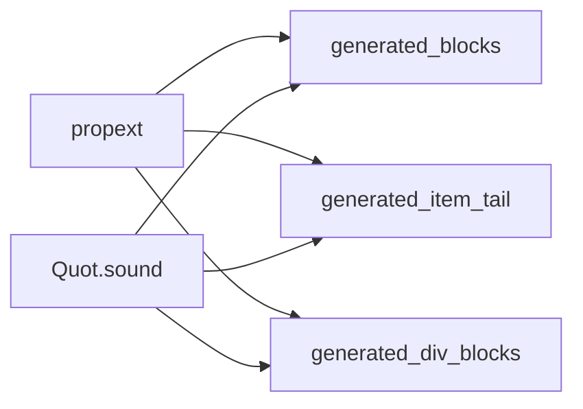
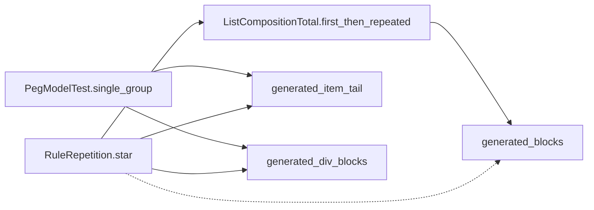

# ブロック列の認識合成の証明と依存関係

この記録は、[root ADR 0351](../adr/0351-prove-parser-formatter-round-trips.md) の認識モデルから、ブロックを並べる三つの規則を扱う。
基準は、定義リストの認識合成を追加したコミット `4cb395af00b5426a77e7aee189c4b8e5b78f38eb` である。
対象は `experiments/parser-fmt-proof/grammar/BlockSequenceTotal.lean` の名前付き宣言と、依存の説明に必要な既存の補助宣言である。
対象ファイルの SHA-256 は `a5207df1c5cc695039f27248d99e12dbffdc5b65ad3d96e2d226dd8ba1ad2431` である。
Lean 4.7.0（`6fce8f7d5cd1`、aarch64）を使った。

## 命題と前提

`Golem.hpeg` の 189、673、614 行が定める `Blocks`、`ItemTail`、`DivBlocks` の認識結果を、子の解析と反復の走査へ分解する。
三つの定理は任意の入力、自然数の字下げ量と fuel を対象にし、子の成功や結果の一致を前提にしない。
`Blocks` は最初の `Block` を要求し、その後は空行と先読みを含むブロックを繰り返す。
`ItemTail` と `DivBlocks` は、ゼロ回からの反復を走査に置き換える。
`DivBlocks` の閉じ行を調べる否定の先読みも、走査する式に残す。

fuel は、モデルの再帰や反復へ渡す自然数である。
`Blocks` は入口に `fuel + 3` を、最初の子と末尾の反復に `fuel + 1` を渡す。
ほかの二つは入口に `fuel + 2` を、反復の走査に `fuel` を渡す。
通常の不一致では走査のその周の開始位置を返し、子のエラー、打ち切り、入力が進まない反復のエラーはそのまま返す。
すべての入力の成功や、任意の有限 fuel で文法全体を読み切ることは主張しない。

`generated_blocks` は、参照一つと後続の反復を扱う一般形を使う。
ほかの二つは、一つの式からなる選択を子の認識へ移す `PegModelTest.single_group` と、反復を走査へ移す `RuleRepetition.star` を使う。
`single_group` は、対象の式が名前付きの `bind` ではないことを前提にする。
今回の対象は `star` なので、この前提はコンストラクターから証明する。
子の成功や結果の一致を仮定するものではなく、任意の束縛を変える式まで一般化するものでもない。

## 宣言の一覧

| 完全修飾名と対象ファイルの行 | 概要 |
| --- | --- |
| `BlockSequenceTotal.generated_blocks`、31 行 | 最初の `Block` と先読み付きの後続ブロックの反復を合成する。 |
| `BlockSequenceTotal.generated_item_tail`、45 行 | リスト項目の末尾を、字下げの先読みを含む式の反復へ移す。 |
| `BlockSequenceTotal.generated_div_blocks`、57 行 | 囲みの内部を、閉じ行の否定の先読みを含む式の反復へ移す。 |
| `BlockSequenceTotal.blocksStep`、11 行 | 空行の省略、同じ字下げの空でない行の先読み、後続の `Block` からなる式。 |
| `BlockSequenceTotal.nonblankGuard`、16 行 | 字下げ後に空白で始まらず、空行でなく、一文字以上ある行の先読み。 |
| `BlockSequenceTotal.itemStep`、21 行 | 空行の省略、本文の先読み、`Block` からなる式。 |
| `BlockSequenceTotal.divStep`、24 行 | 空行の省略、閉じ行の否定の先読み、本文の先読み、`Block` からなる式。 |
| private `_private.BlockSequenceTotal.0.BlockSequenceTotal.next`、6 行 | 成功した残りを次へ渡し、不一致とエラーはそのまま返す定義。 |

必要な既存の補助定理は、`ListCompositionTotal.first_then_repeated`、`PegModelTest.single_group`、`RuleRepetition.star` である。
反復の定義は `RuleRepetition.scan` にある。

## 公理と証明の穴

Lean の環境で宣言の種類を調べた結果、対象モジュールが宣言した公理はなかった。
型と elaboration 後の証明項を調べ、各定理に `#print axioms` を実行した。
三つの新しい定理は、推移的に標準公理の `propext` と `Quot.sound` に依存する。

| 公理 | 命題と Lean 4.7.0 の宣言元 |
| --- | --- |
| `propext` | 命題同士の同値から等式を得る。`Init/Core.lean:1287`。 |
| `Quot.sound` | 関係で結ばれた要素が商の要素として等しい。`Init/Core.lean:1459`。 |

`ListCompositionTotal.first_then_repeated` と `PegModelTest.single_group` も、二つの標準公理に依存する。
`RuleRepetition.star` は `propext` だけに依存する。
対象内の補助定義と `RuleRepetition.scan` は公理に依存しない。
次の図は、補助宣言を経由したものも含めた推移的な公理依存を示す。

対象ソースに `sorry`、`admit`、`sorryAx` の使用はない。
コンパイルの診断と公理依存にも証明の穴はなく、報告する位置はない。
`CollectAxioms` の訪問済み宣言を調べ、三つの定理が `lcProof` に依存しないことも確認した。

## 定理間の依存関係

直接依存は、elaboration 後の型と証明項の `getUsedConstants` を合わせ、環境の定理として解決した参照から求めた。
次の図はプロジェクト内の定理間を示す。
実線は直接参照、破線は表示した補助定理を経由する間接参照であり、矢印は依存先から利用する定理へ向ける。

定理の型には、生成した文法、認識器、対象内の反復の式と走査の定義も現れる。
標準ライブラリでは、等式と命題の簡約、`congrArg`、`Eq.trans`、`forall_congr` などの補助定理を使う。
この図では、それらの定義と標準ライブラリの補助定理を省略した。
生成文法を持たない手書きの代用ルールだけの証明にはしていない。

## 実装との照合

回帰は、下限、空行の省略、先読み、参照や字下げ引数を変える十二の文法変異を検査する。
変異したルールを未証明の一覧へ戻し、生成した PEG の AST を変えた三つの対照で、Lean の定理が通らないことも検査する。
実パーサーでは、三つの段落、末尾にブロックを持たないリスト、末尾の見出しと複数の段落、空と複数ブロックの囲みを読み切る。

四つの native parser の対照は、下限と閉じ行の先読みを変える。
一回以上に変えた `Blocks` と `ItemTail` は、それぞれ、一つのブロックからなる入力と、末尾にブロックを持たないリストを拒む。
一回以上に変えた `DivBlocks` は、空の囲みを囲みとして認識しなくなる。
閉じ行の先読みを外した `DivBlocks` は、閉じ印を本文に取り込む。
最後の二つは入力全体を受けいれるため、単なる受理の有無ではなく CST の印の件数も照合する。

`Blocks` と `ItemTail` は `%inline` により通常の CST では省略される。
この二つの表示指定だけを外した文法でも同じ六つの原稿を解析し、対象ノードが呼ばれたことを確認する。
追加された補助ノードを取り除いた結果は、子の順序と入力の範囲を含め、元の文法の CST と一致する。
これは有限の例での照合であり、CST の表示指定を変えた結果を、任意の原稿の AST や整形の証明とは数えない。

## 残件

この増分で認識の合成として扱う選択肢は三つ増え、未証明の一覧は 18 個から 15 個になる。
子ルールを含む再帰全体、Haskell のアクションが作る AST、復旧、コメントの保存、整形と評価の一般的な往復は未完了である。
[root ADR 0351](../adr/0351-prove-parser-formatter-round-trips.md) の未実装のステータスを保つ。
