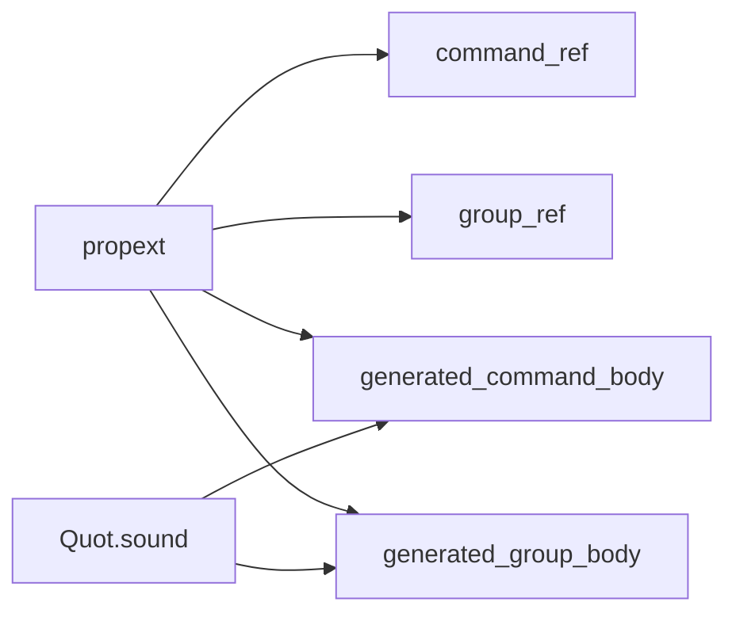
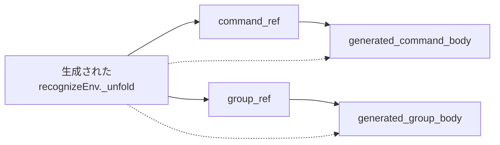

# コマンドの本体を選ぶ認識合成の証明と依存関係

この記録は、[root ADR 0351](../adr/0351-prove-parser-formatter-round-trips.md) の認識モデルから、`CommandBody` と `GroupBody` を扱う。
基準は、ファイル入口の認識合成を追加したコミット `ab1260889660b11addb9f6fda3364e608373bdf7` である。
対象は `experiments/parser-fmt-proof/grammar/BodyDispatchTotal.lean` の名前付き宣言と、依存の説明に必要な補助宣言である。
対象ファイルの SHA-256 は `a2ada734fdbe45ff3a570f090a0e5aebd8da82b4bec984b400b1f4f1fb064cca` である。
Lean 4.7.0（`6fce8f7d5cd1`、aarch64）を使った。

## 命題と前提

`generated_command_body` は、`Golem.hpeg:649` の字下げした本体の認識を合成する。
`generated_group_body` は、同じファイルの 604、605 行の、囲みと直後のブロックを順に試す認識を合成する。
どちらも任意の入力、自然数の字下げ量と fuel を対象にし、子の成功や結果の一致を前提にしない。
入口へ `fuel + 3` を渡し、子へ `fuel + 1` を渡す。

`CommandBody` は、先読みが成功したときだけ、残りを `Blocks(col ind + 2)` へ渡す。
先読みには、字下げ、空白で始まらないこと、空行でないこと、一文字以上あることを保持する。
`GroupBody` は、最初に `Div(ind)` を試す。
通常の不一致の場合だけ、同じ入力で先読みと `AttributedBlock(ind)` を試す。
最初の子の成功はそのまま返し、エラーの場合に後続の選択肢を試すことはない。
合成に使う子の認識結果のエラーは、fuel の打ち切りや反復のエラーを含めて保つ。
先読みの内部でラベルエラーを不一致へ移す処理も、既存の認識器のままである。

補助定理 `command_ref` と `group_ref` は、文法の検索結果と対象ルールの構造の一致を前提にする。
この前提は、二つの主定理の 29、75 行で、実際の `Generated.pegGrammar` に対して `rfl` で証明する。
子の解析結果の等しさを仮定する形へ置き換えていない。
構造を表す補助定義の行番号と action は引数であり、主定理は生成された 649、604、605 行の定義を使う。

`CommandBody` の先読みには、既存の `DefinitionCompositionTotal.bodyGuard` を使う。
実文法で同じ式を使う箇所を共有し、別の認識規則を足していない。
この定義は `DefinitionCompositionTotal.lean:20` にあり、公理に依存しない。
`BodyDispatchTotal` は既存の定義リストのモジュールをインポートするが、その逆のインポートや、新しい定理を互いに仮定する関係はない。

## 宣言の一覧

| 完全修飾名と対象ファイルの行 | 前提と結論の概要 |
| --- | --- |
| `BodyDispatchTotal.command_ref`、14 行 | 検索結果の構造が一致すれば、`CommandBody` の参照を、その先読みとブロック列の認識へ移す。 |
| `BodyDispatchTotal.generated_command_body`、22 行 | 実際の字下げ本体の先読みと `Blocks` を、子の結果を保って合成する。 |
| `BodyDispatchTotal.group_ref`、57 行 | 検索結果の構造が一致すれば、`GroupBody` の参照を、順序を保った二つの選択肢へ移す。 |
| `BodyDispatchTotal.generated_group_body`、65 行 | 囲みを先に試し、通常の不一致の場合だけ、元の入力で直後のブロックを試す。 |
| private `_private.BodyDispatchTotal.0.BodyDispatchTotal.next`、5 行 | 成功時の残りだけを後続へ渡し、不一致とエラーを保つ。 |
| private `_private.BodyDispatchTotal.0.BodyDispatchTotal.commandRule`、10 行 | 検索結果に照合する `CommandBody` の構造。 |
| `BodyDispatchTotal.groupGuard`、48 行 | 字下げ、コマンドの開始、空白、空行の先読みを保持する式。 |
| private `_private.BodyDispatchTotal.0.BodyDispatchTotal.groupRule`、52 行 | 検索結果に照合する、順序付きの `GroupBody` の構造。 |

必要な既存の定義は `DefinitionCompositionTotal.bodyGuard` である。
同じモジュールにある定義リストの定理は、新しい主定理の証明項の依存先ではない。
検証用の harness は、共有する定義をインポートできるよう、先に `DefinitionCompositionTotal.olean` を作る。

## 公理と証明の穴

環境の宣言の種類を調べた結果、対象モジュールが宣言した公理はなかった。
四つの定理は、型と elaboration 後の証明項を調べ、各定理の `#print axioms` で確かめた。

| 定理 | 推移的に使う標準公理 |
| --- | --- |
| `command_ref`、`group_ref` | `propext` |
| `generated_command_body`、`generated_group_body` | `propext`、`Quot.sound` |

`propext` は、命題の同値から等式を得る公理で、Lean 4.7.0 の `Init/Core.lean:1287` にある。
`Quot.sound` は、関係で結ばれた要素が商で等しいという公理で、同じファイルの 1459 行にある。
対象内の四つの補助定義と、共有する `bodyGuard` は、公理に依存しない。
次の図は、補助宣言を経由するものも含めた推移的な公理依存である。

参照を展開する二つの補助定理では、Lean が `_private.BodyDispatchTotal.0.PegModel.recognizeEnv._unfold` と、match の補助宣言を生成する。
この生成された展開の定理は `propext` に依存する。
型と証明項の定数参照を調べ、公理依存は `CollectAxioms.collect` を環境の完全名へ適用して確かめた。
これは `#print axioms` が使う処理と同じである。

対象ソースに `sorry`、`admit`、`sorryAx` の使用はない。
コンパイルの診断と公理依存にも証明の穴はなく、報告する位置はない。
`CollectAxioms` の訪問済み宣言を調べ、四つの定理に `lcProof` への依存がないことも確かめた。

## 定理間の依存関係

直接依存は、elaboration 後の型と証明項の `getUsedConstants` を合わせ、環境の定理として解決した参照から求めた。
実線は直接参照、破線は図に示す補助定理を経由する間接参照であり、矢印は依存先から利用する定理へ向ける。

この図では、標準ライブラリの等式や命題の簡約、`congrArg`、`funext`、`Eq.trans`、`forall_congr` などの補助定理と、定理の型に現れる認識器や文法の定義を省略した。
`BlockGroup` などから子の認識が再帰して戻る経路も、fuel を受け取る認識器の中に保持する。
その再帰全体や Haskell の action の値を証明したことにはしない。

## 実装との照合と残件

回帰では、先読みの反転や省略、字下げ引数、ブロック列の単一ブロックへの変更、選択肢の順序を変える十の文法変異を、未証明として検出する。
生成された PEG の AST の先読み、子の参照、字下げ引数、選択順を変えた五つの対照では、同じ Lean モジュールの証明が失敗する。

実パーサーの通常の照合には、直後の段落、見出し、リスト、空と複数ブロックの囲み、続けて置いたコマンド、囲みの開始印の途中で一致しない本文と、一段落の字下げ本体を含める。
八つの原稿で、`File` が入力の末尾までを含む CST を返し、本体と各ブロックのノードの件数が一致することを照合する。
二段落の字下げ本体は、解析できることだけを確かめる別の一例にする。
[root ADR 0473](../adr/0473-normalize-paragraph-blocks-before-body-binding.md) は、一ブロックの字下げ本体を受け付け、複数ブロックは G02290 とする。
既存の評価処理は `modules/golem-eval/src/Golem/Eval/File.hs:352` にある。
`modules/golem-eval/test/ParagraphBlocksSpec.hs:112` 以降のテストに従い、二段落の対照を正常な CLI 原稿の照合には数えない。

native parser の六つの対照のうち、字下げ本体の先読みを反転したものと、ブロック列を一つに変えたものは、二段落の入力を拒否する。
残りの四つは入力を受け付けるが、選択順や囲みの字下げ引数を変えると囲みのノードが消え、直後の本体の先読みや字下げ引数を変えると本体のノードが消える。
単なる受理の有無だけでなく、この CST の違いを照合する。

この増分で認識の合成を証明した選択肢は三つ増え、未証明の一覧は 14 個から 11 個になる。
子ルールを含む再帰全体、コマンドが返す値、Haskell の action が作る AST、復旧、コメントの保存、整形と評価の一般的な往復は未完了である。
[root ADR 0351](../adr/0351-prove-parser-formatter-round-trips.md) の未実装のステータスを保つ。
