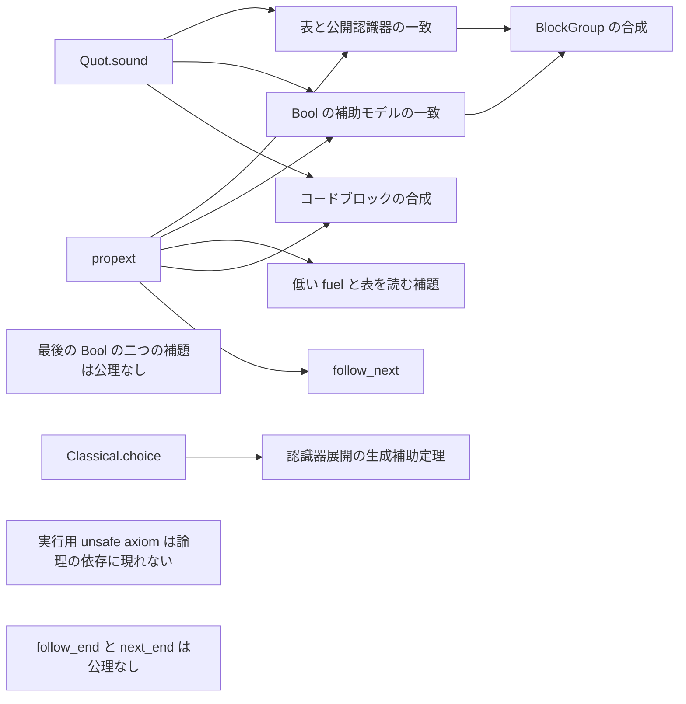
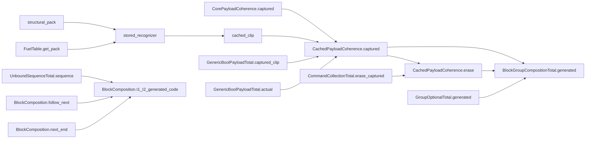

# Bool を束縛するコマンド群の認識合成

この記録は、[root ADR 0351](../adr/0351-prove-parser-formatter-round-trips.md) の認識モデルのうち、`BlockGroup` と、コマンドの本体の有無を集める補助モデルを扱う。
基準は `ef7d0ee3729d9e769ea90e7cb47bbbe4c8d027cf` で、Lean 4.7.0 を使った。
モデルは、再帰の深さと反復を制限する自然数の fuel を使う。
対象は `experiments/parser-fmt-proof/grammar/` の新しい十四の証明ファイルと、それらが照合する `PegModel.lean` の fuel の表と Bool の取得処理である。
既存の `BlockComposition.lean` では、コードブロックの列の展開を、既証明の一般補題へ置き換えた。
命題と fuel の渡し方は変えていない。
この変更で書き換えた `I1_I2_generated_code` と、列のために加えた三つの補題も調べた。

## 命題と前提

`BlockGroupCompositionTotal.generated` は、任意の入力、自然数の字下げ量と fuel に対する認識の合成を示す。
入口へ `fuel + 5`、コマンドの反復へ `fuel + 3` を渡す。
反復が不一致なら不一致、エラーなら同じエラーにする。
成功した場合は Bool の列の最後を調べ、true なら直後の本体を取らない。
false なら `fuel + 1` で `GroupBody` を試し、本体が無ければ反復の接尾辞を保つ。
`low_zero` から `low_four` は、残りの五つの fuel がすべて fuel のエラーになることを示す。

本体の有無の補助モデルは、子の認識結果と Bool を組にして持つ。
`OptionalBoolTotal` は、任意の子の認識器で、optional が不一致なら false、成功なら true にする処理を扱う。
`ChoicePayloadTotal` は、順序付きの選択から値を射影しても、最初の成功、不一致とエラーを保つことを示す。
`PayloadSequenceTotal` と `CommandBoolProjectionTotal` は、設定の false と、通常の呼び出しの optional の本体を合成する。
実際の生成された文法を展開し、先に設定を試す順も照合する。

`BoolRepetitionTotal` は、任意の子の認識器で、反復から値を除くと、同じ fuel の認識だけの反復に一致することを示す。
入力の長さが減らない成功は、どちらもゼロ幅の反復のエラーにする。
`CommandCollectionTotal` は、この補題を生成された `BlockCommand` の参照に接続する。
`GenericBoolPayloadTotal` は、子の認識器を引数にした同じ補助モデルと、実際の認識器を使う補助モデルとの一致を示す。
子に渡す fuel を上限で切るときも、要求した fuel が上限以下なら結果は変わらない。
これは fuel を増やしても結果が不変だという仮定ではない。

`CoreWalkerCoherence` と `CorePayloadCoherence` は、コアに置いた列と Bool の補助処理を、これらの一般補題へ接続する。
`StructuralCoherence` の `PegModel.structural_pack` は、公開の認識器と、fuel ごとの認識器を保持する表との一致を、fuel についての帰納法で示す。
表を作る `interpreterStep` は、公開の認識器を呼ばない。
帰納法の仮定は、より小さい fuel にだけ適用する。
`PegModel.FuelTable.get_pack` と `PegModel.stored_recognizer` は、表から読む値が、要求した小さい fuel の公開の認識器になることを示す。
`CachedPayloadCoherence` は、この一致と fuel の上限の補題を使い、実際の値取得処理を補助モデルに接続する。
子が成功すること、二つの結果が一致すること、主定理の結論そのものは前提に置かない。

`BlockGroupCompositionTotal.group_ref` は、文法のルールが固定した認識の形を持つ場合に参照を展開する一般補題である。
主定理は、この形を実際の生成されたルールで `rfl` によって照合する。
ソースの形の不一致を、認識器全体の簡約の時間超過で検出することは、変異を拒否した証拠に数えない。
最初の直接展開で時間超過した変異は、この補題へ移した後に改めて型の不一致として拒否した。

`LastBoolGuardTotal` は、Bool の列の反転、先頭一つの取得と or の否定が、最後の Bool の否定と一致することを示す。
空の列では false を既定にする。
`GroupOptionalTotal.generated` は、この閉じた述語と、Bool を自然数の 0 と 1 に写す環境を照合する。
設定と呼び出しの二つの action の形が変わった場合は、コアの値取得は不透明なルールとしてエラーにする。
任意の Haskell の action を解釈するモデルではない。

## 公理と証明の穴

対象の証明は Lean の環境から宣言と証明項を取得し、`#print axioms` で公理依存を確かめる。
対象ソースに、人が書いた公理の宣言はない。
`BlockGroupCompositionTotal.generated` と、表と補助モデルを接続する定理は `propext` と `Quot.sound` に依存する。
最後の Bool を調べる二つの補題は公理に依存しない。
低い fuel の五つの補題と、表を読む一般補題は `propext` に依存する。
`propext` は命題の同値から等式を得る公理、`Quot.sound` は関係で結ばれた要素が商で等しいという公理である。
宣言元は Lean 4.7.0 の `Init/Core.lean` の 1287 行と 1459 行である。

`BlockComposition.I1_I2_generated_code` は `propext` と `Quot.sound` に依存する。
非公開の `follow_next` は `propext` に依存し、`follow_end` と `next_end` は公理に依存しない。

認識器の展開で Lean が生成した三つの `interpreterStep.match_6.eq_3` 補助定理には、`Classical.choice` への依存もある。
これは `Init/Prelude.lean:730` の、存在する型から要素を選ぶ公理である。
主定理と表の一致の定理の推移的な公理依存には現れない。
また、コンパイラは `List.foldr._at.LastBoolGuardTotal.guard._spec_1` という実行用の unsafe axiom を生成する。
`guard` の論理上の定義と二つの補題の公理依存には、この宣言は現れない。

`BoolRepetitionTotal._auxLemma.1` の型と証明項の参照は環境から取得したが、この生成された名前を `#print axioms` へ渡すと unknown constant になる。
この一つの生成補助宣言の単独の公理表示は未確認である。
これを使う `plus_nonempty` の推移的な公理依存は `propext` だけで、証明の穴はない。

対象ソースに `sorry`、`admit`、`sorryAx` の使用はない。
コンパイルの診断と、公理依存にも証明の穴はない。

## 定理間の依存

次の図は主要な定理の依存を示す。
実線は型か証明項の直接参照、破線は定義か補助宣言を通る間接参照である。
標準ライブラリの等式の簡約と、生成された補助宣言の表示は省略する。

## 検証と残る範囲

先に、厳密な文法の生成で `BlockGroup` が未対応でないことを要求する回帰を追加し、失敗を確認した。
以前のモデルは、設定だけを含む File でも Bool の束縛を表せず、不透明な述語のエラーになった。
新しいモデルは、この入力を最後まで読む。
既存の公開された構造再帰の式は保ち、巨大な simp が既定の heartbeats を超えた一箇所だけ、一般の列の補題を使う証明に変えた。
heartbeats と CI の予算は変えていない。

実パーサーは GHC 9.10.3 の PATH と、固定版 `4b4adc7046a14d18c8eec711f18dbcaa9b059cca` の peg-hs を指定して実行する。
八つのコマンド群で、モデルの接尾辞や不一致と、実パーサーの入口の読み切りを照合する。
文法と生成した PEG の抽象構文木（AST）の各六つの変異では、認識の形を変えると検査が失敗することを確かめる。
行番号と unit action の空白だけを変えた一つの AST は、証明を保つ。
実パーサーが読み切った既存の百六十七の入力も、モデルの File の入口ですべて読み切る。
この照合を、一般の戻り値と診断位置の対応の証明とは区別する。

これにより、認識の合成が未証明の選択肢の一覧は空になる。
子を含む再帰全体と実パーサーの一般的な対応、Haskell の戻り値、AST、コメントの保存、復旧と診断位置、整形と評価の往復は未完了である。
既存の証明と有限の入力の照合を、これらの一般定理の代わりにしない。
[root ADR 0351](../adr/0351-prove-parser-formatter-round-trips.md) は未実装の状態を保つ。

## 対象のソース

次の SHA-256 は、この調査で使ったファイルの全文を対象にする。

| ファイル | SHA-256 |
| --- | --- |
| `PegModel.lean` | `ed53cc0f53e7fac9410067115c1be025875481248841eeaf119b138684014d09` |
| `BlockComposition.lean` | `46f91cd5545a69a72a615fe2f594668f5de4dbd81f3be67e2d4526d8bab5c4a0` |
| `StructuralCoherence.lean` | `9cdc51646889142b403ba6bfe68774f526803c6bd4c03d565894d8134645551e` |
| `OptionalBoolTotal.lean` | `f53952d0efb287502581980bb38ac58cd94ffc9fa2557fe76ce4853dd532f72e` |
| `ChoicePayloadTotal.lean` | `b32f696fd239580f07506aba1fcaa73c892b0329c43cc2581954ffb3fd1300af` |
| `PayloadSequenceTotal.lean` | `2b8291e3c052dafa23bb3c936d51d0c33f3e357292682206f828a49eb88c0cb8` |
| `CommandBoolProjectionTotal.lean` | `21690e75f3b0ee54534ba69ed5fe73f24c1fd138815a5450ea48ebcd2e0b209c` |
| `BoolRepetitionTotal.lean` | `2f5187de58c6e8ee74ebdada03ba76321a0c2250e4d30b4ace3a63671b4346d1` |
| `CommandCollectionTotal.lean` | `17042261bbe87dbf704c88df2238a6672325b2ba172fc4fff237220af0a1ba77` |
| `GenericBoolPayloadTotal.lean` | `a2a773b63f7d8d8d7cb3468ac4aaec869aefe1381cc33ded59c8d6dcbc35a9b2` |
| `LastBoolGuardTotal.lean` | `29a12a275bcecddccb39e221a85b7182771b94899616d36e20fc7c60c0c11580` |
| `CoreWalkerCoherence.lean` | `12fc355def1c191acda69f79c516968d38d6f6a6d88a2c6d32e6762158297b58` |
| `CorePayloadCoherence.lean` | `1f1ddb3a52c0d0bbda4bac9b234ba73a80aa809603f6bc007c620d52a3084dde` |
| `CachedPayloadCoherence.lean` | `f4278faf31b2a7bf97de53b086036fafc2be0043d8027bd07fc9615e900f517f` |
| `GroupOptionalTotal.lean` | `ea428c166bd1e77b79aa83ef6fba7fae4e2c2f90808d8da37c1cd63291853cf8` |
| `BlockGroupCompositionTotal.lean` | `f1acd48daf52210fe9bec2e44d3e4823918fbbc8ca4de773ff4fcaaceeb57159` |

次は、ソースで名前を付けた定理の位置である。
非公開の定理は private と記す。
Lean が展開から作る match の補助定理などは、この一覧から除き、公理の調査には含めた。

| ファイル | 定理と行 |
| --- | --- |
| `StructuralCoherence.lean` | `structural_pack` 4、`get_pack` 16、`stored_recognizer` 30 |
| `OptionalBoolTotal.lean` | `erase_flag` 18、`payload_flag` 24、`generated_optional` 31、`generated_capture` 38、`maybe_action` 44 |
| `ChoicePayloadTotal.lean` | `folded`（private） 4、`choice_map` 23 |
| `PayloadSequenceTotal.lean` | `erase_false` 9、`erase_captured` 19、`follow_append` 35 |
| `CommandBoolProjectionTotal.lean` | `shape`（private） 7、`follow_one`（private） 17、`erase_call` 23、`erase_map`（private） 49、`erase_command` 53 |
| `BoolRepetitionTotal.lean` | `erase_prepend` 11、`erase_scan` 26、`erase_plus` 49、`prepend_nonempty` 61、`plus_nonempty` 69 |
| `CommandCollectionTotal.lean` | `erase_reference` 11、`erase_collection` 20、`erase_captured` 32 |
| `GenericBoolPayloadTotal.lean` | `actual` 34、`drop_two`（private） 40、`optional_clip` 43、`call_clip` 54、`command_clip` 64、`reference_clip` 73、`scan_clip` 81、`plus_clip` 98、`captured_clip` 111、`clipped_erasure` 118 |
| `LastBoolGuardTotal.lean` | `guard_last` 7、`projected_guard` 17 |
| `CoreWalkerCoherence.lean` | `walk` 6 |
| `CorePayloadCoherence.lean` | `optional` 6、`command` 13、`reference` 26、`scan` 34、`plus` 52、`captured` 67 |
| `CachedPayloadCoherence.lean` | `cached_clip` 11、`captured` 18、`erase` 25 |
| `GroupOptionalTotal.lean` | `generated` 13 |
| `BlockGroupCompositionTotal.lean` | `group_ref` 27、`generated` 34、`low_zero` 87、`low_one` 89、`low_two` 91、`low_three` 93、`low_four` 95 |

`BlockComposition.lean` で調べた四つの定理は、`follow_next`（private、12 行）、`follow_end`（private、20 行）、`next_end`（private、23 行）、`I1_I2_generated_code`（110 行）である。
