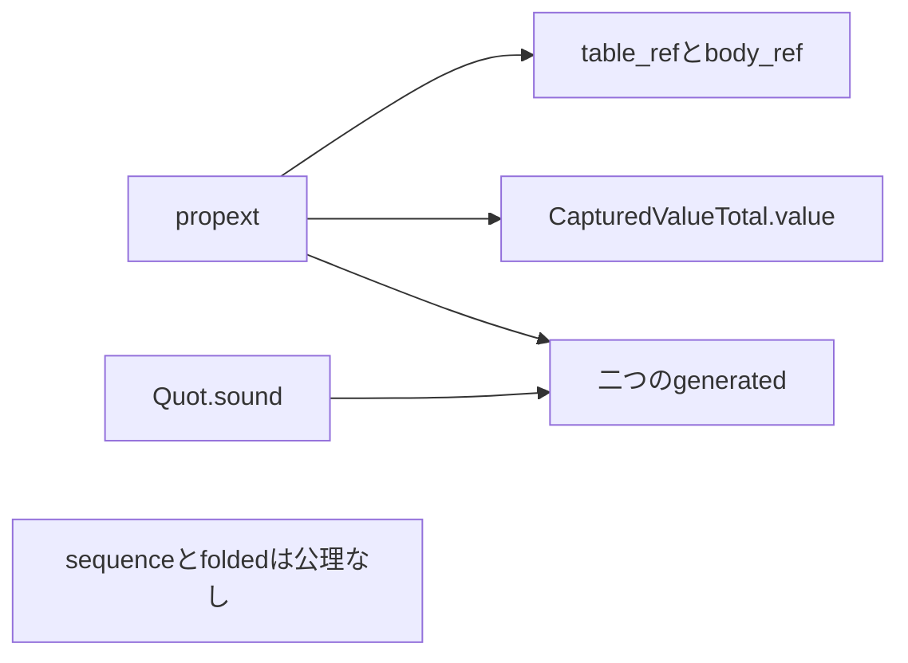
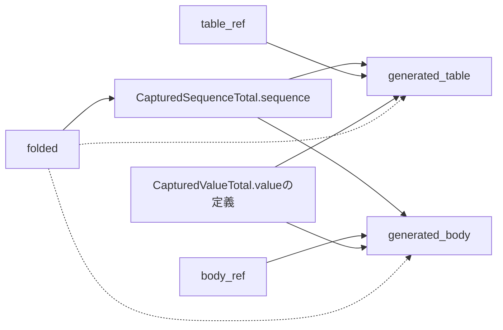

# 値の束縛を保つ表の認識合成と証明の依存関係

この記録は、[root ADR 0351](../adr/0351-prove-parser-formatter-round-trips.md) の認識モデルのうち、環境を更新する列と、表のヘッダーと本文行を扱う。
基準は `c49ffed3bd73300126770434e903c2bbdeac949a` で、Lean 4.7.0 を使った。
対象は `experiments/parser-fmt-proof/grammar/` の次の三つのファイルの全文である。

| ファイル | SHA-256 |
| --- | --- |
| `CapturedSequenceTotal.lean` | `4347e56f0b54ab132985387b6504cc233190df8ad09e5bcc9bbc4a90bec58ea7` |
| `CapturedValueTotal.lean` | `12d0e03b5f6ede1b9884849daf26bab78e6d709503fc2f92cbb78c5380c2d776` |
| `TableCompositionTotal.lean` | `97d97a7159029c3d6701a16f5b1b046883a816be517a24510238ab3b12a94327` |

## 命題と前提

`CapturedSequenceTotal.sequence`（68 行）は、`runSequence` を、子と値取得関数を順に呼ぶ `follow` へ移す。
認識器、値取得関数、環境、式の列と入力はすべて任意である。
名前付きの束縛で値が得られたときは、後続の子が使う環境へその値を追加する。
子の不一致やエラー、値取得関数のエラーを保つ。
子の成功、結果の一致、環境が不変であることは前提に置かない。

補助定理 `CapturedSequenceTotal.folded`（private、22 行）は、任意の中間状態からの列の処理を、列の長さについての帰納法で示す。
`sequence` は、この定理を入力と初期環境の組に適用する。
外側に名前付きの束縛がないという、以前の補題の条件も要らない。

`TableCompositionTotal.generated_table`（13 行）は、実際の `Table` の参照を、ヘッダー、改行、区切り行、本文行の反復と、後続の行と行末の検査へ分解する。
`TableCompositionTotal.generated_body`（33 行）は、改行の後で本文行の幅を `r` に束縛し、先に束縛した `h` との比較を保つ。
入力、自然数の字下げ量と fuel は任意で、本文行では `h` も任意の自然数である。
入口へ `fuel + 2`、直接の子へ `fuel` を渡す。

二つの補助定理 `TableCompositionTotal.table_ref`（8 行）と `TableCompositionTotal.body_ref`（28 行）は、対象ルールの構造が固定のレコードと一致することを前提に参照を展開する。
主定理では、この前提を実際の生成文法について `rfl` で満たす。
行番号と unit action は実際のソースから取り出し、認識する式、名前付きの束縛、引数とラベルは固定して照合する。

`CapturedValueTotal.value`（4 行）は、現在の `PegModel.recognizeEnv` の値取得の式を、子の認識器を引数に取る純粋な補助定義として記述したものである。
主定理の型検査で、実際の関数とこの補助定義が定義上等しいことを確かめる。
セルを数える処理を変えた対照では、実装とのこの一致が失われ、主定理が失敗する。

これらは現行モデルの認識の合成を示す。
Haskell の action が返す `length cs` と、モデルの取得する値の一般的な対応を仮定するものではなく、その証明は残る。
任意の fuel のモデルが native parser と同じエラー位置になるとも主張しない。

## 公理と証明の穴

型と証明項の定数参照は Lean の `getUsedConstants` で調べた。
`#print axioms` と `CollectAxioms.collect` を使い、生成された非公開の補助宣言を通る公理も調べた。
`CapturedSequenceTotal.sequence` と `folded` は公理に依存しない。
二つの参照を展開する補助定理は `propext` に依存する。
二つの主定理は `propext` と `Quot.sound` に依存する。

八つの定義のうち、`CapturedValueTotal.value` は `propext` に依存する。
残りの七つの定義は公理に依存しない。
`propext` は命題の同値から等式を得る公理で、Lean 4.7.0 の `Init/Core.lean:1287` にある。
`Quot.sound` は関係で結ばれた要素が商で等しいという公理で、同じファイルの 1459 行にある。
次は、補助宣言を通る推移的な依存も含む図である。

対象ソースに `sorry`、`admit`、`sorryAx` の使用はない。
コンパイルの診断と公理の調査にも証明の穴はなく、報告する位置はない。
五つの公開定理の推移的な依存に `lcProof` がないことも確かめた。

## 定理間の依存

実線は型か証明項からの直接参照、破線は図に示す補助定理を通る間接参照である。
矢印は依存先から利用する定理へ向ける。
標準ライブラリの等式と命題の簡約、`funext` などは省略する。

`CapturedValueTotal.value` は、主定理の型が参照する定義であり、図では定理と区別して示す。
二つの参照を展開する補助定理は、生成された `recognizeEnv._unfold` を直接参照する。
この展開の補助定理は `propext` に依存する。

## 実装との照合と残件

回帰では、実装を接続する前に、表のヘッダーと本文行を未証明とする検査が失敗することを確かめた。
七つの文法変異と、十の生成済み AST の変異は、検査か証明が失敗する。
名前付きの束縛で環境を更新しない変異と、セル数を増やさない変異も、証明が失敗する。
行番号と unit action の空白だけを変えた二つの AST は、証明を保つ。

native parser の入口では、ヘッダーだけの表、一列と二列の本文、Unicode の文字を含む五例を読み切る。
幅の不一致、区切りのない行、本文行の先頭に改行がない場合などの五例は拒否する。
七つの文法変異では、元の表の拒否、または不正な幅や改行の欠落を受理することを、実パーサーで照合する。
同じ十例を Lean のモデルでも実行し、全入力の受理、不一致とラベルのエラーを照合する。
これは有限の照合であり、一般の戻り値や診断位置の対応を示す証明とは区別する。

認識の合成が未証明の選択肢は、三個から `BlockGroup` の一個になる。
子を含む再帰全体、Haskell の戻り値の一般的な対応、AST、復旧、コメントの保存、整形と評価の往復は未完了である。
全範囲が終わるまで、[root ADR 0351](../adr/0351-prove-parser-formatter-round-trips.md) の未実装のステータスを保つ。
