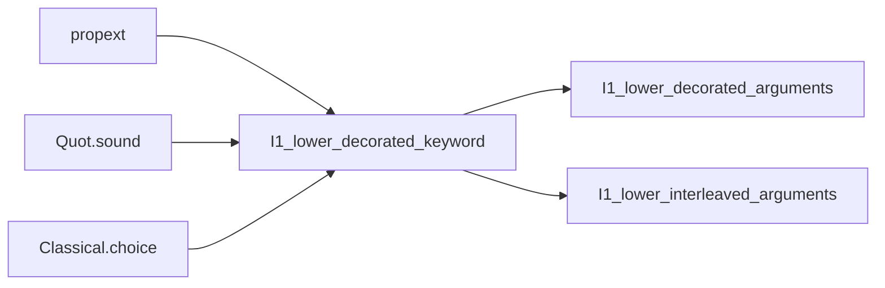
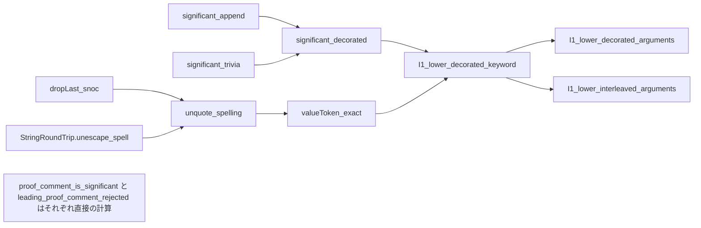

# 構築した CST のキーワード引数を AST へ移す証明

この増分は [root ADR 0351](../adr/0351-prove-parser-formatter-round-trips.md) のうち、語と引用値を持つキーワードの CST から、AST の名前、種類と値を得る段階を扱う。
基準は `1987793f99ed4a3367acbe9462f5b65b4a861d12` である。
対象は `experiments/parser-fmt-proof/grammar/KeywordLowering.lean` の全文で、Lean 4.7.0 を使う。
原稿全体をパースし、整形して読み戻す一般証明ではない。

## 実装と領域

実装の基準は Golem.Parser.Lower の significant、arguments、argValue、unquote である。
[Lower.hs の 45〜49 行](../../modules/golem-parser/src/Golem/Parser/Lower.hs#L45) は KWhitespace、KComment と KNewline を除く。
KProofComment は除かない。
[Lower.hs の 284〜315 行](../../modules/golem-parser/src/Golem/Parser/Lower.hs#L284) は、KeywordArgument の有意な子の先頭が Word で、その後に一要素と値があれば、値を読む。
その第二要素の種類を Equals と比較する検査はない。
値が Word なら文字を保持し、StringLit なら最初と最後の文字を除いてバックスラッシュを外す。
この範囲をモデルの関数へ対応付ける。

モデルの Decorated は、既存の MixedKeywords.Entry と四つの trivia の列である。
名前、等号と値の前後へ、任意長の trivia を置ける。
trivia は KWhitespace、KComment と KNewline に対応する三種類のトークンで、文字列は任意である。
Word と引用値の種類は区別し、引用値は既存の Part の列から印字する。
名前や値を字句として読む過程は、この CST の領域の前にある。

この領域は、構築した CST の領域である。
実文法の Eq は等号一文字だけで、KeywordArgument の内部へ自由に trivia を差した CST のすべてが、実パーサーから得られるわけではない。
trivia の文字列も、指定した種類のトークンとしてそのままモデルへ渡す。
この列を文字列へ戻して正しい Golem 原稿だと主張しない。

## 命題

I1_lower_decorated_keyword は、四つの任意長の trivia の列を持つ一つの CST から、元の名前、Word または StringLit の種類と復号値を得ることを示す。
unquote_spelling は、Part の列を引用してから外側の二文字とエスケープを外すと、元の値の文字列になることを示す。
値は任意長であり、空の引用値と、引用符、バックスラッシュ、Unicode の文字も扱う。

I1_lower_decorated_arguments は、この一引数の性質を任意長の列へ広げる。
同じ名前と同じ値が何度現れても、元の出現順を保つ。
I1_lower_interleaved_arguments は、さらにキーワードに当たらない要素を任意に差しても、それらだけが除かれることを示す。
この ignored は外側のトークンなどの、実装が引数として扱わない要素を表す。
実装が別に処理する位置引数、展開や式を ignored として証明したものではない。

proof_comment_is_significant と leading_proof_comment_rejected は、KProofComment を通常のコメントと同じ trivia にしないことを示す。
後者の対象は、キーワードの最初に KProofComment を置いた、構築した CST である。
その構文を原稿として正常に読むことや、その入力の diagnostics を証明するものではない。

これらは CST を入力とする直接の関数の性質であり、子が成功することや結論の一致を前提に置かない。
一方、実 PEG のパースが常にこの CST の形を作るという一般対応は、引き続き未証明である。

## 公理と依存関係

名前を付けた十一の定理と、生成された補助定理を合わせた七十六の定理について、環境の型と証明項を調べた。
公理依存は #print axioms で調べた。
三つの主定理は propext、Quot.sound と Classical.choice に依存し、既存の引用文字列の一般補題を通る。
propext は命題の同値から等式を得る公理、Quot.sound は商の同値関係が等式を与える公理、Classical.choice は存在する型から要素を選ぶ公理である。
宣言元は Lean 4.7.0 の Init/Core.lean:1287、同 1459 行と Init/Prelude.lean:730 である。

図は三つの主定理への推移的な公理依存を示す。
補助定理の依存も、後の宣言の表に載せる。



コンパイラが作る三つの unsafe axiom は次のとおりである。
フィルターと写像の実行用の特殊化であり、それぞれを #print で調べた。

```text
List.filterTR.loop._at.KeywordLowering.significant._spec_1
List.filterMap._at.KeywordLowering.lowerArguments._spec_1
List.mapTR.loop._at.KeywordLowering.triviaTokens._spec_1
```

significant、lowerArguments と triviaTokens の論理上の定義は公理に依存しない。
主定理の公理依存に、この三つの実行用の特殊化は現れない。
新しいユーザー定義の公理と、sorry、admit と sorryAx の使用はない。
取得できなかった宣言や証明項もない。

## 実装との照合と残件

先に、CST の文字を平坦につないで既存の引数モデルへ渡す入口では、trivia を持つ CST の期待する値を得られないことを確かめた。
CST の有意な子を読む入口に替えた後、同じ回帰が名前、種類と値で一致する。
これは従来の Golem の lower に不具合があるという主張ではなく、検証用の平坦なモデルでは足りないことの対照である。

八つの変異が定理を失敗させることを確かめた。
変異は、通常のコメントを除かない、引用値を復号しない、Word の種類を変える、StringLit の種類を変えるという四つを含む。
残りは、名前を捨てる、順序を逆にする、ignored を値にする、KProofComment まで除くという四つである。
共通の五つの構築した CST を、モデルと実際の公開関数 Lower.lower へ渡す。
十二の保持される引数の名前、種類と値を照合する。
KProofComment が先頭の一引数と、外側の無関係な二要素が除かれることも照合する。
実装側は Haskell の AST の構成子から直接値を取り出し、Show の表示から位置を正規表現で取り除かない。

CST の trivia を AST に移さないこの段階は、整形で CST のコメントを消してよいという意味ではない。
コメントの内容、相対位置と順序を整形が保存する一般証明は残る。
位置と UTF-8 の幅、原稿から CST ができる一般対応、ほかの引数やブロックの AST、復旧、diagnostics、整形と評価の一般的な往復も未完了である。
[root ADR 0351](../adr/0351-prove-parser-formatter-round-trips.md) の未実装の状態を保つ。

## 定理間の依存とソース

次は、名前を付けた定理の主要な参照である。
実線は、型と証明項で確かめた直接参照を表す。
経路をたどると補助定理を通る間接参照が分かる。
標準ライブラリの等式と簡約は省く。



次の宣言名の接頭辞は KeywordLowering である。

| 宣言と行 | 前提と結論 | 公理依存 |
| --- | --- | --- |
| `significant_trivia` 53 | 任意の trivia の列から、有意な要素は一つも残らない | なし |
| `proof_comment_is_significant` 58 | 任意の文字列の KProofComment は、有意な要素として残る | なし |
| `significant_append` 61 | 任意の二列で、連結と有意な要素の抽出が交換できる | `propext` |
| `significant_decorated` 68 | 任意の四列の trivia を除くと、名前、等号と値の三要素が残る | `propext` |
| `dropLast_snoc` 75 | 任意の文字列へ末尾に一文字を加えて外すと、元の列になる | `propext` |
| `unquote_spelling` 80 | 任意の Part の列の引用と復号から、元の値の文字が戻る | `propext`、`Classical.choice`、`Quot.sound` |
| `valueToken_exact` 84 | 任意の Word または引用値のトークンから、元の種類と値が戻る | `propext`、`Classical.choice`、`Quot.sound` |
| `I1_lower_decorated_keyword` 90 | 任意の Decorated から、名前、種類と復号値が戻る | `propext`、`Classical.choice`、`Quot.sound` |
| `leading_proof_comment_rejected` 98 | 任意の Decorated の先頭に KProofComment を置くと、このキーワードは値にならない | なし |
| `I1_lower_decorated_arguments` 111 | 任意長の Decorated の列で、名前、種類と値の出現順が保たれる | `propext`、`Classical.choice`、`Quot.sound` |
| `I1_lower_interleaved_arguments` 125 | 任意長の Option Decorated の列で、値のある要素だけが出現順に残る | `propext`、`Classical.choice`、`Quot.sound` |

KeywordLowering.lean の全文の SHA-256 は `edede66bae22d2d33201ebc4a86146acfe84cb2a5979d9572badfd62f1691f7d` である。
