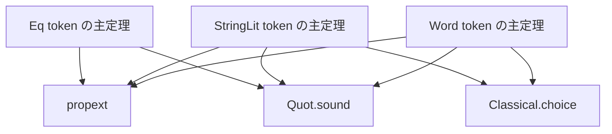

# 文法の属性と認識結果から得る CST トークンの原綴り

この増分は [root ADR 0351](../adr/0351-prove-parser-formatter-round-trips.md) のうち、Word、StringLit と Eq が読む区間を、原綴りを持つ CST トークンへ写す段階を扱う。
対象は CstWrapperMetadata.lean と CstWrapper.lean の全文で、Lean 4.7.0 を使う。
CST を出力するモードを対象とし、原稿全体の CST を返すパーサーの一般証明ではない。

## 実装とモデルの範囲

peg-hs の [Codegen.hs:681〜685](https://github.com/tett23/peg-hs/blob/4b4adc7046a14d18c8eec711f18dbcaa9b059cca/packages/peg-codegen/src/Peg/Codegen.hs#L681) は、CST 出力が無効なら wrapper を置かず、有効なら inline、token、通常の node の順で分類する。
isInline と isToken は、同:864〜868 の文法の inline と token の一覧を読む。
モデルは、既に生成されている Grammar.inline と Grammar.tokens を使う。
手書きの別の一覧を与えない。

[Runtime/Internal.hs:917〜929](https://github.com/tett23/peg-hs/blob/4b4adc7046a14d18c8eec711f18dbcaa9b059cca/packages/peg-runtime/src/Peg/Runtime/Internal.hs#L917) は、通常の node で子を保持し、token では子を捨てて消費区間だけを記録する。
[Runtime/Syntax.hs:352〜365](https://github.com/tett23/peg-hs/blob/4b4adc7046a14d18c8eec711f18dbcaa9b059cca/packages/peg-runtime/src/Peg/Runtime/Syntax.hs#L352) は、その区間から原綴りを取り出す。
モデルの wrap も、inline では子を渡し、token では原綴り一つを返し、通常の場合は名前付きの node に子を入れる。

project は、実際の Generated.pegGrammar の規則を recognizeEnv で認識した結果を、この wrapper へ渡す。
成功時の残りの文字列を保ち、不一致とエラーも保つ。
原綴りには、入力の長さから残りの長さを引いた文字数の先頭部分を使う。
StringLit の原綴りは、外側の引用符とエスケープも含む。
AST の値を得る unquote をここで使わない。

このモデルは位置を除いたトークンの文字列を扱う。
実装が UTF-8 の byte offset を使うことと、モデルの Char の列の関係を、任意の入力について証明したものではない。
通常の node の wrapper の補題は、GreenNode を作る前の子の包み方だけを扱う。
実装が後で補う terminal 間の Text token や、幅を再現するものではない。

## 命題と前提

CstWrapperMetadata の九つの定理は、実際の生成文法で Word、StringLit と Eq が token で inline ではないことを示す。
ArgValue は inline、KeywordArgument は token でも inline でもないことも示す。
いずれも前提のない閉じた計算である。

I1_generated_word_token は、既存の Word の非空と禁止文字の条件、先頭が %% でない条件と、後続の区切りが禁止文字である条件から、原綴りの Word token と残りを得る。
fuel は入力長に 8 と任意の自然数を足したものとする。
I1_generated_quoted_token は、任意の Part の列と接尾辞から、引用符とエスケープを残した StringLit token と残りを得る。
fuel は Part の個数に 7 と任意の自然数を足したものとする。
I1_generated_eq_token は、等号と任意の後続列から、等号一文字の Eq token を得る。
その fuel は任意の自然数に 3 を足したものである。

三つの主定理は、子の CST の列に制限を置かない。
実装の token wrapper が子を捨てるためであり、子の成功や、示したい結果の一致を仮定するものではない。
実際の認識の成功は、Word と引用文字列の既存の一般定理と、実際の Eq の生成 AST から導く。
I1_generated_argvalue_inline と I1_generated_keyword_node は、それぞれの wrapper の分類だけを示し、渡した子が実パーサーの返す子だと示すものではない。

## 実装との照合

先に、token の payload を AST の unquote へ渡すモデルでは、引用符とエスケープを失うことを回帰で確かめた。
原綴りを保つモデルへ替えた後、同じ引用値の回帰が通る。
原綴りを空にする、token で子を返す、inline で空にする、通常の node を省く、一区間長く取る、token を inline より先に選ぶという六つの変異は定理を失敗させる。

四つの文法の属性の変更では、実際に Generated を作り直し、Generated だけをインポートする metadata の証明をソースから検査する。
変更は StringLit の token を外す、ArgValue の inline を外す、KeywordArgument を token にする、Word を token から inline に替えるという四つである。
四つとも証明が失敗し、同じ原稿の実 peg-hs の解析は成功しつつ、CST の形が変わることを確かめる。
元の Generated を戻した後は、同じ証明が通る。
基準の Generated に依存した古い証明の artifact を、変更後の metadata の検査へ流用しない。

Word を token のまま inline にもする別の試行は、文法の検査が拒否した。
この不正な文法は、成功する CST の形状の対照には数えない。
一般の wrap_inline の補題は任意の Grammar の値を扱うが、不正な属性の組を原稿として許す主張ではない。

共通の八つの構文入力で、モデルと実際の Golem.Parser.parse の CST を照合する。
Word、Eq と StringLit の二十四のトークンの名前と原綴りを、Haskell の CST の構成子から取り出す。
引用符とバックスラッシュ、バックスラッシュと n の原綴り、エスケープした改行、空の引用値、Unicode と補助平面の文字を含む。
StringLit が持つ原綴りと、後で AST が持つ復号値を区別する。
これらは構文の照合であり、照合用の inspect の宣言や引数の型検査を通る原稿の証明ではない。

## 残る範囲

有限の八例のモデルでは、Word、Eq と値の token を結合し、実際の KeywordArgument の認識の残りも照合する。
この結合から、任意の入力の KeywordArgument の全 CST の形状を証明したとは数えない。
位置と UTF-8 の幅、terminal の間隙、ほかの規則の CST、復旧、全 AST、コメントの保存、整形と評価の一般的な往復は残る。
[root ADR 0351](../adr/0351-prove-parser-formatter-round-trips.md) の未実装の状態を保つ。

## 環境と公理

基準は `405df3f823f1ced0d0e2be6c38d07f638b758dfd`。
Lean 4.7.0、GHC 9.10.3 と peg-hs `4b4adc7046a14d18c8eec711f18dbcaa9b059cca` を使う。
対象の二ファイルには `sorry`、`admit` と手書きの公理を置かない。
Haskell の照合には既存の golem-0479-dist の plan を使った。
その plan が選ぶ parser の文法と、parser と fmt の src 以下の九つの Haskell ファイルは、この基準とバイト単位で一致した。
CLI 全体をこの増分のソースから新しくビルドしたという記録ではない。

| 定理 | 位置 | `#print axioms` |
| --- | --- | --- |
| `CstWrapper.word_token` | [CstWrapperMetadata.lean:3](../../experiments/parser-fmt-proof/grammar/CstWrapperMetadata.lean#L3) | `なし` |
| `CstWrapper.word_not_inline` | [CstWrapperMetadata.lean:4](../../experiments/parser-fmt-proof/grammar/CstWrapperMetadata.lean#L4) | `なし` |
| `CstWrapper.string_token` | [CstWrapperMetadata.lean:5](../../experiments/parser-fmt-proof/grammar/CstWrapperMetadata.lean#L5) | `なし` |
| `CstWrapper.string_not_inline` | [CstWrapperMetadata.lean:6](../../experiments/parser-fmt-proof/grammar/CstWrapperMetadata.lean#L6) | `なし` |
| `CstWrapper.eq_token` | [CstWrapperMetadata.lean:7](../../experiments/parser-fmt-proof/grammar/CstWrapperMetadata.lean#L7) | `なし` |
| `CstWrapper.eq_not_inline` | [CstWrapperMetadata.lean:8](../../experiments/parser-fmt-proof/grammar/CstWrapperMetadata.lean#L8) | `なし` |
| `CstWrapper.argvalue_inline` | [CstWrapperMetadata.lean:9](../../experiments/parser-fmt-proof/grammar/CstWrapperMetadata.lean#L9) | `なし` |
| `CstWrapper.keyword_not_inline` | [CstWrapperMetadata.lean:10](../../experiments/parser-fmt-proof/grammar/CstWrapperMetadata.lean#L10) | `なし` |
| `CstWrapper.keyword_not_token` | [CstWrapperMetadata.lean:11](../../experiments/parser-fmt-proof/grammar/CstWrapperMetadata.lean#L11) | `なし` |
| `CstWrapper.consumed_append` | [CstWrapper.lean:24](../../experiments/parser-fmt-proof/grammar/CstWrapper.lean#L24) | `[propext]` |
| `CstWrapper.wrap_token` | [CstWrapper.lean:30](../../experiments/parser-fmt-proof/grammar/CstWrapper.lean#L30) | `[propext]` |
| `CstWrapper.wrap_inline` | [CstWrapper.lean:36](../../experiments/parser-fmt-proof/grammar/CstWrapper.lean#L36) | `[propext]` |
| `CstWrapper.wrap_node` | [CstWrapper.lean:40](../../experiments/parser-fmt-proof/grammar/CstWrapper.lean#L40) | `[propext]` |
| `CstWrapper.I1_generated_word_token` | [CstWrapper.lean:45](../../experiments/parser-fmt-proof/grammar/CstWrapper.lean#L45) | `[propext, Classical.choice, Quot.sound]` |
| `CstWrapper.I1_generated_quoted_token` | [CstWrapper.lean:58](../../experiments/parser-fmt-proof/grammar/CstWrapper.lean#L58) | `[propext, Classical.choice, Quot.sound]` |
| `CstWrapper.I1_generated_eq_token` | [CstWrapper.lean:74](../../experiments/parser-fmt-proof/grammar/CstWrapper.lean#L74) | `[propext, Quot.sound]` |
| `CstWrapper.I1_generated_argvalue_inline` | [CstWrapper.lean:92](../../experiments/parser-fmt-proof/grammar/CstWrapper.lean#L92) | `[propext]` |
| `CstWrapper.I1_generated_keyword_node` | [CstWrapper.lean:96](../../experiments/parser-fmt-proof/grammar/CstWrapper.lean#L96) | `[propext]` |

公理の図は三つの主定理について、直接と間接の依存をまとめる。



次の図はソースに明示した十八の定理間で、証明項と型から得た直接の参照を描く。
生成された計算式の内部は省く。
既存の Word と StringLit の認識定理、Eq の literal の定理も描く。
認識定理のさらに前の依存は、[引数の一般証明の前提](0351-quoted-keyword-proof-dependencies.md) の範囲を参照する。

```mermaid
flowchart TD
  I1_generated_word_token --> canonical_word_before_separator
  I1_generated_quoted_token --> I1_generated_quoted_round_trip
  I1_generated_eq_token --> literal_total
  I1_generated_word_token --> wrap_token
  I1_generated_word_token --> word_not_inline
  I1_generated_word_token --> word_token
  I1_generated_word_token --> consumed_append
  I1_generated_quoted_token --> wrap_token
  I1_generated_quoted_token --> string_not_inline
  I1_generated_quoted_token --> string_token
  I1_generated_quoted_token --> consumed_append
  I1_generated_eq_token --> wrap_token
  I1_generated_eq_token --> eq_not_inline
  I1_generated_eq_token --> eq_token
  I1_generated_eq_token --> consumed_append
  I1_generated_argvalue_inline --> wrap_inline
  I1_generated_argvalue_inline --> argvalue_inline
  I1_generated_keyword_node --> wrap_node
  I1_generated_keyword_node --> keyword_not_inline
  I1_generated_keyword_node --> keyword_not_token
```



環境中には、実行用の特殊化と Repr の生成に由来する九つの unsafe 宣言もある。
三つの主定理の論理的な依存には含まれない。
`project` の論理定義は `propext` に依存し、`wrap` と `consumed` は公理に依存しない。

| ソース | SHA-256 |
| --- | --- |
| `CstWrapperMetadata.lean` | `4b425ee6390b5fd6d2999245d14ffd902d7b0bd570656d3a01306ab3eea23f8d` |
| `CstWrapper.lean` | `3cae7500cf580185c52a5dd064ad3fe5b22a0ff6f48c99c8b41c8d5fd4a4ddd8` |

## 再現するコマンド

リポジトリのルートで、実際の Cabal plan と、その plan でビルドした peg-hs を指定する。
native parser をコンパイルする GHC は peg-hs 自身の GHC と独立なので、PATH も指定する。

```sh
PATH=/Users/tett23/.ghcup/ghc/9.10.3/bin:$PATH \
CABAL_PLAN=/private/tmp/golem-0351-body-dist/cache/plan.json \
PEG_HS=/Users/tett23/.cabal/store/ghc-9.10.3-fe9c/pg-cl-0.1.0.0-d6f17192/bin/peg-hs \
LEAN=/Users/tett23/.elan/toolchains/leanprover--lean4---v4.7.0/bin/lean \
node experiments/parser-fmt-proof/grammar/test.mjs
```

Haskell の CST と照合する場合は、README の通常 CLI のビルドと Cabal plan の選択の後に、次を実行する。

```sh
node --test experiments/parser-fmt-proof/arguments/raw-cst.native-test.mjs
```

## 生成された補助宣言

対象のモジュールの環境には七十一の定理があり、上の十八と、生成された五十三をすべて `#print axioms` で検査した。
五十八は公理に依存せず、八つは `propext`、三つは `propext`、`Classical.choice` と `Quot.sound` に依存する。
残る二つは、それぞれ `propext` と `Quot.sound` の組、`Quot.sound` だけに依存する。
`propext` は同値な命題の等しさ、`Classical.choice` は非空な型からの選択、`Quot.sound` は商の関係による等しさを与える既存の Lean の公理である。

生成された補助定理は、パターンマッチ、構成子の単射性と sizeOf、展開した List と PegModel の関数の計算式である。
元の関数や型の構成子による場合分けの等式を述べ、未実装の意味を仮定するものではない。
以下の完全修飾名は、一時ディレクトリで各モジュールをその名前でコンパイルした環境のものを記す。

| 生成された定理 | 公理 |
| --- | --- |
| `_private.CstWrapper.0.List.isPrefixOf._eq_1` | `なし` |
| `_private.CstWrapper.0.PegModel.runSequence.match_2.eq_2` | `なし` |
| `_private.CstWrapper.0.List.drop.match_1.eq_2` | `なし` |
| `_private.CstWrapper.0.PegModel.interpreterStep.match_6.eq_1` | `なし` |
| `_private.CstWrapper.0.List.take._eq_2` | `なし` |
| `_private.CstWrapper.0.PegModel.interpreterStep.match_2.eq_1` | `なし` |
| `_private.CstWrapper.0.CstWrapper.project.match_1.eq_2` | `なし` |
| `_private.CstWrapper.0.List.drop.match_1.eq_1` | `なし` |
| `_private.CstWrapper.0.PegModel.foldChoice.match_1.eq_1` | `なし` |
| `_private.CstWrapper.0.List.isPrefixOf.match_1.eq_2` | `なし` |
| `CstWrapper.Element._sizeOf_2_eq` | `なし` |
| `_private.CstWrapper.0.PegModel.runSequence.match_3.eq_1` | `なし` |
| `_private.CstWrapper.0.List.isPrefixOf.match_1.eq_3` | `なし` |
| `_private.CstWrapper.0.List.isPrefixOf._eq_2` | `[Quot.sound]` |
| `_private.CstWrapper.0.List.isPrefixOf.match_1.eq_1` | `なし` |
| `_private.CstWrapper.0.PegModel.interpreterStep.match_6.eq_3` | `[Classical.choice, propext, Quot.sound]` |
| `_private.CstWrapper.0.PegModel.interpreterStep.match_3.eq_2` | `なし` |
| `_private.CstWrapper.0.PegModel.runSequence.match_1.eq_1` | `なし` |
| `CstWrapper.Element.node.inj` | `なし` |
| `_private.CstWrapper.0.PegModel.foldChoice.match_1.eq_2` | `なし` |
| `_private.CstWrapper.0.PegModel.runSequence.match_1.eq_3` | `なし` |
| `_private.CstWrapper.0.PegModel.interpreterStep.match_1.eq_2` | `なし` |
| `CstWrapper.Element.token.inj` | `なし` |
| `_private.CstWrapper.0.Except.map.match_1.eq_1` | `なし` |
| `CstWrapper.Element.node.sizeOf_spec` | `なし` |
| `_private.CstWrapper.0.PegModel.interpreterStep.match_4.eq_1` | `なし` |
| `_private.CstWrapper.0.PegModel.interpreterStep.match_5.eq_2` | `なし` |
| `_private.CstWrapper.0.List.isPrefixOf._eq_3` | `なし` |
| `_private.CstWrapper.0.PegModel.interpreterStep.match_2.eq_2` | `なし` |
| `_private.CstWrapper.0.PegModel.runSequence.match_1.eq_2` | `なし` |
| `_private.CstWrapper.0.CstWrapper.project.match_1.eq_1` | `なし` |
| `_private.CstWrapper.0.CstWrapper.project.match_1.eq_3` | `なし` |
| `_private.CstWrapper.0.PegModel.BoolPayload.supported.match_3.eq_1` | `なし` |
| `_private.CstWrapper.0.Except.map.match_1.eq_2` | `なし` |
| `_private.CstWrapper.0.PegModel.interpreterStep.match_6.eq_2` | `なし` |
| `_private.CstWrapper.0.PegModel.runSequence.match_2.eq_1` | `なし` |
| `CstWrapper.Element.token.injEq` | `[propext]` |
| `_private.CstWrapper.0.PegModel.interpreterStep.match_3.eq_3` | `なし` |
| `_private.CstWrapper.0.PegModel.BoolPayload.supported.match_3.eq_2` | `なし` |
| `_private.CstWrapper.0.PegModel.runSequence.match_3.eq_2` | `なし` |
| `_private.CstWrapper.0.PegModel.runSequence.match_3.eq_3` | `なし` |
| `_private.CstWrapper.0.PegModel.runSequence.match_4.eq_1` | `なし` |
| `CstWrapper.Element.node.injEq` | `[propext]` |
| `_private.CstWrapper.0.List.drop.match_1.eq_3` | `なし` |
| `_private.CstWrapper.0.PegModel.interpreterStep.match_4.eq_2` | `なし` |
| `_private.CstWrapper.0.List.take._eq_1` | `なし` |
| `_private.CstWrapper.0.PegModel.interpreterStep.match_2.eq_3` | `なし` |
| `_private.CstWrapper.0.PegModel.interpreterStep.match_1.eq_1` | `なし` |
| `_private.CstWrapper.0.PegModel.interpreterStep.match_5.eq_1` | `なし` |
| `_private.CstWrapper.0.List.take._eq_3` | `なし` |
| `_private.CstWrapper.0.PegModel.interpreterStep.match_3.eq_1` | `なし` |
| `_private.CstWrapper.0.PegModel.runSequence.match_4.eq_2` | `なし` |
| `CstWrapper.Element.token.sizeOf_spec` | `なし` |

実行用の unsafe 宣言の一覧は次のとおりである。
一つ目は `wrap` の List.elem の特殊化、残りは Element の `deriving Repr` によるもので、論理定理の公理を追加するものではない。

```text
List.elem._at.CstWrapper.wrap._spec_1
Std.Format.joinSep._at._private.CstWrapper.0.CstWrapper.reprElement.«_@».CstWrapper._hyg.40._spec_3
List.foldl._at._private.CstWrapper.0.CstWrapper.reprElement.«_@».CstWrapper._hyg.40._spec_8
List.repr._at._private.CstWrapper.0.CstWrapper.reprElement.«_@».CstWrapper._hyg.40._spec_5
Std.Format.joinSep._at._private.CstWrapper.0.CstWrapper.reprElement.«_@».CstWrapper._hyg.40._spec_7
List.repr'._at._private.CstWrapper.0.CstWrapper.reprElement.«_@».CstWrapper._hyg.40._spec_1
repr._at._private.CstWrapper.0.CstWrapper.reprElement.«_@».CstWrapper._hyg.40._spec_6
repr._at._private.CstWrapper.0.CstWrapper.reprElement.«_@».CstWrapper._hyg.40._spec_2
List.foldl._at._private.CstWrapper.0.CstWrapper.reprElement.«_@».CstWrapper._hyg.40._spec_4
```
