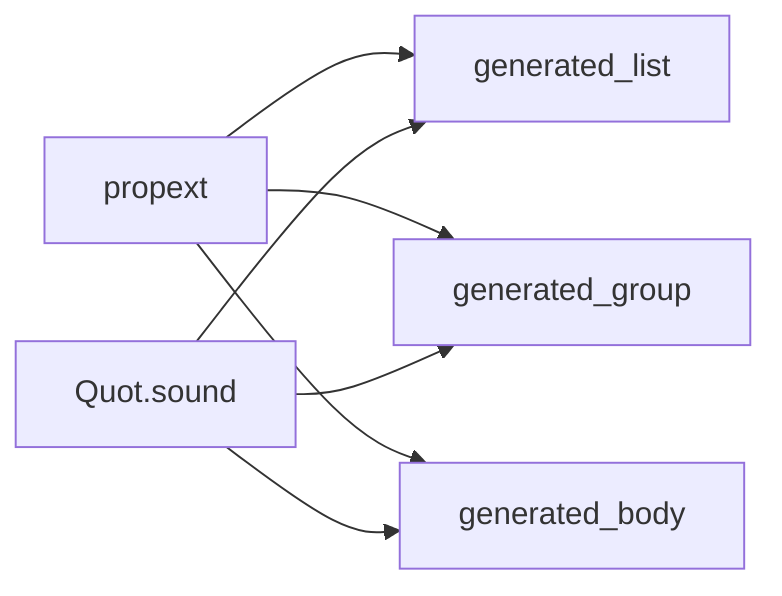
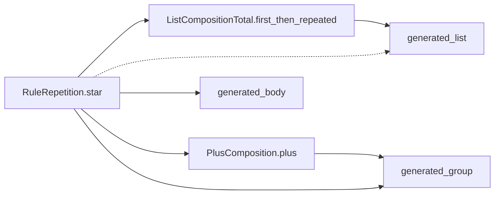

# 定義リストの認識合成の証明と依存関係

この記録は、[root ADR 0351](../adr/0351-prove-parser-formatter-round-trips.md) の認識モデルから、定義リストの三つの規則を扱う。
基準の main は `decbc49d1ef9d1feecd4c6027b1f6964a78e45f7` である。
対象は `experiments/parser-fmt-proof/grammar/DefinitionCompositionTotal.lean` の名前付き宣言と、依存を説明するために必要な既存の補助宣言である。
対象ファイルの SHA-256 は `8cc528ce1ec7a84ba1c841387523efd6424a2fff4a61def07fc16e5030e08e64` である。
Lean 4.7.0（`6fce8f7d5cd1`、aarch64）を使った。

## 命題と前提

`Golem.hpeg` の 678、681、696 行が定める `DefList`、`DefGroup`、`DefBody` を、最初の解析と反復の走査へ分解する。
三つの定理は、任意の入力、自然数の字下げ量と fuel に対する等式である。
生成した実際の文法を使い、子の成功や認識結果の一致を前提にしない。

fuel は、認識モデルの再帰や繰り返しに渡す自然数である。
入口には `fuel + 3` を、外側の式の列には `fuel + 2` を渡す。
その列の各要素と末尾の反復には `fuel + 1` を渡す。
`DefGroup` の先頭の `plus` は、最初の用語とその後の走査へ `fuel` を渡す。
打ち切り、通常の不一致、子のエラー、入力が進まない反復のエラーも等式の両辺で保つ。
すべての入力の成功や、任意の有限 fuel で文法全体を読み切ることは主張しない。

`DefList` の最初の参照と後続の反復は、既存の一般形 `ListCompositionTotal.first_then_repeated` を使う。
`DefGroup` と `DefBody` では、最初の演算と本文の解析結果の全コンストラクターを場合分けし、実際の環境を保ったまま反復へ渡す。
後続の環境を変える任意の `bind` 式への一般化は行っていない。

## 宣言の一覧

| 完全修飾名と対象ファイルの行 | 概要 |
| --- | --- |
| `DefinitionCompositionTotal.generated_list`、30 行 | 最初の `DefGroup` に、先読み付きの後続グループの走査を合成する。 |
| `DefinitionCompositionTotal.generated_group`、44 行 | 一回以上の `DefTerm` と最初の `DefBody`、後続の本文の走査を合成する。 |
| `DefinitionCompositionTotal.generated_body`、82 行 | 最初の字下げの先読みと `Block`、先読み付きの後続ブロックの走査を合成する。 |
| `DefinitionCompositionTotal.listStep`、12 行 | 空行の省略、次の用語の印の先読み、後続のグループからなる式。 |
| `DefinitionCompositionTotal.groupStep`、17 行 | 空行の省略、`DefNew`、後続の本文からなる式。 |
| `DefinitionCompositionTotal.bodyGuard`、20 行 | 本文の字下げ、空白で始まらないこと、空行でないことと一文字以上の存在の先読み。 |
| `DefinitionCompositionTotal.bodyStep`、25 行 | 空行の省略、本文の先読み、後続の `Block` からなる式。 |
| private `_private.DefinitionCompositionTotal.0.DefinitionCompositionTotal.next`、7 行 | 成功した残りを次へ渡し、不一致とエラーをそのまま返す定義。 |

必要な既存の補助定理は、`ListCompositionTotal.first_then_repeated`、`PlusComposition.plus`、`RuleRepetition.star` である。
反復の定義は `PlusComposition.scanPlus` と `RuleRepetition.scan` にある。
これらは、実際の子の認識結果を走査へ渡し、反復中の不一致、エラー、進行の有無を扱う。

## 公理と証明の穴

Lean の環境で宣言の種類を調べた結果、対象モジュールが宣言した公理はなかった。
型と elaboration 後の証明項を調べ、各定理に `#print axioms` を実行した。
三つの新しい定理の推移的な公理依存は、標準公理の `propext` と `Quot.sound` だけである。

| 公理 | 命題と Lean 4.7.0 の宣言元 |
| --- | --- |
| `propext` | 命題同士の同値から等式を得る。`Init/Core.lean:1287`。 |
| `Quot.sound` | 関係で結ばれた要素が商の要素として等しい。`Init/Core.lean:1459`。 |

`PlusComposition.plus` と `RuleRepetition.star` は `propext` だけに依存する。
`ListCompositionTotal.first_then_repeated` は `propext` と `Quot.sound` に依存する。
対象内の補助定義と、二つの走査の定義は公理に依存しない。
次の図は、補助宣言を経由した依存も含め、三つの新しい定理への推移的な公理依存を示す。

対象ソースに `sorry`、`admit`、`sorryAx` の使用はない。
コンパイルの診断と公理依存にも証明の穴はなく、報告する位置はない。
`CollectAxioms` の訪問済み宣言を調べ、三つの新しい定理が `lcProof` に依存しないことも確認した。

## 定理間の依存関係

直接依存は、elaboration 後の型と証明項の `getUsedConstants` を合わせ、環境の定理として解決した参照から求めた。
次の図はプロジェクト内の定理間の依存を示す。
実線は直接参照、破線は表示した補助定理を経由する間接参照であり、矢印は依存先から利用する定理へ向ける。

三つの定理の型には、生成した文法、認識器、対象内の反復の式と、残りの入力を渡す定義も現れる。
標準ライブラリの直接参照には、`Eq.trans`、`Eq.symm`、`congrArg`、`funext`、`ite_congr`、`forall_congr`、`List.foldlM_cons`、`bind_pure` と Option や命題の簡約補助定理がある。
この図では、それらの定義と標準ライブラリの補助定理を省略した。
生成文法を持たない手書きの代用ルールだけの証明にはしていない。

## 実装との照合と残件

回帰は、繰り返しの下限、空行の省略、先読み、最初と後続の参照、字下げ引数を変える十二の文法変異を検査する。
変異したルールを未証明の一覧へ戻し、生成した PEG の AST を変えた三つの対照で Lean の定理が通らないことも検査する。
実パーサーでは、複数の用語やグループ、本文、空行の有無、リスト内の定義リストを含む原稿を読み切る。
反復の下限、空行の省略、本文参照、先読みを変えた四つの native parser の対照も検査する。

この増分で認識の合成として扱う選択肢は三つ増え、未証明の一覧は 21 個から 18 個になる。
子ルールを含む再帰全体、Haskell のアクションと AST の値、復旧、コメントを含む CST、整形と評価の一般的な往復は未完了である。
[root ADR 0351](../adr/0351-prove-parser-formatter-round-trips.md) の未実装のステータスは保つ。
