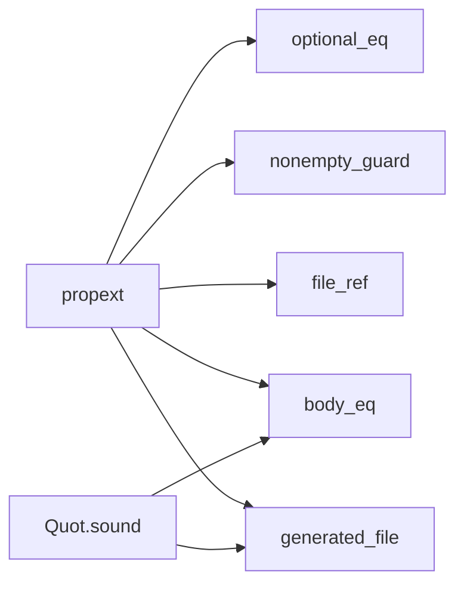
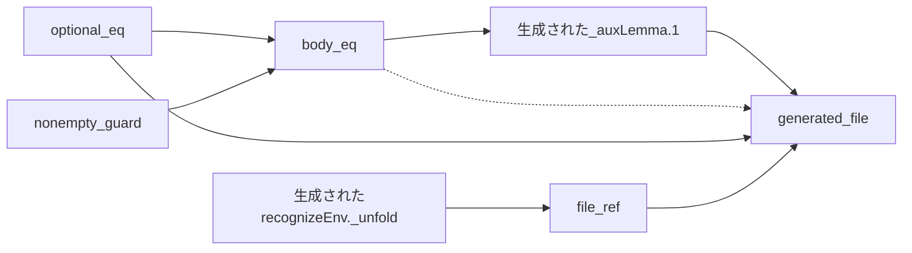

# ファイル入口の認識合成の証明と依存関係

この記録は、[root ADR 0351](../adr/0351-prove-parser-formatter-round-trips.md) の認識モデルから、ファイル入口の `File` を扱う。
基準は、ブロック列の認識合成を追加したコミット `bad6811cfe037eac9f43a1b12c1c958222a0f270` である。
対象は `experiments/parser-fmt-proof/grammar/FileCompositionTotal.lean` の名前付き宣言と、依存の説明に必要な生成済みの補助宣言である。
対象ファイルの SHA-256 は `02c2746f775c45dc9ee5955ef50483b5f441cfc8aa62de3c625ee0807977c1d2` である。
Lean 4.7.0（`6fce8f7d5cd1`、aarch64）を使った。

## 命題と前提

`Golem.hpeg:179` の `File <- BlankLines? (&. Blocks(0) BlankLines?)?` を、空行と本文の解析結果を順に扱う処理へ分解する。
主定理 `generated_file` は、任意の入力、環境、自然数の fuel を対象にする。
子の成功、子の結果の一致、入力の長さの上限は前提にしない。

入口へ `fuel + 6` を渡し、先頭の空行へ `fuel + 3`、本文の `Blocks(0)` へ `fuel + 2`、末尾の空行へ `fuel + 1` を渡す。
本文の先読みは、入力が空なら不一致、空でなければ入力を消費せず成功する。
省略可能な式が通常の不一致なら、その式の開始位置を返す。
子のエラーは、fuel の打ち切りや反復のエラーも含めて、そのまま返す。
`File` は引数を持たないため、呼出し元の環境は子へ引き継がず、空の環境を使う。

補助定理 `file_ref` は、文法の検索結果が `File` の構造と一致することを前提にする。
この前提は、主定理の 74 行で実際の `Generated.pegGrammar` に対して `rfl` で証明する。
子が成功するという仮定や、結論の認識結果が等しいという仮定へ置き換えていない。
`fileRule` の行番号と action はこの橋渡しの引数であり、主定理は生成された 179 行の定義を使う。

認識モデルの `File` の式には EOF が含まれない。
成功時に残った入力も結果の一部であり、認識の成功だけで任意の原稿を最後まで読めるとは主張しない。
native parser の入口での読み切りは、後述の有限の例で別に確かめる。
Haskell の action の値、復旧後の AST、コメントの保存、整形と評価の一般的な往復は、この命題に含まれない。

## 宣言の一覧

| 完全修飾名と対象ファイルの行 | 前提と結論の概要 |
| --- | --- |
| `FileCompositionTotal.optional_eq`、15 行 | 任意の文法、環境、式、入力について、省略可能な式の不一致を開始位置での成功へ移し、エラーと成功を保つ。 |
| `FileCompositionTotal.nonempty_guard`、28 行 | 任意の文法と環境で、一文字の肯定の先読みを、入力が空かどうかの判定へ移す。 |
| `FileCompositionTotal.body_eq`、33 行 | 本文の先読み、実文法の `Blocks(0)`、省略可能な末尾の空行を合成する。 |
| `FileCompositionTotal.file_ref`、59 行 | 文法の検索結果が `fileRule` と一致すれば、`File` の参照をその選択肢の認識へ移す。 |
| `FileCompositionTotal.generated_file`、66 行 | 実際に生成した `File` 全体を、前後の空行と本文の処理へ分解する。 |
| private `_private.FileCompositionTotal.0.FileCompositionTotal.next`、6 行 | 成功時の残りだけを後続へ渡し、不一致とエラーを保つ。 |
| private `_private.FileCompositionTotal.0.FileCompositionTotal.optional`、11 行 | 通常の不一致を、消費前の入力を返す成功へ移す。 |
| `FileCompositionTotal.body`、26 行 | 先読み、`Blocks(0)`、末尾の空行の順序を保持する式。 |
| private `_private.FileCompositionTotal.0.FileCompositionTotal.fileRule`、55 行 | 実際の検索結果に照合する、引数と template を持たない `File` の構造。 |

Lean は、`simp only [← body_eq]` から `FileCompositionTotal._auxLemma.1` を生成する。
これは `body_eq` の等式を逆向きに使う補助定理である。
`file_ref` での `unfold recognizeEnv` からは、private な `_private.FileCompositionTotal.0.PegModel.recognizeEnv._unfold` と、その match の補助宣言も対象モジュールに生成される。
これらは手で追加した別の認識規則ではない。

## 公理と証明の穴

環境の宣言の種類を調べた結果、対象モジュールが宣言した公理はなかった。
五つの名前付き定理は、型と elaboration 後の証明項を調べ、各定理の `#print axioms` で確かめた。

| 定理 | 推移的に使う標準公理 |
| --- | --- |
| `optional_eq`、`nonempty_guard`、`file_ref` | `propext` |
| `body_eq`、`generated_file` | `propext`、`Quot.sound` |

`propext` は、命題の同値から等式を得る公理で、Lean 4.7.0 の `Init/Core.lean:1287` にある。
`Quot.sound` は、関係で結ばれた要素が商で等しいという公理で、同じファイルの 1459 行にある。
対象内の四つの補助定義は、公理に依存しない。
次の図は、補助宣言を経由するものも含めた推移的な公理依存である。

生成された `_auxLemma.1` は環境で参照できるが、インポート先からの `#print axioms` の名前解決は失敗する。
この補助定理は、`#print axioms` と同じ `CollectAxioms.collect` を環境の完全名へ適用し、`propext` と `Quot.sound` だけに依存することを確かめた。
生成された `recognizeEnv._unfold` は `propext` だけに依存する。

対象ソースに `sorry`、`admit`、`sorryAx` の使用はない。
コンパイルの診断と公理依存にも証明の穴はなく、報告する位置はない。
`CollectAxioms` の訪問済み宣言を調べ、五つの定理に `lcProof` への依存がないことも確かめた。

## 定理間の依存関係

直接依存は、elaboration 後の型と証明項の `getUsedConstants` を合わせ、環境の定理として解決した参照から求めた。
実線は直接参照、破線は図に示す補助定理を経由する間接参照であり、矢印は依存先から利用する定理へ向ける。

この図では、標準ライブラリの等式や命題の簡約、`congrArg`、`funext`、`Eq.trans`、`forall_congr` などの補助定理と、定理の型に現れる認識器や文法の定義を省略した。
生成された文法の検索結果との等式を主定理で証明するため、手書きの代用ルールだけの証明にはしていない。

## 実装との照合と残件

回帰では、先頭の空行、本文、末尾の空行を必須にする変異、先読みの反転、本文の字下げ引数の変更を、未証明として検出する。
生成された PEG の AST の先頭の空行、先読み、字下げ引数を変えた三つの対照では、同じ Lean モジュールの証明が失敗する。

実パーサーでは、空の入力、空行だけ、段落一つと二つ、前後の空行、和文、補助平面の文字とタイ語を含む六つの原稿を読む。
入口の `File` が入力の末尾までを含む CST を返すことを照合する。
先頭の空行、本文、末尾の空行を必須にする三つの native parser と、先読みを反転する一つの native parser は、それぞれの境界の対照を拒否する。

この増分で認識の合成を証明した選択肢は一つ増え、未証明の一覧は 15 個から 14 個になる。
子ルールを含む再帰全体、Haskell の action の値、復旧、コメントを含む AST と整形、評価の一般的な往復は未完了である。
[root ADR 0351](../adr/0351-prove-parser-formatter-round-trips.md) の未実装のステータスを保つ。
