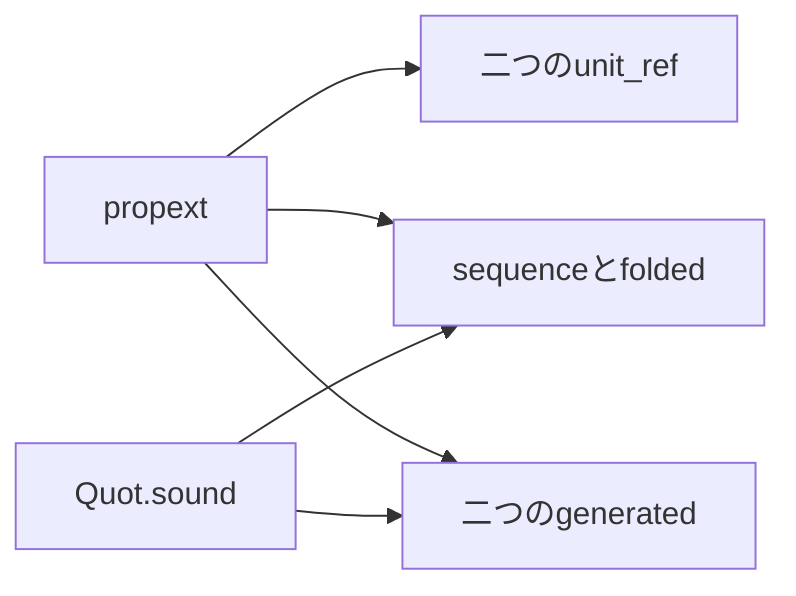
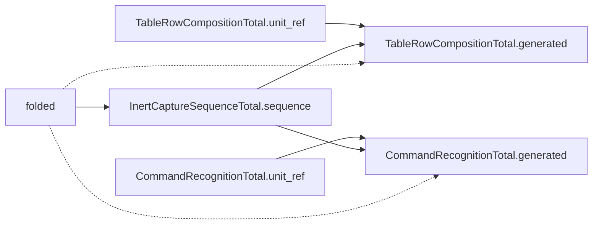

# 認識に値を使わない束縛の合成と証明の依存関係

この記録は、[root ADR 0351](../adr/0351-prove-parser-formatter-round-trips.md) の認識モデルから、表の行とコマンドの選択肢を扱う。
基準は `4d56c35488ca9e72b25dd962e7373a4429a798ba` で、Lean 4.7.0 を使った。
対象は `experiments/parser-fmt-proof/grammar/` の次の三つのファイルの全文である。

| ファイル | SHA-256 |
| --- | --- |
| `InertCaptureSequenceTotal.lean` | `05e9086252a117d7d3815a576758037516c46a017b07c44b538de66fe6daed3e` |
| `TableRowCompositionTotal.lean` | `8bac149c77323898c626d12927d58389b24e294ce89ded3551828894f5ab6804` |
| `CommandRecognitionTotal.lean` | `388ad1682041ddda1265450532c4dbe304ef789529efd2c30880554f54a28c59` |

## 命題と前提

`InertCaptureSequenceTotal.sequence`（53 行）は、モデルの列の認識を、同じ環境で子を順に認識する `UnboundSequenceTotal.follow` へ移す。
認識器、値取得関数、環境、入力と列は任意である。
前提は、列の各要素について、値取得関数が任意の環境と入力で `.ok none` を返すことである。
補助定理 `InertCaptureSequenceTotal.folded`（private、5 行）は、中間状態の環境が初期環境と等しいという不変条件を前提に持ち、列の長さについての帰納法で保持する。
公開定理は、入力と初期環境の組から始め、この前提を自明な等式で満たす。
認識結果の一致を前提に置かず、初期状態から結論を導く。
子の認識の成功も仮定しない。

`TableRowCompositionTotal.generated`（18 行）は、実際の `TableRow` の参照を、その五つの子の順の認識へ移す。
`CommandRecognitionTotal.generated`（19 行）は、実際の `BlockCommand` を、設定と通常の呼び出しの二つの列を順に試す処理へ移す。
入力、自然数の字下げ量と fuel は任意であり、入口へ `fuel + 2`、子へ `fuel` を渡す。
通常の不一致、子のエラー、fuel の打ち切りをすべて保つ。

それぞれの `unit_ref`（`TableRowCompositionTotal.lean:11`、`CommandRecognitionTotal.lean:12`）は、ルールの構造が固定のレコードと一致するという前提から参照を展開する。
実際の主定理は、生成文法でその前提を `rfl` により満たす。
行番号はソースから取り出し、認識する式と順序、`length cs`、`False`、`maybe False (const True) b` の action は固定して照合する。

二つのルールの名前付きの束縛は、それぞれ `plus` と `opt` である。
現在のモデルの値取得関数は、名前付きの `ref` に対してだけセル数を求めるため、この二つの束縛では値を返さない。
主定理の前提は、この構文とモデルの実装を展開して `rfl` で満たす。
これは、Haskell の `length cs` や本体の有無という戻り値を、モデルが一般に復元したことを意味しない。
`BlockGroup` が使う Bool の値と、表の外側が使うセル数の対応は別の残件である。

## 公理と証明の穴

Lean の型と証明項の `getUsedConstants` を調べ、`#print axioms` と `CollectAxioms.collect` で公理を求めた。
後者は `#print axioms` と同じ処理を、生成された非公開の補助宣言にも適用するために使った。
二つの `unit_ref` は `propext` に依存する。
二つの `generated`、`sequence` と `folded` は `propext` と `Quot.sound` に依存する。
対象の七つの定義と、既存の `UnboundSequenceTotal.follow` は公理に依存しない。

`propext` は命題の同値から等式を得る公理で、Lean 4.7.0 の `Init/Core.lean:1287` にある。
`Quot.sound` は関係で結ばれた要素が商で等しいという公理で、同じファイルの 1459 行にある。
次は、補助宣言を通る推移的な公理依存も含む図である。

対象ソースに `sorry`、`admit`、`sorryAx` の使用はない。
コンパイルの診断と公理の調査にも証明の穴はなく、報告する位置はない。
五つの公開定理の推移的な依存に `lcProof` がないことも確かめた。

## 定理間の依存

実線は証明項の直接参照、破線は図の補助定理を通る間接参照である。
矢印は依存先から利用する定理へ向ける。
標準ライブラリの等式と命題の簡約、`funext` などは省略する。

二つの `unit_ref` は、Lean が実際に生成した `recognizeEnv._unfold` を直接参照する。
この生成された補助定理は `propext` に依存する。
単に別の手書き文法を仮定するのではなく、実際の `Generated.pegGrammar` の構造と照合している。

## 実装との照合と残件

回帰では、実装を接続する前に、`TableRow` と `BlockCommand` の未証明の検査が失敗することを確かめた。
十五の文法変異、十一の生成済み AST の変異、束縛の環境へ余分な名前を漏らす一つの変異は、検査か証明が失敗する。
行番号だけを変えた二つの AST は、証明を保つ。

実パーサーの表の入口は、空のセル、複数のセル、字下げ、Unicode の文字、末尾の空白を含む七例でセル数を返す。
コマンドの入口は、設定、キーワードに似た識別子、本体なし、字下げ本体と EOF を含む七例で Bool を返す。
入力を残すものや不正なもの七例は、入口が拒否する。
文法を変えた十二の native parser では、受理と拒否、または実際の戻り値が変わることを照合する。

同じ二十一例を Lean のモデルでも実行し、接尾辞、不一致とラベルのエラーを照合する。
これらは有限の実行であり、一般の戻り値の対応を示すカーネルの証明ではない。
字下げのない直後の段落は `BlockCommand` の本体にはならず、モデルはその段落を残す。
この段落を扱う `BlockGroup` の認識と、原稿の評価は別に残る。

この増分で、認識の合成が未証明の選択肢は六個から三個になる。
戻り値の一般的な対応、子の再帰全体、AST、復旧、コメントの保存、整形と評価の往復は未完了である。
全範囲が終わるまで、[root ADR 0351](../adr/0351-prove-parser-formatter-round-trips.md) の未実装のステータスを保つ。
