# 生成した文法を走査してキーワードの capture を得る証明

この増分は [root ADR 0351](../adr/0351-prove-parser-formatter-round-trips.md) のうち、語と引用値のキーワードに限って、文法の走査、capture の構築、種類の変換と、Lean の TokenLowering と KeywordLowering のモデルの値を接続する。
実際の Golem.Parser.AST との一致は十二例で照合し、Haskell の AST への一般的な対応を証明したものではない。
対象は KeywordTrace.lean の全文で、Lean 4.7.0 を使う。
基準は c24069bfee1c5e409f7c80542224611a80ad406a、ソースの fingerprint は末尾に記す。
このモデルの capture は、GreenNode にする前の、位置を省いた名前と原綴りの木である。

## モデルと実装の範囲

body は、実際の Generated.pegGrammar.rules から規則を探し、alts の items を順に読む。
固定した別の Word Eq ArgValue の一覧で代用せず、既存の QuotedArgumentRules が、生成した二つの規則の形を照合する。
空の params と templateParams を持つ規則だけを扱い、列の要素は ref に限る。

sequence は子へ直前の残りを渡し、子の capture を入力順に結合する。
choices は通常の不一致の場合だけ、同じ開始入力で次を試す。
子のエラーはそのまま保つ。
CST モードの [Codegen.hs:1011〜1042](https://github.com/tett23/peg-hs/blob/4b4adc7046a14d18c8eec711f18dbcaa9b059cca/packages/peg-codegen/src/Peg/Codegen.hs#L1011) の順序と子の結合に対応付ける。

leaf は実際の ref の名前と args を recognizeEnv へ渡す。
成功した token で inline でなければ、消費区間の原綴りを capture にする。
それ以外の規則が成功した場合に、偽の空の子を作って先へ進めず、unmodeled non-token capture というモデルのエラーを返す。

keyword は KeywordArgument を展開し、引数なしの ArgValue だけをさらに展開する。
value は ArgValue の実際の五つの選択肢を試し、子は leaf に渡す。
展開する深さはこの二段階に限り、再帰を含む全規則の CST を生成する処理ではない。
各展開は、呼出し元の fuel から 2 を引く。
fuel が 2 未満の入口、参照以外の式、パラメーター付き規則など、未対応の経路を明示的なエラーにする。

wrapper は実際の文法の inline と token の属性を使う。
[Codegen.hs:681〜685](https://github.com/tett23/peg-hs/blob/4b4adc7046a14d18c8eec711f18dbcaa9b059cca/packages/peg-codegen/src/Peg/Codegen.hs#L681) と [Runtime/Internal.hs:917〜929](https://github.com/tett23/peg-hs/blob/4b4adc7046a14d18c8eec711f18dbcaa9b059cca/packages/peg-runtime/src/Peg/Runtime/Internal.hs#L917) の分類に対応する。
Word、Eq と StringLit の token、ArgValue の inline と、KeywordArgument の node という既存の閉じた証明を使う。
子の CST の列を入口の前提として与えない。

## 主定理の前提と結論

入力長は Lean の List Char の長さを指し、UTF-8 の byte 数や書記素クラスタ数とは区別する。

引用値の場合、名前は非空で許された文字からなる Word で、先頭が %% ではないことを前提にする。
引用値は任意長の Part の列、接尾辞も任意である。
入口の fuel は入力長、Part の個数、16 と任意の自然数の和である。
I1_quoted_keyword は三つの token を持つ KeywordArgument の capture と残りを示す。
I1_quoted_erasure は capture を捨てた結果が、同じ fuel の実際の生成規則の認識と一致することを示す。
I1_quoted_ast はモデルの名前と、StringLit に相当する種類と復号値を示す。

語の値では、名前と値の両方を Word とし、先頭が %% ではないことと、値の次の文字を Word に含められないことを前提にする。
それ以降の入力は任意で、入口の fuel は入力長に 20 と任意の自然数を足したものである。
I1_word_keyword、I1_word_erasure と I1_word_ast は、同じ三段階をモデルの語の値について示す。
先行する StringLit、ExprCtx、ReservedBracket と InlineCommand の不一致は、値の先頭文字の許容条件から導く。
子の認識の成功や、示したい結果の一致を主定理の前提に置かない。

value_quoted と value_word は一段下の ArgValue の capture を示す。
value_word_recognizer は同じ語の実際の ArgValue の認識を示す。
leaf_project は token の分類という前提の下で既存の CstWrapper.project と一致する補題であり、project_erasure は任意の CstWrapper.project の capture を捨てると認識の結果が戻る補題である。

## G01102 の射影

[Parser.hs:86〜118](../../modules/golem-parser/src/Golem/Parser.hs#L86) は、キーワードの直接の Word token を集め、最初の名前を除いてから、値に %% が含まれるかを調べる。
keywordQuoteCodes はこの部分だけをモデルにし、quoteFlags は返された KeywordArgument の node に適用する。
名前に %% が含まれても、それだけでは G01102 にしない。
引用値は Word token ではないため、内容に %% があっても G01102 にしない。

word_quote_codes と string_quote_codes は、この性質を構築した rawFields について示す。
I1_word_quote_codes と I1_quoted_quote_codes は、実際の規則を走査して得た capture に接続する。
語の値に %% があれば G01102 一つ、なければ空の列、引用値なら空の列となる。
これは G01102 のコードだけの射影である。
重大度、位置、fix、ほかの diagnostics や、木を再帰して集める commentDiagnostics 全体の一般証明ではない。

語に内部の %% がある場合、文法は認識して capture と AST の値を返せても、公開の parse は G01102 を報告する。
文法の成功を、公開 API の diagnostics が無いこととは扱わない。

## 実装との有限の照合

共通の十二例は、一つのキーワードを持つ inspect の原稿から作る。
モデルは KeywordArgument の本体を読み、閉じ角括弧と改行を未消費の接尾辞として残す。
外側の command やファイル全体をモデルが走査するという照合ではない。
実際の Haskell の CST と parseAst から、名前、Word または StringLit の種類、原綴りと復号値を取り出す。
通常の golem fmt の前後で AST の値が同じことと、二度目のバイト列の不変も確かめる。

八つの値の例に加え、名前の内部の %%、値の単独の %、引用値の %%= と、Word の 0.10 を含む。
これらの通常の例では公開の parser の diagnostics が空であることも観測器が要求する。

別の三例は、引用符なしの値に %% を持つエラーの原稿である。
実際の G01102、重大度 error、値全体の UTF-8 の byte span と、引用符を付ける fix を照合する。
ASCII の名前と値、和文の名前、補助平面の文字を持つ値を含む。
通常の fmt は失敗し、元の原稿のバイト列を変えないことも確かめる。
モデルで照合するのはコードの列であり、位置と fix はこの三例の実測に限る。

`key=[= 1]` は、実 peg-hs の構文解析では受理するが、限定した capture モデルでは明示的な未対応となる対照である。
これを Golem 自体が拒否する例や、認識の反例の個数には数えない。

## 回帰と変異

子の capture を捨てるモデルで、原綴りと AST の回帰が失敗することを先に確かめた。
同じ入力の子を順に保持するモデルへ直した後、回帰が通る。
診断コードを常に空にするモデルでは、実測した G01102 を表せない回帰が失敗し、値の検査を追加した後に通る。

十個の変異は、子の削除と逆順、次の参照への入力のリセット、node の削除、inline の無視、最初の選択肢の削除、ArgValue の展開先の誤り、G01102 の省略、名前への誤った G01102 と、コードの射影の削除を検出する。
型の正しい変異で証明の goal が失敗したものだけを数え、未知の field や identifier、構文の誤り、import と heartbeat の失敗を除く。

さらに、未対応の非 token を成功した空の子として返す変異は、通常の語と引用値の定理を保つ。
この変異は式の範囲の対照を通せないため、別の runtime の回帰が拒否する。
これを十個の証明の反証と混ぜない。
変異の検査後は元の source と artifact を復元して、同じ未対応の対照が通ることも確かめる。

## 環境と公理

Lean 4.7.0、GHC 9.10.3 と peg-hs `4b4adc7046a14d18c8eec711f18dbcaa9b059cca` を使う。
対象の十五の名前付き定理と、生成された三十五の補助定理をすべて `#print axioms` で調べた。
手書きの公理、`sorry` と `admit` はない。

| ソースに明示した定理 | 位置 | 公理 |
| --- | --- | --- |
| `KeywordTrace.leaf_project` | [KeywordTrace.lean:58](../../experiments/parser-fmt-proof/grammar/KeywordTrace.lean#L58) | `[propext, Quot.sound]` |
| `KeywordTrace.value_quoted` | [KeywordTrace.lean:64](../../experiments/parser-fmt-proof/grammar/KeywordTrace.lean#L64) | `[propext, Classical.choice, Quot.sound]` |
| `KeywordTrace.I1_quoted_keyword` | [KeywordTrace.lean:84](../../experiments/parser-fmt-proof/grammar/KeywordTrace.lean#L84) | `[propext, Quot.sound, Classical.choice]` |
| `KeywordTrace.project_erasure` | [KeywordTrace.lean:133](../../experiments/parser-fmt-proof/grammar/KeywordTrace.lean#L133) | `[propext]` |
| `KeywordTrace.I1_quoted_erasure` | [KeywordTrace.lean:145](../../experiments/parser-fmt-proof/grammar/KeywordTrace.lean#L145) | `[propext, Quot.sound, Classical.choice]` |
| `KeywordTrace.I1_quoted_ast` | [KeywordTrace.lean:158](../../experiments/parser-fmt-proof/grammar/KeywordTrace.lean#L158) | `[propext, Quot.sound, Classical.choice]` |
| `KeywordTrace.value_word` | [KeywordTrace.lean:173](../../experiments/parser-fmt-proof/grammar/KeywordTrace.lean#L173) | `[propext, Quot.sound, Classical.choice]` |
| `KeywordTrace.I1_word_keyword` | [KeywordTrace.lean:220](../../experiments/parser-fmt-proof/grammar/KeywordTrace.lean#L220) | `[propext, Quot.sound, Classical.choice]` |
| `KeywordTrace.I1_word_ast` | [KeywordTrace.lean:266](../../experiments/parser-fmt-proof/grammar/KeywordTrace.lean#L266) | `[propext, Quot.sound, Classical.choice]` |
| `KeywordTrace.value_word_recognizer` | [KeywordTrace.lean:281](../../experiments/parser-fmt-proof/grammar/KeywordTrace.lean#L281) | `[propext, Classical.choice, Quot.sound]` |
| `KeywordTrace.I1_word_erasure` | [KeywordTrace.lean:318](../../experiments/parser-fmt-proof/grammar/KeywordTrace.lean#L318) | `[propext, Quot.sound, Classical.choice]` |
| `KeywordTrace.word_quote_codes` | [KeywordTrace.lean:379](../../experiments/parser-fmt-proof/grammar/KeywordTrace.lean#L379) | `[propext]` |
| `KeywordTrace.string_quote_codes` | [KeywordTrace.lean:385](../../experiments/parser-fmt-proof/grammar/KeywordTrace.lean#L385) | `なし` |
| `KeywordTrace.I1_word_quote_codes` | [KeywordTrace.lean:388](../../experiments/parser-fmt-proof/grammar/KeywordTrace.lean#L388) | `[propext, Quot.sound, Classical.choice]` |
| `KeywordTrace.I1_quoted_quote_codes` | [KeywordTrace.lean:398](../../experiments/parser-fmt-proof/grammar/KeywordTrace.lean#L398) | `[propext, Quot.sound, Classical.choice]` |

公理の図は、各主定理の間接の依存も含む。
両方の図の矢印は、依存先から利用する定理へ向ける。
propext、Classical.choice と Quot.sound の意味と前提は、[CST wrapper の記録](0351-cst-wrapper-proof-dependencies.md) にある。

```mermaid
flowchart TD
  P[propext] --> leaf_project
  Q[Quot.sound] --> leaf_project
  P[propext] --> value_quoted
  C[Classical.choice] --> value_quoted
  Q[Quot.sound] --> value_quoted
  P[propext] --> I1_quoted_keyword
  C[Classical.choice] --> I1_quoted_keyword
  Q[Quot.sound] --> I1_quoted_keyword
  P[propext] --> project_erasure
  P[propext] --> I1_quoted_erasure
  C[Classical.choice] --> I1_quoted_erasure
  Q[Quot.sound] --> I1_quoted_erasure
  P[propext] --> I1_quoted_ast
  C[Classical.choice] --> I1_quoted_ast
  Q[Quot.sound] --> I1_quoted_ast
  P[propext] --> value_word
  C[Classical.choice] --> value_word
  Q[Quot.sound] --> value_word
  P[propext] --> I1_word_keyword
  C[Classical.choice] --> I1_word_keyword
  Q[Quot.sound] --> I1_word_keyword
  P[propext] --> I1_word_ast
  C[Classical.choice] --> I1_word_ast
  Q[Quot.sound] --> I1_word_ast
  P[propext] --> value_word_recognizer
  C[Classical.choice] --> value_word_recognizer
  Q[Quot.sound] --> value_word_recognizer
  P[propext] --> I1_word_erasure
  C[Classical.choice] --> I1_word_erasure
  Q[Quot.sound] --> I1_word_erasure
  P[propext] --> word_quote_codes
  P[propext] --> I1_word_quote_codes
  C[Classical.choice] --> I1_word_quote_codes
  Q[Quot.sound] --> I1_word_quote_codes
  P[propext] --> I1_quoted_quote_codes
  C[Classical.choice] --> I1_quoted_quote_codes
  Q[Quot.sound] --> I1_quoted_quote_codes
```



次の図は、ソースに明示した定理と必要な既存の定理への、型と証明項から得た直接の参照を示す。
生成された計算式と標準ライブラリの内部は省く。

```mermaid
flowchart TD
  QuotedArgumentRules_value_found --> KeywordTrace_value_quoted
  KeywordTrace_leaf_project --> KeywordTrace_value_quoted
  CstWrapper_string_token --> KeywordTrace_value_quoted
  CstWrapper_string_not_inline --> KeywordTrace_value_quoted
  CstWrapper_I1_generated_quoted_token --> KeywordTrace_value_quoted
  CstWrapper_I1_generated_argvalue_inline --> KeywordTrace_value_quoted
  KeywordTrace_leaf_project --> KeywordTrace_I1_quoted_keyword
  CstWrapper_word_token --> KeywordTrace_I1_quoted_keyword
  CstWrapper_word_not_inline --> KeywordTrace_I1_quoted_keyword
  CstWrapper_I1_generated_word_token --> KeywordTrace_I1_quoted_keyword
  CstWrapper_eq_token --> KeywordTrace_I1_quoted_keyword
  CstWrapper_eq_not_inline --> KeywordTrace_I1_quoted_keyword
  CstWrapper_I1_generated_eq_token --> KeywordTrace_I1_quoted_keyword
  KeywordTrace_value_quoted --> KeywordTrace_I1_quoted_keyword
  QuotedArgumentRules_keyword_found --> KeywordTrace_I1_quoted_keyword
  CstWrapper_I1_generated_keyword_node --> KeywordTrace_I1_quoted_keyword
  KeywordTrace_I1_quoted_keyword --> KeywordTrace_I1_quoted_erasure
  QuotedKeywords_I1_generated_quoted_keyword --> KeywordTrace_I1_quoted_erasure
  KeywordTrace_I1_quoted_keyword --> KeywordTrace_I1_quoted_ast
  TokenLowering_I1_converted_keyword --> KeywordTrace_I1_quoted_ast
  KeywordTrace_leaf_project --> KeywordTrace_value_word
  CstWrapper_word_token --> KeywordTrace_value_word
  CstWrapper_word_not_inline --> KeywordTrace_value_word
  CstWrapper_I1_generated_word_token --> KeywordTrace_value_word
  WordRoundTrip_ordinary_value_precedence --> KeywordTrace_value_word
  QuotedArgumentRules_value_found --> KeywordTrace_value_word
  CstWrapper_I1_generated_argvalue_inline --> KeywordTrace_value_word
  KeywordTrace_leaf_project --> KeywordTrace_I1_word_keyword
  CstWrapper_word_token --> KeywordTrace_I1_word_keyword
  CstWrapper_word_not_inline --> KeywordTrace_I1_word_keyword
  CstWrapper_I1_generated_word_token --> KeywordTrace_I1_word_keyword
  CstWrapper_eq_token --> KeywordTrace_I1_word_keyword
  CstWrapper_eq_not_inline --> KeywordTrace_I1_word_keyword
  CstWrapper_I1_generated_eq_token --> KeywordTrace_I1_word_keyword
  KeywordTrace_value_word --> KeywordTrace_I1_word_keyword
  QuotedArgumentRules_keyword_found --> KeywordTrace_I1_word_keyword
  CstWrapper_I1_generated_keyword_node --> KeywordTrace_I1_word_keyword
  KeywordTrace_I1_word_keyword --> KeywordTrace_I1_word_ast
  TokenLowering_I1_converted_keyword --> KeywordTrace_I1_word_ast
  ArgumentsRoundTrip_canonical_word_before_separator --> KeywordTrace_value_word_recognizer
  WordRoundTrip_ordinary_value_precedence --> KeywordTrace_value_word_recognizer
  ArgumentsRoundTrip_canonical_argvalue_word --> KeywordTrace_value_word_recognizer
  KeywordTrace_I1_word_keyword --> KeywordTrace_I1_word_erasure
  ArgumentsRoundTrip_canonical_word_at_budget --> KeywordTrace_I1_word_erasure
  CstWrapper_I1_generated_eq_token --> KeywordTrace_I1_word_erasure
  KeywordTrace_project_erasure --> KeywordTrace_I1_word_erasure
  KeywordTrace_value_word_recognizer --> KeywordTrace_I1_word_erasure
  ArgumentsRoundTrip_canonical_keyword_of_parts --> KeywordTrace_I1_word_erasure
  KeywordTrace_I1_word_keyword --> KeywordTrace_I1_word_quote_codes
  KeywordTrace_word_quote_codes --> KeywordTrace_I1_word_quote_codes
  KeywordTrace_I1_quoted_keyword --> KeywordTrace_I1_quoted_quote_codes
```



| 生成された補助定理 | 公理 |
| --- | --- |
| `_private.KeywordTrace.0.CstWrapper.project.match_1.eq_3` | `なし` |
| `_private.KeywordTrace.0.KeywordTrace.leaf.match_1.eq_1` | `なし` |
| `_private.KeywordTrace.0.List.isEmpty.match_1.eq_2` | `なし` |
| `_private.KeywordTrace.0.KeywordTrace.sequence.match_1.eq_1` | `なし` |
| `_private.KeywordTrace.0.KeywordTrace.choices.match_2.eq_1` | `なし` |
| `_private.KeywordTrace.0.KeywordTrace.quoteFlags.match_1.eq_1` | `なし` |
| `_private.KeywordTrace.0.List.filterMap._eq_2` | `なし` |
| `_private.KeywordTrace.0.KeywordTrace.quoteFlags.match_1.eq_2` | `[Classical.choice, propext, Quot.sound]` |
| `_private.KeywordTrace.0.KeywordTrace.sequence.match_1.eq_3` | `なし` |
| `_private.KeywordTrace.0.KeywordTrace.sequence.match_2.eq_3` | `なし` |
| `_private.KeywordTrace.0.TokenLowering.arguments.match_1.eq_1` | `なし` |
| `_private.KeywordTrace.0.KeywordTrace.sequence.match_2.eq_1` | `なし` |
| `_private.KeywordTrace.0.KeywordTrace.choices._eq_1` | `なし` |
| `_private.KeywordTrace.0.List.drop._eq_2` | `なし` |
| `_private.KeywordTrace.0.CstWrapper.project.match_1.eq_1` | `なし` |
| `_private.KeywordTrace.0.KeywordTrace.sequence._eq_2` | `なし` |
| `_private.KeywordTrace.0.CstWrapper.project.match_1.eq_2` | `なし` |
| `_private.KeywordTrace.0.List.filterMap._eq_1` | `なし` |
| `_private.KeywordTrace.0.List.isEmpty.match_1.eq_1` | `なし` |
| `_private.KeywordTrace.0.KeywordTrace.choices._eq_2` | `なし` |
| `_private.KeywordTrace.0.List.drop.match_1.eq_2` | `なし` |
| `_private.KeywordTrace.0.TokenLowering.arguments.match_1.eq_2` | `[Classical.choice, propext, Quot.sound]` |
| `_private.KeywordTrace.0.KeywordTrace.sequence._eq_1` | `なし` |
| `_private.KeywordTrace.0.KeywordTrace.choices.match_1.eq_2` | `なし` |
| `_private.KeywordTrace.0.KeywordTrace.leaf.match_1.eq_3` | `なし` |
| `_private.KeywordTrace.0.List.drop.match_1.eq_1` | `なし` |
| `_private.KeywordTrace.0.KeywordTrace.leaf.match_1.eq_2` | `なし` |
| `_private.KeywordTrace.0.KeywordTrace.sequence.match_2.eq_2` | `なし` |
| `_private.KeywordTrace.0.List.drop._eq_3` | `なし` |
| `_private.KeywordTrace.0.KeywordTrace.sequence.match_1.eq_2` | `なし` |
| `_private.KeywordTrace.0.List.drop._eq_1` | `なし` |
| `_private.KeywordTrace.0.KeywordTrace.choices.match_2.eq_2` | `なし` |
| `_private.KeywordTrace.0.List.drop.match_1.eq_3` | `なし` |
| `_private.KeywordTrace.0.KeywordTrace.sequence._eq_3` | `なし` |
| `_private.KeywordTrace.0.KeywordTrace.choices.match_1.eq_1` | `なし` |

生成された三つの unsafe 宣言は実行用のリスト処理の特殊化であり、主定理の論理的な依存には含まれない。

```text
List.filterMap._at.KeywordTrace.wordTokens._spec_1
List.mapTR.loop._at.KeywordTrace.quoteFlags._spec_1
List.filterMap._at.KeywordTrace.keywordQuoteCodes._spec_1
```

leaf、value と keyword の論理定義は propext に依存し、ほかの対象の論理定義は公理に依存しない。

KeywordTrace.lean の SHA-256 は `71a1011f1d8932b47977f1c69652193c27d4b0508fc8ade22c86dec00108f622`。

## 再現と残る範囲

grammar の [README](../../experiments/parser-fmt-proof/grammar/README.md) に従い、プロジェクトの peg-hs と GHC 9.10.3 の PATH を指定して全ハーネスを実行する。
同じ CLI と Cabal plan の選択の後、次で CST、AST と diagnostics の実装を照合できる。

```sh
node --test experiments/parser-fmt-proof/arguments/trace-values.native-test.mjs \
  experiments/parser-fmt-proof/arguments/trace-diagnostics.native-test.mjs
```

公理と直接参照の一覧は、別途、次の一時ファイルを使って再取得した。
環境内の KeywordTrace モジュールに属する全定理を列挙するため、ソースの十二個の #print だけに依存しない。
同じ peg-hs、Cabal plan と Lean を選択して、リポジトリのルートで次を実行する。
標準出力の THEOREM は五十件、unsafe axiom は三件となる。
一時ディレクトリを使う subshell 内で実行し、既存の成果物を書き換えない。

```sh
(
set -eu
task_lean=${LEAN:-lean}
task_proof=$(mktemp -d /private/tmp/golem-keyword-dependencies-XXXXXX)
trap 'rm -rf "$task_proof"' EXIT HUP INT TERM
node experiments/parser-fmt-proof/grammar/generate.mjs --fragment \
  modules/golem-parser/grammar/Golem.hpeg "$task_proof/Generated.lean"
for task_module in PegModel PegModelTest WordRoundTrip StringRoundTrip ArgumentsRoundTrip \
  QuotedArgumentRules QuotedKeywords PrintedArguments QuotedCanonical MixedKeywords \
  KeywordLowering CstWrapperMetadata CstWrapper TokenLowering KeywordTrace; do
  cp "experiments/parser-fmt-proof/grammar/$task_module.lean" "$task_proof/"
done
cd "$task_proof"
export LEAN_PATH=$task_proof
for task_module in PegModel Generated PegModelTest WordRoundTrip StringRoundTrip ArgumentsRoundTrip \
  QuotedArgumentRules QuotedKeywords PrintedArguments QuotedCanonical MixedKeywords \
  KeywordLowering CstWrapperMetadata CstWrapper TokenLowering KeywordTrace; do
  "$task_lean" -o "$task_module.olean" "$task_module.lean" > "$task_module.log"
done
cat > Inspect.lean <<'LEAN'
import Lean
import KeywordTrace
open Lean Elab Command
run_cmd do
  let env ← getEnv
  for (name, info) in env.constants.toList do
    let some index := env.getModuleIdxFor? name | continue
    unless env.allImportedModuleNames[index.toNat]! == `KeywordTrace do continue
    match info with
    | .axiomInfo _ => elabCommand (← `(#print $(mkIdent name)))
    | .thmInfo theoremInfo =>
      logInfo m!"THEOREM {name} {(toJson ((info.type.getUsedConstants ++ theoremInfo.value.getUsedConstants).toList.map Name.toString)).compress}"
      elabCommand (← `(#print axioms $(mkIdent name)))
    | _ => pure ()
LEAN
"$task_lean" Inspect.lean
)
```

位置を省いた二段階の capture モデルであり、任意の文法や原稿から Haskell の CST を生成する一般証明ではない。
UTF-8 と文字の対応、GreenNode の間隙、再帰全体、式と展開、コメントの保存、復旧、全 diagnostics の位置と fix、AST 全体、整形と評価の一般的な往復は残る。
[root ADR 0351](../adr/0351-prove-parser-formatter-round-trips.md) 全体の未実装の状態を保つ。
