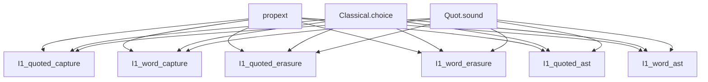

# KwArg のキーワード経路の capture

この増分は、[root ADR 0351](../adr/0351-prove-parser-formatter-round-trips.md) のうち、KwArg がキーワードの経路を選ぶときの子の CST を扱う。
実際の生成規則を読み、語と引用値のキーワードについて、KeywordArgument の node を保って KwArg 自体の node を追加しないことを示す。
対象は KwArgMetadata.lean と KwArgTrace.lean の全文、基準は `ac418a4b07cc59488fcd9a7cbe8b61aff4165d45`、Lean 4.7.0 を使う。
CST は位置を省いた CstWrapper.Element、値は Lean の TokenLowering と KeywordLowering のモデルの値である。
Haskell の CST と AST 全体への一般的な対応ではない。

## モデルと実際の文法

KwArgMetadata.lean は、生成文法の KwArg の引数とテンプレート引数が空で、先頭の選択肢が KeywordArgument の参照一つであることを検査する。
残りの選択肢は実際の生成規則から drop 1 で取り出し、別の固定した規則に置き換えない。
KwArg が inline であることも検査する。
行番号と action の文字列は、この構造の射影に含めない。

KwArgTrace.read は、実際の文法を検索して選択肢と子の参照を順に読む KeywordTrace.body を使う。
引数のない KeywordArgument の参照だけは、既存の KeywordTrace.keyword でさらに展開する。
ほかの参照は KeywordTrace.leaf に渡し、未対応の非 token が成功しても偽の空の子を作らない。
KwArg の展開では fuel から 2 を引く。

今回の一般定理は、先頭のキーワードの経路で成功する入力が対象である。
式からの展開である SplatArgument は、KwArg のもう一つの選択肢として文法に残すが、その capture は未証明である。
その選択肢にある参照以外の式へ進むと、モデルは明示的な未対応のエラーにする。
このモデルのエラーは、実際の parser が原稿を拒否するという意味ではない。

## 主定理の前提と結論

入力長は Lean の List Char の長さであり、UTF-8 の byte 数や書記素クラスタ数とは区別する。
引用値の場合、名前は非空で許された文字からなる Word で、先頭が %% でないことを前提にする。
引用値は任意長の Part の列、接尾辞は任意である。
fuel は入力長、Part の個数、18 と任意の自然数の和である。

語の値の場合、名前と値を Word とし、どちらも先頭が %% ではないことと、値の次の文字が Word に含められないことを前提にする。
それ以降の接尾辞は任意である。
fuel は入力長に 22 と任意の自然数を足したものである。

I1_quoted_capture と I1_word_capture は、名前、等号と値の三つの token を持つ KeywordArgument の node と残りの入力を示す。
子の CST を引数として与えず、既存の一般定理で子の capture を導く。
KwArg が inline であるため、外側に KwArg の node を追加しない。

I1_quoted_erasure と I1_word_erasure は、子を消した結果が同じ fuel の実際の KwArg の認識と一致することを示す。
使う既存の canonical_kwarg_of_keyword は子の認識成功を前提にするが、その前提は KeywordTrace の認識と capture の一般定理から導く。
主定理は、子の成功や結果の一致を未証明の前提にしない。

I1_quoted_ast と I1_word_ast は、その capture を TokenLowering.arguments へ渡したとき、名前、Word または StringLit の種類と復号値が戻ることを示す。
これはキーワードだけを取り出すモデルの射影であり、位置引数と展開も含む Haskell の arguments 全体ではない。
語の内部の %% による G01102 については、[キーワードの capture の記録](0351-keyword-capture-proof-dependencies.md) と同じく、文法上の成功を公開 API のエラーなしの受理とは区別する。

## 回帰と変異

KwArg の inline 指定を無視するモデルをコンパイルしてから、余分な KwArg node が現れて回帰が失敗することを先に確かめた。
正しい指定へ戻すと、同じ回帰が通る。
inline の無視、KeywordArgument の展開先の変更、検索するルール名の変更という三つの型の正しい変異で、一般定理が失敗する。
各変異では、定理を除いた同じ実装をコンパイルして、同じ回帰も失敗することを確かめる。
証明スクリプトだけが変更に追随できない失敗と区別する。
変異の後は、元のソースと成果物を復元し、回帰が通ることも確かめる。

十二の共通ケースを KwArgTrace.read から読み、CST の token、モデルの値と残りの入力を照合する。
Word、StringLit、引用符とエスケープ、空の引用値、Unicode と改行、名前に含まれる %%、単独の %、引用値の %%= と語の 0.10 を含む。
同じケースの実際の CST、parseAst と通常の fmt の照合は、[キーワードの capture の記録](0351-keyword-capture-proof-dependencies.md) と共通の観測器を使う。
この対応は十二例の有限の検査であり、一般的な Haskell の AST の証明とは数えない。

実際の KwArg を参照する KwArgProbe を別の入口に追加して、キーワードの CST に KwArg の node がないことを確かめる。
inline の除去と、先頭の参照を StringLit に変える二つの source の変異は、fresh な Generated と KwArgMetadata で拒否する。
後者では、未使用になる KeywordArgument の到達性を保つため、その規則も別の入口として公開する。
この公開は、開始規則から KwArg を読む経路を変更しない。

最初の変異では KwArg の node が現れることを実際の parser で確かめる。
二つ目では、変更した文法が引用値を受理してコンパイルできることを先に確かめ、元は受理したキーワードを拒否することを確かめる。
parser のコンパイル失敗を、入力を拒否する反例には数えない。
生成した AST の KwArg の行番号だけを変える対照では、構造の射影の証明が通ることも確かめる。
この metadata だけの対照では、古い Generated に依存する証明の成果物を流用しない。

`**[items]` は実際の parser が SplatArgument として受理し、この capture モデルだけが未対応となる対照である。
これを parser の拒否や、二つの source の変異に対する反例の個数には数えない。
KwArgProbe は既存の KwArg を参照する入口の観測であり、コマンドの宣言と引数検査を通る正しい原稿全体の証明でもない。

## 環境と公理

Lean 4.7.0、GHC 9.10.3 と peg-hs `4b4adc7046a14d18c8eec711f18dbcaa9b059cca` を使う。
AST と fmt の照合には既存の golem-0479-dist の plan と CLI を使い、parser と fmt の九つの Haskell ソースと文法が基準と一致することを確かめた。
この増分から CLI 全体を新しくビルドしたという記録ではない。
対象の八つの名前付き定理と、生成された二十一の補助定理をすべて Lean の環境から列挙し、#print axioms で調べた。
手書きの公理と unsafe 宣言、sorry と admit はない。
read の論理定義は propext に依存し、fallback は公理に依存しない。

| ソースに明示した定理 | 位置 | 公理 |
| --- | --- | --- |
| `KwArgTrace.kwarg_found` | [KwArgMetadata.lean:8](../../experiments/parser-fmt-proof/grammar/KwArgMetadata.lean#L8) | `なし` |
| `KwArgTrace.kwarg_inline` | [KwArgMetadata.lean:13](../../experiments/parser-fmt-proof/grammar/KwArgMetadata.lean#L13) | `なし` |
| `KwArgTrace.I1_quoted_capture` | [KwArgTrace.lean:13](../../experiments/parser-fmt-proof/grammar/KwArgTrace.lean#L13) | `[propext, Classical.choice, Quot.sound]` |
| `KwArgTrace.I1_word_capture` | [KwArgTrace.lean:43](../../experiments/parser-fmt-proof/grammar/KwArgTrace.lean#L43) | `[propext, Classical.choice, Quot.sound]` |
| `KwArgTrace.I1_quoted_erasure` | [KwArgTrace.lean:73](../../experiments/parser-fmt-proof/grammar/KwArgTrace.lean#L73) | `[propext, Classical.choice, Quot.sound]` |
| `KwArgTrace.I1_word_erasure` | [KwArgTrace.lean:97](../../experiments/parser-fmt-proof/grammar/KwArgTrace.lean#L97) | `[propext, Classical.choice, Quot.sound]` |
| `KwArgTrace.I1_quoted_ast` | [KwArgTrace.lean:121](../../experiments/parser-fmt-proof/grammar/KwArgTrace.lean#L121) | `[propext, Classical.choice, Quot.sound]` |
| `KwArgTrace.I1_word_ast` | [KwArgTrace.lean:132](../../experiments/parser-fmt-proof/grammar/KwArgTrace.lean#L132) | `[propext, Classical.choice, Quot.sound]` |

公理の図は、ソースに明示した主定理の間接の依存も含む。
両方の図の矢印は、依存先から利用する定理へ向ける。
二つの metadata の定理は公理を使わない。
公理の意味は、[CST wrapper の記録](0351-cst-wrapper-proof-dependencies.md) にある。



次の図は、型と証明項から得た、ソースに明示した定理と既存の補題の間の直接の参照である。
生成された計算式と標準ライブラリの内部は省く。

```mermaid
flowchart TD
  ArgumentsRoundTrip_canonical_kwarg_of_keyword --> KwArgTrace_I1_quoted_erasure
  ArgumentsRoundTrip_canonical_kwarg_of_keyword --> KwArgTrace_I1_word_erasure
  KeywordTrace_I1_quoted_erasure --> KwArgTrace_I1_quoted_erasure
  KeywordTrace_I1_quoted_keyword --> KwArgTrace_I1_quoted_capture
  KeywordTrace_I1_quoted_keyword --> KwArgTrace_I1_quoted_erasure
  KeywordTrace_I1_word_erasure --> KwArgTrace_I1_word_erasure
  KeywordTrace_I1_word_keyword --> KwArgTrace_I1_word_capture
  KeywordTrace_I1_word_keyword --> KwArgTrace_I1_word_erasure
  KwArgTrace_I1_quoted_capture --> KwArgTrace_I1_quoted_ast
  KwArgTrace_I1_quoted_capture --> KwArgTrace_I1_quoted_erasure
  KwArgTrace_I1_word_capture --> KwArgTrace_I1_word_ast
  KwArgTrace_I1_word_capture --> KwArgTrace_I1_word_erasure
  KwArgTrace_kwarg_found --> KwArgTrace_I1_quoted_capture
  KwArgTrace_kwarg_found --> KwArgTrace_I1_word_capture
  KwArgTrace_kwarg_inline --> KwArgTrace_I1_quoted_capture
  KwArgTrace_kwarg_inline --> KwArgTrace_I1_word_capture
  TokenLowering_I1_converted_keyword --> KwArgTrace_I1_quoted_ast
  TokenLowering_I1_converted_keyword --> KwArgTrace_I1_word_ast
```



生成された二十一の補助定理にも、公理依存をすべて記す。

| 生成された定理 | 公理 |
| --- | --- |
| `_private.KwArgTrace.0.KeywordTrace.choices._eq_1` | `なし` |
| `_private.KwArgTrace.0.KeywordTrace.choices._eq_2` | `なし` |
| `_private.KwArgTrace.0.KeywordTrace.choices.match_1.eq_1` | `なし` |
| `_private.KwArgTrace.0.KeywordTrace.choices.match_1.eq_2` | `なし` |
| `_private.KwArgTrace.0.KeywordTrace.choices.match_2.eq_1` | `なし` |
| `_private.KwArgTrace.0.KeywordTrace.choices.match_2.eq_2` | `なし` |
| `_private.KwArgTrace.0.KeywordTrace.sequence._eq_1` | `なし` |
| `_private.KwArgTrace.0.KeywordTrace.sequence._eq_2` | `なし` |
| `_private.KwArgTrace.0.KeywordTrace.sequence._eq_3` | `なし` |
| `_private.KwArgTrace.0.KeywordTrace.sequence.match_1.eq_1` | `なし` |
| `_private.KwArgTrace.0.KeywordTrace.sequence.match_1.eq_2` | `なし` |
| `_private.KwArgTrace.0.KeywordTrace.sequence.match_1.eq_3` | `なし` |
| `_private.KwArgTrace.0.KeywordTrace.sequence.match_2.eq_1` | `なし` |
| `_private.KwArgTrace.0.KeywordTrace.sequence.match_2.eq_2` | `なし` |
| `_private.KwArgTrace.0.KeywordTrace.sequence.match_2.eq_3` | `なし` |
| `_private.KwArgTrace.0.List.filterMap._eq_1` | `なし` |
| `_private.KwArgTrace.0.List.filterMap._eq_2` | `なし` |
| `_private.KwArgTrace.0.List.isEmpty.match_1.eq_1` | `なし` |
| `_private.KwArgTrace.0.List.isEmpty.match_1.eq_2` | `なし` |
| `_private.KwArgTrace.0.TokenLowering.arguments.match_1.eq_1` | `なし` |
| `_private.KwArgTrace.0.TokenLowering.arguments.match_1.eq_2` | `[Classical.choice, propext, Quot.sound]` |

KwArgMetadata.lean の SHA-256 は `33c7f4d06bac2dace0289d9f6c91a7513b3f7248d1d02c9f4e2a063dd278c7fd`。
KwArgTrace.lean の SHA-256 は `1812adf583aad0b56f43164424db3cc0678021b643a4317314d64119aa01ef08`。

## 再現と残る範囲

grammar の [README](../../experiments/parser-fmt-proof/grammar/README.md) に従い、プロジェクトの peg-hs と GHC 9.10.3 の PATH を指定して全ハーネスを実行する。
同じ CLI と Cabal plan の選択の後、共通の実装の観測器は次で実行する。

```sh
node --test experiments/parser-fmt-proof/arguments/trace-values.test.mjs
```

### 既存成果物のソースの照合

今回は、既存の成果物の確認に使った checkout の HEAD `a90640fdad4dcae101db1233e06687c46c11907e` と、次の十ファイルを byte 単位で比較し、差分がなかった。
このうち九つが Haskell ソース、一つが文法である。
比較した checkout は `/private/tmp/golem-impl-root-0479-nov27`、コマンドは次のとおりである。
新しく CLI をビルドする場合は README に従い、この既存の成果物の利用を必須としない。

```sh
task_producer_tree=/private/tmp/golem-impl-root-0479-nov27
git ls-files modules/golem-parser/src modules/golem-fmt/src modules/golem-parser/grammar/Golem.hpeg |
  while IFS= read -r task_source; do
    cmp "$task_source" "$task_producer_tree/$task_source" || exit 1
    shasum -a 256 "$task_source"
  done
```

実測した両 checkout の各 SHA-256 は次の値で一致した。

```text
e136f4452240a40109295d9d49e1c03b9142d52792bb53382c4ebff42d5a4035  modules/golem-fmt/src/Golem/Fmt.hs
82c0987f5952d519c27cb137c5fe31c77b5c3d7db6c36cdae902a4b9cec7eefb  modules/golem-parser/grammar/Golem.hpeg
3201d024e991b6d527568d9cb7fa744a00e1096e4d3b4e325865b7552427d160  modules/golem-parser/src/Golem/Parser/AST.hs
5f581e44bd36382fd05718e7c5bdfe0005ddc77c72850e25ac47c4b586c1fc58  modules/golem-parser/src/Golem/Parser/CST.hs
9294470bb36da3cbe0514a14d564fcec5bed01dfb38fee42d33373b59cb1d076  modules/golem-parser/src/Golem/Parser/Convert.hs
b4c22be5ea3d9b1e8fb035d4d0ad9297e0a20287f77bce968aea40a86e72ac6c  modules/golem-parser/src/Golem/Parser/Generated.hs
1004f0f77be0aced40d83906c0e87a3c0384d0965488d2ece76dd6d65635ed2c  modules/golem-parser/src/Golem/Parser/Lower.hs
e7dc8e2b2135a6c39517d7b8a4f6e97533782c148fa7bf93630fcba99cb6f5a8  modules/golem-parser/src/Golem/Parser/Read.hs
1c896be9431a8ab1cade7d700f037a99f1bb12d650c557219f55f6a68b7208e5  modules/golem-parser/src/Golem/Parser/SourceSettings.hs
3781a5132b67a485e3f389d4099a480bb18cfaab7da34b7dbafd25e902abac93  modules/golem-parser/src/Golem/Parser.hs
```

既存の CLI の SHA-256 は `6bb2e6907331619947900ba3dd7554e180dffacab2972d632b1c82c12c7b4781`、plan.json は `81a81df04e79e9418735ba8f6611032937c562b0952337eb41f664421cf35e39` だった。
これらは今回使った成果物の識別子であり、別の環境で新しくビルドする際の必須値ではない。
この十ファイルの比較を、CLI 全体や全リンク先のソースの一致を示す一般証明とは扱わない。

### 公理と直接参照の再取得

公理と直接参照は、次の一時ファイルで再取得する。
環境中の全定理が対象で、THEOREM は二十九件となり、unsafe axiom の出力はない。
既存の成果物を使わずに依存するモジュールをコンパイルする。

```sh
(
set -eu
task_lean=${LEAN:-lean}
task_proof=$(mktemp -d /private/tmp/golem-keyword-dependencies-XXXXXX)
trap 'rm -rf "$task_proof"' EXIT HUP INT TERM
node experiments/parser-fmt-proof/grammar/generate.mjs --fragment \
  modules/golem-parser/grammar/Golem.hpeg "$task_proof/Generated.lean"
for task_module in PegModel PegModelTest WordRoundTrip StringRoundTrip ArgumentsRoundTrip \
  QuotedArgumentRules QuotedKeywords PrintedArguments QuotedCanonical MixedKeywords \
  KeywordLowering CstWrapperMetadata CstWrapper TokenLowering KeywordTrace KwArgMetadata KwArgTrace; do
  cp "experiments/parser-fmt-proof/grammar/$task_module.lean" "$task_proof/"
done
cd "$task_proof"
export LEAN_PATH=$task_proof
for task_module in PegModel Generated PegModelTest WordRoundTrip StringRoundTrip ArgumentsRoundTrip \
  QuotedArgumentRules QuotedKeywords PrintedArguments QuotedCanonical MixedKeywords \
  KeywordLowering CstWrapperMetadata CstWrapper TokenLowering KeywordTrace KwArgMetadata KwArgTrace; do
  "$task_lean" -o "$task_module.olean" "$task_module.lean" > "$task_module.log"
done
cat > Inspect.lean <<'LEAN'
import Lean
import KwArgTrace
open Lean Elab Command
run_cmd do
  let env ← getEnv
  for (name, info) in env.constants.toList do
    let some index := env.getModuleIdxFor? name | continue
    unless [`KwArgTrace, `KwArgMetadata].contains env.allImportedModuleNames[index.toNat]! do continue
    match info with
    | .axiomInfo _ => elabCommand (← `(#print $(mkIdent name)))
    | .thmInfo theoremInfo =>
      logInfo m!"THEOREM {name} {(toJson ((info.type.getUsedConstants ++ theoremInfo.value.getUsedConstants).toList.map Name.toString)).compress}"
      elabCommand (← `(#print axioms $(mkIdent name)))
    | _ => pure ()
LEAN
"$task_lean" Inspect.lean
)
```

### 未証明の範囲

この増分は、語と引用値のキーワードを読む KwArg の一つ目の経路に限る。
展開と位置引数、任意長の引数列全体、コメント、位置と UTF-8、復旧、全 AST、全 diagnostics、整形と評価の一般的な往復は残る。
[root ADR 0351](../adr/0351-prove-parser-formatter-round-trips.md) 全体の未実装の状態を保つ。
