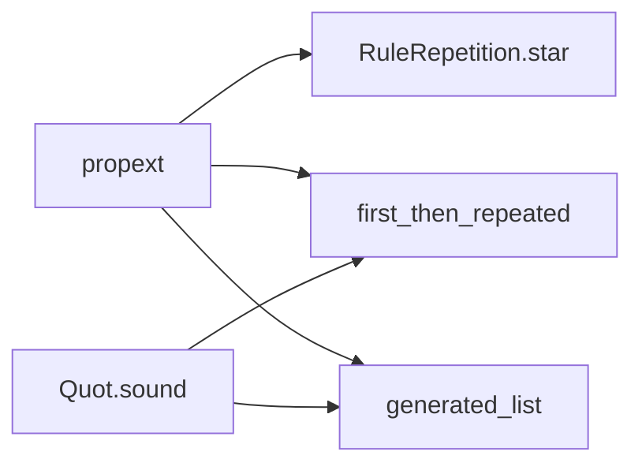
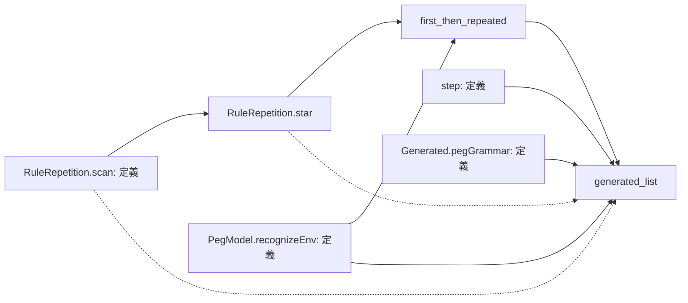

# 箇条書きと番号付きリストの合成の証明と依存関係

この記録は、[root ADR 0351](../adr/0351-prove-parser-formatter-round-trips.md) の認識モデルから、`BulletList` と `OrderedList` の合成を扱う。
基準の main は `fd1936c2a43a2a392541d156c544ac70edb7e88b` である。
対象は `experiments/parser-fmt-proof/grammar/ListCompositionTotal.lean` の名前付き宣言と、必要な `RuleRepetition` の補助宣言である。
新しいファイルの SHA-256 は `b2cd149f77884acd07c19677c8b463535a4dfb6d0215ad1bfc2f76d2d91fd920` である。
Lean 4.7.0（`6fce8f7d5cd1`、aarch64）を使った。

## 命題と前提

実文法の `Golem.hpeg:654` と 657 行は、最初の `ListItem` に、空行を省略できる後続の項目を任意回続ける。
`ListCompositionTotal.generated_list` は、生成された実際のルールの認識結果が、この順序で合成した走査と一致すると示す。
任意の入力、自然数の字下げ量、fuel に対する等式であり、項目の成功や認識結果の一致を前提にしない。

fuel は、認識モデルで再帰や繰り返しに渡す自然数である。
この定理では、入口に `fuel + 3`、最初の項目と繰り返しに `fuel + 1` を渡す。
有限の fuel による打ち切り、通常の不一致、子のエラー、入力が進まない繰り返しのエラーも等式の両辺で保つ。
すべての入力が成功することや、有限の fuel で文法全体を読み切ることは主張しない。

一般形の `first_then_repeated` は、最初の要素を名前と引数を持つルール参照に限る。
任意の `bind` 式には広げていない。
`bind` は後続へ渡す環境を変えうる一方、今回のリストの最初の要素は実文法でも `ListItem` への参照だからである。
後続の本文や結果を手書きの成功値に置き換えてはいない。

## 対象の宣言

| 宣言とソース | 内容 |
| --- | --- |
| `ListCompositionTotal.first_then_repeated`、16 行 | 任意の文法、環境、参照名、参照引数、反復する式、fuel、入力で、参照一つと繰り返しの合成を示す。 |
| `ListCompositionTotal.generated_list`、37 行 | 任意の入力、自然数の字下げ量、fuel と両リスト種別について、実生成ルールに一般形を適用する。 |
| `RuleRepetition.star`、`RuleRepetition.lean:18` | 任意の入力、文法、環境、式、fuel で、モデルの `star` と同じ進行条件とエラーを持つ走査が一致する。 |
| `RuleRepetition.scan`、同 9 行 | 各反復で fuel を減らし、通常の不一致で止まり、エラーと入力の進まない反復を報告する定義。 |
| private `ListCompositionTotal.next`、6 行 | 直前の成功で残りを次へ渡し、不一致とエラーをそのまま返す定義。 |
| `ListCompositionTotal.step`、13 行 | 省略できる `BlankLines` と後続の `ListItem` を順に読む式。 |

名前のない具体例は、このファイルにはない。
名前付きの private 定理も追加していない。
Lean が private な `next` のマッチや証明項の式から生成した補助宣言は、環境の宣言として確認した。
それらを独立した手書きの定理として数えていない。

## 公理と証明の穴

環境の宣言の種類を調べた結果、対象モジュールが宣言した公理はなかった。
各定理に `#print axioms` を実行した。
二つの新しい定理は、次の標準公理に依存する。

| 公理 | 命題と Lean 4.7.0 の宣言元 |
| --- | --- |
| `propext` | 命題同士の同値から等式を得る。`Init/Core.lean:1287`。 |
| `Quot.sound` | 関係で結ばれた要素が商の要素として等しい。`Init/Core.lean:1459`。 |

`RuleRepetition.star` は `propext` だけに依存する。
`RuleRepetition.scan`、`step`、private な `next` は公理に依存しない。
次の図は、補助定理を経由するものを含めた推移的な公理依存である。

対象ソースに `sorry`、`admit`、`sorryAx` の使用はない。
コンパイルの診断と公理依存にも証明の穴はなく、報告する位置はない。
`CollectAxioms` の訪問済み宣言を調べ、二つの新しい定理が `lcProof` に依存しないことも確認した。

## 定理と定義の依存関係

直接依存は、elaboration 後の型と証明項の `getUsedConstants` を合わせ、環境の定理として解決した参照から求めた。
プロジェクト内で、`first_then_repeated` は `RuleRepetition.star` を直接使い、`generated_list` は `first_then_repeated` を直接使う。
次の図の実線は直接参照、破線は表示した定理や定義を経由する間接参照である。
矢印は依存先から利用する定理へ向ける。

標準ライブラリでは、一般形の証明が等式の推移、`congrArg`、`funext`、`ite_congr`、`forall_congr`、`List.foldlM_cons`、`bind_pure` と、Option や命題の簡約補助定理を参照する。
実生成ルールへの適用は、一般形の定理と `Eq.symm` を直接参照する。
この図では標準ライブラリの補助定理群を省略した。
生成文法を持たない手書きの代用ルールだけの証明にはしていない。

## 実装との照合と残件

回帰は、繰り返しを一回以上にする変更、空行を必須にする変更、最初と後続の項目種別の変更を、両ルールへ別々に加える。
八つの文法変異が未証明の一覧へ戻ることと、生成した AST の最初の項目種別を変えると Lean の定理が失敗することを検査する。
実パーサーでは項目一つと三つ、途中の空行、和文、補助平面の文字、タイ語を通す。
繰り返しの下限と空行の省略を変えた四つの native parser の対照も検査する。

これで認識の合成として扱う選択肢は二つ増える。
`ListItem` と `ItemTail` の再帰全体、Haskell のアクションと AST の値、コメントを含む CST、整形と評価の一般的な往復は未完了である。
未証明の選択肢は 21 個であり、[root ADR 0351](../adr/0351-prove-parser-formatter-round-trips.md) の未実装の状態は保つ。
