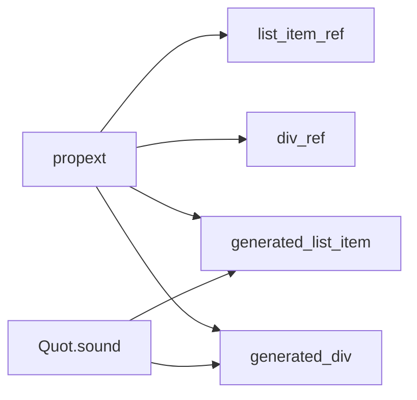
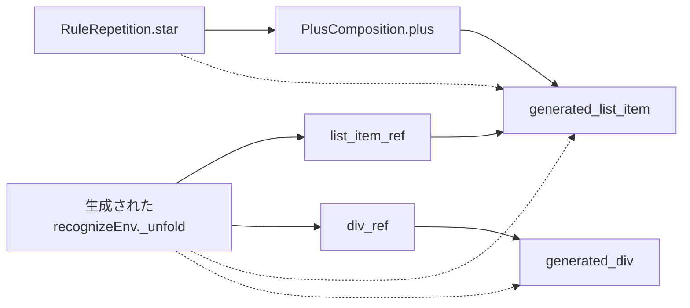

# リスト項目と囲みの認識合成の証明と依存関係

この記録は、[root ADR 0351](../adr/0351-prove-parser-formatter-round-trips.md) の認識モデルから、`ListItem` と `Div` を扱う。
基準は、本体の選択の認識合成を追加したコミット `5a94a691e0841d256796602e240bd09411d390e2` である。
対象は `experiments/parser-fmt-proof/grammar/BlockRemainderTotal.lean` の名前付き宣言と、依存の説明に必要な既存の補助宣言である。
対象ファイルの SHA-256 は `ecb8c950ba2a8454e4d9c42b74233a1b76ec4f0d0772589eea87d0de2dea3491` である。
Lean 4.7.0（`6fce8f7d5cd1`、aarch64）を使った。

## 命題と前提

`generated_list_item` は、`Golem.hpeg:660` のリスト項目を合成する。
任意の入力、自然数の字下げ量、リスト種別の引数、fuel を対象にする。
字下げ、項目の印、必須の空白、本文の一回以上の反復、改行か EOF、項目の末尾のブロックを順に認識する。
本文の反復は `PlusComposition.scanPlus` へ移し、不一致、エラー、fuel の打ち切り、入力が進まない反復のエラーも保つ。

`generated_div` は、同じファイルの 611 行の囲みを合成する。
任意の入力、自然数の字下げ量と fuel を対象にする。
字下げ、開始印、空白、改行か EOF、囲みの本体、閉じ行の式を順に認識する。
本体へ渡す `fenced ind` と、閉じ行の前の空行を含む省略可能な式を、そのまま残す。
この命題は閉じ行の有無に応じた diagnostic の生成を含まない。

どちらも入口へ `fuel + 3`、直接の子へ `fuel + 1` を渡す。
リスト項目の本文の反復は、子を読む fuel を減らす走査へ移す。
子の成功や結果の一致を前提にせず、子の認識結果を順に渡す。
先読みや省略可能な式の内部の扱いも、既存の認識器のままである。

`list_item_ref` と `div_ref` は、文法の検索結果と対象ルールの構造の一致を前提にする。
主定理では、実際の `Generated.pegGrammar` に対して、この一致を `rfl` で証明する。
構造の一致は、認識結果が等しいという結論の仮定ではない。
行番号と action の文字列は `metadata` で実際のルールから得る。
本文の式は固定した構造と照合するため、行番号だけの変更と、認識を変える式の変更を区別できる。

## 宣言の一覧

| 完全修飾名と対象ファイルの行 | 前提と結論の概要 |
| --- | --- |
| `BlockRemainderTotal.list_item_ref`、26 行 | 検索結果が一致すれば、二つの引数を渡した `ListItem` の参照を、その式の列へ移す。 |
| `BlockRemainderTotal.generated_list_item`、33 行 | 実際の項目の構造を、子の認識と本文の反復の走査へ分解する。 |
| `BlockRemainderTotal.div_ref`、85 行 | 検索結果が一致すれば、`Div` の参照を、閉じ行の式を含む構造へ移す。 |
| `BlockRemainderTotal.generated_div`、92 行 | 実際の囲みの六つの部分を、子の結果を保って合成する。 |
| private `_private.BlockRemainderTotal.0.BlockRemainderTotal.next`、6 行 | 成功時の残りだけを後続へ渡し、不一致とエラーを保つ。 |
| private `_private.BlockRemainderTotal.0.BlockRemainderTotal.metadata`、11 行 | 実際のルールから行番号と先頭の選択肢の action を得る。認識する式は取り出さない。 |
| `BlockRemainderTotal.lineEnd`、16 行 | 改行か EOF を調べる、実文法と同じ式。 |
| `BlockRemainderTotal.closing`、18 行 | 閉じる側の空行、字下げ、印、空白と行末を含む、省略可能な式。 |
| private `_private.BlockRemainderTotal.0.BlockRemainderTotal.list_itemRule`、22 行 | 検索結果に照合する `ListItem` の構造。 |
| private `_private.BlockRemainderTotal.0.BlockRemainderTotal.divRule`、81 行 | 検索結果に照合する `Div` の構造。 |

必要な既存の補助定理は `PlusComposition.plus` と、その依存先の `RuleRepetition.star` である。
走査には `PlusComposition.scanPlus` と `RuleRepetition.scan` を使う。
これらも、子の成功を前提にせずに結果と進行の検査を扱う。

## 公理と証明の穴

環境の宣言の種類を調べた結果、対象モジュールが宣言した公理はなかった。
四つの定理は、型と elaboration 後の証明項を調べ、各定理の `#print axioms` で確かめた。

| 定理 | 推移的に使う標準公理 |
| --- | --- |
| `list_item_ref`、`div_ref` | `propext` |
| `generated_list_item`、`generated_div` | `propext`、`Quot.sound` |
| 既存の `PlusComposition.plus`、`RuleRepetition.star` | `propext` |

`propext` は、命題の同値から等式を得る公理で、Lean 4.7.0 の `Init/Core.lean:1287` にある。
`Quot.sound` は、関係で結ばれた要素が商で等しいという公理で、同じファイルの 1459 行にある。
対象内の六つの補助定義と、既存の二つの走査の定義は、公理に依存しない。
次の図は、補助宣言を経由するものも含めた推移的な公理依存である。

参照を展開する二つの補助定理では、Lean が `_private.BlockRemainderTotal.0.PegModel.recognizeEnv._unfold` と、match の補助宣言を生成する。
この生成された展開の定理は `propext` に依存する。
型と証明項の定数参照を調べ、公理依存は `CollectAxioms.collect` を環境の完全名へ適用して確かめた。
これは `#print axioms` が使う処理と同じである。

対象ソースに `sorry`、`admit`、`sorryAx` の使用はない。
コンパイルの診断と公理依存にも証明の穴はなく、報告する位置はない。
`CollectAxioms` の訪問済み宣言を調べ、四つの定理に `lcProof` への依存がないことも確かめた。

## 定理間の依存関係

直接依存は、elaboration 後の型と証明項の `getUsedConstants` を合わせ、環境の定理として解決した参照から求めた。
実線は直接参照、破線は図に示す補助定理を経由する間接参照であり、矢印は依存先から利用する定理へ向ける。

この図では、標準ライブラリの等式や命題の簡約、`congrArg`、`funext`、`Eq.trans`、`forall_congr` などの補助定理と、定理の型に現れる認識器や文法の定義を省略した。
主定理で実際の生成文法との構造の一致を証明するため、手書きの代用ルールだけの証明にはしていない。

## 実装との照合と残件

回帰では、本文の反復の下限、必須の空白、項目種別、字下げ引数、改行か EOF、囲みの印と閉じる側の省略を変える十二の文法変異を、未証明として検出する。
生成された PEG の AST を変えた八つの対照でも、同じ Lean モジュールの証明が失敗する。
行番号と、`()` を返す action の空白だけを変えた二つの AST の対照は、証明が通る。
これらは認識する式の変更とは区別する。

通常の実パーサーの照合には、箇条書きの `-` と番号付きリストの `+`、必須の空白、行末の改行の有無、項目の後続の段落と見出し、囲みの空と複数の本体、入れ子、Unicode の文字を含む十六の原稿を使う。
入力の末尾までを含む `File` の CST と、各ブロックや閉じ印の件数を照合する。
本文が空の二つのリスト項目は、拒否することも確かめる。

閉じる側の印を持たない囲みは、別の一例で認識だけを確かめる。
既存の `modules/golem-parser/src/Golem/Parser.hs:67` は、この形を G01030 とするため、正常な CLI 原稿の照合には数えない。
この診断を生成する処理は変更しない。

native parser の八つの変異のうち、本文をゼロ回からにするものは空の項目を受け付け、空白を省略可能にするものは `-a` をリストとして受け付ける。
項目種別を変えたものと、改行を必須にしたものは、それぞれ、番号付きの項目と改行なしの項目を拒否する。
囲みを変える残りの四つは入力を受け付けるが、囲みや閉じ印の CST が変わる。
単なる受理の有無だけでなく、この違いを照合する。

この増分で認識の合成を証明した選択肢は二つ増え、未証明の一覧は 11 個から 9 個になる。
子ルールを含む再帰全体、コマンドの返す値、Haskell の action が作る AST、復旧、コメントの保存、整形と評価の一般的な往復は未完了である。
[root ADR 0351](../adr/0351-prove-parser-formatter-round-trips.md) の未実装のステータスを保つ。
