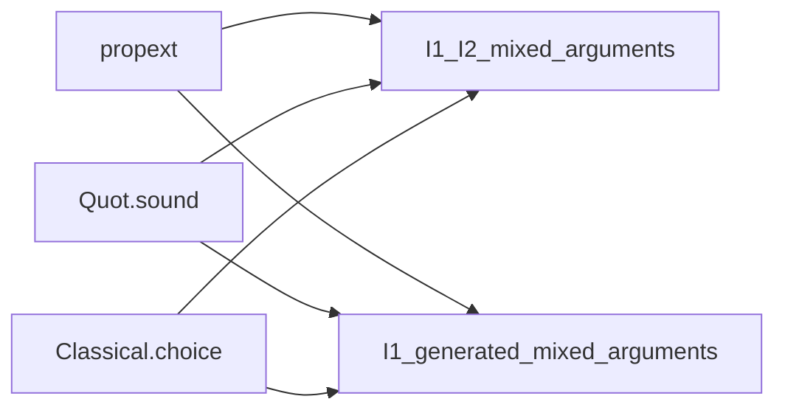
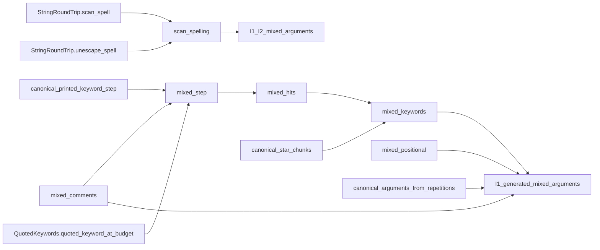

# 語と引用値を混ぜたキーワード引数の一般証明

この増分は [root ADR 0351](../adr/0351-prove-parser-formatter-round-trips.md) の引数列のモデルを、語の値と引用値を任意に混ぜた列へ広げる。
基準は `af7fd6a1e02ee66513c236b49b6fc663104159a5` である。
対象は `experiments/parser-fmt-proof/grammar/` の `MixedKeywords.lean` と `MixedCanonical.lean` の全文で、Lean 4.7.0 を使う。
名前と値の種類、復号した文字を扱い、Golem の AST 全体と fmt の一般的な対応を完了したものではない。

## 領域と主定理

名前には既存の Word の非空と禁止文字の条件を使い、先頭の `%%` を除く。
値の Input は、Word と引用値の Part の列の二種類である。
Word の値には `%%` を含まない条件を加え、引用値には既存の Part の領域をそのまま使う。
引用値の Part は、通常の文字かエスケープした文字である。
通常の文字は引用符、バックスラッシュと LF 以外で、エスケープした文字は任意の Char である。
同じ名前や同じ値の繰り返しを許し、二種類の値の個数と並び順に上限を置かない。
これは構文の順序を保つ命題であり、評価時の重複引数の検査をモデルにするものではない。

`MixedKeywords.I1_I2_mixed_arguments` は、この列を印字してモデルで読むと、名前、Word または StringLit の種類と値が元の順で戻ることを示す。
モデルの fuel は残りの引数の個数以上とする。
語と引用値で同じ綴りの `0.10` を使っても、戻る値の種類は区別する。

`MixedKeywords.I1_generated_mixed_arguments` は、実際の Generated.pegGrammar の Arguments が同じ列を読み、改行と任意の接尾辞を残すことを示す。
input は、改行で終わる引数列の印字に任意の接尾辞をつないだものである。
fuel を `input.length + weight args + extra + args.length + 83` とする。
extra は任意の自然数、weight は引用値を構成する Part の総数であり、Word の値の重みはゼロである。
この PEG の fuel は認識の再帰を制限する値であり、値のモデルの引数個数の制限とは区別する。
入力の長さ、列の長さや引用値の長さに固定の上限を置かない。

Word の分岐では既存の `canonical_printed_keyword_step` を使い、引用値の分岐では `QuotedKeywords.quoted_keyword_at_budget` を使う。
その後の省略可能なコメント、位置引数として取らないこと、反復と引数順の検査を実際の認識器で示す。
条件付きの中間補題が取る子の結果は公開の入口で導く。
公開の主定理に、子が成功することや、示したい結果の一致を仮定しない。

Part の領域は PEG の断片の領域である。
CR などの入力全体の検査が拒む文字まで、正しい Golem 原稿だとは主張しない。
式、展開、位置引数、引数間のコメントを自由に混ぜる一般形は、この増分に含めない。

## 公理と証明の穴

二ファイルで名前を付けた十二の定理と、Lean が生成した補助定理を合わせた七十三の定理について、型と証明項を環境から調べた。
公理依存は各定理の `#print axioms` で調べた。
主定理二つの依存は propext、Quot.sound と Classical.choice であり、既存の Word と引用文字列の一般補題を通る。
新しいユーザー定義の公理はない。

propext は命題の同値から等式を得る公理、Quot.sound は関係で結ばれた要素が商で等しいという公理、Classical.choice は存在する型から要素を選ぶ公理である。
Lean 4.7.0 の宣言元は、それぞれ Init/Core.lean:1287、Init/Core.lean:1459、Init/Prelude.lean:730 である。

コンパイラが chunks の実行用に作る `List.mapTR.loop._at.MixedKeywords.chunks._spec_1` は unsafe axiom である。
これを `#print` で調べ、chunks、abstract、parseArgs、printArgs、scanValue、weight の論理上の定義は公理に依存しないことも確かめた。
主定理の公理依存に、この実行用の特殊化は現れない。
ソースに sorry、admit と sorryAx はなく、主定理や補助定理の依存にも証明の穴はない。
取得できなかった定理や証明項はない。

## 定理間の依存

次は、名前を付けた定理の主要な参照である。
実線は、調べた型と証明項に現れる直接参照を表す。
経路をたどると、補助定理を通る間接参照が分かる。
標準ライブラリの簡約と等式の参照は省く。

## 実装との照合と残件

先に、語と引用値を持つ、構文として有効な二引数の入力がモデルの入口で値を返さないことを、回帰で確かめた。
混在を読む実装へ置き換えた後、同じ回帰が名前、種類と値で一致する。
語の種類を変える、引用値の種類を変える、引用値を復号しない、名前を捨てる、残りの列を捨てるという五つの変異は、一般の値の往復の定理を失敗させる。

共通の五つの原稿の十一の引数出現で、モデルの値と、実際の Generated.Arguments の読み残しを照合する。
原稿には空の列、両種類の隣接、同じ名前、空の引用値、Unicode、先頭の `%x`、引用符と改行のエスケープを含める。
同じ `0.10` を Word と StringLit にした例も含める。
実際の Golem.Parser.parseAst を使う Haskell のプログラムで、構成子から名前、種類と値を取り出す。
通常の golem fmt の前後でこれらが一致し、二度目の整形でバイト列が変わらないことを照合した。
照合用の `@inspect` は構文だけの例であり、命令の宣言の検査を通った原稿には数えない。

この有限の実装比較は、Haskell が返す AST の一般的な値の対応の証明とは区別する。
語と引用値の組以外の AST、コメントの保存、復旧、診断の位置と順、整形と評価の一般的な往復は残る。
既採択の import の整形と冗長なエスケープの除去について、一般の AST の比較を新しく定義しない。
この二つの境界は、[引用値の証明の記録](0351-quoted-keyword-proof-dependencies.md) にある。
[root ADR 0351](../adr/0351-prove-parser-formatter-round-trips.md) の未実装の状態を保つ。

## 宣言の位置と概要

次の宣言名の接頭辞はすべて MixedKeywords である。
not_empty は非公開の補題を表す。

| ファイルと行 | 宣言 | 前提と結論 |
| --- | --- | --- |
| MixedKeywords.lean:49 | not_empty | Word の非空の条件から isEmpty が false になる |
| MixedKeywords.lean:54 | printed_tail | 任意の列の印字が、Word を区切る空白か改行で始まる |
| MixedKeywords.lean:60 | scan_spelling | 安全な値と禁止文字の区切りから、印字した一値の種類と文字が戻る |
| MixedKeywords.lean:90 | I1_I2_mixed_arguments | 安全な名前と値、個数以上の fuel から、任意長の列の名前、種類と値が戻る |
| MixedCanonical.lean:18 | chunks_length | 塊の列と引数の列の長さが同じになる |
| MixedCanonical.lean:19 | chunks_join | 塊の連結と改行が印字した列になる |
| MixedCanonical.lean:28 | mixed_comments | 安全な名前と 80 以上の fuel から、省略可能なコメントが入力を残す |
| MixedCanonical.lean:43 | mixed_step | 安全な名前と値と明記した fuel の下限から、一つの反復が一引数だけ読む |
| MixedCanonical.lean:87 | mixed_hits | 安全な名前と値、入力長と Part の総数以上の余裕から、各塊の反復条件を示す |
| MixedCanonical.lean:110 | mixed_keywords | 同じ条件から、反復が列を読み、改行と接尾辞を残す |
| MixedCanonical.lean:119 | mixed_positional | 安全な名前から、位置引数の反復が入力を残す |
| MixedCanonical.lean:162 | I1_generated_mixed_arguments | 安全な名前と値から、明記した fuel で Arguments が列を読み切る |

## 対象ソースのハッシュ

次の SHA-256 は対象の全文である。

| ファイル | SHA-256 |
| --- | --- |
| `MixedKeywords.lean` | `09d3523a2bff2634b2962537d5aef091bd3096c566189252b97f1e4b5f78367e` |
| `MixedCanonical.lean` | `328bf6f4c0660b35e6773b7ac73dc39c6716535bbba5ba908bbb70b56a642c1b` |
