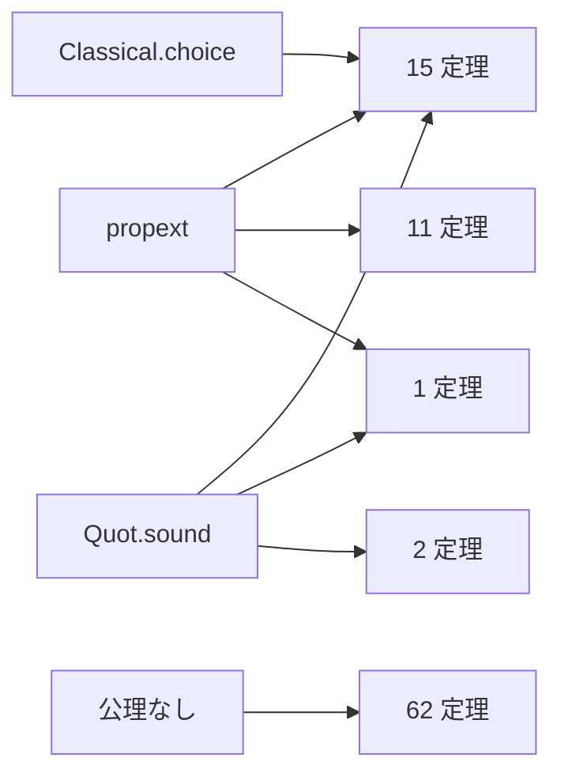
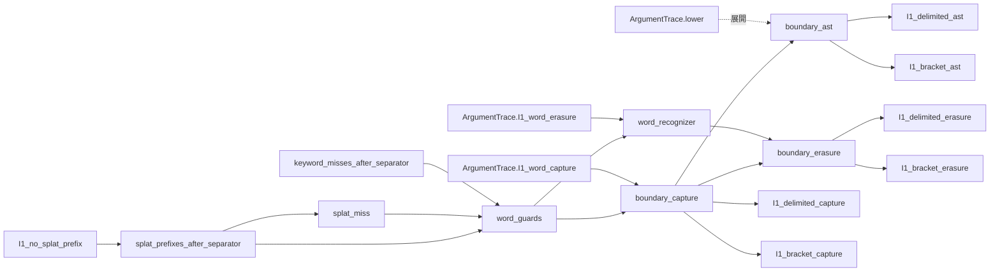

# root [ADR 0351](../adr/0351-prove-parser-formatter-round-trips.md): 左角括弧で区切った語の位置引数

## 対象と範囲

この増分は、[区切りを持つ語の位置引数](0351-posarg-delimited-proof-dependencies.md) で除外していた左角括弧 `[` の一部を対象にする。
基準は `deccf1262aaf410ae71868c6cf94f4c71fe40a42` と、この変更の証明ソースである。
空でなく、各文字が Word の許可文字であり、先頭が `%%` でない語を扱う。
その語が `*` または `**` だけの場合を除けば、直後の `[` と任意の残りの入力に対し、捕捉、抽象 AST と認識結果の一致を導く。
[root ADR 0351](../adr/0351-prove-parser-formatter-round-trips.md) 全体は未完了のままである。

`*` と `**` の除外は、語全体との等値である。
`***` や `*cinder` を除くという意味ではない。
Word の各文字が許されるという条件から、語の中には `[` がない。
これと、語の長さが一文字または二文字の場合の除外から、先頭が `*[` と `**[` のどちらでもないことを示す。
`PosArgBracketPrefix.I1_no_splat_prefix` は、この語彙条件だけを前提にする。
パーサーの成功や先読みの結果を、未証明の前提として受け取らない。

`PosArgDelimited` の内部では、従来の区切りと今回の左角括弧を共通の証明へ渡す。
区切りが `[` の場合にだけ、語が `*` と `**` のどちらでもないことを要求する。
従来の公開三定理の型を保ち、新しい左角括弧の三定理をこの共通証明から導く。
親の fuel は入力長に `14 + extra` を足し、Argument を読む子の fuel は同じ入力長に `12 + extra` を足す。
子の成功や捕捉結果の一致を、公開定理の前提には置かない。

捕捉結果は Word トークンを一つ持つ Argument node で、残りの入力は `[` から始まる元の接尾辞そのものである。
抽象 AST は既存の `ArgumentTrace.Argument` の Positional と Word である。
本体の Haskell AST、CST の位置、引数列全体、スプラット、整形と評価の一般的な対応とは区別する。
内部の `%%` を持つ語を実パーサーの選択した入口で読むことも、通常原稿が診断なしで通るという主張ではない。
通常原稿と整形の G01102 の対照は、先行する [Word の記録](0351-posarg-word-proof-dependencies.md) に残す。

## 定理と公理

対象は `PosArgBracketPrefix` と、変更後の `PosArgDelimited` である。
Lean 4.7.0 の新しい作業ディレクトリへソースをコピーし、依存からコンパイルした。
公開 7 定理、手書き private 14 定理、生成 70 定理の計 91 定理について、型、証明項、直接参照と `#print axioms` を取得した。
取得できなかった証明項はない。
前の checkpoint の `PosArgDelimitedMetadata` の二定理は、この一覧へ重ねて数えない。
その独立した source 検査は既存のハーネスに保つ。

公理の略号は `P` が `propext`、`C` が `Classical.choice`、`Q` が `Quot.sound` である。
意味は [先行する区切りの記録](0351-posarg-delimited-proof-dependencies.md) に記す。
15 件が PQC、11 件が P、1 件が PQ、2 件が Q に依存し、62 件は公理に依存しない。
新しい公理宣言、opaque 宣言、手書きの定義はいずれも 0 件だった。
コンパイラーが生成した 91 定義は safe 23 件、unsafe 68 件、partial 0 件だった。
全 91 定理の型と証明項からたどった 2,126 定数には、unsafe 定義、partial 定義と標準の三公理以外の公理の参照はなかった。

### 公開定理

`PosArgBracketPrefix.I1_no_splat_prefix` は、前述の語彙条件から二つのスプラットの接頭辞が一致しないことを導く。
`PosArgDelimited.I1_delimited_capture`、`I1_delimited_ast` と `I1_delimited_erasure` の前提と結論は、先行する版から変えていない。
`I1_bracket_capture`、`I1_bracket_ast` と `I1_bracket_erasure` は同じ結果を左角括弧に対して述べる。
残りの入力は、任意の接尾辞の先頭へ左角括弧を付けた元の列である。

| 定理 | 位置 | 公理 |
| --- | --- | --- |
| `PosArgBracketPrefix.I1_no_splat_prefix` | [15 行](../../experiments/parser-fmt-proof/grammar/PosArgBracketPrefix.lean#L15) | P |
| `PosArgDelimited.I1_delimited_capture` | [258 行](../../experiments/parser-fmt-proof/grammar/PosArgDelimited.lean#L258) | PCQ |
| `PosArgDelimited.I1_delimited_ast` | [267 行](../../experiments/parser-fmt-proof/grammar/PosArgDelimited.lean#L267) | PCQ |
| `PosArgDelimited.I1_delimited_erasure` | [276 行](../../experiments/parser-fmt-proof/grammar/PosArgDelimited.lean#L276) | PCQ |
| `PosArgDelimited.I1_bracket_capture` | [285 行](../../experiments/parser-fmt-proof/grammar/PosArgDelimited.lean#L285) | PCQ |
| `PosArgDelimited.I1_bracket_ast` | [294 行](../../experiments/parser-fmt-proof/grammar/PosArgDelimited.lean#L294) | PCQ |
| `PosArgDelimited.I1_bracket_erasure` | [303 行](../../experiments/parser-fmt-proof/grammar/PosArgDelimited.lean#L303) | PCQ |

### private 定理

private 名の接頭辞は、モジュールごとに `_private.PosArgBracketPrefix.0.PosArgBracketPrefix.` と `_private.PosArgDelimited.0.PosArgDelimited.` である。
以下の表では、モジュール名と末尾の名前を示す。
`boundary_capture`、`boundary_ast` と `boundary_erasure` は、区切りが左角括弧のときだけ語全体の二つの除外を要求する共通証明である。
ほかの private 定理は、文字の一致の拒否、コメントと keyword とスプラットのガード、同じ fuel の認識結果を接続する。

| モジュールと定理 | 位置 | 公理 |
| --- | --- | --- |
| `PosArgBracketPrefix.bracket_miss` | [5 行](../../experiments/parser-fmt-proof/grammar/PosArgBracketPrefix.lean#L5) | なし |
| `PosArgDelimited.blocked_excludes` | [8 行](../../experiments/parser-fmt-proof/grammar/PosArgDelimited.lean#L8) | なし |
| `PosArgDelimited.safe_after_separator` | [18 行](../../experiments/parser-fmt-proof/grammar/PosArgDelimited.lean#L18) | PCQ |
| `PosArgDelimited.bracket_miss` | [38 行](../../experiments/parser-fmt-proof/grammar/PosArgDelimited.lean#L38) | なし |
| `PosArgDelimited.splat_prefixes_after_separator` | [48 行](../../experiments/parser-fmt-proof/grammar/PosArgDelimited.lean#L48) | P |
| `PosArgDelimited.keyword_misses_after_separator` | [74 行](../../experiments/parser-fmt-proof/grammar/PosArgDelimited.lean#L74) | PCQ |
| `PosArgDelimited.literal_miss` | [110 行](../../experiments/parser-fmt-proof/grammar/PosArgDelimited.lean#L110) | P |
| `PosArgDelimited.negative_miss` | [115 行](../../experiments/parser-fmt-proof/grammar/PosArgDelimited.lean#L115) | P |
| `PosArgDelimited.splat_miss` | [124 行](../../experiments/parser-fmt-proof/grammar/PosArgDelimited.lean#L124) | PQ |
| `PosArgDelimited.word_guards` | [136 行](../../experiments/parser-fmt-proof/grammar/PosArgDelimited.lean#L136) | PCQ |
| `PosArgDelimited.boundary_capture` | [170 行](../../experiments/parser-fmt-proof/grammar/PosArgDelimited.lean#L170) | PCQ |
| `PosArgDelimited.boundary_ast` | [208 行](../../experiments/parser-fmt-proof/grammar/PosArgDelimited.lean#L208) | PCQ |
| `PosArgDelimited.word_recognizer` | [218 行](../../experiments/parser-fmt-proof/grammar/PosArgDelimited.lean#L218) | PCQ |
| `PosArgDelimited.boundary_erasure` | [248 行](../../experiments/parser-fmt-proof/grammar/PosArgDelimited.lean#L248) | PCQ |

### 生成定理

次の 70 定理には、宣言位置の情報がない。
名前の `D:` は `_private.PosArgDelimited.0.`、`B:` は `_private.PosArgBracketPrefix.0.` の略である。
これらも公理と論理依存の調査から除外しない。

| 定理 | 公理 |
| --- | --- |
| `B:List.append._eq_1` | なし |
| `B:List.append._eq_2` | なし |
| `B:List.isPrefixOf._eq_1` | なし |
| `B:List.isPrefixOf._eq_2` | Q |
| `B:List.isPrefixOf._eq_3` | なし |
| `B:List.isPrefixOf.match_1.eq_1` | なし |
| `B:List.isPrefixOf.match_1.eq_2` | なし |
| `B:List.isPrefixOf.match_1.eq_3` | なし |
| `B:List.reverseAux.match_1.eq_1` | なし |
| `B:List.reverseAux.match_1.eq_2` | なし |
| `D:Except.map.match_1.eq_1` | なし |
| `D:Except.map.match_1.eq_2` | なし |
| `D:List.append._eq_1` | なし |
| `D:List.append._eq_2` | なし |
| `D:List.foldlM._eq_1` | なし |
| `D:List.foldlM._eq_2` | なし |
| `D:List.foldlM.match_1.eq_1` | なし |
| `D:List.foldlM.match_1.eq_2` | なし |
| `D:List.isPrefixOf._eq_1` | なし |
| `D:List.isPrefixOf._eq_2` | Q |
| `D:List.isPrefixOf._eq_3` | なし |
| `D:List.isPrefixOf.match_1.eq_1` | なし |
| `D:List.isPrefixOf.match_1.eq_2` | なし |
| `D:List.isPrefixOf.match_1.eq_3` | なし |
| `D:List.reverseAux.match_1.eq_1` | なし |
| `D:List.reverseAux.match_1.eq_2` | なし |
| `D:PegModel.BoolPayload.supported.match_3.eq_1` | なし |
| `D:PegModel.BoolPayload.supported.match_3.eq_2` | なし |
| `D:PegModel.foldChoice.match_1.eq_1` | なし |
| `D:PegModel.foldChoice.match_1.eq_2` | なし |
| `D:PegModel.interpreterStep.match_1.eq_1` | なし |
| `D:PegModel.interpreterStep.match_1.eq_2` | なし |
| `D:PegModel.interpreterStep.match_2.eq_1` | なし |
| `D:PegModel.interpreterStep.match_2.eq_2` | なし |
| `D:PegModel.interpreterStep.match_2.eq_3` | なし |
| `D:PegModel.interpreterStep.match_3.eq_1` | なし |
| `D:PegModel.interpreterStep.match_3.eq_2` | なし |
| `D:PegModel.interpreterStep.match_3.eq_3` | なし |
| `D:PegModel.interpreterStep.match_4.eq_1` | なし |
| `D:PegModel.interpreterStep.match_4.eq_2` | なし |
| `D:PegModel.interpreterStep.match_5.eq_1` | なし |
| `D:PegModel.interpreterStep.match_5.eq_2` | なし |
| `D:PegModel.interpreterStep.match_6.eq_1` | なし |
| `D:PegModel.interpreterStep.match_6.eq_2` | なし |
| `D:PegModel.interpreterStep.match_6.eq_3` | PCQ |
| `D:PegModel.recognizeEnv._eq_1` | P |
| `D:PegModel.recognizeEnv._eq_2` | P |
| `D:PegModel.recognizeEnv._unfold` | P |
| `D:PegModel.recognizeEnv.match_1.eq_1` | なし |
| `D:PegModel.recognizeEnv.match_1.eq_2` | なし |
| `D:PegModel.runSequence.match_1.eq_1` | なし |
| `D:PegModel.runSequence.match_1.eq_2` | なし |
| `D:PegModel.runSequence.match_1.eq_3` | なし |
| `D:PegModel.runSequence.match_2.eq_1` | なし |
| `D:PegModel.runSequence.match_2.eq_2` | なし |
| `D:PegModel.runSequence.match_3.eq_1` | なし |
| `D:PegModel.runSequence.match_3.eq_2` | なし |
| `D:PegModel.runSequence.match_3.eq_3` | なし |
| `D:PegModel.runSequence.match_4.eq_1` | なし |
| `D:PegModel.runSequence.match_4.eq_2` | なし |
| `D:PosArgTrace.choices._eq_1` | P |
| `D:PosArgTrace.choices._eq_2` | P |
| `D:PosArgTrace.choices.match_2.eq_1` | なし |
| `D:PosArgTrace.choices.match_2.eq_2` | なし |
| `D:PosArgTrace.sequence._eq_1` | P |
| `D:PosArgTrace.sequence._eq_2` | P |
| `D:PosArgTrace.sequence.match_2.eq_1` | なし |
| `D:PosArgTrace.sequence.match_2.eq_2` | なし |
| `D:WordRoundTrip.startsComment.match_1.eq_1` | なし |
| `D:WordRoundTrip.startsComment.match_1.eq_2` | PCQ |



次の定理間の図は、型と elaboration 後の証明項で確認した直接参照のうち、接続に必要なものを示す。
標準の等式操作と生成定理を省略し、破線は定義の展開を表す。



## 境界と本体との比較

最初に新しい公開三定理の一般適用を追加し、未定義の定理名で失敗することを確認した。
これは追加前の未実装を確かめたもので、偽の命題を Lean が拒否したとの意味ではない。
その後、公開三定理と従来の三定理が標準公理だけで通り、左角括弧についての一般適用三件も通った。
`*`、`**` と `***` の接頭辞を区別する閉じた四件も置く。

共有する入力は五種類の語と三種類の接尾辞の十五例である。
原綴り、捕捉した node、復号した抽象 AST と残りの入力を比較する。
`*[7]` はスプラットの未対応の捕捉、`**[7]` は位置引数の拒否という二つの範囲の対照に残す。
これらを成功例の入力から黙って削除して一般性を主張しない。

本体との比較では、元の `Golem.hpeg` の PosArg の定義を変えず、残りの入力を捕まえる wrapper だけを付ける。
この選択した入口から読む有限の比較を、通常原稿全体の受理と混同しない。
三つの意味の変異は、元の PosArgTrace の実装を変更し、その定義をコンパイルした後、共通の一般証明と新しい十五例の実行を拒否した。
実行時の対照は、古い PosArgDelimited の `.olean` を使わず、変更した PosArgTrace を直接読む。
実文法のスプラットの接頭辞を `*[` から `*` へ変える対照では、対象内の `***[7]` が語として読めなくなり、1 行 2 列の構文の診断を返した。
プロセスの起動や import の失敗を、変異の拒否としては数えない。
従来の区切り四十八例、三つの意味の変異と二つの文法の変異、一つの行番号だけの対照も、変更後の共通証明とともに終了コード 0 を確認した。

## 全体のローカル検証

```sh
export PATH=/Users/tett23/.ghcup/ghc/9.10.3/bin:$PATH
export GHC=/Users/tett23/.ghcup/ghc/9.10.3/bin/ghc
export CABAL_PLAN=/private/tmp/golem-0479-main-integration-dist/cache/plan.json
export PEG_HS=/Users/tett23/.cabal/store/ghc-9.10.3-fe9c/pg-cl-0.1.0.0-d6f17192/bin/peg-hs
export LEAN=/Users/tett23/.elan/toolchains/leanprover--lean4---v4.7.0/bin/lean
export GOLEM=/private/tmp/golem-0479-0483-cli-artifact/golem
sh experiments/parser-fmt-proof/check-local.sh
```

全体ハーネスは終了コード 0 となった。
source、AST とモデルの規則は各 151 件で、未対応の選択肢は 0 件だった。
正の証明モジュール 82 件、負の変異 363 件、行番号だけの対照 16 件、本体パーサーの 167 例を確認した。
runner 自体の 4 試験、八ファイルの本体観測の 82 試験、既存の引数の 60 試験も、失敗と skip がともに 0 件だった。
この実行の前後で、次節に記した八つの入力の SHA-256 が一致した。
先行する Word と区切りの全体検証は checkpoint `deccf1262aaf410ae71868c6cf94f4c71fe40a42` の記録である。
この変更後の値へ読み替えない。
新しい証明専用 CI、GHC の CI 依存、予算の変更は加えない。
八ファイルの明示的なローカルの本体観測を、既存 CI の保証へ含めない。
実装との照合には、製品ソースが同じ main `365b43c4ab5e01c863916504f417b0e596a0b3c6` 用の GHC 9.10.3 の plan と package DB を読み取り専用で使う。
peg-hs の pin は `4b4adc7046a14d18c8eec711f18dbcaa9b059cca` である。
標準の Cabal 環境を新しく構築したという検証ではない。


## ソースと依存調査の再現

次の SHA-256 は、この増分の検証入力である。

| ファイル | SHA-256 |
| --- | --- |
| `PosArgBracketPrefix.lean` | `e9f761e31f2f2621a9bd0560165c1612340f01936b3c2d2c9c84fa00f329524a` |
| `PosArgDelimited.lean` | `192ec4ae3e9ba7ba5772aac0134c67aabf5c813b199407f7dfbb95a57007f374` |
| `PosArgBracketBoundary.lean` | `a5fbd5a1ec543c599cabd63170f67318a7656d1a880dd7830a374a5be13f2ea8` |
| `bracket-cases.mjs` | `2ec20b4ebe1675c9019959ae6e00fd6ea74778e4f7b5462f3605c56ff673399a` |
| `verify-bracket.mjs` | `857ebfba4e9cbeb3ffd0e1b20e648ac6e52430b8335a21ef9cd851768eca7015` |
| `verify-delimited.mjs` | `8d3b80d6cdee22c886b6d39efb2c998730b12f4a2b3ef64067ceba879710730a` |
| `test.mjs` | `6c9db56e978be5ae86f029a5f0a82e5016f5085035d3d85d59a6dea19918a03b` |
| `Golem.hpeg` | `82c0987f5952d519c27cb137c5fe31c77b5c3d7db6c36cdae902a4b9cec7eefb` |

次の手順は、古いモデルの `.olean` を使わず、依存から新しくコンパイルする。
全 91 定理と 91 定義、論理依存の 2,126 定数を同じ環境で取得し、終了コード 0 を確認した。
上記と同じ GHC 9.10.3 の PATH、PEG_HS と Cabal plan、Lean 4.7.0 の LEAN を指定して実行する。

```sh
(
set -eu
task_lean=${LEAN:?set the Lean 4.7.0 executable}
: "${PEG_HS:?set the project-pinned peg-hs executable}"
: "${CABAL_PLAN:?set the project Cabal plan}"
test "$(ghc --numeric-version)" = 9.10.3
case "$("$task_lean" --version)" in
  *"version 4.7.0,"*) ;;
  *) echo "Lean 4.7.0 is required" >&2; exit 1 ;;
esac
task_proof=$(mktemp -d /private/tmp/golem-bracket-doc-dependencies-XXXXXX)
trap 'rm -rf "$task_proof"' EXIT HUP INT TERM
node experiments/parser-fmt-proof/grammar/generate.mjs --fragment \
  modules/golem-parser/grammar/Golem.hpeg "$task_proof/Generated.lean"
for task_module in PegModel PegModelTest WordRoundTrip StringRoundTrip ArgumentsRoundTrip \
  QuotedArgumentRules QuotedKeywords PrintedArguments QuotedCanonical MixedKeywords \
  KeywordLowering CstWrapperMetadata CstWrapper TokenLowering KeywordTrace ArgumentMetadata ArgumentTrace PosArgMetadata PosArgTrace PosArgQuoted PosArgWord PosArgBracketPrefix PosArgDelimitedMetadata PosArgDelimited; do
  cp "experiments/parser-fmt-proof/grammar/$task_module.lean" "$task_proof/"
done
cd "$task_proof"
export LEAN_PATH=$task_proof
for task_module in PegModel Generated PegModelTest WordRoundTrip StringRoundTrip ArgumentsRoundTrip \
  QuotedArgumentRules QuotedKeywords PrintedArguments QuotedCanonical MixedKeywords \
  KeywordLowering CstWrapperMetadata CstWrapper TokenLowering KeywordTrace ArgumentMetadata ArgumentTrace PosArgMetadata PosArgTrace PosArgQuoted PosArgWord PosArgBracketPrefix PosArgDelimitedMetadata PosArgDelimited; do
  "$task_lean" -o "$task_module.olean" "$task_module.lean" > "$task_module.log" || { cat "$task_module.log"; exit 1; }
done
cat > Inspect.lean <<'LEAN'
import Lean
import PosArgDelimited
open Lean Elab Command
run_cmd do
  let env ← getEnv
  for (name, info) in env.constants.toList do
    let some index := env.getModuleIdxFor? name | continue
    unless [`PosArgBracketPrefix, `PosArgDelimited].contains env.allImportedModuleNames[index.toNat]! do continue
    match info with
    | .axiomInfo ax =>
      logInfo m!"AXIOM {name} {ax.isUnsafe}"
      elabCommand (← `(#print $(mkIdent name)))
    | .defnInfo definition => logInfo m!"DEF {name} {repr definition.safety}"
    | .opaqueInfo _ => logInfo m!"OPAQUE {name}"
    | .thmInfo theoremInfo =>
      logInfo m!"TYPE {name} {theoremInfo.type}"
      let names := info.type.getUsedConstants ++ theoremInfo.value.getUsedConstants
      logInfo m!"THEOREM {name} {(toJson (names.toList.map Name.toString)).compress}"
      let direct := names.toList.filter (fun n => match env.find? n with | some (.thmInfo _) => true | _ => false)
      logInfo m!"DIRECT {name} {(toJson (direct.map Name.toString)).compress}"
      elabCommand (← `(#print axioms $(mkIdent name)))
    | _ => pure ()
LEAN
"$task_lean" Inspect.lean
cat > LogicalClosure.lean <<'LEAN_CLOSURE'
import Lean
import PosArgDelimited
open Lean Elab Command
run_cmd do
  let env ← getEnv
  let targets := env.constants.toList.filterMap fun (name, info) => do
    let index ← env.getModuleIdxFor? name
    if !([`PosArgBracketPrefix, `PosArgDelimited].contains env.allImportedModuleNames[index.toNat]!) then none else
      match info with
      | .thmInfo _ => some name
      | _ => none
  let mut pending := targets
  let mut visited : NameSet := {}
  let mut unsafeCount := 0
  let mut partialCount := 0
  let mut axioms : List Name := []
  while !pending.isEmpty do
    let name := pending.head!
    pending := pending.tail!
    if visited.contains name then continue
    visited := visited.insert name
    let some info := env.find? name | continue
    let mut refs := info.type.getUsedConstants.toList
    match info with
    | .thmInfo value => refs := refs ++ value.value.getUsedConstants.toList
    | .defnInfo value =>
      refs := refs ++ value.value.getUsedConstants.toList
      match value.safety with
      | .unsafe =>
        unsafeCount := unsafeCount + 1
        logInfo m!"LOGICAL_UNSAFE {name}"
      | .partial =>
        partialCount := partialCount + 1
        logInfo m!"LOGICAL_PARTIAL {name}"
      | .safe => pure ()
    | .opaqueInfo value => refs := refs ++ value.value.getUsedConstants.toList
    | .axiomInfo _ => axioms := name :: axioms
    | _ => pure ()
    pending := refs ++ pending
  logInfo m!"CLOSURE targets={targets.length} visited={visited.toList.length} unsafe={unsafeCount} partial={partialCount}"
  logInfo m!"AXIOMS {axioms}"
LEAN_CLOSURE
"$task_lean" LogicalClosure.lean
)
```

## 証明の穴と残る接続

今回の完成条件は、語彙条件からガードを導く局所の一般証明と、その捕捉と抽象 AST の接続である。
引数列全体とスプラット、本体の Haskell AST と整形と評価の一般的な往復、位置と任意の原稿との対応は残る。
この増分だけで root [ADR 0351](../adr/0351-prove-parser-formatter-round-trips.md) 全体を完了扱いにしない。
