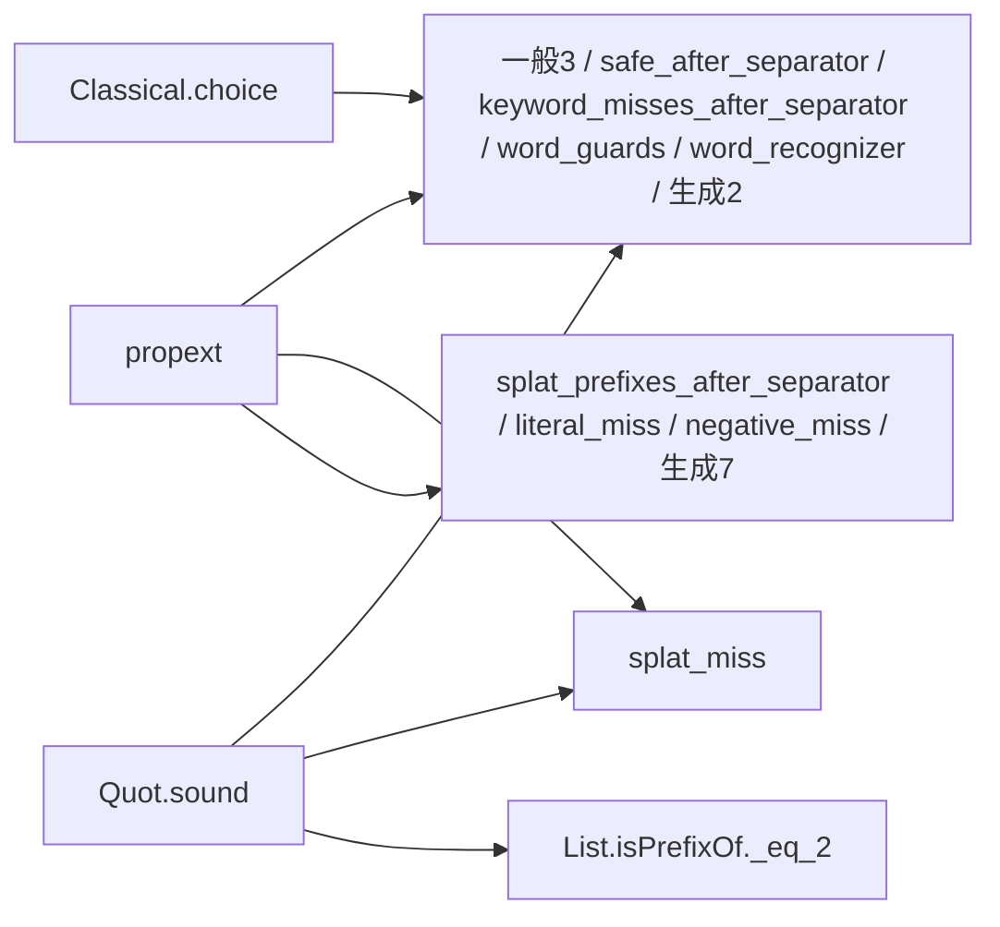
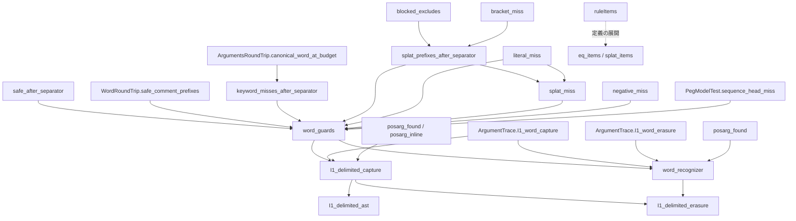

# root [ADR 0351](../adr/0351-prove-parser-formatter-round-trips.md): 区切りを持つ語の位置引数

## 対象と前提

この記録のソース表、依存件数と全体検証は、checkpoint `deccf1262aaf410ae71868c6cf94f4c71fe40a42` の値である。
左角括弧への一般化による内部証明の変更は、[左角括弧の記録](0351-posarg-bracket-proof-dependencies.md) で分けて扱う。

[PosArgDelimited.lean](../../experiments/parser-fmt-proof/grammar/PosArgDelimited.lean) は、[空白一文字の証明](0351-posarg-word-proof-dependencies.md) から対象を広げ、語の禁止文字で区切った位置引数の捕捉、抽象 AST と認識結果を接続する。
基準は Word の検証済み増分を main へ合わせた `daad761a81593aa886b2116489218e0c56e5972c` と、この変更のソースである。
[root ADR 0351](../adr/0351-prove-parser-formatter-round-trips.md) 全体は未完了のままである。

公開する三つの一般定理は、空でなく各文字が許され、先頭が `%%` でない `WordRoundTrip.Word` を取る。
区切りは `WordRoundTrip.allowed` が偽となる文字であり、`=` と `[` を除く。
その後の入力は任意である。
予算は入力全体の長さに 14 と任意の自然数を加え、捕捉と実文法を同じ値で比べる。
子ルールの成功や、先読みの成功、目的とする等式を公開定理の前提にしない。

コメントとスプラットの接頭辞の不一致は、語の文字条件と区切りの条件から導く。
実文法の Word を認識すると区切りが残り、その文字が等号でないため Word Eq は不一致になる。
Splat と先行する SplatArgument の不一致も生成済みの実定義から導き、Argument の既存の語の捕捉と消去の定理へ接続する。
`%inline PosArg` のメタデータで、余分な PosArg ノードを作らないことも確認する。

等号の直前の語はキーワード引数となる。
左角括弧では `*[7]` のようなスプラットになる場合があり、この三定理は対象にしない。
ただし `cinder[7]` は語の捕捉に成功するので、左角括弧の除外は、すべての語について必要最小の条件だとの主張でもない。
これらを範囲の対照として残す。

AST は `ArgumentTrace.Argument` という抽象型であり、Haskell の AST、位置、診断、整形と評価の一般的一致は含まない。
内部に `%%` を持つ語はこの語彙条件にも入るが、本体では既存の G01102 が出る。
本体の AST と通常の整形が通る 11 例、診断と整形の拒否を保つ一例の照合は、前の Word の増分に記録した。
今回の 48 例は、実文法の一部分の CST と残りの入力を比べる検査であり、48 個の通常原稿が診断なく通るという意味ではない。

## 定理と公理

Lean 4.7.0 の新しい作業ディレクトリで、`PosArgDelimitedMetadata` と `PosArgDelimited` の全宣言を調べた。
公開の一般定理は 3 件、公開のメタデータの定理は 2 件、private 定理は 10 件、生成定理は 60 件で、合計 75 件となった。
全件の型、証明項、直接参照と公理依存を取得し、取得できない証明項はなかった。

公開名の共通接頭辞は `PosArgDelimited.`、private 名の共通接頭辞は `_private.PosArgDelimited.0.PosArgDelimited.` である。
P は `propext`、C は `Classical.choice`、Q は `Quot.sound` を表す。

| 定理 | 位置 | 前提と結論 | 公理 |
| --- | --- | --- | --- |
| `eq_items` | [PosArgDelimitedMetadata.lean:9](../../experiments/parser-fmt-proof/grammar/PosArgDelimitedMetadata.lean#L9) | 実文法の Eq が単一の等号リテラルである。 | なし |
| `splat_items` | [PosArgDelimitedMetadata.lean:10](../../experiments/parser-fmt-proof/grammar/PosArgDelimitedMetadata.lean#L10) | 実文法の Splat が二種類の開始リテラルを持つ。 | なし |
| `blocked_excludes` | [PosArgDelimited.lean:6](../../experiments/parser-fmt-proof/grammar/PosArgDelimited.lean#L6) | 禁止文字と、許される文字は一致しない。 | なし |
| `safe_after_separator` | [PosArgDelimited.lean:16](../../experiments/parser-fmt-proof/grammar/PosArgDelimited.lean#L16) | コメントで始まらない語の後へ禁止文字を置いても、コメントで始まらない。 | P, C, Q |
| `bracket_miss` | [PosArgDelimited.lean:36](../../experiments/parser-fmt-proof/grammar/PosArgDelimited.lean#L36) | 語に含む文字は左角括弧でない。 | なし |
| `splat_prefixes_after_separator` | [PosArgDelimited.lean:46](../../experiments/parser-fmt-proof/grammar/PosArgDelimited.lean#L46) | 語と禁止文字の連結は、左角括弧を除くとスプラットで始まらない。 | P |
| `keyword_misses_after_separator` | [PosArgDelimited.lean:68](../../experiments/parser-fmt-proof/grammar/PosArgDelimited.lean#L68) | 等号以外の禁止文字の前では、実文法の Word Eq が不一致になる。 | P, C, Q |
| `literal_miss` | [PosArgDelimited.lean:104](../../experiments/parser-fmt-proof/grammar/PosArgDelimited.lean#L104) | 接頭辞が不一致なら、リテラルの認識も不一致になる。 | P |
| `negative_miss` | [PosArgDelimited.lean:109](../../experiments/parser-fmt-proof/grammar/PosArgDelimited.lean#L109) | 子の不一致は、入力を消費しない否定先読みの成功になる。 | P |
| `splat_miss` | [PosArgDelimited.lean:118](../../experiments/parser-fmt-proof/grammar/PosArgDelimited.lean#L118) | 語と対象の区切りで始まる入力では実文法の Splat が不一致になる。 | P, Q |
| `word_guards` | [PosArgDelimited.lean:130](../../experiments/parser-fmt-proof/grammar/PosArgDelimited.lean#L130) | 語彙条件から全先読みと、先行する SplatArgument の不一致を導く。 | P, C, Q |
| `I1_delimited_capture` | [PosArgDelimited.lean:164](../../experiments/parser-fmt-proof/grammar/PosArgDelimited.lean#L164) | 任意の語、対象の区切り、後続入力で Word の原綴りと Argument ノード、後続入力を保つ。 | P, C, Q |
| `I1_delimited_ast` | [PosArgDelimited.lean:202](../../experiments/parser-fmt-proof/grammar/PosArgDelimited.lean#L202) | 同じ捕捉から、語の原綴りを保つ位置引数の抽象 AST を得る。 | P, C, Q |
| `word_recognizer` | [PosArgDelimited.lean:212](../../experiments/parser-fmt-proof/grammar/PosArgDelimited.lean#L212) | 子の捕捉と消去の既存定理から、実文法の同じ予算の認識結果を導く。 | P, C, Q |
| `I1_delimited_erasure` | [PosArgDelimited.lean:242](../../experiments/parser-fmt-proof/grammar/PosArgDelimited.lean#L242) | 捕捉を消去すると、実文法の同じ予算の PosArg と一致する。 | P, C, Q |

`literal_miss` と `negative_miss` は、与えられた不一致を先読みに移す補題である。
公開定理では、その不一致自体を語彙条件と実文法から導いている。
メタデータの二定理は Eq と Splat の構造の独立した検査であり、公開三定理へ仮定として渡さない。
公開三定理の証明は Generated の実定義を展開する。

生成された 60 定理の共通接頭辞は `_private.PosArgDelimited.0.` であり、位置情報はない。
認識、先頭のコメント判定、捕捉とリスト処理を証明内で展開した際の等式である。

| 生成定理 | 公理 |
| --- | --- |
| `Except.map.match_1.eq_1` | なし |
| `Except.map.match_1.eq_2` | なし |
| `List.append._eq_1` | なし |
| `List.append._eq_2` | なし |
| `List.foldlM._eq_1` | なし |
| `List.foldlM._eq_2` | なし |
| `List.foldlM.match_1.eq_1` | なし |
| `List.foldlM.match_1.eq_2` | なし |
| `List.isPrefixOf._eq_1` | なし |
| `List.isPrefixOf._eq_2` | Q |
| `List.isPrefixOf._eq_3` | なし |
| `List.isPrefixOf.match_1.eq_1` | なし |
| `List.isPrefixOf.match_1.eq_2` | なし |
| `List.isPrefixOf.match_1.eq_3` | なし |
| `List.reverseAux.match_1.eq_1` | なし |
| `List.reverseAux.match_1.eq_2` | なし |
| `PegModel.BoolPayload.supported.match_3.eq_1` | なし |
| `PegModel.BoolPayload.supported.match_3.eq_2` | なし |
| `PegModel.foldChoice.match_1.eq_1` | なし |
| `PegModel.foldChoice.match_1.eq_2` | なし |
| `PegModel.interpreterStep.match_1.eq_1` | なし |
| `PegModel.interpreterStep.match_1.eq_2` | なし |
| `PegModel.interpreterStep.match_2.eq_1` | なし |
| `PegModel.interpreterStep.match_2.eq_2` | なし |
| `PegModel.interpreterStep.match_2.eq_3` | なし |
| `PegModel.interpreterStep.match_3.eq_1` | なし |
| `PegModel.interpreterStep.match_3.eq_2` | なし |
| `PegModel.interpreterStep.match_3.eq_3` | なし |
| `PegModel.interpreterStep.match_4.eq_1` | なし |
| `PegModel.interpreterStep.match_4.eq_2` | なし |
| `PegModel.interpreterStep.match_5.eq_1` | なし |
| `PegModel.interpreterStep.match_5.eq_2` | なし |
| `PegModel.interpreterStep.match_6.eq_1` | なし |
| `PegModel.interpreterStep.match_6.eq_2` | なし |
| `PegModel.interpreterStep.match_6.eq_3` | P, C, Q |
| `PegModel.recognizeEnv._eq_1` | P |
| `PegModel.recognizeEnv._eq_2` | P |
| `PegModel.recognizeEnv._unfold` | P |
| `PegModel.recognizeEnv.match_1.eq_1` | なし |
| `PegModel.recognizeEnv.match_1.eq_2` | なし |
| `PegModel.runSequence.match_1.eq_1` | なし |
| `PegModel.runSequence.match_1.eq_2` | なし |
| `PegModel.runSequence.match_1.eq_3` | なし |
| `PegModel.runSequence.match_2.eq_1` | なし |
| `PegModel.runSequence.match_2.eq_2` | なし |
| `PegModel.runSequence.match_3.eq_1` | なし |
| `PegModel.runSequence.match_3.eq_2` | なし |
| `PegModel.runSequence.match_3.eq_3` | なし |
| `PegModel.runSequence.match_4.eq_1` | なし |
| `PegModel.runSequence.match_4.eq_2` | なし |
| `PosArgTrace.choices._eq_1` | P |
| `PosArgTrace.choices._eq_2` | P |
| `PosArgTrace.choices.match_2.eq_1` | なし |
| `PosArgTrace.choices.match_2.eq_2` | なし |
| `PosArgTrace.sequence._eq_1` | P |
| `PosArgTrace.sequence._eq_2` | P |
| `PosArgTrace.sequence.match_2.eq_1` | なし |
| `PosArgTrace.sequence.match_2.eq_2` | なし |
| `WordRoundTrip.startsComment.match_1.eq_1` | なし |
| `WordRoundTrip.startsComment.match_1.eq_2` | P, C, Q |

全 75 定理のうち、9 件は P、C、Q、10 件は P だけ、1 件は Q だけ、1 件は P と Q、54 件は公理に依存しない。
P は命題の同値から等式を導き、C は `Nonempty` な型から値を選び、Q は商の関係から商の値の等式を導く標準公理である。
新しい公理宣言はない。



この図は推移的な公理依存で、公理に依存しない定理には辺を置かない。
次の実線は型または証明項の定理への直接参照である。
破線は定義の展開を示し、標準の算術、等式とリストの補題、生成等式は省略する。
メタデータの二定理から一般三定理への直接参照はない。



## 定義の安全性と証明の穴

定義は 87 件で、手書きはメタデータの `ruleItems` 一件、生成された補助定義は 86 件だった。
`ruleItems` は `safe` であり、全体では `safe` が 22 件、`unsafe` が 65 件、`partial` が 0 件である。
opaque 宣言はなかった。
実行用の生成定義の安全性と、論理依存は区別する。
全 75 定理の型と証明項から定理、定義と opaque の本体をたどった 2,111 定数には、`unsafe` と `partial` の定義への参照はなかった。
公理の到達先は標準の P、C、Q だけだった。
対象ソースに `sorry` と `admit` はなく、公理依存に `sorryAx` はなかった。

## 境界と変異

新しい三定理の一般適用を先に置くと、三つの名前が未定義で終了コード 1 となった。
これは定理の追加前の検査の失敗であり、偽の命題の反証とは区別する。
三定理を加えた後、同じ一般適用が通った。
[PosArgDelimitedBoundary.lean](../../experiments/parser-fmt-proof/grammar/PosArgDelimitedBoundary.lean) は 6 種類の語と 8 種類の区切りから作る 48 入力で、語彙条件、捕捉、残りの入力、抽象 AST と実文法の認識結果を比較する。
等号、単一と二重のスプラット、長い語の直後の左角括弧という四つの範囲の対照も残す。

[verify-delimited.mjs](../../experiments/parser-fmt-proof/grammar/verify-delimited.mjs) は、Argument のディスパッチ、包むノード、先読みの出力を変える三つの意味の変異を作る。
定義を変更したモジュール自体はコンパイルを通し、一般証明と実行時の照合がそれぞれ拒否することを確認した。
実行時の対照は、通らなかった定理の古い `.olean` を使わず、変更した PosArgTrace を直接読む。
プロセスの起動失敗、signal による終了、構文や import の不備、heartbeat の上限による失敗を、証明の反証として通さない。

二つの実文法の変異も作り、そこから新しい Generated を生成した。
元の PegModel 以外の証明キャッシュを使わないディレクトリで、メタデータの定理が拒否した。
等号の変異は Eq を `==` にするもので、対象外の `cinder=7` が PosArg の語として読めるようになる。
これは三つの一般定理の対象内の反証とは数えず、ソースの契約の不一致と対象外の本体対照として扱う。
スプラットの変異は `*[` を `*` にし、対象内の `* 1]` が Word から SplatArgument の CST に変わることを実パーサーで確認した。
Eq と Splat の行番号だけを 17 増やす AST の対照では、メタデータの定理が通った。
入力原稿の位置を一般に保存する証明ではない。

## 実パーサーとの照合

[delimited-cases.mjs](../../experiments/parser-fmt-proof/grammar/delimited-cases.mjs) の 48 例を、モデルと正規の peg-hs の実パーサーで共有する。
区切りは空白、タブ、改行、右角括弧、コロン、縦線、二重引用符とバックスラッシュである。
語には単一と二重のアスタリスク、和文、小数に見える文字列、内部に `%%` を持つ文字列も含める。

本体の Golem.hpeg の PosArg を入口とする小さな wrapper を足す。
wrapper は残りの入力だけを新しい DelimitedRest トークンで捕まえ、PosArg の定義は変えない。
本体の CST の Argument ノード、Word の原綴り、残りの入力をモデルと比較する。
これは peg-hs の選択した入口の CST であり、Golem の Haskell AST と診断の一般的一致とは区別する。
四つの範囲の対照と二つの実文法の変異も、この同じ経路で確認した。
局所ハーネスは、48 モデル例と 48 実パーサー例、三つの意味の変異と実行時の対照、二つのソース変異、一つの行番号だけの対照を含み、終了コード 0 となった。

## 全体のローカル検証

```sh
export PATH=/Users/tett23/.ghcup/ghc/9.10.3/bin:$PATH
export GHC=/Users/tett23/.ghcup/ghc/9.10.3/bin/ghc
export CABAL_PLAN=/private/tmp/golem-0479-main-integration-dist/cache/plan.json
export PEG_HS=/Users/tett23/.cabal/store/ghc-9.10.3-fe9c/pg-cl-0.1.0.0-d6f17192/bin/peg-hs
export LEAN=/Users/tett23/.elan/toolchains/leanprover--lean4---v4.7.0/bin/lean
export GOLEM=/private/tmp/golem-0479-0483-cli-artifact/golem
sh experiments/parser-fmt-proof/check-local.sh
```

この全体実行は終了コード 0 となった。
文法は source、AST とモデルの規則が各 151 件で、未対応の選択肢は 0 件だった。
正の証明モジュール 80 件、負の変異 360 件、行番号だけの対照 16 件、本体パーサーの 167 例を確認した。
ローカル runner 自体の 4 試験、8 ファイルの本体観測 82 試験、既存の引数 60 試験も、失敗と skip がともに 0 件だった。
Word の単独の増分は、保存した checkpoint `08c5b87bf590c071257049f36eb7760b51cbae57` で全体の終了コード 0 を確認した。
今回は区切りの増分と合わせ、同じ全体ハーネスを改めて実行した。
新しい証明専用 CI、GHC の CI 依存、予算の変更は加えない。
8 ファイルの明示的なローカルの本体観測を、既存 CI の保証へ含めない。

実装の照合には、製品が同じ main `365b43c4ab5e01c863916504f417b0e596a0b3c6` 用の GHC 9.10.3 の登録済み plan と package DB を読み取り専用で使う。
peg-hs の pin は `4b4adc7046a14d18c8eec711f18dbcaa9b059cca` である。
標準の Cabal 環境を新しく構築したという検証ではない。

## ソースと依存調査の再現

全体実行の入力は、次の SHA-256 で固定した。

| ファイル | SHA-256 |
| --- | --- |
| `PosArgDelimitedMetadata.lean` | `0352cc4e02810a0269e8ff3e775ae4e197f3979e0a89a0ffee787fafd416cb16` |
| `PosArgDelimited.lean` | `03f1680873383aa1bd825e4976f0380f0bc33ef5d744cf92b92e11ba2bdba2ce` |
| `PosArgDelimitedBoundary.lean` | `569cd846aa18fa44d15ba19ab899e8254bd1636e6eb0fb94b8d2f5bb49dfbc3d` |
| `delimited-cases.mjs` | `b0f56ae1cd414ea9521842ad8cc5898c826831c34a3e34105c92796ea49678cc` |
| `verify-delimited.mjs` | `707b812af35a9ef05d8ff5175106f07aaeeb87e85b538295b6ff305108b96d94` |
| `test.mjs` | `6246e714dcdb0fe694b8d9922539e918c951b1323685e4dbc61425a859dd38a8` |
| `Golem.hpeg` | `82c0987f5952d519c27cb137c5fe31c77b5c3d7db6c36cdae902a4b9cec7eefb` |

次の手順は、古いモデルの `.olean` をコピーせず、新しい作業ディレクトリでソースから依存をコンパイルする。
型、公理、直接参照と定義の安全性、論理依存の再帰的な参照を同じ環境で取得する。
上の環境変数を指定して実行し、終了コード 0 と本文に記した 75 定理、87 定義、2,111 定数を確認した。

```sh
(
set -eu
task_lean=${LEAN:?set the Lean 4.7.0 executable}
: "${PEG_HS:?set the project-pinned peg-hs executable}"
: "${CABAL_PLAN:?set the project Cabal plan}"
test "$(ghc --numeric-version)" = 9.10.3
case "$("$task_lean" --version)" in
  *"version 4.7.0,"*) ;;
  *) echo "Lean 4.7.0 is required" >&2; exit 1 ;;
esac
task_proof=$(mktemp -d /private/tmp/golem-delimited-doc-dependencies-XXXXXX)
trap 'rm -rf "$task_proof"' EXIT HUP INT TERM
node experiments/parser-fmt-proof/grammar/generate.mjs --fragment \
  modules/golem-parser/grammar/Golem.hpeg "$task_proof/Generated.lean"
for task_module in PegModel PegModelTest WordRoundTrip StringRoundTrip ArgumentsRoundTrip \
  QuotedArgumentRules QuotedKeywords PrintedArguments QuotedCanonical MixedKeywords \
  KeywordLowering CstWrapperMetadata CstWrapper TokenLowering KeywordTrace ArgumentMetadata ArgumentTrace PosArgMetadata PosArgTrace PosArgQuoted PosArgWord PosArgDelimitedMetadata PosArgDelimited; do
  cp "experiments/parser-fmt-proof/grammar/$task_module.lean" "$task_proof/"
done
cd "$task_proof"
export LEAN_PATH=$task_proof
for task_module in PegModel Generated PegModelTest WordRoundTrip StringRoundTrip ArgumentsRoundTrip \
  QuotedArgumentRules QuotedKeywords PrintedArguments QuotedCanonical MixedKeywords \
  KeywordLowering CstWrapperMetadata CstWrapper TokenLowering KeywordTrace ArgumentMetadata ArgumentTrace PosArgMetadata PosArgTrace PosArgQuoted PosArgWord PosArgDelimitedMetadata PosArgDelimited; do
  "$task_lean" -o "$task_module.olean" "$task_module.lean" > "$task_module.log" || { cat "$task_module.log"; exit 1; }
done
cat > Inspect.lean <<'LEAN'
import Lean
import PosArgDelimited
open Lean Elab Command
run_cmd do
  let env ← getEnv
  for (name, info) in env.constants.toList do
    let some index := env.getModuleIdxFor? name | continue
    unless [`PosArgDelimitedMetadata, `PosArgDelimited].contains env.allImportedModuleNames[index.toNat]! do continue
    match info with
    | .axiomInfo ax =>
      logInfo m!"AXIOM {name} {ax.isUnsafe}"
      elabCommand (← `(#print $(mkIdent name)))
    | .defnInfo definition => logInfo m!"DEF {name} {repr definition.safety}"
    | .opaqueInfo _ => logInfo m!"OPAQUE {name}"
    | .thmInfo theoremInfo =>
      logInfo m!"TYPE {name} {theoremInfo.type}"
      let names := info.type.getUsedConstants ++ theoremInfo.value.getUsedConstants
      logInfo m!"THEOREM {name} {(toJson (names.toList.map Name.toString)).compress}"
      let direct := names.toList.filter (fun n => match env.find? n with | some (.thmInfo _) => true | _ => false)
      logInfo m!"DIRECT {name} {(toJson (direct.map Name.toString)).compress}"
      elabCommand (← `(#print axioms $(mkIdent name)))
    | _ => pure ()
LEAN
"$task_lean" Inspect.lean
cat > LogicalClosure.lean <<'LEAN_CLOSURE'
import Lean
import PosArgDelimited
open Lean Elab Command
run_cmd do
  let env ← getEnv
  let targets := env.constants.toList.filterMap fun (name, info) => do
    let index ← env.getModuleIdxFor? name
    if !([`PosArgDelimitedMetadata, `PosArgDelimited].contains env.allImportedModuleNames[index.toNat]!) then none else
      match info with
      | .thmInfo _ => some name
      | _ => none
  let mut pending := targets
  let mut visited : NameSet := {}
  let mut unsafeCount := 0
  let mut partialCount := 0
  let mut axioms : List Name := []
  while !pending.isEmpty do
    let name := pending.head!
    pending := pending.tail!
    if visited.contains name then continue
    visited := visited.insert name
    let some info := env.find? name | continue
    let mut refs := info.type.getUsedConstants.toList
    match info with
    | .thmInfo value => refs := refs ++ value.value.getUsedConstants.toList
    | .defnInfo value =>
      refs := refs ++ value.value.getUsedConstants.toList
      match value.safety with
      | .unsafe =>
        unsafeCount := unsafeCount + 1
        logInfo m!"LOGICAL_UNSAFE {name}"
      | .partial =>
        partialCount := partialCount + 1
        logInfo m!"LOGICAL_PARTIAL {name}"
      | .safe => pure ()
    | .opaqueInfo value => refs := refs ++ value.value.getUsedConstants.toList
    | .axiomInfo _ => axioms := name :: axioms
    | _ => pure ()
    pending := refs ++ pending
  logInfo m!"CLOSURE targets={targets.length} visited={visited.toList.length} unsafe={unsafeCount} partial={partialCount}"
  logInfo m!"AXIOMS {axioms}"
LEAN_CLOSURE
"$task_lean" LogicalClosure.lean
)
```

その他の区切りとスプラットの一般的な捕捉、引数列全体、CST の位置、本体の AST、診断、整形と評価への一般的な対応は残る。
この結果を root [ADR 0351](../adr/0351-prove-parser-formatter-round-trips.md) 全体の完了にはしない。
