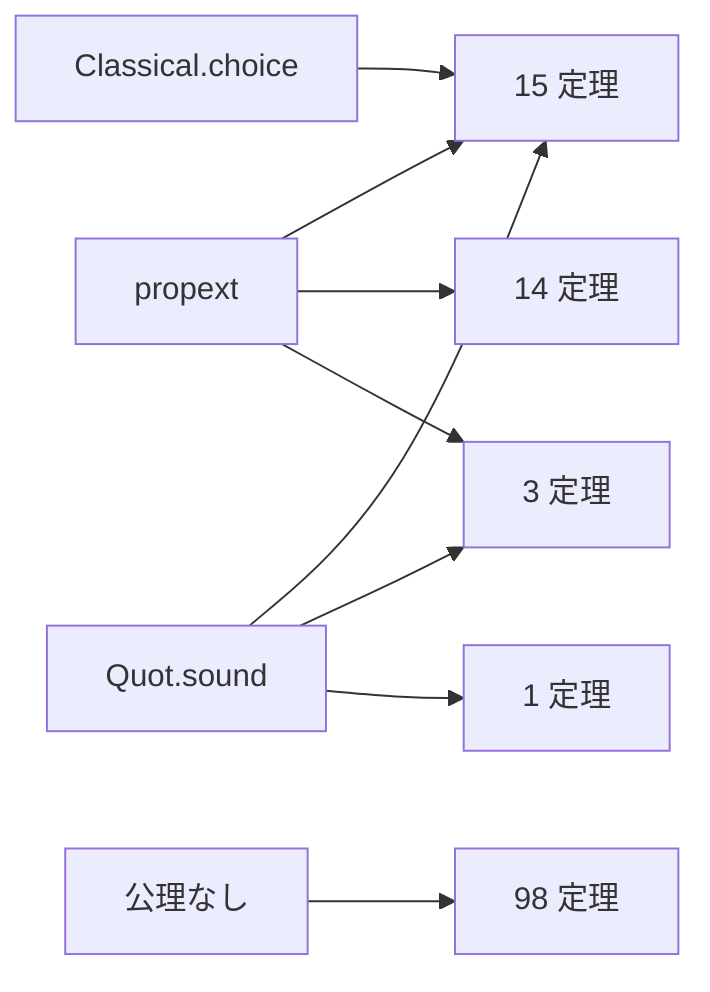
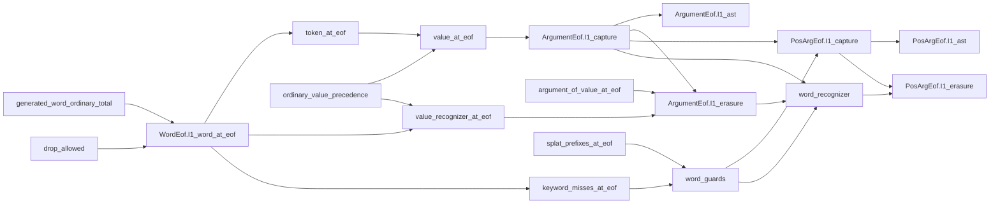

# root [ADR 0351](../adr/0351-prove-parser-formatter-round-trips.md): 入力末尾の語の位置引数

## 対象と前提

この増分は、入力全部が一つの語で終わる場合を対象にする。
EOF は入力の終わりを指す。
基準は、[左角括弧の保存点](0351-posarg-bracket-proof-dependencies.md) へ main を通常マージした `fa2a517129ef0eb6defc6f27001cee7093e69b6f` と、この変更のソースである。
その取り込みの tree は、検証済みの checkpoint `6106bd11c3fb2680e4861126b6dcfadfb3fd210d` と一致する。
[root ADR 0351](../adr/0351-prove-parser-formatter-round-trips.md) 全体は未完了のままである。

語は空でなく、各文字が Word の許可文字であり、先頭が `%%` でないものとする。
区切りを入力へ補ったり、後ろに仮の空白があると仮定したりしない。
Word 自体の認識から、Word トークン、ArgValue、Argument と PosArg の捕捉へ順に接続する。
残りの入力はいずれも空列であり、抽象 AST は既存の `ArgumentTrace.Argument` の Positional と Word である。

語の内部に `[` がないことから、入力が `*[` と `**[` で始まらないことを導く。
そのため、左角括弧で区切る証明とは異なり、語全体が `*` と `**` の場合も対象に含む。
Word が入力全部を消費すると、後続の Eq は空の入力で失敗するので、keyword のガードも導ける。
コメントのガードは、語の先頭の条件から導く。

公開する七定理は、子の成功や、捕捉の結果、先読みの結果を前提にしない。
private の `argument_of_value_at_eof` は子の認識成功から親の認識を導く合成の補題である。
公開定理では、その前提を別の未証明の仮定にせず、Word の認識と ArgValue の選択肢の順から導いた `value_recognizer_at_eof` で満たす。

入力の長さを L とすると、Word の fuel は L + 8 + extra、ArgValue は L + 10 + extra、Argument は L + 12 + extra、PosArg は L + 14 + extra である。
extra は任意の自然数で、捕捉結果と、捕捉だけを消して残りの入力を保った認識結果は同じ fuel で比較する。
本体の前処理、CST の位置、Haskell の AST、引数列全体、整形と評価の一般的な対応とは区別する。
内部の `%%` を持つ語の通常原稿での G01102 と整形の拒否は、先行する [Word の記録](0351-posarg-word-proof-dependencies.md) に保つ。

## 定理と公理

Lean 4.7.0 の新しい作業ディレクトリへソースをコピーし、依存からコンパイルした。
対象は `WordEof`、`ArgumentEof` と `PosArgEof` の三モジュールである。
公開 7 定理、手書き private 15 定理、生成 109 定理の計 131 定理について、型、証明項、直接参照と `#print axioms` を取得した。
取得できなかった証明項はない。

公理の略号は、P が `propext`、C が `Classical.choice`、Q が `Quot.sound` である。
P は同値な命題の等しさ、C は非空の型から値を選ぶこと、Q は同値な代表から商型の値の等しさを導くことを支える。
15 件が PQC、14 件が P、3 件が PQ、1 件が Q に依存し、98 件は公理に依存しない。
新しい公理宣言、opaque 宣言、手書きの定義はいずれも 0 件だった。
コンパイラーが生成した 154 定義は safe 39 件、unsafe 115 件、partial 0 件だった。
全 131 定理の型と証明項からたどった 2,146 定数には、unsafe 定義、partial 定義と標準の三公理以外の公理の参照はなかった。

### 公開定理

`WordEof.I1_word_at_eof` は、実文法の Word が語全体を消費して空列を残すことを示す。
`ArgumentEof` と `PosArgEof` の `I1_capture` は Word トークン一つを持つ Argument node の捕捉、`I1_ast` はその復号した Positional、`I1_erasure` は捕捉を消した結果と実文法の認識との一致を示す。

| 定理 | 位置 | 公理 |
| --- | --- | --- |
| `WordEof.I1_word_at_eof` | [22 行](../../experiments/parser-fmt-proof/grammar/WordEof.lean#L22) | PCQ |
| `ArgumentEof.I1_capture` | [60 行](../../experiments/parser-fmt-proof/grammar/ArgumentEof.lean#L60) | PCQ |
| `ArgumentEof.I1_ast` | [79 行](../../experiments/parser-fmt-proof/grammar/ArgumentEof.lean#L79) | PCQ |
| `ArgumentEof.I1_erasure` | [132 行](../../experiments/parser-fmt-proof/grammar/ArgumentEof.lean#L132) | PCQ |
| `PosArgEof.I1_capture` | [110 行](../../experiments/parser-fmt-proof/grammar/PosArgEof.lean#L110) | PCQ |
| `PosArgEof.I1_ast` | [148 行](../../experiments/parser-fmt-proof/grammar/PosArgEof.lean#L148) | PCQ |
| `PosArgEof.I1_erasure` | [187 行](../../experiments/parser-fmt-proof/grammar/PosArgEof.lean#L187) | PCQ |

### private 定理

private 名の接頭辞は、モジュールごとに `_private.WordEof.0.WordEof.`、`_private.ArgumentEof.0.ArgumentEof.` と `_private.PosArgEof.0.PosArgEof.` である。
次の表では、モジュール名と末尾の名前を示す。
`WordEof` の補題は許可文字の定義と、全文字が許可された入力の消費を接続する。
`ArgumentEof` はトークンへの包み、ArgValue の選択と親への合成、`PosArgEof` はガードと同じ fuel の認識を接続する。

| モジュールと定理 | 位置 | 公理 |
| --- | --- | --- |
| `WordEof.generated_ordinary_ranges` | [4 行](../../experiments/parser-fmt-proof/grammar/WordEof.lean#L4) | なし |
| `WordEof.ordinary_permitted_is_allowed` | [8 行](../../experiments/parser-fmt-proof/grammar/WordEof.lean#L8) | PQ |
| `WordEof.drop_allowed` | [12 行](../../experiments/parser-fmt-proof/grammar/WordEof.lean#L12) | P |
| `ArgumentEof.token_at_eof` | [6 行](../../experiments/parser-fmt-proof/grammar/ArgumentEof.lean#L6) | PCQ |
| `ArgumentEof.value_at_eof` | [16 行](../../experiments/parser-fmt-proof/grammar/ArgumentEof.lean#L16) | PCQ |
| `ArgumentEof.value_recognizer_at_eof` | [85 行](../../experiments/parser-fmt-proof/grammar/ArgumentEof.lean#L85) | PCQ |
| `ArgumentEof.argument_of_value_at_eof` | [122 行](../../experiments/parser-fmt-proof/grammar/ArgumentEof.lean#L122) | PQ |
| `PosArgEof.bracket_miss` | [6 行](../../experiments/parser-fmt-proof/grammar/PosArgEof.lean#L6) | なし |
| `PosArgEof.splat_prefixes_at_eof` | [16 行](../../experiments/parser-fmt-proof/grammar/PosArgEof.lean#L16) | P |
| `PosArgEof.keyword_misses_at_eof` | [32 行](../../experiments/parser-fmt-proof/grammar/PosArgEof.lean#L32) | PCQ |
| `PosArgEof.literal_miss` | [51 行](../../experiments/parser-fmt-proof/grammar/PosArgEof.lean#L51) | P |
| `PosArgEof.negative_miss` | [56 行](../../experiments/parser-fmt-proof/grammar/PosArgEof.lean#L56) | P |
| `PosArgEof.splat_miss` | [65 行](../../experiments/parser-fmt-proof/grammar/PosArgEof.lean#L65) | PQ |
| `PosArgEof.word_guards` | [77 行](../../experiments/parser-fmt-proof/grammar/PosArgEof.lean#L77) | PCQ |
| `PosArgEof.word_recognizer` | [158 行](../../experiments/parser-fmt-proof/grammar/PosArgEof.lean#L158) | PCQ |

### 生成定理

次の 109 定理には、宣言位置の情報がない。
名前の `W:` は `_private.WordEof.0.`、`A:` は `_private.ArgumentEof.0.`、`P:` は `_private.PosArgEof.0.` の略である。
これらも公理と論理依存の調査に含める。

| 定理 | 公理 |
| --- | --- |
| `A:Except.map.match_1.eq_1` | なし |
| `A:Except.map.match_1.eq_2` | なし |
| `A:KeywordTrace.choices._eq_1` | なし |
| `A:KeywordTrace.choices._eq_2` | なし |
| `A:KeywordTrace.choices.match_1.eq_1` | なし |
| `A:KeywordTrace.choices.match_1.eq_2` | なし |
| `A:KeywordTrace.choices.match_2.eq_1` | なし |
| `A:KeywordTrace.choices.match_2.eq_2` | なし |
| `A:KeywordTrace.sequence._eq_1` | なし |
| `A:KeywordTrace.sequence._eq_2` | なし |
| `A:KeywordTrace.sequence._eq_3` | なし |
| `A:KeywordTrace.sequence.match_1.eq_1` | なし |
| `A:KeywordTrace.sequence.match_1.eq_2` | なし |
| `A:KeywordTrace.sequence.match_1.eq_3` | なし |
| `A:KeywordTrace.sequence.match_2.eq_1` | なし |
| `A:KeywordTrace.sequence.match_2.eq_2` | なし |
| `A:KeywordTrace.sequence.match_2.eq_3` | なし |
| `A:PegModel.BoolPayload.supported.match_3.eq_1` | なし |
| `A:PegModel.BoolPayload.supported.match_3.eq_2` | なし |
| `A:PegModel.foldChoice.match_1.eq_1` | なし |
| `A:PegModel.foldChoice.match_1.eq_2` | なし |
| `A:PegModel.interpreterStep.match_1.eq_1` | なし |
| `A:PegModel.interpreterStep.match_1.eq_2` | なし |
| `A:PegModel.interpreterStep.match_2.eq_1` | なし |
| `A:PegModel.interpreterStep.match_2.eq_2` | なし |
| `A:PegModel.interpreterStep.match_2.eq_3` | なし |
| `A:PegModel.interpreterStep.match_3.eq_1` | なし |
| `A:PegModel.interpreterStep.match_3.eq_2` | なし |
| `A:PegModel.interpreterStep.match_3.eq_3` | なし |
| `A:PegModel.interpreterStep.match_4.eq_1` | なし |
| `A:PegModel.interpreterStep.match_4.eq_2` | なし |
| `A:PegModel.interpreterStep.match_5.eq_1` | なし |
| `A:PegModel.interpreterStep.match_5.eq_2` | なし |
| `A:PegModel.interpreterStep.match_6.eq_1` | なし |
| `A:PegModel.interpreterStep.match_6.eq_2` | なし |
| `A:PegModel.interpreterStep.match_6.eq_3` | PCQ |
| `A:PegModel.recognizeEnv._eq_1` | P |
| `A:PegModel.recognizeEnv._eq_2` | P |
| `A:PegModel.recognizeEnv._unfold` | P |
| `A:PegModel.recognizeEnv.match_1.eq_1` | なし |
| `A:PegModel.recognizeEnv.match_1.eq_2` | なし |
| `A:PegModel.runSequence.match_1.eq_1` | なし |
| `A:PegModel.runSequence.match_1.eq_2` | なし |
| `A:PegModel.runSequence.match_1.eq_3` | なし |
| `A:PegModel.runSequence.match_2.eq_1` | なし |
| `A:PegModel.runSequence.match_2.eq_2` | なし |
| `A:PegModel.runSequence.match_3.eq_1` | なし |
| `A:PegModel.runSequence.match_3.eq_2` | なし |
| `A:PegModel.runSequence.match_3.eq_3` | なし |
| `A:PegModel.runSequence.match_4.eq_1` | なし |
| `A:PegModel.runSequence.match_4.eq_2` | なし |
| `P:Except.map.match_1.eq_1` | なし |
| `P:Except.map.match_1.eq_2` | なし |
| `P:List.foldlM._eq_1` | なし |
| `P:List.foldlM._eq_2` | なし |
| `P:List.foldlM.match_1.eq_1` | なし |
| `P:List.foldlM.match_1.eq_2` | なし |
| `P:List.isPrefixOf._eq_1` | なし |
| `P:List.isPrefixOf._eq_2` | Q |
| `P:List.isPrefixOf._eq_3` | なし |
| `P:List.isPrefixOf.match_1.eq_1` | なし |
| `P:List.isPrefixOf.match_1.eq_2` | なし |
| `P:List.isPrefixOf.match_1.eq_3` | なし |
| `P:PegModel.BoolPayload.supported.match_3.eq_1` | なし |
| `P:PegModel.BoolPayload.supported.match_3.eq_2` | なし |
| `P:PegModel.foldChoice.match_1.eq_1` | なし |
| `P:PegModel.foldChoice.match_1.eq_2` | なし |
| `P:PegModel.interpreterStep.match_1.eq_1` | なし |
| `P:PegModel.interpreterStep.match_1.eq_2` | なし |
| `P:PegModel.interpreterStep.match_2.eq_1` | なし |
| `P:PegModel.interpreterStep.match_2.eq_2` | なし |
| `P:PegModel.interpreterStep.match_2.eq_3` | なし |
| `P:PegModel.interpreterStep.match_3.eq_1` | なし |
| `P:PegModel.interpreterStep.match_3.eq_2` | なし |
| `P:PegModel.interpreterStep.match_3.eq_3` | なし |
| `P:PegModel.interpreterStep.match_4.eq_1` | なし |
| `P:PegModel.interpreterStep.match_4.eq_2` | なし |
| `P:PegModel.interpreterStep.match_5.eq_1` | なし |
| `P:PegModel.interpreterStep.match_5.eq_2` | なし |
| `P:PegModel.interpreterStep.match_6.eq_1` | なし |
| `P:PegModel.interpreterStep.match_6.eq_2` | なし |
| `P:PegModel.interpreterStep.match_6.eq_3` | PCQ |
| `P:PegModel.recognizeEnv._eq_1` | P |
| `P:PegModel.recognizeEnv._eq_2` | P |
| `P:PegModel.recognizeEnv._unfold` | P |
| `P:PegModel.recognizeEnv.match_1.eq_1` | なし |
| `P:PegModel.recognizeEnv.match_1.eq_2` | なし |
| `P:PegModel.runSequence.match_1.eq_1` | なし |
| `P:PegModel.runSequence.match_1.eq_2` | なし |
| `P:PegModel.runSequence.match_1.eq_3` | なし |
| `P:PegModel.runSequence.match_2.eq_1` | なし |
| `P:PegModel.runSequence.match_2.eq_2` | なし |
| `P:PegModel.runSequence.match_3.eq_1` | なし |
| `P:PegModel.runSequence.match_3.eq_2` | なし |
| `P:PegModel.runSequence.match_3.eq_3` | なし |
| `P:PegModel.runSequence.match_4.eq_1` | なし |
| `P:PegModel.runSequence.match_4.eq_2` | なし |
| `P:PosArgTrace.choices._eq_1` | P |
| `P:PosArgTrace.choices._eq_2` | P |
| `P:PosArgTrace.choices.match_2.eq_1` | なし |
| `P:PosArgTrace.choices.match_2.eq_2` | なし |
| `P:PosArgTrace.sequence._eq_1` | P |
| `P:PosArgTrace.sequence._eq_2` | P |
| `P:PosArgTrace.sequence.match_2.eq_1` | なし |
| `P:PosArgTrace.sequence.match_2.eq_2` | なし |
| `W:List.dropWhile._eq_1` | なし |
| `W:List.dropWhile._eq_2` | なし |
| `W:List.isEmpty.match_1.eq_1` | なし |
| `W:List.isEmpty.match_1.eq_2` | なし |



次の定理間の図は、型と elaboration 後の証明項で確認した直接参照のうち、接続に必要なものを示す。
標準の等式操作と生成定理を省略する。



## 境界と本体との比較

最初に新しい七定理の一般適用を追加し、未定義の定理名で失敗することを確認した。
これは追加前の証明の不足を確認したもので、パーサー自体の故障を再現したという意味ではない。
[EofBoundary.lean](../../experiments/parser-fmt-proof/grammar/EofBoundary.lean) には、七つの一般適用と十二入力の実行時の比較を置く。
実行時にも語の非空、許可文字と先頭の条件を調べ、対象外の入力を成功例へ混ぜない。

十二例には、長さ一の語、`*`、`**`、`***`、小数に見える語、和文、内部の `%%` を含む語を含む。
実パーサーは、元の PosArg の定義を変えず、`EofProbe <- PosArg !.` という入口で読む。
入力末尾まで消費した Word の原綴りと Argument node を比較する。
これは、通常の原稿を十二件受理したことや、Haskell の AST と整形の一般的な一致を示すものではない。
空入力一例と、先頭が `%%` の二例を、三つの対象外の対照として拒否する。

三つの意味の変異は、実際の PosArgTrace の dispatch、包む node と、ガードから作る捕捉を変える。
変更した定義がコンパイルできることを確認し、一般証明と十二例の実行が拒否することを確かめた。
実行時の対照は、古い PosArgEof の `.olean` を使わず、変更した PosArgTrace を直接読む。

実文法のスプラットを `*[` から `*` へ変える対照では、対象内の語 `*` が入力末尾の位置引数として読めなくなる。
native parser は 1 行 2 列で構文の診断を返す。
同じ変更から PegModel と Generated だけを別々の新しいディレクトリへコンパイルした対照も、元の認識成功から `Except.error "label: expr"` へ変わることを確認した。
この比較は、生の認識結果の有限の不一致であり、新しい一般定理自体を source の変異で拒否したとは数えない。
依存を全部コンパイルする変異の試行は、既存の PegModelTest の別の閉じた例で先に失敗したためである。
通常の全体ハーネスでは、その既存の検査を取り除いていない。
構文や import の不備、fuel の不足とプロセスの起動の失敗を、変異の拒否として数えない。

局所ハーネスは、四モジュール、モデルと native parser に共通する十二入力、三つの意味の変異と実行時の対照、一つの source の対照、三つの対象外の対照を含み、終了コード 0 となった。

## 全体のローカル検証

```sh
export PATH=/Users/tett23/.ghcup/ghc/9.10.3/bin:$PATH
export GHC=/Users/tett23/.ghcup/ghc/9.10.3/bin/ghc
export CABAL_PLAN=/private/tmp/golem-0479-main-integration-dist/cache/plan.json
export PEG_HS=/Users/tett23/.cabal/store/ghc-9.10.3-fe9c/pg-cl-0.1.0.0-d6f17192/bin/peg-hs
export LEAN=/Users/tett23/.elan/toolchains/leanprover--lean4---v4.7.0/bin/lean
export GOLEM=/private/tmp/golem-0479-0483-cli-artifact/golem
sh experiments/parser-fmt-proof/check-local.sh
```

全体ハーネスは終了コード 0 になった。
文法の 151 規則に未対応の選択肢はなく、正の証明モジュール 86 件、変異 367 件、メタデータだけの対照 16 件、本体 parser の 167 例を確認した。
ローカルの本体観測 82 件、既存の引数の検査 60 件、ローカル runner の回帰 4 件もすべて成功し、失敗とスキップは 0 件だった。
実行前後で、表に挙げる九つの入力の SHA-256 が変わらなかった。
新しい証明専用 CI、GHC の CI 依存、予算の変更は加えない。
八ファイルの明示的なローカルの本体観測を、既存 CI の保証へ含めない。
実装との照合には、製品ソースが同じ main `365b43c4ab5e01c863916504f417b0e596a0b3c6` 用の GHC 9.10.3 の plan と package DB を読み取り専用で使う。
peg-hs の pin は `4b4adc7046a14d18c8eec711f18dbcaa9b059cca` である。
標準の Cabal 環境を新しく構築したという検証ではない。

## ソースと依存調査の再現

次の SHA-256 は、この全体検証の入力である。

| ファイル | SHA-256 |
| --- | --- |
| `WordEof.lean` | `82b597d66e8e368e240cfee07131bb8be6f919c77753aa45069f027d0499c98c` |
| `ArgumentEof.lean` | `521d5bfde0b03d231cc229344d14b2b726da3fbfde7002702c87fe20a00cbd59` |
| `PosArgEof.lean` | `f234aba17847522cfe22671b68d29213fa70d3cf6d42041ab89220d920feb426` |
| `EofBoundary.lean` | `8bfd6485c1973021f1f33a1b8cebf782f67aa0eb953cad5aa293c75aff000883` |
| `eof-cases.mjs` | `4a9afcbd4bae18482a2f510a0dd2fd17b236176b77cab67a5fb8a98955daed21` |
| `verify-eof.mjs` | `69340eaaa5742ccde0b715dc8275c14bba2f53a953255911da1a7804e665d7a6` |
| `test.mjs` | `51b5ce211100d196871e0effbc03e9751976ed0872c9bb61242711c8ac8b9017` |
| `PegModel.lean` | `ed53cc0f53e7fac9410067115c1be025875481248841eeaf119b138684014d09` |
| `Golem.hpeg` | `82c0987f5952d519c27cb137c5fe31c77b5c3d7db6c36cdae902a4b9cec7eefb` |

次の手順は、古いモデルの `.olean` を使わず、依存から新しくコンパイルする。
全 131 定理と 154 定義、論理依存の 2,146 定数を同じ環境で取得し、終了コード 0 を確認した。
上記と同じ GHC 9.10.3 の PATH、PEG_HS と Cabal plan、Lean 4.7.0 の LEAN を指定して実行する。

```sh
(
set -eu
task_lean=${LEAN:?set the Lean 4.7.0 executable}
: "${PEG_HS:?set the project-pinned peg-hs executable}"
: "${CABAL_PLAN:?set the project Cabal plan}"
test "$(ghc --numeric-version)" = 9.10.3
case "$("$task_lean" --version)" in
  *"version 4.7.0,"*) ;;
  *) echo "Lean 4.7.0 is required" >&2; exit 1 ;;
esac
task_proof=$(mktemp -d /private/tmp/golem-eof-doc-dependencies-XXXXXX)
trap 'rm -rf "$task_proof"' EXIT HUP INT TERM
node experiments/parser-fmt-proof/grammar/generate.mjs --fragment \
  modules/golem-parser/grammar/Golem.hpeg "$task_proof/Generated.lean"
for task_module in PegModel PegModelTest WordRoundTrip StringRoundTrip ArgumentsRoundTrip \
  QuotedArgumentRules QuotedKeywords PrintedArguments QuotedCanonical MixedKeywords \
  KeywordLowering CstWrapperMetadata CstWrapper TokenLowering KeywordTrace ArgumentMetadata ArgumentTrace PosArgMetadata PosArgTrace PosArgQuoted PosArgWord WordEof ArgumentEof PosArgEof; do
  cp "experiments/parser-fmt-proof/grammar/$task_module.lean" "$task_proof/"
done
cd "$task_proof"
export LEAN_PATH=$task_proof
for task_module in PegModel Generated PegModelTest WordRoundTrip StringRoundTrip ArgumentsRoundTrip \
  QuotedArgumentRules QuotedKeywords PrintedArguments QuotedCanonical MixedKeywords \
  KeywordLowering CstWrapperMetadata CstWrapper TokenLowering KeywordTrace ArgumentMetadata ArgumentTrace PosArgMetadata PosArgTrace PosArgQuoted PosArgWord WordEof ArgumentEof PosArgEof; do
  "$task_lean" -o "$task_module.olean" "$task_module.lean" > "$task_module.log" || { cat "$task_module.log"; exit 1; }
done
cat > Inspect.lean <<'LEAN'
import Lean
import PosArgEof
open Lean Elab Command
run_cmd do
  let env ← getEnv
  for (name, info) in env.constants.toList do
    let some index := env.getModuleIdxFor? name | continue
    unless [`WordEof, `ArgumentEof, `PosArgEof].contains env.allImportedModuleNames[index.toNat]! do continue
    match info with
    | .axiomInfo ax =>
      logInfo m!"AXIOM {name} {ax.isUnsafe}"
      elabCommand (← `(#print $(mkIdent name)))
    | .defnInfo definition => logInfo m!"DEF {name} {repr definition.safety}"
    | .opaqueInfo _ => logInfo m!"OPAQUE {name}"
    | .thmInfo theoremInfo =>
      logInfo m!"TYPE {name} {theoremInfo.type}"
      let names := info.type.getUsedConstants ++ theoremInfo.value.getUsedConstants
      logInfo m!"THEOREM {name} {(toJson (names.toList.map Name.toString)).compress}"
      let direct := names.toList.filter (fun n => match env.find? n with | some (.thmInfo _) => true | _ => false)
      logInfo m!"DIRECT {name} {(toJson (direct.map Name.toString)).compress}"
      elabCommand (← `(#print axioms $(mkIdent name)))
    | _ => pure ()
LEAN
"$task_lean" Inspect.lean
cat > LogicalClosure.lean <<'LEAN_CLOSURE'
import Lean
import PosArgEof
open Lean Elab Command
run_cmd do
  let env ← getEnv
  let targets := env.constants.toList.filterMap fun (name, info) => do
    let index ← env.getModuleIdxFor? name
    if !([`WordEof, `ArgumentEof, `PosArgEof].contains env.allImportedModuleNames[index.toNat]!) then none else
      match info with
      | .thmInfo _ => some name
      | _ => none
  let mut pending := targets
  let mut visited : NameSet := {}
  let mut unsafeCount := 0
  let mut partialCount := 0
  let mut axioms : List Name := []
  while !pending.isEmpty do
    let name := pending.head!
    pending := pending.tail!
    if visited.contains name then continue
    visited := visited.insert name
    let some info := env.find? name | continue
    let mut refs := info.type.getUsedConstants.toList
    match info with
    | .thmInfo value => refs := refs ++ value.value.getUsedConstants.toList
    | .defnInfo value =>
      refs := refs ++ value.value.getUsedConstants.toList
      match value.safety with
      | .unsafe =>
        unsafeCount := unsafeCount + 1
        logInfo m!"LOGICAL_UNSAFE {name}"
      | .partial =>
        partialCount := partialCount + 1
        logInfo m!"LOGICAL_PARTIAL {name}"
      | .safe => pure ()
    | .opaqueInfo value => refs := refs ++ value.value.getUsedConstants.toList
    | .axiomInfo _ => axioms := name :: axioms
    | _ => pure ()
    pending := refs ++ pending
  logInfo m!"CLOSURE targets={targets.length} visited={visited.toList.length} unsafe={unsafeCount} partial={partialCount}"
  logInfo m!"AXIOMS {axioms}"
LEAN_CLOSURE
"$task_lean" LogicalClosure.lean
)
```

## 証明の穴と残る接続

新しい Lean ソースに手書きの `axiom`、`sorry`、`admit`、`sorryAx` はない。
入力末尾の Word から位置引数の抽象 AST までを接続したが、式とスプラット、引数列全体、本体の前処理と位置、Haskell の AST と整形と評価の一般的な対応は残る。
この増分だけで root [ADR 0351](../adr/0351-prove-parser-formatter-round-trips.md) 全体を完了扱いにしない。
