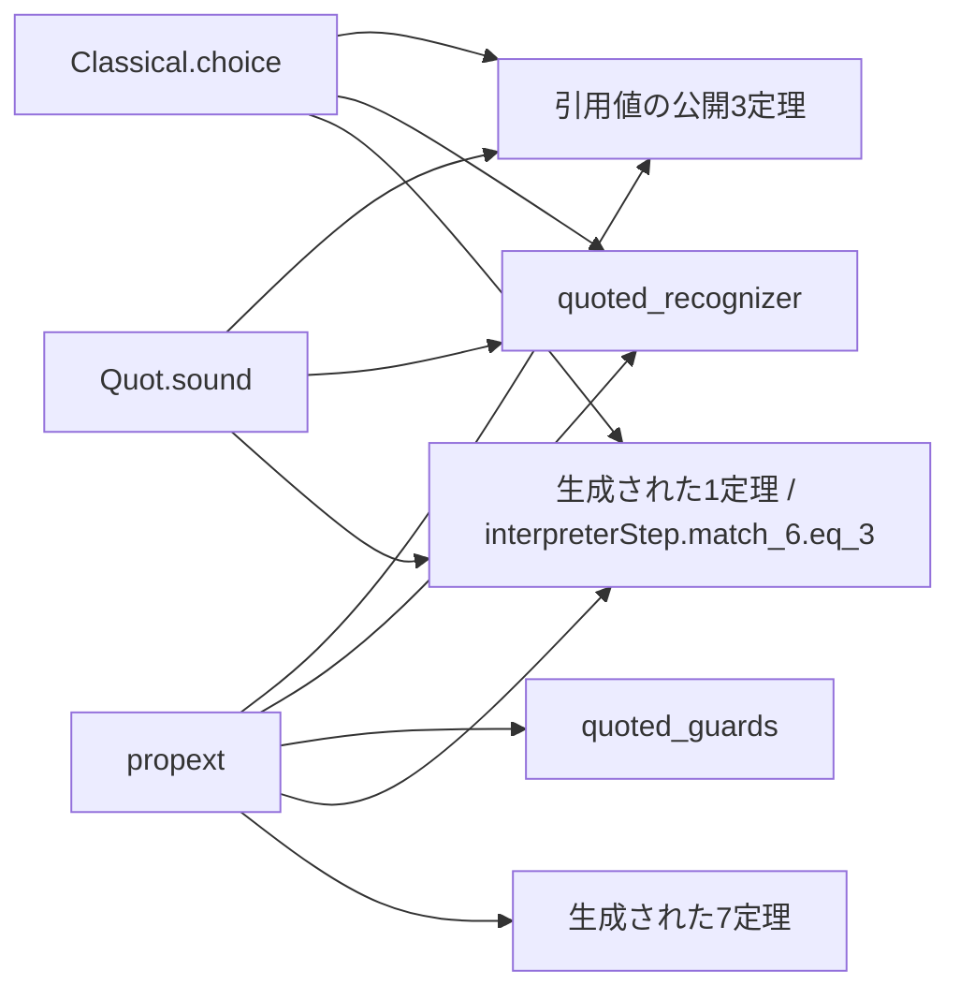
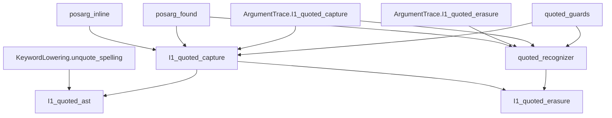

# [root ADR 0351](../adr/0351-prove-parser-formatter-round-trips.md): 位置引数の先読みと引用値の捕捉

## 範囲

基準は、前段の捕捉の増分 `227807d63adb0287c57babfecdebc8e24ab0c50c` である。
今回の追加ファイルを Lean 4.7.0 で検査し、実際の `PosArg` から引用値の `Argument` を読む経路を接続した。
否定先読みは入力を消費せず、内側の規則が失敗すれば成功する。
`PosArg` の四種類の否定先読みと、先行する `SplatArgument` の失敗を実際の生成規則から導き、前段の `ArgumentTrace` の捕捉へ渡す。
子のパースの成功や、結論の一致を未証明の前提にはしない。

入力は `StringRoundTrip.Part` の列から書いた引用値と、任意の接尾辞である。
モデルの再帰を追う自然数 `fuel` は `parts.length + 13 + extra` とし、任意の自然数 `extra` を許す。
子の `ArgumentTrace` には二つ少ない `fuel` を渡す。
引用値は二重引用符から始まるので、コメント、`Word Eq`、展開の接頭辞に当たらないことも入力から導く。

`inline` は自身の node を作らず子の捕捉を返す分類である。
`PosArgMetadata` は二つの選択肢全体、パラメーターと結果型、inline と token の分類を確認する。
行番号と action の綴りは実際のソースから保ち、位置の値を特定の数へ固定しない。
`PosArgTrace` は参照と否定先読みの列を扱い、先読みの捕捉は空の列にする。
ほかの式は明示的に未対応とし、成功した非 token の子を無条件に文字列へ変換しない。

文法の SHA-256 は `82c0987f5952d519c27cb137c5fe31c77b5c3d7db6c36cdae902a4b9cec7eefb` である。
調べた追加モジュールの SHA-256 は次のとおりである。

| ファイル | SHA-256 |
| --- | --- |
| `PosArgMetadata.lean` | `cd38bf545d85ced97dcd46ede5a36483f82004adca9e0992a89db357f0b14074` |
| `PosArgTrace.lean` | `81b8280bbdd0d6b93383b304ed4d647d00e511618b218f7a36c4bcdc2271114f` |
| `PosArgQuoted.lean` | `d4df88f72cccd065d258437bf2c966a888a340825da2523ac5831987d79eb942` |

## 定理と前提

対象は [PosArgMetadata.lean](../../experiments/parser-fmt-proof/grammar/PosArgMetadata.lean)、[PosArgTrace.lean](../../experiments/parser-fmt-proof/grammar/PosArgTrace.lean)、[PosArgQuoted.lean](../../experiments/parser-fmt-proof/grammar/PosArgQuoted.lean) の全体である。
新しい一時ディレクトリで依存モジュールをソースから検査し、全 52 定理の型、証明項と公理依存を取得した。
取得できなかった証明項はない。
手書きの定理は公開の捕捉三本、metadata 三本、private の補助二本であり、残り 44 本は生成された展開や分岐の等式である。

次の公開名の共通接頭辞は `PosArgTrace.`、private 名の共通接頭辞は `_private.PosArgQuoted.0.PosArgTrace.` である。

| 定理 | 位置 | 概要 | 公理 |
| --- | --- | --- | --- |
| `I1_quoted_capture` | [13 行](../../experiments/parser-fmt-proof/grammar/PosArgQuoted.lean#L13) | 任意の引用値について、先読み後に元の引用符を含む StringLit token を持つ Argument node を返し、接尾辞を残す。 | 標準三公理 |
| `I1_quoted_ast` | [53 行](../../experiments/parser-fmt-proof/grammar/PosArgQuoted.lean#L53) | 捕捉から位置を除くモデルの Positional と復号した値を得る。 | 標準三公理 |
| `I1_quoted_erasure` | [97 行](../../experiments/parser-fmt-proof/grammar/PosArgQuoted.lean#L97) | 同じ fuel の実際の生成規則の認識と、捕捉を消した結果が一致する。 | 標準三公理 |
| `posarg_found` | [20 行](../../experiments/parser-fmt-proof/grammar/PosArgMetadata.lean#L20) | 実際の二つの選択肢、型とパラメーターが確認した形と一致する。 | なし |
| `posarg_inline` | [22 行](../../experiments/parser-fmt-proof/grammar/PosArgMetadata.lean#L22) | PosArg が inline である。 | なし |
| `posarg_not_token` | [23 行](../../experiments/parser-fmt-proof/grammar/PosArgMetadata.lean#L23) | PosArg は token ではない。 | なし |
| `quoted_guards` | [5 行](../../experiments/parser-fmt-proof/grammar/PosArgQuoted.lean#L5) | 二重引用符から始まる任意の列で、四つの先読みが入力を保ち、先行する展開が失敗する。 | `propext` |
| `quoted_recognizer` | [66 行](../../experiments/parser-fmt-proof/grammar/PosArgQuoted.lean#L66) | 実際の PosArg の認識が引用値を消費して接尾辞を返す。子の認識は既存の捕捉と消去の定理から導く。 | 標準三公理 |

生成定理の共通接頭辞は `_private.PosArgQuoted.0.` である。
以下の 44 本は、列と選択肢の処理、認識器、Except.map の展開やパターン分岐の等式である。
宣言位置の情報はない。

| 生成定理 | 公理 |
| --- | --- |
| `Except.map.match_1.eq_1` | なし |
| `Except.map.match_1.eq_2` | なし |
| `PegModel.BoolPayload.supported.match_3.eq_1` | なし |
| `PegModel.BoolPayload.supported.match_3.eq_2` | なし |
| `PegModel.foldChoice.match_1.eq_1` | なし |
| `PegModel.foldChoice.match_1.eq_2` | なし |
| `PegModel.interpreterStep.match_1.eq_1` | なし |
| `PegModel.interpreterStep.match_1.eq_2` | なし |
| `PegModel.interpreterStep.match_2.eq_1` | なし |
| `PegModel.interpreterStep.match_2.eq_2` | なし |
| `PegModel.interpreterStep.match_2.eq_3` | なし |
| `PegModel.interpreterStep.match_3.eq_1` | なし |
| `PegModel.interpreterStep.match_3.eq_2` | なし |
| `PegModel.interpreterStep.match_3.eq_3` | なし |
| `PegModel.interpreterStep.match_4.eq_1` | なし |
| `PegModel.interpreterStep.match_4.eq_2` | なし |
| `PegModel.interpreterStep.match_5.eq_1` | なし |
| `PegModel.interpreterStep.match_5.eq_2` | なし |
| `PegModel.interpreterStep.match_6.eq_1` | なし |
| `PegModel.interpreterStep.match_6.eq_2` | なし |
| `PegModel.interpreterStep.match_6.eq_3` | Classical.choice, Quot.sound, propext |
| `PegModel.recognizeEnv._eq_1` | propext |
| `PegModel.recognizeEnv._eq_2` | propext |
| `PegModel.recognizeEnv._unfold` | propext |
| `PegModel.recognizeEnv.match_1.eq_1` | なし |
| `PegModel.recognizeEnv.match_1.eq_2` | なし |
| `PegModel.runSequence.match_1.eq_1` | なし |
| `PegModel.runSequence.match_1.eq_2` | なし |
| `PegModel.runSequence.match_1.eq_3` | なし |
| `PegModel.runSequence.match_2.eq_1` | なし |
| `PegModel.runSequence.match_2.eq_2` | なし |
| `PegModel.runSequence.match_3.eq_1` | なし |
| `PegModel.runSequence.match_3.eq_2` | なし |
| `PegModel.runSequence.match_3.eq_3` | なし |
| `PegModel.runSequence.match_4.eq_1` | なし |
| `PegModel.runSequence.match_4.eq_2` | なし |
| `PosArgTrace.choices._eq_1` | propext |
| `PosArgTrace.choices._eq_2` | propext |
| `PosArgTrace.choices.match_2.eq_1` | なし |
| `PosArgTrace.choices.match_2.eq_2` | なし |
| `PosArgTrace.sequence._eq_1` | propext |
| `PosArgTrace.sequence._eq_2` | propext |
| `PosArgTrace.sequence.match_2.eq_1` | なし |
| `PosArgTrace.sequence.match_2.eq_2` | なし |

## 公理と生成された実行用の宣言

全 52 定理のうち、五本は標準三公理、八本は `propext` だけ、39 本は公理に依存しない。
標準三公理は次のとおりである。

| 公理 | Lean 4.7.0 の位置 | 内容 |
| --- | --- | --- |
| `Classical.choice` | `Init.Prelude:730` | Nonempty な型から要素を選ぶ。 |
| `propext` | `Init.Core:1287` | 命題の同値から等式を得る。 |
| `Quot.sound` | `Init.Core:1459` | 関係を満たす二要素が同じ商の値を持つ。 |

環境には定義 175 件があった。
手書きの 11 定義はすべて safe であり、生成された定義は 164 件だった。
手書きの名前は、共通接頭辞 `PosArgTrace.` の後に `sourceRule`、`noComment`、`noKeyword`、`noDoubleSplat`、`noSplat`、`branches`、`layout`、`expression`、`sequence`、`choices`、`read` を付ける。
全体では safe が 35 件、unsafe が 138 件、partial が二件である。
partial の二件は `PosArgTrace.sequence._unsafe_rec` と `PosArgTrace.choices._unsafe_rec` で、全域の定義からコンパイラーが作った実行用の再帰である。

このほかに、コンパイラーが生成した unsafe axiom が一件あった。
名前は `List.mapTR.loop._at.PosArgTrace.layout._spec_1` であり、Rule と二つの列を受け取って Alt の列を返す型を持つ。
Prop の証明を与える宣言ではない。
手書きの公理宣言はない。

52 定理の型と証明項から、参照する定理、定義、opaque の本体とその型を再帰的にたどった。
2,117 定数の論理的な参照先に unsafe と partial の定義はなく、公理は標準三公理だけだった。
生成された実行用の宣言を、証明の前提として数えない。

## 依存の図

公理の図は、定義や補助定理を通る推移的な依存を示す。
公理に依存しない 39 本には辺がない。



次の実線は、型または証明項で確認したプロジェクトの定理への直接参照である。
標準の等式、算術と生成された展開等式は省いた。



## 赤と変異、実装との照合

既存の参照だけの列の処理で PosArg を読ませると、正しい引用値でも未対応の式となり、捕捉の回帰が失敗した。
先読みを入力を消費しない式として扱い、既存の ArgumentTrace へ子を渡す実装で成功した。
回帰は引用値五例、位置引数にならない接頭辞三例、未対応の展開一例である。

子の振り分け、外側の node、先読みの空の捕捉を変える三つのモデル変異は、定理と実行時の回帰が拒否した。
先読みそのものを消す四つ目の変異では、引用値の定理は通る。
引用値は元から先読みをすべて通るためであり、この定理の対象外の接頭辞の回帰が誤りを検出する。
この違いを、PosArg 全体の一般証明が済んだことへ読み替えない。

三つの文法変異は、否定先読みを肯定へ変えること、inline を外すこと、子の Argument を ArgValue へ変えることである。
新しい生成 AST の metadata の検査と、実際の native parser の結果を照合した。
子を変える対照には、Argument を到達可能に保つため、その規則だけを追加の entry に指定する。
到達不能という lint の失敗を、捕捉の違いの検出には数えない。
行番号だけを 17 増やした AST の対照は、metadata の検査を通る。

共有する十二例は、前段と同じ [argument-cases.mjs](../../experiments/parser-fmt-proof/grammar/argument-cases.mjs) を使う。
モデルの CST、位置を除く AST、同じ fuel の実際の PosArg の認識を比較し、十二例すべてが一致した。
実パーサーと通常 CLI の整形については、同じコーパスと観測器の前段の [70 件の照合](0351-positional-capture-proof-dependencies.md) を使う。
パーサー、整形、Haskell の観測器とコーパスのソースは前段と同じである。
十二例には語も含むが、語の一般的な PosArg の捕捉は今回の定理の結論に含めていない。

`*[1]` は native parser が受理し、今回の捕捉モデルが明示的な未対応を返す対照である。
`key=value`、`%% note`、`**[1]` は PosArg の入口では失敗する。
原稿全体が同じ文字列を拒否するという意味ではない。

## 実行する環境と残る範囲

GHC 9.10.3、プロジェクトで固定した peg-hs `4b4adc7046a14d18c8eec711f18dbcaa9b059cca`、Lean 4.7.0 と、検証した通常の CLI を指定する。
native parser のビルドは PATH の GHC を使うため、PATH も固定する。
追加の proof 専用 CI、GHC の依存と時間上限は設けない。
新しい native observer は [ローカルの全実行](../../experiments/parser-fmt-proof/grammar/README.md#ローカルでの全実行と-ci-の境界) の経路で検証する。

```sh
PATH=/path/to/ghc-9.10.3/bin:$PATH \
GHC=/path/to/ghc-9.10.3/bin/ghc \
CABAL_PLAN=/path/to/dist/cache/plan.json \
PEG_HS=/path/to/project-pinned/peg-hs \
LEAN=/path/to/lean-4.7.0/bin/lean \
GOLEM=/path/to/golem \
sh experiments/parser-fmt-proof/check-local.sh
```

公理と参照先は、次のコードで再取得できる。
`PATH`、`PEG_HS`、`CABAL_PLAN` と `LEAN` を上記の版とパスへ設定したシェルで動かす。
既存の `.olean` はコピーせず、必要なモジュールを新しい一時ディレクトリでソースから検査する。
THEOREM の 52 件と各公理、定義の安全性、実行用の axiom、参照先全体の検査結果を出す。

```sh
(
set -eu
task_lean=${LEAN:?set the Lean 4.7.0 executable}
: "${PEG_HS:?set the project-pinned peg-hs executable}"
: "${CABAL_PLAN:?set the project Cabal plan}"
test "$(ghc --numeric-version)" = 9.10.3
case "$("$task_lean" --version)" in
  *"version 4.7.0,"*) ;;
  *) echo "Lean 4.7.0 is required" >&2; exit 1 ;;
esac
task_proof=$(mktemp -d /private/tmp/golem-posarg-doc-dependencies-XXXXXX)
trap 'rm -rf "$task_proof"' EXIT HUP INT TERM
node experiments/parser-fmt-proof/grammar/generate.mjs --fragment \
  modules/golem-parser/grammar/Golem.hpeg "$task_proof/Generated.lean"
for task_module in PegModel PegModelTest WordRoundTrip StringRoundTrip ArgumentsRoundTrip \
  QuotedArgumentRules QuotedKeywords PrintedArguments QuotedCanonical MixedKeywords \
  KeywordLowering CstWrapperMetadata CstWrapper TokenLowering KeywordTrace ArgumentMetadata ArgumentTrace PosArgMetadata PosArgTrace PosArgQuoted; do
  cp "experiments/parser-fmt-proof/grammar/$task_module.lean" "$task_proof/"
done
cd "$task_proof"
export LEAN_PATH=$task_proof
for task_module in PegModel Generated PegModelTest WordRoundTrip StringRoundTrip ArgumentsRoundTrip \
  QuotedArgumentRules QuotedKeywords PrintedArguments QuotedCanonical MixedKeywords \
  KeywordLowering CstWrapperMetadata CstWrapper TokenLowering KeywordTrace ArgumentMetadata ArgumentTrace PosArgMetadata PosArgTrace PosArgQuoted; do
  "$task_lean" -o "$task_module.olean" "$task_module.lean" > "$task_module.log" || { cat "$task_module.log"; exit 1; }
done
cat > Inspect.lean <<'LEAN'
import Lean
import PosArgQuoted
open Lean Elab Command
run_cmd do
  let env ← getEnv
  for (name, info) in env.constants.toList do
    let some index := env.getModuleIdxFor? name | continue
    unless [`PosArgMetadata, `PosArgTrace, `PosArgQuoted].contains env.allImportedModuleNames[index.toNat]! do continue
    match info with
    | .axiomInfo ax =>
      logInfo m!"AXIOM {name} {ax.isUnsafe}"
      elabCommand (← `(#print $(mkIdent name)))
    | .defnInfo definition => logInfo m!"DEF {name} {repr definition.safety}"
    | .opaqueInfo _ => logInfo m!"OPAQUE {name}"
    | .thmInfo theoremInfo =>
      logInfo m!"TYPE {name} {theoremInfo.type}"
      let names := info.type.getUsedConstants ++ theoremInfo.value.getUsedConstants
      logInfo m!"THEOREM {name} {(toJson (names.toList.map Name.toString)).compress}"
      let direct := names.toList.filter (fun n => match env.find? n with | some (.thmInfo _) => true | _ => false)
      logInfo m!"DIRECT {name} {(toJson (direct.map Name.toString)).compress}"
      elabCommand (← `(#print axioms $(mkIdent name)))
    | _ => pure ()
LEAN
"$task_lean" Inspect.lean
cat > LogicalClosure.lean <<'LEAN_CLOSURE'
import Lean
import PosArgQuoted
open Lean Elab Command
run_cmd do
  let env ← getEnv
  let targets := env.constants.toList.filterMap fun (name, info) => do
    let index ← env.getModuleIdxFor? name
    if !([`PosArgMetadata, `PosArgTrace, `PosArgQuoted].contains env.allImportedModuleNames[index.toNat]!) then none else
      match info with
      | .thmInfo _ => some name
      | _ => none
  let mut pending := targets
  let mut visited : NameSet := {}
  let mut unsafeCount := 0
  let mut partialCount := 0
  let mut axioms : List Name := []
  while !pending.isEmpty do
    let name := pending.head!
    pending := pending.tail!
    if visited.contains name then continue
    visited := visited.insert name
    let some info := env.find? name | continue
    let mut refs := info.type.getUsedConstants.toList
    match info with
    | .thmInfo value => refs := refs ++ value.value.getUsedConstants.toList
    | .defnInfo value =>
      refs := refs ++ value.value.getUsedConstants.toList
      match value.safety with
      | .unsafe =>
        unsafeCount := unsafeCount + 1
        logInfo m!"LOGICAL_UNSAFE {name}"
      | .partial =>
        partialCount := partialCount + 1
        logInfo m!"LOGICAL_PARTIAL {name}"
      | .safe => pure ()
    | .opaqueInfo value => refs := refs ++ value.value.getUsedConstants.toList
    | .axiomInfo _ => axioms := name :: axioms
    | _ => pure ()
    pending := refs ++ pending
  logInfo m!"CLOSURE targets={targets.length} visited={visited.toList.length} unsafe={unsafeCount} partial={partialCount}"
  logInfo m!"AXIOMS {axioms}"
LEAN_CLOSURE
"$task_lean" LogicalClosure.lean
)
```

上記の `check-local.sh` 全体は終了コード 0 となった。
文法の規則はソース、AST とモデルがすべて 151 件で一致し、表せない選択肢は 0 件だった。
正の証明モジュール 75 件、拒否する変異 352 件、位置だけを変える AST の対照 15 件、本体パーサーとの全原稿の照合 167 件を含む。
続く明示的なローカル実行では、登録済みの観測器 8 ファイルの全 70 試験、既存の引数 60 試験も通った。
観測器の登録と失敗集約を確かめる先頭の 4 試験を含め、実行を省いた構成要素はない。
CI の検査がこの新しいローカル観測器 8 ファイルを実行したという記録にはしない。
対象ソースと 52 定理の公理依存に `sorry`、`admit`、`sorryAx` はなく、取得できない証明項もなかった。
PosArg の語と展開の一般的な捕捉、引数列全体、CST の位置、Haskell の AST と整形、評価の一般的な往復の証明は残る。
[root ADR 0351](../adr/0351-prove-parser-formatter-round-trips.md) は未実装の状態を保つ。
