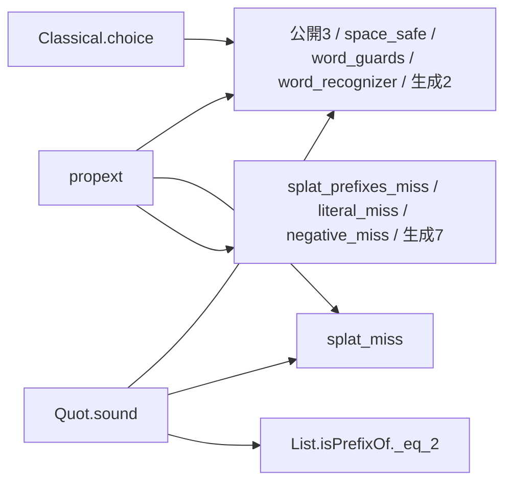
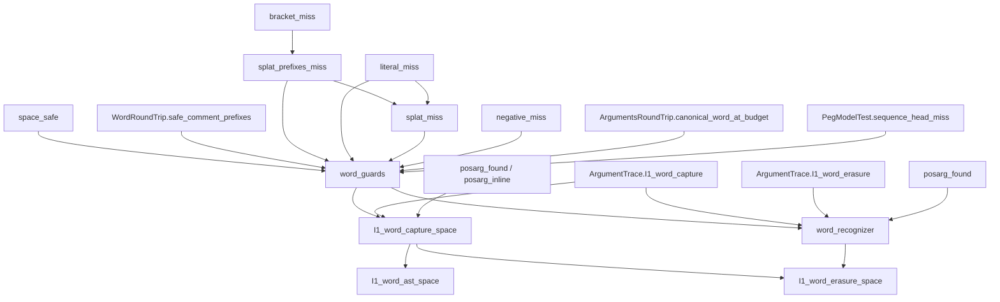

# root [ADR 0351](../adr/0351-prove-parser-formatter-round-trips.md): 空白で区切った語の位置引数

## 対象と範囲

[PosArgWord.lean](../../experiments/parser-fmt-proof/grammar/PosArgWord.lean) は、空白一文字で区切った語について、`PosArg` の捕捉、抽象 AST への変換と認識結果の一致を示す。
基準は引用値の増分 `33f0d15d700e3b48d90d6b26dbdb49a2037309c0` と同じ製品コードである。
[root ADR 0351](../adr/0351-prove-parser-formatter-round-trips.md) 全体を完了したとは記録しない。

入力は `WordRoundTrip.Word` の文字列、空白一文字、任意の後続文字列を連結したものである。
`Word` は空でなく、各文字が実文法の通常の語に許された文字であることを持つ。
さらに、語の先頭が `%%` でないことを前提にする。
予算は入力全体の長さに 14 と任意の自然数 `extra` を加えた値であり、三定理は同じ予算で比較する。

引用値の [PosArg の証明](0351-posarg-quoted-proof-dependencies.md) と同じ捕捉モデルを使う。
`Word Eq`、コメントとスプラットの先読みの結果は、語の条件と生成済みの実文法から導く。
子の解析成功、先読み成功や、目的とする捕捉結果を公開定理の前提にはしていない。
`Argument` の語の捕捉と認識の既存定理を同じ子の予算で使い、`%inline PosArg` が余分なノードを作らないことも実際のメタデータで確かめる。

区切りを単に語の禁止文字へ広げることはしない。
`=` ではキーワード引数になり、語 `*` の直後に `[` を置くとスプラットになるため、同じ捕捉結果を一般には主張できない。
空白の後の文字列は任意であり、この二つの文字やコメントに見える文字列がそこにあっても、語の末尾を変えない。

ここでいう AST は `ArgumentTrace.Argument` という抽象型である。
Haskell の AST、位置、整形と評価についての一般証明ではない。
内部に `%%` を持つ `cinder%%` はこの語彙領域に含まれるが、本体では既存の G01102 が出る。
この三定理は診断のない原稿だけを表すものではなく、診断の一般的一致も保証しない。
この例を落とさず、モデルの捕捉と本体の診断を別々に確認する。

## 定理と公理

Lean 4.7.0 の対象モジュールには、公開定理 3 件、手書きの private 定理 8 件、生成定理 60 件があった。
全 71 定理の型と証明項、公理依存、定理の直接参照を取得した。
取得できなかった証明項はない。

公開名の共通接頭辞は `PosArgTrace.`、private 名の共通接頭辞は `_private.PosArgWord.0.PosArgTrace.` である。
`P` は `propext`、`C` は `Classical.choice`、`Q` は `Quot.sound` を表す。

| 定理 | 位置 | 前提と結論 | 公理 |
| --- | --- | --- | --- |
| `space_safe` | [5 行](../../experiments/parser-fmt-proof/grammar/PosArgWord.lean#L5) | 先頭がコメントでない語の後に空白を加えても、コメントの先頭にならない。 | P, C, Q |
| `bracket_miss` | [18 行](../../experiments/parser-fmt-proof/grammar/PosArgWord.lean#L18) | 語に属する文字は左角括弧でない。 | なし |
| `splat_prefixes_miss` | [28 行](../../experiments/parser-fmt-proof/grammar/PosArgWord.lean#L28) | 語と空白から始まる入力は、二種類のスプラットの開始文字列を持たない。 | P |
| `literal_miss` | [44 行](../../experiments/parser-fmt-proof/grammar/PosArgWord.lean#L44) | 文字列が入力の接頭辞でないとき、十分な予算でそのリテラルは不一致となる。 | P |
| `negative_miss` | [49 行](../../experiments/parser-fmt-proof/grammar/PosArgWord.lean#L49) | 子が不一致なら、その否定先読みは入力を消費せず成功する。 | P |
| `splat_miss` | [58 行](../../experiments/parser-fmt-proof/grammar/PosArgWord.lean#L58) | 語と空白の入力では、実文法の Splat が不一致になる。 | P, Q |
| `word_guards` | [69 行](../../experiments/parser-fmt-proof/grammar/PosArgWord.lean#L69) | 語彙の条件から全先読みと、先行する SplatArgument の不一致を導く。 | P, C, Q |
| `I1_word_capture_space` | [108 行](../../experiments/parser-fmt-proof/grammar/PosArgWord.lean#L108) | 語と後続入力を任意にし、Argument ノードと Word の原綴り、後続の空白を保つ。 | P, C, Q |
| `I1_word_ast_space` | [145 行](../../experiments/parser-fmt-proof/grammar/PosArgWord.lean#L145) | 同じ捕捉を、語の原綴りを保つ位置引数の抽象 AST に変換する。 | P, C, Q |
| `word_recognizer` | [154 行](../../experiments/parser-fmt-proof/grammar/PosArgWord.lean#L154) | 子の捕捉と消去の定理から、実文法の PosArg の認識成功を導く。 | P, C, Q |
| `I1_word_erasure_space` | [183 行](../../experiments/parser-fmt-proof/grammar/PosArgWord.lean#L183) | 捕捉を消去した認識結果が、実文法の同じ予算の PosArg と一致する。 | P, C, Q |

private の `negative_miss` と `literal_miss` は、与えられた子の不一致や接頭辞の不一致を先読みに移す補題である。
公開定理では、これらの条件を `word_guards` で語彙条件と実文法から導いている。
補題の仮定をそのまま公開定理へ移したものではない。

生成された 60 定理を次に示す。
名前の共通接頭辞は `_private.PosArgWord.0.` であり、位置情報はない。
実文法の認識、先頭のコメント判定、捕捉とリスト処理を証明中に展開した際の等式である。

| 生成定理 | 公理 |
| --- | --- |
| `Except.map.match_1.eq_1` | なし |
| `Except.map.match_1.eq_2` | なし |
| `List.append._eq_1` | なし |
| `List.append._eq_2` | なし |
| `List.foldlM._eq_1` | なし |
| `List.foldlM._eq_2` | なし |
| `List.foldlM.match_1.eq_1` | なし |
| `List.foldlM.match_1.eq_2` | なし |
| `List.isPrefixOf._eq_1` | なし |
| `List.isPrefixOf._eq_2` | Q |
| `List.isPrefixOf._eq_3` | なし |
| `List.isPrefixOf.match_1.eq_1` | なし |
| `List.isPrefixOf.match_1.eq_2` | なし |
| `List.isPrefixOf.match_1.eq_3` | なし |
| `List.reverseAux.match_1.eq_1` | なし |
| `List.reverseAux.match_1.eq_2` | なし |
| `PegModel.BoolPayload.supported.match_3.eq_1` | なし |
| `PegModel.BoolPayload.supported.match_3.eq_2` | なし |
| `PegModel.foldChoice.match_1.eq_1` | なし |
| `PegModel.foldChoice.match_1.eq_2` | なし |
| `PegModel.interpreterStep.match_1.eq_1` | なし |
| `PegModel.interpreterStep.match_1.eq_2` | なし |
| `PegModel.interpreterStep.match_2.eq_1` | なし |
| `PegModel.interpreterStep.match_2.eq_2` | なし |
| `PegModel.interpreterStep.match_2.eq_3` | なし |
| `PegModel.interpreterStep.match_3.eq_1` | なし |
| `PegModel.interpreterStep.match_3.eq_2` | なし |
| `PegModel.interpreterStep.match_3.eq_3` | なし |
| `PegModel.interpreterStep.match_4.eq_1` | なし |
| `PegModel.interpreterStep.match_4.eq_2` | なし |
| `PegModel.interpreterStep.match_5.eq_1` | なし |
| `PegModel.interpreterStep.match_5.eq_2` | なし |
| `PegModel.interpreterStep.match_6.eq_1` | なし |
| `PegModel.interpreterStep.match_6.eq_2` | なし |
| `PegModel.interpreterStep.match_6.eq_3` | P, C, Q |
| `PegModel.recognizeEnv._eq_1` | P |
| `PegModel.recognizeEnv._eq_2` | P |
| `PegModel.recognizeEnv._unfold` | P |
| `PegModel.recognizeEnv.match_1.eq_1` | なし |
| `PegModel.recognizeEnv.match_1.eq_2` | なし |
| `PegModel.runSequence.match_1.eq_1` | なし |
| `PegModel.runSequence.match_1.eq_2` | なし |
| `PegModel.runSequence.match_1.eq_3` | なし |
| `PegModel.runSequence.match_2.eq_1` | なし |
| `PegModel.runSequence.match_2.eq_2` | なし |
| `PegModel.runSequence.match_3.eq_1` | なし |
| `PegModel.runSequence.match_3.eq_2` | なし |
| `PegModel.runSequence.match_3.eq_3` | なし |
| `PegModel.runSequence.match_4.eq_1` | なし |
| `PegModel.runSequence.match_4.eq_2` | なし |
| `PosArgTrace.choices._eq_1` | P |
| `PosArgTrace.choices._eq_2` | P |
| `PosArgTrace.choices.match_2.eq_1` | なし |
| `PosArgTrace.choices.match_2.eq_2` | なし |
| `PosArgTrace.sequence._eq_1` | P |
| `PosArgTrace.sequence._eq_2` | P |
| `PosArgTrace.sequence.match_2.eq_1` | なし |
| `PosArgTrace.sequence.match_2.eq_2` | なし |
| `WordRoundTrip.startsComment.match_1.eq_1` | なし |
| `WordRoundTrip.startsComment.match_1.eq_2` | P, C, Q |

全 71 定理のうち、8 件は標準三公理、10 件は P だけ、1 件は Q だけ、1 件は P と Q、51 件は公理に依存しない。
P は命題の同値から等式を導く公理、C は `Nonempty` な型から値を選ぶ公理、Q は商の関係から商の値の等式を導く公理である。
対象モジュールに新しい公理宣言はない。



この図は推移的な公理依存を示す。
公理に依存しない定理には辺を置かない。
次の図は、対象内と接続先の定理の直接参照であり、標準の算術、等式、リストの補題と生成等式は省く。



## 生成された実行用定義と証明の穴

対象にある定義 83 件はすべて生成された補助宣言であり、手書きの定義はない。
21 件は `safe`、62 件は `unsafe` で、`partial` と opaque 宣言はなかった。
全 71 定理の型と証明項から定理、定義と opaque の本体を再帰的にたどった 2,110 定数に、`unsafe` と `partial` の定義への参照はなかった。
この論理依存と、実行用の補助宣言の安全性は区別する。
公理の到達先は標準の P、C、Q だけで、独自の公理や `sorryAx` はない。
対象の証明ソースに `sorry` と `admit` はなく、取得できない証明項もなかった。

## 境界と本体の照合

新しい三定理を一般適用する試験を先に加えたところ、三つの名前が未定義で終了コード 1 となった。
これは定理の追加前の失敗であり、偽の命題の反証や製品の不具合の証拠とは区別する。
証明を加えると三つの一般適用が通った。
[PosArgWordBoundary.lean](../../experiments/parser-fmt-proof/grammar/PosArgWordBoundary.lean) はさらに 12 入力で、捕捉した語、後続入力、抽象 AST と実文法の認識結果を比較する。

[verify-posarg-word.mjs](../../experiments/parser-fmt-proof/grammar/verify-posarg-word.mjs) は、Argument のディスパッチ、ノードの包み方、先読みが子を出力しない規則を変える三変異を作る。
変更した定義自体はコンパイルを通し、語の一般証明と実行時の照合をそれぞれ拒否する。
実行時の対照は、変異後に通らなかった定理の古い `.olean` を使わず、変更した捕捉モデルを直接読み込む。
文法と生成 AST の制御は、先行する PosArg の既存ハーネスも全体実行で保持する。

[posarg-word-cases.mjs](../../experiments/parser-fmt-proof/grammar/posarg-word-cases.mjs) の共有 12 例では、語の後に空白を置いたモデルの CST と抽象 AST を比較する。
本体との比較は明示的なローカル観測器で行い、11 例は本体の CST と AST、通常の `golem fmt` 後の AST と二度目の整形結果を確かめる。
内部に `%%` を持つ残り一例は、初回に受理を期待した照合が既存の G01102 で失敗したため、診断と修正案の位置とバイト列、整形の拒否、原稿が変わらないことを別に確かめた。
入力を除いて成功件数だけを残す扱いにはしていない。
この比較に、素の `*`、`**`、`%`、小数、負数、和文と、スラッシュやドットを含む語も含める。
既存例と合わせた二つのローカル観測器の試験は 29 件すべて通った。

```sh
export PATH=/Users/tett23/.ghcup/ghc/9.10.3/bin:$PATH
export GHC=/Users/tett23/.ghcup/ghc/9.10.3/bin/ghc
export CABAL_PLAN=/private/tmp/golem-0479-main-integration-dist/cache/plan.json
export PEG_HS=/Users/tett23/.cabal/store/ghc-9.10.3-fe9c/pg-cl-0.1.0.0-d6f17192/bin/peg-hs
export LEAN=/Users/tett23/.elan/toolchains/leanprover--lean4---v4.7.0/bin/lean
export GOLEM=/private/tmp/golem-0479-0483-cli-artifact/golem
sh experiments/parser-fmt-proof/check-local.sh
```

この全体実行も終了コード 0 となった。
規則はソース、AST とモデルがすべて 151 件で一致し、表せない選択肢は 0 件、正の証明モジュール 77 件、拒否する変異 355 件、位置だけを変える AST の対照 15 件、本体パーサーとの全原稿の照合 167 件を含む。
先頭の登録と失敗集約の 4 試験、続く明示的なローカル観測器 8 ファイルの全 82 試験、既存の引数の全 60 試験も通った。
GHC 9.10.3 の本体と正規の peg-hs の pin `4b4adc7046a14d18c8eec711f18dbcaa9b059cca` を使う。
読み取り専用の既存 plan と package DB の利用であり、新しい Cabal 環境で製品をビルドしたという検証ではない。
新しい GHC 依存の CI や証明専用 CI は加えない。
8 ファイルの明示的なローカル観測器を CI が実行したとは主張しない。

## ソースと依存調査の再現

全検査中に入力を変えないよう、次の SHA-256 で固定した。

| ファイル | SHA-256 |
| --- | --- |
| `PosArgWord.lean` | `f74d0420e6ab218b8277787734074770850292d443e27724fc492bd9f5c5c926` |
| `PosArgWordBoundary.lean` | `b8e4c21a67634231ce827ef39f3f79d3f44d4ddca163af6c6bd54565e5842754` |
| `verify-posarg-word.mjs` | `5ecf39ffcdfc6c144e19a0908b11598bda990faa42eba22259ba2498e52a6a56` |
| `posarg-word-cases.mjs` | `a488e8ba7b501ce700c5effc4ace80736ac09a1f9bc953cac192d9999bc70cb3` |
| `test.mjs` | `14b375892e80a18bb005611e639595329670cde03dfa08cda645a33199cbe4fb` |
| `arguments/positional-values.native-test.mjs` | `56ce0efc605a730ff49002ad60efcf7213f5706f223eb0232d873e8bd41b4f43` |
| `arguments/trace-diagnostics.native-test.mjs` | `1a389675db4cbd592d8fc4b38b63ef1c2e6d0645dd24dcf236d0c570f1a6ef45` |
| `Golem.hpeg` | `82c0987f5952d519c27cb137c5fe31c77b5c3d7db6c36cdae902a4b9cec7eefb` |

次の手順は、古い `.olean` をコピーせず、新しい作業ディレクトリでソースから依存モジュールを作り直す。
型、公理、直接参照と論理依存を同じ環境で取得する。
環境変数は上のローカル全体実行と同じ値を指定する。

```sh
(
set -eu
task_lean=${LEAN:?set the Lean 4.7.0 executable}
: "${PEG_HS:?set the project-pinned peg-hs executable}"
: "${CABAL_PLAN:?set the project Cabal plan}"
test "$(ghc --numeric-version)" = 9.10.3
case "$("$task_lean" --version)" in
  *"version 4.7.0,"*) ;;
  *) echo "Lean 4.7.0 is required" >&2; exit 1 ;;
esac
task_proof=$(mktemp -d /private/tmp/golem-posarg-word-doc-dependencies-XXXXXX)
trap 'rm -rf "$task_proof"' EXIT HUP INT TERM
node experiments/parser-fmt-proof/grammar/generate.mjs --fragment \
  modules/golem-parser/grammar/Golem.hpeg "$task_proof/Generated.lean"
for task_module in PegModel PegModelTest WordRoundTrip StringRoundTrip ArgumentsRoundTrip \
  QuotedArgumentRules QuotedKeywords PrintedArguments QuotedCanonical MixedKeywords \
  KeywordLowering CstWrapperMetadata CstWrapper TokenLowering KeywordTrace ArgumentMetadata ArgumentTrace PosArgMetadata PosArgTrace PosArgQuoted PosArgWord; do
  cp "experiments/parser-fmt-proof/grammar/$task_module.lean" "$task_proof/"
done
cd "$task_proof"
export LEAN_PATH=$task_proof
for task_module in PegModel Generated PegModelTest WordRoundTrip StringRoundTrip ArgumentsRoundTrip \
  QuotedArgumentRules QuotedKeywords PrintedArguments QuotedCanonical MixedKeywords \
  KeywordLowering CstWrapperMetadata CstWrapper TokenLowering KeywordTrace ArgumentMetadata ArgumentTrace PosArgMetadata PosArgTrace PosArgQuoted PosArgWord; do
  "$task_lean" -o "$task_module.olean" "$task_module.lean" > "$task_module.log" || { cat "$task_module.log"; exit 1; }
done
cat > Inspect.lean <<'LEAN'
import Lean
import PosArgWord
open Lean Elab Command
run_cmd do
  let env ← getEnv
  for (name, info) in env.constants.toList do
    let some index := env.getModuleIdxFor? name | continue
    unless [`PosArgWord].contains env.allImportedModuleNames[index.toNat]! do continue
    match info with
    | .axiomInfo ax =>
      logInfo m!"AXIOM {name} {ax.isUnsafe}"
      elabCommand (← `(#print $(mkIdent name)))
    | .defnInfo definition => logInfo m!"DEF {name} {repr definition.safety}"
    | .opaqueInfo _ => logInfo m!"OPAQUE {name}"
    | .thmInfo theoremInfo =>
      logInfo m!"TYPE {name} {theoremInfo.type}"
      let names := info.type.getUsedConstants ++ theoremInfo.value.getUsedConstants
      logInfo m!"THEOREM {name} {(toJson (names.toList.map Name.toString)).compress}"
      let direct := names.toList.filter (fun n => match env.find? n with | some (.thmInfo _) => true | _ => false)
      logInfo m!"DIRECT {name} {(toJson (direct.map Name.toString)).compress}"
      elabCommand (← `(#print axioms $(mkIdent name)))
    | _ => pure ()
LEAN
"$task_lean" Inspect.lean
cat > LogicalClosure.lean <<'LEAN_CLOSURE'
import Lean
import PosArgWord
open Lean Elab Command
run_cmd do
  let env ← getEnv
  let targets := env.constants.toList.filterMap fun (name, info) => do
    let index ← env.getModuleIdxFor? name
    if !([`PosArgWord].contains env.allImportedModuleNames[index.toNat]!) then none else
      match info with
      | .thmInfo _ => some name
      | _ => none
  let mut pending := targets
  let mut visited : NameSet := {}
  let mut unsafeCount := 0
  let mut partialCount := 0
  let mut axioms : List Name := []
  while !pending.isEmpty do
    let name := pending.head!
    pending := pending.tail!
    if visited.contains name then continue
    visited := visited.insert name
    let some info := env.find? name | continue
    let mut refs := info.type.getUsedConstants.toList
    match info with
    | .thmInfo value => refs := refs ++ value.value.getUsedConstants.toList
    | .defnInfo value =>
      refs := refs ++ value.value.getUsedConstants.toList
      match value.safety with
      | .unsafe =>
        unsafeCount := unsafeCount + 1
        logInfo m!"LOGICAL_UNSAFE {name}"
      | .partial =>
        partialCount := partialCount + 1
        logInfo m!"LOGICAL_PARTIAL {name}"
      | .safe => pure ()
    | .opaqueInfo value => refs := refs ++ value.value.getUsedConstants.toList
    | .axiomInfo _ => axioms := name :: axioms
    | _ => pure ()
    pending := refs ++ pending
  logInfo m!"CLOSURE targets={targets.length} visited={visited.toList.length} unsafe={unsafeCount} partial={partialCount}"
  logInfo m!"AXIOMS {axioms}"
LEAN_CLOSURE
"$task_lean" LogicalClosure.lean
)
```

この再現手順も終了コード 0 となり、71 定理と 83 定義、論理依存 2,110 定数、公理の各集合と定義の安全性は同じ結果になった。

語のほかの区切りとスプラット、引数列全体、CST の位置、Haskell の AST、診断、整形、評価との一般的な往復の証明は、この増分の完了範囲に含めない。
[root ADR 0351](../adr/0351-prove-parser-formatter-round-trips.md) は未実装の状態を保つ。
