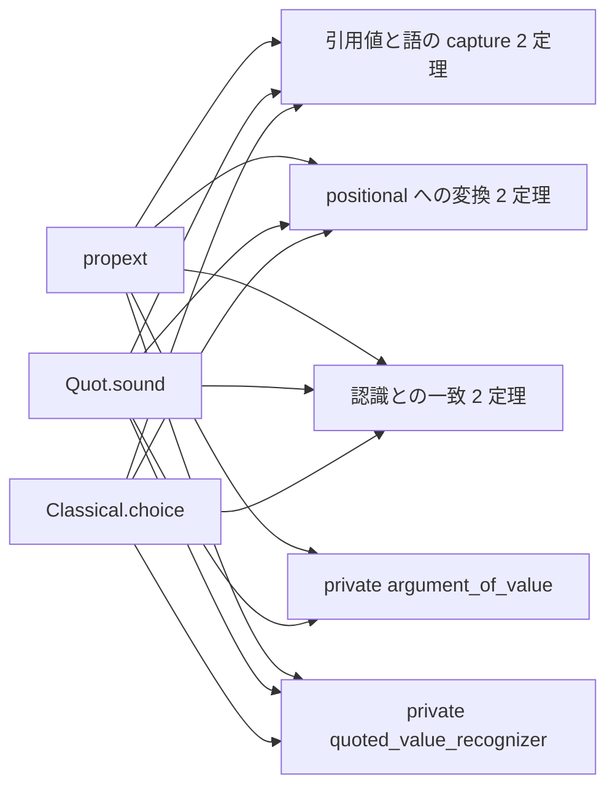
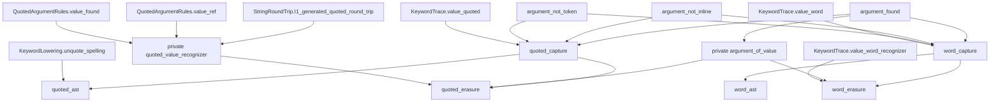

# 通常引数の語と引用値の capture

[root ADR 0351](../adr/0351-prove-parser-formatter-round-trips.md) のモデルで、`Argument` から `ArgValue` への参照と、その結果の捕捉を接続した。
基準は `a52309ca1402c854af83a07ae3e0ce1287b7cde7` である。
Lean 4.7.0 で [ArgumentTrace.lean](../../experiments/parser-fmt-proof/grammar/ArgumentTrace.lean) と [ArgumentMetadata.lean](../../experiments/parser-fmt-proof/grammar/ArgumentMetadata.lean) を検査した。
二つのファイルの SHA-256 は、それぞれ `6713795bd6d37df1c42dbca5dc01a5de730ab6eea6cc5c16baefd905104d63b1` と `7092d3c7174c79c453451c3a8d46f62bbb4264a205e2079d53f849d672311087` である。

## モデルと入力の範囲

実文法の `Argument <- ArgValue` を読み、語または引用文字列の token を含む `Argument` node を返す。
`ArgValue` の子は既存の `KeywordTrace.value` が実際の生成規則から読む。
呼び出し元から CST の子や、子の成功と結果の一致を渡さない。
`ArgumentMetadata` は引数とテンプレート引数がないこと、参照先と選択肢の全体、node の分類を検査する。
行番号と action は生成規則から取得し、行番号だけを変えた対照は通る。

引用値の定理は、任意長の `StringRoundTrip.Part` の列、任意の残りの入力と自然数 `extra` を扱う。
外側の引用符を付けた綴りについて、fuel を `parts.length + 11 + extra` とする。
語の定理は、空でなく許される文字だけを含む `WordRoundTrip.Word`、語に含められない区切り文字、その後の任意の入力を扱う。
語が `%%` で始まらないことを前提とし、fuel は区切り以降も含む入力長に `12 + extra` を足した値である。
どちらも、ここで得た子の成功を前提とする定理ではない。

`ArgumentTrace.Argument.positional` は、モデルの語または引用値を保持する型である。
捕捉した node をこの型へ変換すると、引用文字列を復号した値と、語の綴りを保持する。
Haskell の `Golem.Parser.AST.Positional` との一般的一致は、型の名前からは導けない。
実装との照合は、下記の十二例で別に行った。

`PosArg` の先読み、引数列全体の反復、順序の検査は、この捕捉モデルにはまだ接続していない。
式や命令を値とする `ArgValue` の捕捉も未対応であり、成功した未知の非 token を空の子として通すことはない。
`[=1 + 2]` は native parser が受理し、今回のモデルが明示的に未対応を返す対照である。
この対照を、parser が拒否した例に数えない。

## 宣言と公理

対象の二つのモジュールについて、Lean の環境から定理の型、証明項と直接参照を取得した。
定理は 65 件で、手書きの公開定理が六件、private の補助定理が二件、metadata の定理が三件、生成定理が 54 件である。
全定理に `#print axioms` を実行し、取得できなかった証明項はない。
定義は 132 件で、手書きは `sourceRule`、`layout`、`read`、`arguments`、`lower` の五件である。
残りはコンパイラーが生成した定義である。

以下の公開定理の名前は `ArgumentTrace.` を接頭辞とする。

| 宣言とソースの位置 | 前提と結論 | 公理 |
| --- | --- | --- |
| `I1_quoted_capture`、25 行 | 任意の引用値を読み、同じ残りの入力と `Argument` node、元の `StringLit` token を返す。 | `propext`、`Quot.sound`、`Classical.choice` |
| `I1_word_capture`、41 行 | 上記の語と区切りについて、同じ残りの入力と `Argument` node、元の `Word` token を返す。 | 同上 |
| `I1_quoted_ast`、59 行 | 捕捉した引用値を、復号後の同じ値を持つ `positional` へ変換する。 | 同上 |
| `I1_word_ast`、72 行 | 捕捉した語を、同じ綴りの `positional` へ変換する。 | 同上 |
| `I1_quoted_erasure`、109 行 | 捕捉結果から子を取り除くと、同じ fuel で実際の生成規則を認識した結果と一致する。 | 同上 |
| `I1_word_erasure`、120 行 | 語について、同じ fuel の認識と捕捉の残りの入力が一致する。 | 同上 |

private の接頭辞は `_private.ArgumentTrace.0.ArgumentTrace.` である。
`argument_of_value`（81 行）は、`ArgValue` の認識結果から二段分の fuel を加えた `Argument` の認識を導く。
この補題の子の成功は、二つの公開 erasure 定理で、既存の語の認識定理と引用値の認識の証明から導いている。
公開定理の未証明の前提へ移していない。
公理依存は `propext` と `Quot.sound` である。
`quoted_value_recognizer`（90 行）は、任意の引用値に対して `ArgValue` の認識が成功することを示し、三つの標準公理に依存する。

metadata の三定理は同じ `ArgumentTrace.` の `argument_found`（11 行）、`argument_not_inline`（14 行）、`argument_not_token`（15 行）であり、公理に依存しない。
`propext` は命題の同値から等値を得る公理で、Lean 4.7.0 の `Init/Core.lean:1287` にある。
`Quot.sound` は関係を満たす要素の商の等値を示す公理で、同 1459 にある。
`Classical.choice` は `Nonempty α` から要素を選ぶ公理で、`Init/Prelude.lean:730` にある。

ソースに公理の宣言はない。
環境には、`List.filterMap._at.ArgumentTrace.arguments._spec_1` というコンパイラー生成の `unsafe axiom` が一件ある。
型は `List CstWrapper.Element → List ArgumentTrace.Argument` で、実行用に特殊化した関数である。
六つの公開定理の公理依存には現れず、モデルの一致や成功を置く仮定には使っていない。

次の公理依存図は、六つの公開定理と二つの private 補題の推移的な依存を示す。
三つの metadata 定理には公理依存がない。



次の図の実線は、型または elaboration 後の証明項から環境の定理として解決した直接参照である。
対象内の接頭辞 `ArgumentTrace.` と `I1_` は省いた。
標準の等式、簡約、Omega の補助定理と、生成した定理は図から省き、生成定理は次の表に列挙する。



## 生成定理

次の 54 件は、対象の宣言を elaboration したときに生成された等式、pattern match や constructor の補助定理である。
`_private.ArgumentTrace.0.` から始まる名前は、その接頭辞を表で省いた。
元の認識器や捕捉器を簡約した際に生成されたものも含み、手書きの対象定理へ数え直していない。

| 完全修飾名（上記の private 接頭辞だけ省略） | 公理 |
| --- | --- |
| `ArgumentTrace.Argument.positional.inj` | なし |
| `ArgumentTrace.Argument.positional.injEq` | `propext` |
| `ArgumentTrace.Argument.positional.sizeOf_spec` | なし |
| `Except.map.match_1.eq_1` | なし |
| `Except.map.match_1.eq_2` | なし |
| `KeywordTrace.choices._eq_1` | なし |
| `KeywordTrace.choices._eq_2` | なし |
| `KeywordTrace.choices.match_1.eq_1` | なし |
| `KeywordTrace.choices.match_1.eq_2` | なし |
| `KeywordTrace.choices.match_2.eq_1` | なし |
| `KeywordTrace.choices.match_2.eq_2` | なし |
| `KeywordTrace.sequence._eq_1` | なし |
| `KeywordTrace.sequence._eq_2` | なし |
| `KeywordTrace.sequence._eq_3` | なし |
| `KeywordTrace.sequence.match_1.eq_1` | なし |
| `KeywordTrace.sequence.match_1.eq_2` | なし |
| `KeywordTrace.sequence.match_1.eq_3` | なし |
| `KeywordTrace.sequence.match_2.eq_1` | なし |
| `KeywordTrace.sequence.match_2.eq_2` | なし |
| `KeywordTrace.sequence.match_2.eq_3` | なし |
| `PegModel.BoolPayload.supported.match_3.eq_1` | なし |
| `PegModel.BoolPayload.supported.match_3.eq_2` | なし |
| `PegModel.foldChoice.match_1.eq_1` | なし |
| `PegModel.foldChoice.match_1.eq_2` | なし |
| `PegModel.interpreterStep.match_1.eq_1` | なし |
| `PegModel.interpreterStep.match_1.eq_2` | なし |
| `PegModel.interpreterStep.match_2.eq_1` | なし |
| `PegModel.interpreterStep.match_2.eq_2` | なし |
| `PegModel.interpreterStep.match_2.eq_3` | なし |
| `PegModel.interpreterStep.match_3.eq_1` | なし |
| `PegModel.interpreterStep.match_3.eq_2` | なし |
| `PegModel.interpreterStep.match_3.eq_3` | なし |
| `PegModel.interpreterStep.match_4.eq_1` | なし |
| `PegModel.interpreterStep.match_4.eq_2` | なし |
| `PegModel.interpreterStep.match_5.eq_1` | なし |
| `PegModel.interpreterStep.match_5.eq_2` | なし |
| `PegModel.interpreterStep.match_6.eq_1` | なし |
| `PegModel.interpreterStep.match_6.eq_2` | なし |
| `PegModel.interpreterStep.match_6.eq_3` | `Classical.choice`、`propext`、`Quot.sound` |
| `PegModel.recognizeEnv._eq_1` | `propext` |
| `PegModel.recognizeEnv._eq_2` | `propext` |
| `PegModel.recognizeEnv._unfold` | `propext` |
| `PegModel.recognizeEnv.match_1.eq_1` | なし |
| `PegModel.recognizeEnv.match_1.eq_2` | なし |
| `PegModel.runSequence.match_1.eq_1` | なし |
| `PegModel.runSequence.match_1.eq_2` | なし |
| `PegModel.runSequence.match_1.eq_3` | なし |
| `PegModel.runSequence.match_2.eq_1` | なし |
| `PegModel.runSequence.match_2.eq_2` | なし |
| `PegModel.runSequence.match_3.eq_1` | なし |
| `PegModel.runSequence.match_3.eq_2` | なし |
| `PegModel.runSequence.match_3.eq_3` | なし |
| `PegModel.runSequence.match_4.eq_1` | なし |
| `PegModel.runSequence.match_4.eq_2` | なし |

## 回帰と実装との照合

最初の回帰では、既存の leaf だけで `Argument` を読む入口が、引用値の捕捉を「未対応」として返して失敗した。
実際の子の結果を返す処理を接続すると、語と引用値の回帰が通る。
node を inline にする変更、子を別のルールへ渡す変更、復号後の種類と値を捨てる変更は、定理をまとめたモジュールの検査と実行時の回帰が拒否する。
実行時の変異の検査では、定理を取り除いた定義だけのモジュールを先にコンパイルする。
変えた定義自体の型の誤りや、未定義の識別子、import の失敗を、意味のある変異の拒否には数えない。

文法に `%inline Argument` を追加した対照と、`Argument` の子を `StringLit` へ変えた対照は、fresh な `Generated` と metadata の定理が拒否する。
native parser でも、前者は `Argument` node がなくなり、後者は引用値を受理して語を拒否することを検査する。
行番号だけを変えた生成 AST は metadata の検査に通る。

[共通の十二例](../../experiments/parser-fmt-proof/grammar/argument-cases.mjs) を、モデルと Haskell の観測器に渡す。
語、引用符と改行のエスケープ、空の引用値、和文、補助平面の文字、家族絵文字、タイ語、ZWNJ を含むペルシア語を含む。
`0.10` は語、引用された `%%= note` は引用値として保持する。
モデルの期待値は、任意の子の木を入力として渡すものではない。
実際の `ArgumentTrace.read` から得た token とモデルの `positional` を JSON にして比較する。

[NativePositional.hs](../../experiments/parser-fmt-proof/arguments/NativePositional.hs) は実パーサーの CST と AST を読み、ソース位置を除いた種類と値を返す。
同じ十二例について、整形前の CST の token、AST、通常の `golem fmt` 後の AST と、二度目の整形のバイト列を照合した。
Node のテストは親一件と子十二件の全十三件が成功した。
引用文字列の同じ値を保つエスケープの変更は許されるため、整形後の CST の生の綴りまで不変とはしていない。
原稿の `inspect` は観測用の命令名であり、命令の評価や宣言の検査を通した例には数えない。

## 再現する環境

GHC 9.10.3、プロジェクトで固定した peg-hs `4b4adc7046a14d18c8eec711f18dbcaa9b059cca`、Lean 4.7.0 を使う。
native parser のコンパイルは PATH の GHC を使うため、PEG_HS だけでなく PATH も指定する。
観測器は指定した Cabal plan の package ID と package DB を読み取り専用で使い、Cabal の再計画や本体のビルドは行わない。
照合に使った parser、文法と fmt のソースは、基準 `a52309ca` と、runtime をビルドした `e9d92609d7578e0e687f684ce4e00d9292a72373` の間で差分がないことを確認した。
この runtime の製品ソースは、後の main `bead6802895091038fc1870e4d67ae098c847582` からも変わっていない。
Golem 全体のバイナリーを、この証明の基準のソースで新しくビルドしたという主張にはしない。

通常の CLI と Cabal plan を用意した後、次のように指定する。
パスは、それぞれが存在する検証済みの環境へ置き換える。

```sh
PATH=/path/to/ghc-9.10.3/bin:$PATH \
CABAL_PLAN=/path/to/dist/cache/plan.json \
PEG_HS=/path/to/project-pinned/peg-hs \
LEAN=/path/to/lean-4.7.0/bin/lean \
node experiments/parser-fmt-proof/grammar/test.mjs

PATH=/path/to/ghc-9.10.3/bin:$PATH \
GHC=/path/to/ghc-9.10.3/bin/ghc \
CABAL_PLAN=/path/to/dist/cache/plan.json \
GOLEM=/path/to/golem \
node --test experiments/parser-fmt-proof/arguments/positional-values.native-test.mjs
```

全体をローカルで再実行するときは、上記と同じ環境変数を指定して `sh experiments/parser-fmt-proof/check-local.sh` を使う。
この経路は全 grammar harness と八ファイルの native observer、既存の引数テストを実行する。
observer の一覧の欠落や追加を見逃さない回帰も実行する。
既存の CI の構成と検査は維持し、新しい native observer 用の GHC や Cabal の準備は追加しない。
新しい八ファイルは `*.native-test.mjs` として CI の既存の `*.test.mjs` から分け、CI の計測や成功を observer の成否の証拠には含めない。

八ファイルの明示的なローカル実行は、親のテストを含む全 70 件が成功した。
既存の `check-suite.sh arguments 2 1` も全 60 件が成功した。
一覧の検査の回帰は三件で、一覧を調べない仮実装では二件が失敗し、各ファイルの欠落と追加を検出する実装では三件が成功した。
これとは別に、証明の検査が失敗しても全 observer と既存の引数テストへ進み、全体が失敗を返すことを一件の回帰で確認した。
この記録の通過数は、まとめるシェル内の四つのコマンドを個別に実行して取得した。
シェルの呼び出し順と失敗の集約は、この回帰で確かめた。

全 grammar harness も終了コード 0 で通った。
実際のソース、生成 AST、モデルのルール数は 151 件ずつで、表せない選択肢は 0 件だった。
正の証明モジュール 73 件、負の変異 346 件、意味を変えない AST の対照 14 件、実装パーサーの 167 例と同じ原稿のモデルの照合を含む。
これらの件数は、今回の通常引数の定理だけの数ではなく、既存の増分も含む harness 全体の通過数である。
任意の本体の値や AST、整形、評価との一般的な対応を、この件数から導いてはいない。

公理と定理の直接参照は、次のように新しい一時環境で再取得する。
既存の `.olean` をコピーする手順にはしていない。
出力の THEOREM は 65 件で、コンパイラー生成の unsafe axiom は一件である。

```sh
(
set -eu
task_lean=${LEAN:-lean}
task_proof=$(mktemp -d /private/tmp/golem-positional-dependencies-XXXXXX)
trap 'rm -rf "$task_proof"' EXIT HUP INT TERM
node experiments/parser-fmt-proof/grammar/generate.mjs --fragment \
  modules/golem-parser/grammar/Golem.hpeg "$task_proof/Generated.lean"
for task_module in PegModel PegModelTest WordRoundTrip StringRoundTrip ArgumentsRoundTrip \
  QuotedArgumentRules QuotedKeywords PrintedArguments QuotedCanonical MixedKeywords \
  KeywordLowering CstWrapperMetadata CstWrapper TokenLowering KeywordTrace ArgumentMetadata ArgumentTrace; do
  cp "experiments/parser-fmt-proof/grammar/$task_module.lean" "$task_proof/"
done
cd "$task_proof"
export LEAN_PATH=$task_proof
for task_module in PegModel Generated PegModelTest WordRoundTrip StringRoundTrip ArgumentsRoundTrip \
  QuotedArgumentRules QuotedKeywords PrintedArguments QuotedCanonical MixedKeywords \
  KeywordLowering CstWrapperMetadata CstWrapper TokenLowering KeywordTrace ArgumentMetadata ArgumentTrace; do
  "$task_lean" -o "$task_module.olean" "$task_module.lean" > "$task_module.log"
done
cat > Inspect.lean <<'LEAN'
import Lean
import ArgumentTrace
open Lean Elab Command
run_cmd do
  let env ← getEnv
  for (name, info) in env.constants.toList do
    let some index := env.getModuleIdxFor? name | continue
    unless [`ArgumentTrace, `ArgumentMetadata].contains env.allImportedModuleNames[index.toNat]! do continue
    match info with
    | .axiomInfo _ => elabCommand (← `(#print $(mkIdent name)))
    | .thmInfo theoremInfo =>
      let names := info.type.getUsedConstants ++ theoremInfo.value.getUsedConstants
      logInfo m!"THEOREM {name} {(toJson (names.toList.map Name.toString)).compress}"
      let direct := names.toList.filter (fun n => match env.find? n with | some (.thmInfo _) => true | _ => false)
      logInfo m!"DIRECT {name} {(toJson (direct.map Name.toString)).compress}"
      elabCommand (← `(#print axioms $(mkIdent name)))
    | _ => pure ()
LEAN
"$task_lean" Inspect.lean
)
```

## 証明の穴と残る範囲

対象のソースに `sorry`、`admit`、`sorryAx` はなく、65 定理の公理依存にも `sorryAx` はない。
語中の `%%` の diagnostic、その byte offset、CST の隙間に補う token、文字単位のモデルと UTF-8 の対応は、今回の定理の結論に含めていない。
`PosArg` と引数列全体、式や命令の値、コメント、原稿全体の CST、Haskell の AST と整形や評価の一般的な往復は残る。
[root ADR 0351](../adr/0351-prove-parser-formatter-round-trips.md) は未実装の状態を保つ。
