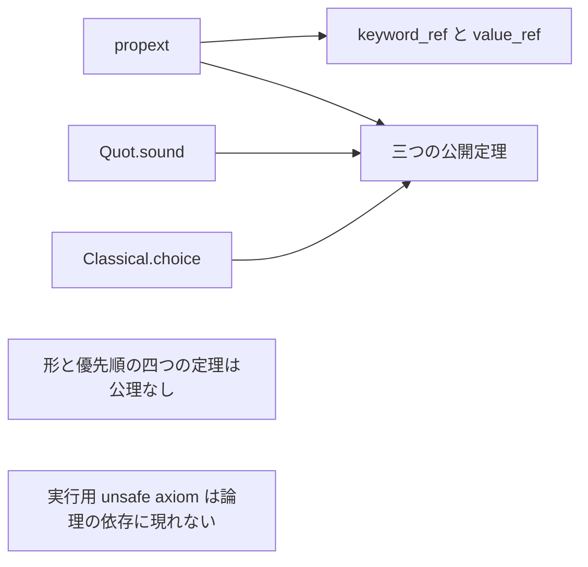
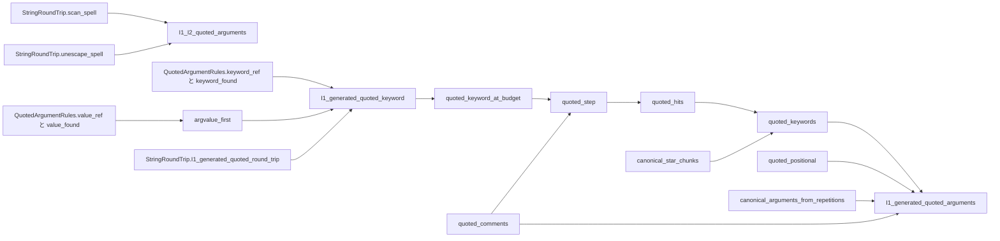

# 引用値を持つキーワード引数の一般証明

この記録は、[root ADR 0351](../adr/0351-prove-parser-formatter-round-trips.md) のうち、引用符で囲む値を持つキーワード引数の列を扱う。
基準は `bd92e39406e51b5c9169fef5480a2b2efc6735bc`、環境は Lean 4.7.0 である。
対象は `experiments/parser-fmt-proof/grammar/` の `QuotedArgumentRules.lean`、`QuotedKeywords.lean`、`QuotedCanonical.lean` の全文である。
文法の全体、AST の全体と整形の往復を証明したという記録ではない。

## 入力の範囲

一つの入力は、語の名前と引用値の組である。
名前には、既存の `WordRoundTrip.Word` の、空でなく禁止文字を含まないという条件を使う。
さらに、名前が `%%` で始まらないことを `safeNames` で要求する。
この領域の組を任意個、任意の順で並べ、同じ名前の繰り返しも許す。
引数の検査で重複が許されると仮定するものではなく、構文を読む段階で順を保つ性質である。

引用値には、`StringRoundTrip.Part` の任意長の列を使う。
通常の文字は `\`、引用符と LF 以外で、エスケープした文字は任意の `Char` である。
空の値、空白、引用符、バックスラッシュ、Unicode の文字と `%%` も表せる。
語の値を扱う既存のモデルの `safeValues` の条件は要らない。

これは PEG の引数の領域である。
CR など、Golem の入力全体の検査が拒む文字を含む列まで、正しい Golem 原稿だと主張しない。
位置引数、語の値との混在、式、展開と引数間のコメントの一般的な往復は、この増分に含めない。

## 命題と前提

`QuotedKeywords.I1_I2_quoted_arguments`（44 行）は、この任意長の列を書き出し、モデルで読み戻すと、名前、値の種類と復号した文字がすべて入力順に戻ることを示す。
`parseArgs` の fuel は残りの引数個数を制限する自然数で、列の長さ以上であることを要求する。
この値取得モデルと、PEG の再帰を制限する fuel は区別する。
値には `word` と `string` の構成子を置き、引用した値が常に `string` になることも結論に含める。

`QuotedKeywords.I1_generated_quoted_keyword` は、任意の名前、引用値と接尾辞で、書き出したキーワードを実際の `Generated.pegGrammar` の `KeywordArgument` が読むことを示す。
名前の文字列に `=` と引用値と接尾辞をつないだものを `input` とし、入口へ `input.length + parts.length + 16 + extra` の fuel を渡す。
`extra` は任意の自然数である。
名前の Word、等号と引用値の認識は、既存の一般補題と実際の `ArgValue` の先頭の選択肢から示す。

`QuotedKeywords.I1_generated_quoted_arguments` は、さらに実際の `Arguments` の入口で、列を読み切って改行と任意の接尾辞を残すことを示す。
入口の fuel は `input.length + weight args + extra + args.length + 83` である。
`input` は改行で終わる引数列と接尾辞、`weight` は引用値の Part の個数の総和である。
列の長さ、値の長さと繰り返し回数に上限を置かない。

この入口の定理は、省略可能なコメントが入力を残すこと、キーワードの先頭を位置引数として取らないこと、キーワードの反復と最後の引数順の検査を、実際の認識器について示す。
反復は既存の `canonical_star_chunks` を使い、空でない塊の消費と fuel の減少を照合する。
子の成功や、証明したい結果の一致を入口の前提に置かない。

中間の非公開補題 `argvalue_first` は、引用文字列の認識を前提にする合成補題である。
公開の一引数の定理は、その前提を任意の Part 列の引用文字列の定理で満たす。
既存の `canonical_arguments_from_repetitions` が取る各反復の結果も、列全体の公開定理で導く。
条件付きの合成補題だけを、一般の往復証明に数えない。

`QuotedArgumentRules` は、キーワード、値と引用文字列の規則を実際の生成された AST から照合する。
四つの閉じた定理が、規則の形とエスケープの優先順を確かめる。
二つの参照を展開する一般補題は、任意の文法がその形の規則を持つことを前提にし、公開定理は実際の生成文法でその前提を満たす。
行番号と unit action の空白だけの変更は認識を変えない。

## 公理と証明の穴

名前を付けた十九の定理と、Lean が生成した補助定理を合わせた百二十の定理について、型と証明項を環境から調べた。
`#print axioms` で、インポートした補題を通る公理依存も調べた。
新しい公理をソースで宣言していない。

規則の形と優先順を照合する四つの定理は、公理に依存しない。
二つの参照を展開する一般補題は `propext` に依存する。
三つの公開の往復と認識の定理は `propext`、`Quot.sound` と `Classical.choice` に依存する。
既存の `StringRoundTrip.scan_spell`、`unescape_spell` と `WordRoundTrip.safe_name_before_equals` の依存にも、この三つの公理が含まれる。

`propext` は命題の同値から等式を得る公理で、Lean 4.7.0 の `Init/Core.lean:1287` にある。
`Quot.sound` は関係で結ばれた要素が商で等しいという公理で、同じファイルの 1459 行にある。
`Classical.choice` は存在する型から要素を選ぶ公理で、`Init/Prelude.lean:730` にある。



コンパイラは、実行用の特殊化として六つの unsafe axiom を生成する。
二つは `List.mapTR.loop` の `abstract` と `chunks` 向けの特殊化、残りの四つは導出した Value の Repr の補助処理である。
この六つを `#print` で調べた。
完全な名前は次のとおりで、Repr の四つにはコンパイラが付けた名前をそのまま載せる。

```text
List.mapTR.loop._at.QuotedKeywords.abstract._spec_1
Std.Format.joinSep._at._private.QuotedKeywords.0.QuotedKeywords.reprValue.«_@».QuotedKeywords._hyg.33._spec_3
repr._at._private.QuotedKeywords.0.QuotedKeywords.reprValue.«_@».QuotedKeywords._hyg.33._spec_2
List.mapTR.loop._at.QuotedKeywords.chunks._spec_1
List.repr'._at._private.QuotedKeywords.0.QuotedKeywords.reprValue.«_@».QuotedKeywords._hyg.33._spec_1
List.foldl._at._private.QuotedKeywords.0.QuotedKeywords.reprValue.«_@».QuotedKeywords._hyg.33._spec_4
```
`abstract`、`chunks`、`parseArgs`、`printArgs` と `weight` の論理上の定義は、これらの公理に依存しない。
三つの公開定理の公理依存にも現れない。

対象のソースに `sorry`、`admit`、`sorryAx` の使用はない。
採用したソースの型検査と公理依存にも証明の穴はない。
この三ファイルについて、取得できなかった証明項や公理依存はない。
インポート先のすべての定理をここで再調査したという意味ではない。

## 定理間の依存

次は、型または elaboration 後の証明項から確かめた主要な参照である。
実線は、調べた型と証明項に現れる直接参照を表す。
図の経路をたどると、補助定理を通る間接参照が分かる。
標準ライブラリの等式と命題の簡約は省く。



## 実装との照合

先に Word だけのモデルを型付きの入口へ接続し、有効な引用値 `path="a\"b"` を読む回帰が、期待する復号値を得られずに失敗することを確かめた。
引用値を読むモデルへ置き換えた後、同じ回帰が名前、種類と値のすべてで通る。
値を復号しない、語の種類にする、名前を捨てる、列の残りを捨てるという四つの変異は、一般定理を失敗させる。

文法の名前、値とエスケープの優先順を変えた三つの対照では、生成器の検査と実パーサーの反例を確かめる。
対応する実際の生成済み AST も変更し、`Generated` と、それだけをインポートする `QuotedArgumentRules` を作り直して定理が失敗することを確かめる。
生成文法が変わったとき、基準の `Generated` に依存する証明の artifact を、その形の照合に再利用しない。
型の不一致を検出した後で既存の大きな合成補題が時間超過した試行は、対照の成功に数えない。
形の照合を Generated だけをインポートする独立したファイルへ置き、改めて型の不一致で拒否した。
既定の heartbeats は増やしていない。

八つの共通の原稿の十二のキーワード出現で、モデルの値を、期待する名前、StringLit の種類と復号値に照合する。
同じ入力を、Golem.Parser.parseAst を呼ぶ Haskell のプログラムと、通常の `golem fmt` にも渡す。
Haskell は AST の構成子を直接照合し、値を JSON にする。
Show の表示から位置を正規表現で取り除く方法は使わない。
fmt の前後の名前、種類と値が一致し、二度目の整形でバイト列が変わらないことを確かめる。

これらの例には、空の列、空の値、同じ名前、エスケープした引用符、バックスラッシュ、空白、区切りの文字と改行、`%%`、算用数字や真偽値に見える文字列を含める。
Unicode の例には、鰍、𠮷、家族の絵文字、タイ語、アラビア語と ZWNJ を含むペルシア語を使う。
値そのものが位置の表示のような ` @17..19 ` である例も含める。
この有限の照合を、Haskell の AST の全体や fmt の一般証明と区別する。

## まだ証明していない範囲

語と引用値を混ぜた列、位置引数、式、展開、コメントを含む一般の引数と、Golem の AST の全体との一般的な対応は残る。
Golem の入力全体の検査、診断の位置と順序、実際の fmt と評価の一般的な往復も残る。

位置だけを除いた AST の同一性には、既採択の二つの書き換えとの境界もある。
[root ADR 0451](../adr/0451-import-listed-names-without-a-namespace.md) の取り込む名前の書式では、`{alpha,beta}` という Word 一つが、整形で四つの Word になる。
[golem-parser ADR 0010](../golem-parser/adr/0010-ruby-slash-escape-and-table-cell-breaks.md) の外してよいエスケープでは、`\甲` の Escaped が Text になる。
両方とも、実際の原稿の check が整形の前後で通り、位置以外の AST が変わることを確かめた。
この増分では、その挙動と ADR を変更せず、一般の比較の定義も新しく決めない。
[root ADR 0351](../adr/0351-prove-parser-formatter-round-trips.md) の未実装の状態を保つ。

## ソースと宣言の位置

次の SHA-256 は対象の全文である。

| ファイル | SHA-256 |
| --- | --- |
| `QuotedArgumentRules.lean` | `b4e6678adf5a2d06260b3cda2a712f892457b08eb056ecd866111ec5950d6f53` |
| `QuotedKeywords.lean` | `99bc42ae768f4dc3abf6423858248fee1fcc75075fddc8095f91930f73709783` |
| `QuotedCanonical.lean` | `f013f9e175df0b7c840e7d5aca0ecf524c174c0f1cffe128133b0a45f0b260bb` |

次は、ソースで名前を付けた十九の定理の位置である。
private は非公開の補題を表す。

| ファイル | 定理と行 |
| --- | --- |
| `QuotedArgumentRules.lean` | `keyword_found` 27、`value_found` 30、`string_found` 33、`escaped_first` 36、`keyword_ref` 38、`value_ref` 43 |
| `QuotedKeywords.lean` | `not_empty`（private） 39、`I1_I2_quoted_arguments` 44、`argvalue_first`（private） 66、`I1_generated_quoted_keyword` 77 |
| `QuotedCanonical.lean` | `chunks_length` 14、`chunks_join` 15、`quoted_keyword_at_budget` 24、`quoted_comments` 36、`quoted_step` 51、`quoted_hits` 83、`quoted_keywords` 103、`quoted_positional` 112、`I1_generated_quoted_arguments` 155 |

宣言名の接頭辞は、最初のファイルが `QuotedArgumentRules`、残りの二つが `QuotedKeywords` である。
次は、それぞれの前提と結論の要約である。

| 宣言 | 主な前提と結論 |
| --- | --- |
| `keyword_found`、`value_found`、`string_found` | 前提なしで、実際の生成文法から取り出す三規則が指定の形になる |
| `escaped_first` | 前提なしで、引用文字列のエスケープの選択肢が先になる |
| `keyword_ref`、`value_ref` | 任意の文法に指定の形の規則があるなら、その参照を一段展開できる |
| `not_empty` | 名前の Word が持つ非空の条件から、isEmpty が false になる |
| `I1_I2_quoted_arguments` | 安全な名前と引数個数以上の fuel から、印字した任意長の列の名前、種類と値が戻る |
| `argvalue_first` | StringLit が成功するなら、十分な段数を加えた ArgValue も同じ残りを返す |
| `I1_generated_quoted_keyword` | 安全な名前と任意の引用値から、指定の fuel で KeywordArgument が接尾辞まで読む |
| `chunks_length` | 前提なしで、塊の列と引数の列の長さが同じになる |
| `chunks_join` | 前提なしで、塊の連結と改行が印字した列になる |
| `quoted_keyword_at_budget` | 安全な名前と明記した fuel の下限から、一引数の一般認識を任意の十分な予算へ移す |
| `quoted_comments` | 安全な名前と 80 以上の fuel から、先頭の省略可能なコメントが入力を残す |
| `quoted_step` | 先頭と残りの安全な名前、および明記した fuel の下限から、一つの反復が一引数だけ読む |
| `quoted_hits` | 安全な名前と入力の長さと引用値の Part の総数以上の余裕から、任意長の各塊の反復条件を示す |
| `quoted_keywords` | 同じ条件から、キーワード反復が列を読み、改行と接尾辞を残す |
| `quoted_positional` | 安全な名前から、位置引数の反復がこの列を読まず入力を残す |
| `I1_generated_quoted_arguments` | 安全な名前と任意の引用値の列から、明記した fuel で Arguments が列を読み切る |
