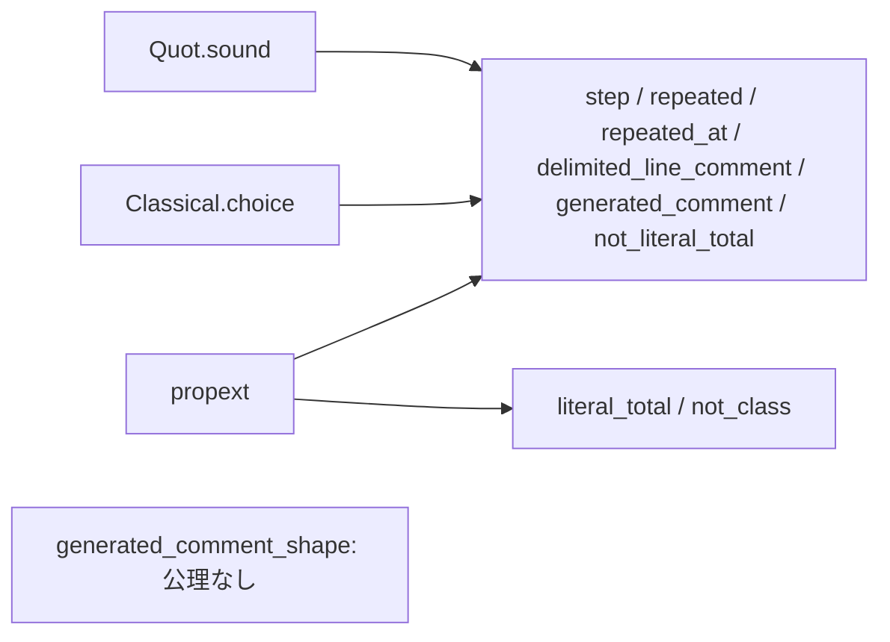
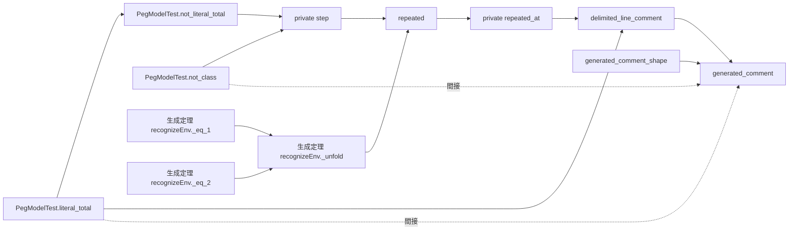
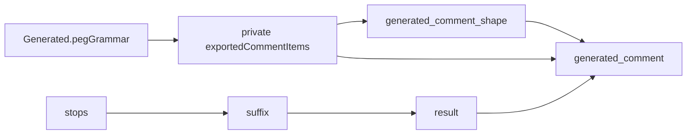

# 予約括弧内のコメントの証明と依存関係

この記録は、[root ADR 0351](../adr/0351-prove-parser-formatter-round-trips.md) のうち、`ReservedBracketBody` 内のコメントの選択肢だけを扱う。
基準の main は `7fe8044d55def38a772cd1cf6f9917cb541bd5e0`、追加した証明は `experiments/parser-fmt-proof/grammar/ReservedCommentTotal.lean` である。
このファイルの SHA-256 は `42c94a80afb207726334b1e4a81a2696860e1af9feef2c421e8660eceec2f591` である。
Lean は 4.7.0（`6fce8f7d5cd1`、aarch64）を使った。
予約括弧の復旧全体や、AST と整形の一般的な往復の証明は、この記録の完了範囲に含めない。

## 証明する結果

対象は、実文法の `Golem.hpeg:805` にある `'%%' (!'%%' ![\n] .)* '%%'` である。
最初の `%%` を読んだ後、次の `%%`、改行、入力末のいずれかに達するまで一文字ずつ進む。
閉じる `%%` があればその後の入力を返し、先頭の区切りがない場合と閉じ区切りがない場合は通常の不一致になる。
途中の `]` はコメントの本文として消費する。

一般形の定理は、任意の文法、環境、区切り文字列、入力について、`suffix` と `result` に定義した結果を証明する。
同じ行に閉じ区切りがあるという説明は、実文法の区切り `%%` についてのものである。
入力の長さに 6 と任意の自然数を足した fuel を使い、入力長には上限を置かない。
fuel は再帰の深さと繰り返しの回数の上限であり、実行ステップ数そのものではない。
後続の解析結果が正しいという仮定はない。

実文法の定理は、`Generated.pegGrammar` から取り出した `ReservedBracketBody` の内側の二番目の選択肢を、直接 `runSequence` に渡す。
`generated_comment_shape` でこの値と一般形の形の一致を証明し、一般形の定理を使う。
生成した AST の先読みを反転すると、この一致と実文法の定理が通らなくなる。

## 宣言の一覧

位置は `experiments/parser-fmt-proof/grammar/` からの相対パスである。
`ReservedCommentTotal` 内の private 宣言の完全修飾名は、表の `private 名` を `_private.ReservedCommentTotal.0.ReservedCommentTotal.名` に置き換えたものである。

| 定理と位置 | 主要な前提と結論 |
| --- | --- |
| `private step`、`ReservedCommentTotal.lean:21` | 任意の文法、環境、区切り、入力について、`fuel + 4` で本文の一回の認識が区切り、改行、入力末では不一致になり、それ以外は一文字だけ消費する。 |
| `ReservedCommentTotal.repeated`、`ReservedCommentTotal.lean:43` | 任意の入力の長さに 5 と任意の自然数を足した fuel で本文を繰り返すと、計算で求めた `suffix` と同じ残りになる。入力に関する帰納法を使う。 |
| `private repeated_at`、`ReservedCommentTotal.lean:63` | `input.length + 5 ≤ fuel` を前提に、繰り返しの結果が `suffix` と一致する。前提は数値の容量だけで、認識結果の一致を仮定していない。 |
| `ReservedCommentTotal.delimited_line_comment`、`ReservedCommentTotal.lean:79` | 任意の文法、環境、区切り、入力について、開き区切り、本文、閉じ区切りの列を認識した結果が `result` と一致する。列の認識に渡す `boundLength` も任意である。 |
| `ReservedCommentTotal.generated_comment_shape`、`ReservedCommentTotal.lean:103` | 実際に生成した文法の当該選択肢が、`%%` によるコメントの形と等しい。追加の仮定はない。 |
| `ReservedCommentTotal.generated_comment`、`ReservedCommentTotal.lean:106` | 実際の選択肢の認識が、任意の入力で `result "%%"` と一致する。入力の長さに 6 と任意の自然数を足した fuel を使う。 |
| `PegModelTest.literal_total`、`PegModelTest.lean:1320` | 任意のリテラルと入力について、`fuel + 1` での認識結果が先頭一致と残りの入力から求まる。 |
| `PegModelTest.not_literal_total`、`PegModelTest.lean:1326` | 任意のリテラルと入力について、`fuel + 2` での否定の先読みは、一致なら不一致、それ以外なら入力を消費しない成功になる。 |
| `PegModelTest.not_class`、`PegModelTest.lean:639` | 任意の文字範囲と入力について、`fuel + 2` での否定の先読みは、先頭文字が範囲内なら不一致、それ以外なら入力を消費しない成功になる。 |

ソースで明示した定義は次の八つである。
これらの型と値も環境から取得し、いずれも公理には依存しないことを確認した。

| 定義と位置 | 役割 |
| --- | --- |
| `private newlineRanges`、`ReservedCommentTotal.lean:7` | 改行の文字範囲 U+000A。 |
| `private bodyItems`、同 8 行 | 区切りと改行の否定の先読みと、一文字の列。 |
| `private body`、同 10 行 | その列を含む一つの選択肢。 |
| `ReservedCommentTotal.stops`、同 12 行 | 区切りか改行で止まるかの判定。 |
| `ReservedCommentTotal.suffix`、同 17 行 | 停止位置まで一文字ずつ進めた残りの入力。 |
| `ReservedCommentTotal.commentItems`、同 70 行 | 開き区切り、本文の繰り返し、閉じ区切りの列。 |
| `ReservedCommentTotal.result`、同 73 行 | 全体の成功か不一致と、成功時の残りの入力。 |
| `private exportedCommentItems`、同 95 行 | `Generated.pegGrammar` の実際のコメントの選択肢。 |

`ReservedCommentTotal.lean:114` から 117 行の名前のない例四つは、空のコメント、途中の `]`、閉じ区切りなし、途中の改行を確かめる。
公開の名前付き定理としては数えていない。

## 公理と証明の穴

環境の宣言の種類を調べた結果、対象モジュールで宣言した公理はなかった。
各定理には `#print axioms` を使い、定理の型と elaboration 後の証明項から、補助定理と定義を経由する公理も調べた。
現れた標準の公理は次の三つである。

| 公理 | 命題と Lean 4.7.0 の宣言元 |
| --- | --- |
| `propext` | 命題同士の同値から等式を得る。`Init/Core.lean:1287`。 |
| `Classical.choice` | 空でない型から要素を選ぶ。`Init/Prelude.lean:730`。 |
| `Quot.sound` | 関係で結ばれた要素が商の要素として等しい。`Init/Core.lean:1459`。 |

`generated_comment_shape` は公理に依存しない。
`literal_total` と `not_class` は `propext` だけ、それ以外の表の定理は三つすべてに依存する。
次の図は、補助定理と定義を経由するものを含む推移的な公理依存である。

対象ソースには `sorry`、`admit`、`sorryAx` の使用はなかった。
コンパイルの診断と公理依存にも `sorryAx` は現れず、報告する証明の穴の位置はない。
名前付きの private 定理も含めて調べた。

## 直接依存と間接依存

直接依存は、環境の定理の型と elaboration 後の証明項の `getUsedConstants` を合わせ、定理の宣言として解決した参照から求めた。
次の図はプロジェクト内の定理と、直接使う生成定理の関係である。
実線は直接参照、破線は表示した定理を経由する間接依存であり、矢印は依存先から利用する定理へ向ける。

`recognizeEnv._eq_1`、`recognizeEnv._eq_2`、`recognizeEnv._unfold` は、このモジュールのコンパイルで Lean が生成した補助定理であり、対応するソース位置は環境から取得できなかった。
完全修飾名は、それぞれ `_private.ReservedCommentTotal.0.PegModel.recognizeEnv.` に表の末尾の名前を続けたものである。
元になる定義は `PegModel.lean:155` 以降の、fuel が 0 の場合と後続の自然数の場合の認識処理である。
各生成定理の公理依存も確認し、この三つは `propext` だけに依存した。
標準ライブラリと `omega` の定理の個別の頂点は、図には載せていない。

定義を経由する、実文法との対応は次のとおりである。

対象モジュールには、ほかにもコンパイラが作る定理と定義がある。
ソース位置のない生成定理 13 個と生成定義 51 個を識別し、生成定理の公理表示も確認した。
公開の四定理から公理表示の再帰的な走査をたどると、いずれも unsafe な証明消去の印 `lcProof` には到達しなかった。

## 実装との照合と残件

実パーサーは固定した peg-hs `4b4adc7046a14d18c8eec711f18dbcaa9b059cca` を使う。
`peg-hs parse` が使うコンパイラも、PATH の先頭を GHC 9.10.3 のディレクトリにして固定した。
`PEG_HS` の実行ファイルの指定だけでは、native parser のコンパイラの固定にはならない。
再現手順は [実験の README](../../experiments/parser-fmt-proof/grammar/README.md) にある。

実パーサーの照合では、実文法の本文は変えず、`%entry ReservedBracketBody` だけを加える。
この入口の CST と全入力の消費を確かめるのであり、構文エラーのない原稿の往復を確かめたとは扱わない。
先読みを反転した対照は、コメント中の `]` で残りの入力を読めなくなる。

この一つの選択肢の一般証明により、未証明の一覧は 24 個から 23 個になる。
本体全体の繰り返し、入れ子の括弧、`SkippedReserved` による復旧全体と、それ以外の未証明の選択肢は残る。
Haskell のアクションが作る AST、コメントの CST 上の相対位置、`golem fmt` と評価の一般的な往復も、この証明の結論には含まれない。
[root ADR 0351](../adr/0351-prove-parser-formatter-round-trips.md) の全範囲は引き続き未完了である。
