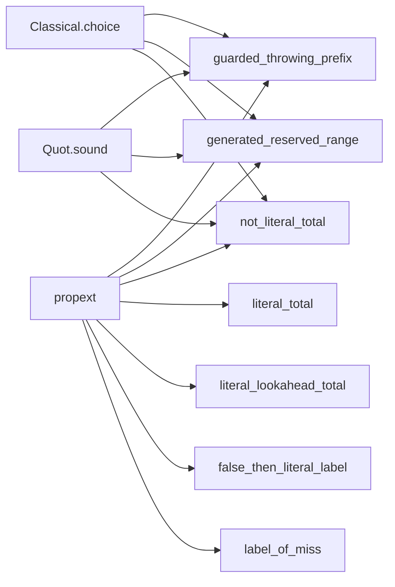
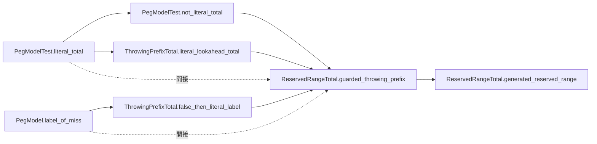
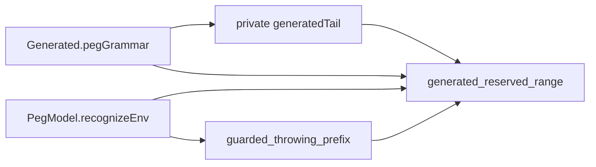

# ReservedRange の証明の前提と依存関係

この文書は、[root ADR 0351](../adr/0351-prove-parser-formatter-round-trips.md) の増分である `ReservedRangeTotal` の証明を調べた記録である。
対象のソースはコミット `c8e8074497a7525d5b67803cdc19d8ff078083e0`、Lean は 4.7.0（`6fce8f7d5cd1`、aarch64）である。
新しい二つの公開定理、private な定義一つと、証明に必要なプロジェクト内の補助定理五つを調べた。
[root ADR 0351](../adr/0351-prove-parser-formatter-round-trips.md) 全体の証明が完了したという記録ではない。

## 確認方法

`experiments/parser-fmt-proof/grammar/` のモデルと生成済み文法を、一時ディレクトリで Lean 4.7.0 によりコンパイルした。
その環境に `ReservedRangeTotal` をインポートし、宣言の種類、型と elaboration 後の証明項を調べた。
直接依存は、型と証明項の `getUsedConstants` を合わせ、環境で `.thmInfo` に解決できる定数から求めた。
定義への参照は定理への参照と分け、定義を経由する公理は各宣言の `#print axioms` で確認した。
ソースの証明スクリプトに名前が現れることだけを依存の根拠にはしていない。

一時ファイルで実行した公理確認の中心部分は次のとおりである。
生成とコンパイルの環境は [実験の README](../../experiments/parser-fmt-proof/grammar/README.md) に従う。

```lean
import ReservedRangeTotal

#print axioms ReservedRangeTotal.guarded_throwing_prefix
#print axioms ReservedRangeTotal.generated_reserved_range
#print axioms PegModelTest.literal_total
#print axioms PegModelTest.not_literal_total
#print axioms ThrowingPrefixTotal.literal_lookahead_total
#print axioms ThrowingPrefixTotal.false_then_literal_label
#print axioms PegModel.label_of_miss
```

さらに `Lean.Elab.Command.CollectAxioms.collect` の訪問済み宣言を調べた。
これは Lean 4.7.0 の `Lean/Elab/Print.lean:91` 以降にある、公理表示のための再帰的な走査である。
宣言の型と値を経由するため、直接参照だけでは見えない定義も確認できる。
今回の二つの公開定理について、証明項を取得できなかった箇所はなかった。

## 定理と定義

以下の位置は `experiments/parser-fmt-proof/grammar/` からの相対パスである。
「任意」は、各定理の型で量化された値について成り立つことを指す。
`fuel` は再帰の深さと繰り返しの回数の上限であり、入力長や実行ステップ数そのものではない。

| 完全修飾名と位置 | 主要な前提と結論 |
| --- | --- |
| `ReservedRangeTotal.guarded_throwing_prefix`、`ReservedRangeTotal.lean:8` | 文法、環境、入力、二つのリテラル、ラベル名、後続の式列は任意。`fuel + 6` で、除外リテラルが先頭にあれば不一致、それ以外で値リテラルが先頭にあればラベルエラー、残りは不一致となる。後続の解析結果の仮定はない。 |
| `ReservedRangeTotal.generated_reserved_range`、`ReservedRangeTotal.lean:42` | 実際に生成した文法の `ReservedRange` を、任意の入力と `fuel + 7` で認識する。`...` で始まれば不一致、`..` で始まり `...` でなければ `reserved` のラベルエラー、残りは不一致となる。入力長の上限はない。 |
| `PegModelTest.literal_total`、`PegModelTest.lean:1320` | 任意の文法、環境、リテラル、入力について、`fuel + 1` でのリテラル認識が、先頭一致と残りの入力を使う結果に等しい。 |
| `PegModelTest.not_literal_total`、`PegModelTest.lean:1326` | 任意のリテラルと入力について、`fuel + 2` での否定の先読みが、先頭一致なら不一致、それ以外なら入力を消費しない成功となる。 |
| `ThrowingPrefixTotal.literal_lookahead_total`、`ThrowingPrefixTotal.lean:19` | 任意のリテラルと入力について、`fuel + 2` での肯定の先読みが、先頭一致なら入力を消費しない成功、それ以外なら不一致となる。 |
| `ThrowingPrefixTotal.false_then_literal_label`、`ThrowingPrefixTotal.lean:8` | 偽の述語とリテラルを並べた選択肢にラベルを付けると、任意の入力について `fuel + 4` でラベルエラーとなる。 |
| `PegModel.label_of_miss`、`PegModel.lean:271` | 子の認識が `fuel` で通常の不一致となることを前提に、ラベル付きの子が `fuel + 1` でそのラベルのエラーとなる。上の補助定理では、偽の述語からこの前提を証明している。 |
| `_private.ReservedRangeTotal.0.ReservedRangeTotal.generatedTail`、`ReservedRangeTotal.lean:38` | 定理ではなく private な定義。`Generated.pegGrammar` の `ReservedRange` の最初の選択肢から先頭三項を除いた、実際の後続部分を保持する。 |

`guarded_throwing_prefix` は、先読みが通った場合にも、直後の偽の述語でラベルエラーになることを使う。
このため後続部分には到達しない。
`generatedTail` に再帰を含む実際の後続部分を残しても、後続の成功や停止を前提に加える必要はない。
`ReservedRangeTotal.lean:56`、60、64、68、72 の名前のない `example` 五件もコンパイルしたが、独立した公開の名前付き定理としては数えていない。

## 公理

対象のソースで新たに宣言した公理はない。
`#print axioms` に現れた公理は、いずれも Lean 4.7.0 の標準ライブラリにある次の三つである。

| 公理 | 命題の概要と宣言元 |
| --- | --- |
| `propext` | 命題 `a` と `b` が同値なら `a = b`。`Init/Core.lean:1287`。 |
| `Classical.choice` | 型 `α` が空でないという証明から、その要素を選ぶ。`Init/Prelude.lean:730`。 |
| `Quot.sound` | 関係 `r` で結ばれた二要素は、`r` による商の要素として等しい。`Init/Core.lean:1459`。 |

二つの公開定理と `not_literal_total` は三つすべてに依存する。
残りの補助定理四つは `propext` だけに依存する。
private な `generatedTail` 自体に公理への依存はない。
次の図は、補助定理と定義を経由するものも含む推移的な公理依存である。
矢印は公理から、それを使う定理へ向けている。



## 定理の直接依存と間接依存

次の図は、今回調べたプロジェクト内の七定理に限る。
実線は型または elaboration 後の証明項にある直接参照、破線は図中の補助定理を経由する間接依存である。
矢印は依存先から利用する定理へ向けている。



標準ライブラリの定理への直接参照も環境で確認したが、この図には個別の頂点として載せていない。
重複を除くと、`guarded_throwing_prefix` はプロジェクト内三定理と標準の 32 定理、`generated_reserved_range` はプロジェクト内の定理一つと標準の 19 定理を直接参照する。
これには `omega` が生成した証明項の参照も含む。
定義を経由する主な関係は、定理間の図と分けて次に示す。



`ReservedRangeTotal` の環境には、二つの公開定理以外に、コンパイラが作る照合分岐などの定理 28 個と定義 52 個もあった。
これらの生成宣言は、今回の二つの公開定理からたどったカーネルの依存には現れなかった。
公開定理から到達する同モジュールの宣言は、一般形ではその定理自身だけ、実文法の定理では自身、一般形の定理、private な `generatedTail` の三つだった。

## 証明の穴と未確認の範囲

`ReservedRangeTotal.lean`、`ThrowingPrefixTotal.lean`、`PegModelTest.lean`、`PegModel.lean` を `rg -n '\b(sorry|admit|sorryAx)\b'` で検索した結果、候補はなかった。
Lean のコンパイルでも `sorry` の診断はなく、今回の公開定理と補助定理の公理依存に `sorryAx` は現れなかった。
この範囲に報告する証明の穴の位置はない。

生成された `_cstage1` などの unsafe な宣言には、標準の `lcProof` を参照するものがある。
Lean 4.7.0 の `Init/Prelude.lean:146` 以降では、これをコンパイラによる証明消去のための unsafe な印として説明している。
今回の二つの公開定理からの再帰的な依存を調べると、どちらも `lcProof` には到達しなかった。
生成された実行用の宣言の参照と、公開定理の証明の前提を区別する必要がある。

この調査は、残る未証明の 24 選択肢、Haskell のアクションが作る AST の値、ラベルエラーからの復旧、`golem fmt`、評価との一般的な往復の依存調査を含まない。
それらの証明がこの増分で得られたとは判断していない。
[root ADR 0351](../adr/0351-prove-parser-formatter-round-trips.md) の全範囲は引き続き未完了である。
