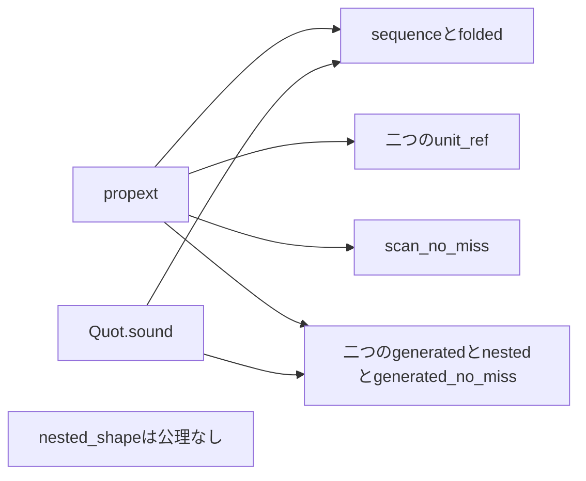
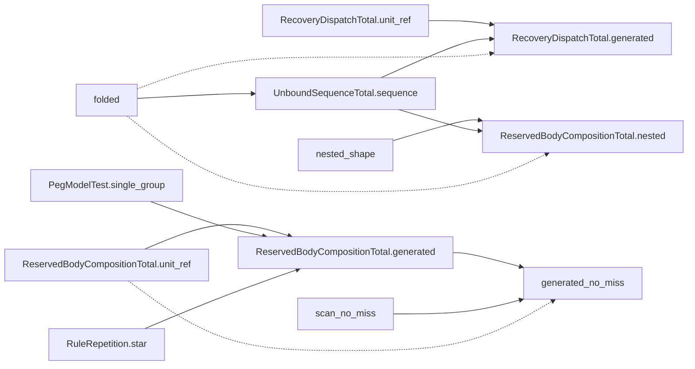

# 予約構文の認識の合成と証明の依存関係

この記録は、[root ADR 0351](../adr/0351-prove-parser-formatter-round-trips.md) の認識モデルの増分について、命題、前提、公理と実装との照合をまとめる。
対象は `UnboundSequenceTotal.lean`、`RecoveryDispatchTotal.lean`、`ReservedBodyCompositionTotal.lean` の全文である。
Lean 4.7.0 で実際に生成した `Generated.lean` を読み、各モジュールをコンパイルした。
文法は `modules/golem-parser/grammar/Golem.hpeg` の SHA-256 `82c0987f5952d519c27cb137c5fe31c77b5c3d7db6c36cdae902a4b9cec7eefb` を使った。

基準のコミットは `42c2cc059f9cab3fa67c8cd4189aca2034393ee2` である。
追加した証明ファイルの SHA-256 は次のとおりである。

| ファイル | SHA-256 |
| --- | --- |
| `UnboundSequenceTotal.lean` | `041e3acaec317b0d9aa15948681fd028f36cee4550d3267b5b021a432e19ab1c` |
| `RecoveryDispatchTotal.lean` | `5323e098b35292d4aeb559e39681b71b85ec3491dc04204346db430c74293c03` |
| `ReservedBodyCompositionTotal.lean` | `a4c946f17f715c743da65ab6223fd53eda371c6f24abb2050c0aef2da561bd6c` |

## 命題と前提

`UnboundSequenceTotal.sequence` は、列の外側の要素に名前付きの束縛がないとき、`runSequence` が子の認識を順に呼ぶ `follow` と等しいことを示す。
認識器と束縛する値を求める関数は任意であり、入力、環境、式の列も任意である。
構文上の条件から環境が変わらないことを、補助定理 `folded` が列の長さについての帰納法で示す。
`bind none` と、子の内部にある束縛は許すが、外側の `bind (some name)` は許さない。
子の成功や、二つの認識器の結果の一致は前提に置かない。

`RecoveryDispatchTotal.unit_ref` は、実際のルールの構造が四つの固定の選択肢と一致するという前提から、参照を選択へ展開する。
`generated` は、その前提を実際の生成文法について `rfl` で満たし、四つの選択肢を順に試す `foldChoice` へ分解する。
閉じた `[!…]`、短い `[!`、改行の前までの `@!…`、`..` の順を保つ。
入力と環境、fuel は任意であり、入口の fuel は `fuel + 2`、各子の fuel は `fuel` である。
行番号と unit action は、実際のソースから取り出す。
認識する式と選択順は固定して照合し、認識式の変異をこのメタデータへ隠さない。

`ReservedBodyCompositionTotal.generated` は、実際の本体ルールの一つの選択肢を、`RuleRepetition.scan` へ移す。
入口へ `fuel + 2` を渡し、走査の最初の fuel は `fuel` とする。
`nested` は、反復の内部にある第三の選択肢を、開く角括弧、本体の参照、閉じる角括弧の順に呼ぶ処理へ移す。
入れ子の式が実際の第三の選択肢と一致することを、補助定理 `nested_shape` が `rfl` で確かめる。
`ReservedBracketBody` に二つのトップレベルの選択肢があるという前提は置かない。

`scan_no_miss` は、任意の子の認識器について、反復の走査が `.ok none` を返さないことを示す。
入力が進まない反復や fuel の打ち切りはエラーであり、この性質と両立する。
`generated_no_miss` は、この性質を実際の生成ルールへ移す。
本体が残した入力を入口の EOF 検査が拒否することはあり、本体が不一致を返さないことから、入口の全入力の受理は導けない。

## 公理と証明の穴

型と証明項の参照は Lean の `getUsedConstants` で求めた。
`#print axioms` と、それが使う `CollectAxioms.collect` により、生成された非公開の補助宣言も含めて公理を調べた。
対象の十個の定理のうち、`nested_shape` は公理に依存せず、二つの `unit_ref` と `scan_no_miss` は `propext` に依存する。
残りの六つは `propext` と `Quot.sound` に依存する。
十個の補助定義は公理に依存しない。

`propext` は命題の同値から等式を得る公理で、Lean 4.7.0 の `Init/Core.lean:1287` にある。
`Quot.sound` は関係で結ばれた要素が商で等しいという公理で、同じファイルの 1459 行にある。
次は、補助宣言を通る推移的な依存を含む図である。

三つの対象ソースに `sorry`、`admit`、`sorryAx` の使用はない。
コンパイルの診断と公理の調査にも証明の穴はなく、報告する位置はない。
八つの公開定理の推移的な依存に `lcProof` がないことも確かめた。

## 定理間の依存

実線は証明項からの直接参照、破線は図の補助定理を通る間接参照である。
矢印は依存先から利用する定理へ向ける。
標準ライブラリの等式と命題の簡約、`funext` などは省略する。

二つの `unit_ref` は、Lean が実際に生成した `recognizeEnv._unfold` の補助定理を直接参照する。
これは `propext` に依存する。
認識式とその構造を実際の `Generated.pegGrammar` と照合し、別に書いた文法だけの証明にはしていない。

## 実装との照合と未確認の範囲

回帰では、最初に未証明の選択肢の検査が失敗することを確認してから、三つの選択肢を一覧から外した。
十六の文法変異、八つの生成済み AST の変異、束縛のない列の処理を壊す一つの変異は、検査か証明が失敗する。
行番号と unit action の空白だけを変えた二つの AST は、証明が通る。

実パーサーの入口では、閉じた本体、空の本体、コメント、エスケープ、入れ子、Unicode の文字を含む十八例を読み切る。
不一致、入力の残り、閉じていない本体を含む七例は、入口が拒否する。
同じ二十五例を Lean の認識モデルでも実行し、残る接尾辞と、実パーサーの入口の受理と拒否を照合する。
これは有限の実行による照合であり、Lean のカーネルが証明した一般定理とは区別する。

`[!abc` では、モデルは短い `[!` の選択肢に戻り、`abc` を残す。
実パーサーの診断位置は 1:6 で、先行した閉じ括弧の選択肢が失敗した位置である。
この位置を残りの接尾辞から計算できるとは主張しない。

未証明の選択肢は九個から六個になる。
`BlockGroup` の Bool の返り値、表のセル数の値と、それを使う認識の合成は残る。
子ルールを含む再帰全体、Haskell の action が作る AST、復旧後の文書、コメントの保存、整形と評価の一般的な往復も未完了である。
全範囲が終わるまで、[root ADR 0351](../adr/0351-prove-parser-formatter-round-trips.md) の未実装のステータスを保つ。

調査した名前付きの定理の位置は、次のとおりである。
表の三つのファイルは `experiments/parser-fmt-proof/grammar/` にある。

| 宣言の完全名 | ソースの位置 |
| --- | --- |
| `UnboundSequenceTotal.folded`（private） | `UnboundSequenceTotal.lean:13` |
| `UnboundSequenceTotal.sequence` | `UnboundSequenceTotal.lean:59` |
| `RecoveryDispatchTotal.unit_ref` | `RecoveryDispatchTotal.lean:23` |
| `RecoveryDispatchTotal.generated` | `RecoveryDispatchTotal.lean:30` |
| `ReservedBodyCompositionTotal.scan_no_miss` | `ReservedBodyCompositionTotal.lean:6` |
| `ReservedBodyCompositionTotal.unit_ref` | `ReservedBodyCompositionTotal.lean:41` |
| `ReservedBodyCompositionTotal.nested_shape`（private） | `ReservedBodyCompositionTotal.lean:48` |
| `ReservedBodyCompositionTotal.generated` | `ReservedBodyCompositionTotal.lean:51` |
| `ReservedBodyCompositionTotal.nested` | `ReservedBodyCompositionTotal.lean:58` |
| `ReservedBodyCompositionTotal.generated_no_miss` | `ReservedBodyCompositionTotal.lean:82` |
