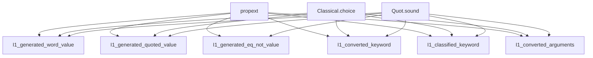
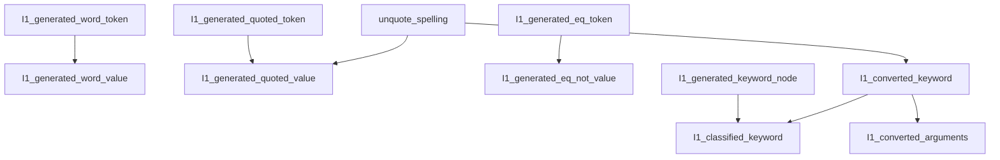

# CST トークンからキーワードの AST へ移す一般証明

この増分は、[root ADR 0351](../adr/0351-prove-parser-formatter-round-trips.md) のうち、raw CST token の種類と原綴りを、Word と StringLit の復号値へ接続する。
ここで示す値は Lean の KeywordLowering.Value 上の値であり、実際の Golem.Parser.AST との一致は九例で照合する。
Haskell の AST への一般的な対応を証明したものではない。
対象は TokenLowering.lean の全文で、基準は `4100e5d00e6c5c39090f2cb824593a79bc839dfe`、Lean 4.7.0 を使う。

## 実装との対応

[Golem.Parser.Convert](../../modules/golem-parser/src/Golem/Parser/Convert.hs#L65) は、Word、StringLit と Eq を KWord、KString と KEquals へ移す。
[Golem.Parser.Lower.argValue](../../modules/golem-parser/src/Golem/Parser/Lower.hs#L300) は、KWord を原綴りの Word、KString を unquote した StringLit とし、KEquals は値にしない。
モデルの token は、この三つの token 名を lowering の種類へ移す。
value は単独の token の値を取り出し、read は実際の生成文法の認識と CST wrapper の後に、この value を適用する。

rawFields は、語の名前、等号と、語または引用値という三つの raw token を構築する。
keyword は、この種類を変換して既存の KeywordLowering.lowerKeyword へ渡す。
arguments は、KeywordArgument の node だけからキーワードの値を取り出す射影である。
位置引数、式、展開を扱う実装の arguments 全体をモデルにした関数ではない。

## 命題と前提

I1_generated_word_value は、任意の Word、Word に含められない区切りと接尾辞に対して、区切り以降を残し、元の Word の値を得る。
Word の非空と文字の条件に加え、先頭が %% でない条件を使う。
fuel は入力長に 8 と任意の自然数を足したものとする。

I1_generated_quoted_value は、任意長の Part の列から、引用符とエスケープを除いた StringLit の値を得る。
接尾辞は任意で、fuel は Part の個数に 7 と任意の自然数を足したものである。
I1_generated_eq_not_value は、等号を認識しても値にせず、残りを保つ。
fuel は任意の自然数に 3 を足したものとする。

これら三つの定理は、子の CST の列を制限しない。
token wrapper が子を捨てる性質を使い、子の認識の成功や、示したい値の一致を仮定しない。

I1_converted_keyword は、構築した rawFields から名前、Word または StringLit の種類と復号値が戻ることを示す。
名前と語の値は Word の領域、引用値は任意の Part の列である。
この構築した CST の性質には、原稿の先頭に関する %% の条件を追加しない。
原稿からこの CST が得られるという主張とは区別する。

I1_classified_keyword は、実際の文法の KeywordArgument の wrapper に rawFields を渡すと、同じキーワードの値を取り出せることを示す。
ここでの入力と残りの文字列は任意であり、渡した子がその入力の解析結果であるという対応は証明しない。
I1_converted_arguments は、そのような構築した node を任意個並べたとき、同名の繰り返しも含め、値を元の順に取り出せることを示す。
個数には上限を置かず、位置引数や展開を混ぜた列には適用しない。

## 実装との照合と回帰

引用 token を Word にしたモデルで、引用符とエスケープを残した Word が返る回帰の失敗を先に確かめた。
種類と復号を分けたモデルへ直すと、同じ回帰が通る。
語と引用値の種類を変える、等号を値にする、残りを消す、すべての値を消すという五つの変異では、一般定理が失敗する。
node の列を逆順にする変異と、最初の node を落とす変異も拒否する。

共通の九つのケースから原稿を作り、実際の Haskell の parseAst と通常の golem fmt へ渡す。
八つは個別の値、最後の一つは同じ八つのキーワードを並べた原稿で、計十六の引数出現になる。
Word と StringLit の種類、名前、復号値と順を照合し、二回目の整形ではバイト列も変わらないことを確かめる。
原綴りと復号値を区別し、冗長なエスケープ、空の引用値、Unicode と改行も含む。

既存の Haskell の観測器は BlockCommand だけを扱い、これらの inline command の原稿を Paragraph として読むと失敗した。
この十個の Node の試験の失敗を保存してから、従来の経路を保ったまま Paragraph 内の単一の Command も観測できるようにした。
既存三十個と新規十個の試験がすべて通る。

これらは inspect の宣言や引数の型検査を通る原稿の証明ではない。
モデルは各引数の末尾に閉じ角括弧と改行を置いた入力を個別に認識し、得られた node をケースの順に並べる。
原稿全体や、最後の原稿の引数間の空白をモデルが走査するという検査ではない。
その個別の入力で、実際の Word、Eq と値の認識結果を結合し、実際の KeywordArgument の残りとも照合する。
有限の九例でのこの結合を、任意の入力から KeywordArgument の全 CST を生成する証明とは数えない。

## 環境と公理

peg-hs は `4b4adc7046a14d18c8eec711f18dbcaa9b059cca`、GHC は 9.10.3 を使う。
Haskell の検査は既存の golem-0479-dist の plan と CLI を使い、parser と fmt の九つの Haskell ソースと文法は、この基準と一致する。
CLI 全体をこの増分から新しくビルドしたという記録ではない。
対象のソースには手書きの公理、`sorry` と `admit` はない。
環境中の十八の定理をすべて `#print axioms` で検査した。

| ソースに明示した定理 | 位置 | 公理 |
| --- | --- | --- |
| `TokenLowering.I1_generated_word_value` | [TokenLowering.lean:22](../../experiments/parser-fmt-proof/grammar/TokenLowering.lean#L22) | `[propext, Classical.choice, Quot.sound]` |
| `TokenLowering.I1_generated_quoted_value` | [TokenLowering.lean:33](../../experiments/parser-fmt-proof/grammar/TokenLowering.lean#L33) | `[propext, Classical.choice, Quot.sound]` |
| `TokenLowering.I1_generated_eq_not_value` | [TokenLowering.lean:45](../../experiments/parser-fmt-proof/grammar/TokenLowering.lean#L45) | `[propext, Quot.sound]` |
| `TokenLowering.I1_converted_keyword` | [TokenLowering.lean:63](../../experiments/parser-fmt-proof/grammar/TokenLowering.lean#L63) | `[propext, Classical.choice, Quot.sound]` |
| `TokenLowering.I1_classified_keyword` | [TokenLowering.lean:74](../../experiments/parser-fmt-proof/grammar/TokenLowering.lean#L74) | `[propext, Classical.choice, Quot.sound]` |
| `TokenLowering.I1_converted_arguments` | [TokenLowering.lean:80](../../experiments/parser-fmt-proof/grammar/TokenLowering.lean#L80) | `[propext, Classical.choice, Quot.sound]` |

公理の図は、六つの主定理の間接の依存も含む。
両方の図の矢印は、依存先から利用する定理へ向ける。
既存の認識と復号の証明の前提は、[CST wrapper の記録](0351-cst-wrapper-proof-dependencies.md) と [lowering の記録](0351-cst-keyword-lowering-proof-dependencies.md) にある。



次は、ソースに明示した定理と既存の補題の間で、証明項と型から得た直接の参照である。
生成された計算式の内部は省く。



生成された十二の補助定理は、token、value、arguments と List の関数の計算式である。
次の一覧にもすべての公理依存を記す。

| 生成された定理 | 公理 |
| --- | --- |
| `_private.TokenLowering.0.TokenLowering.value.match_1.eq_2` | `なし` |
| `_private.TokenLowering.0.List.isEmpty.match_1.eq_2` | `なし` |
| `_private.TokenLowering.0.TokenLowering.token.match_1.eq_4` | `[Classical.choice, propext, Quot.sound]` |
| `_private.TokenLowering.0.TokenLowering.token.match_1.eq_3` | `なし` |
| `_private.TokenLowering.0.List.filterMap._eq_2` | `なし` |
| `_private.TokenLowering.0.List.isEmpty.match_1.eq_1` | `なし` |
| `_private.TokenLowering.0.TokenLowering.token.match_1.eq_2` | `なし` |
| `_private.TokenLowering.0.TokenLowering.token.match_1.eq_1` | `なし` |
| `_private.TokenLowering.0.TokenLowering.arguments.match_1.eq_1` | `なし` |
| `_private.TokenLowering.0.TokenLowering.arguments.match_1.eq_2` | `[Classical.choice, propext, Quot.sound]` |
| `_private.TokenLowering.0.List.filterMap._eq_1` | `なし` |
| `_private.TokenLowering.0.TokenLowering.value.match_1.eq_1` | `なし` |

実行用には次の二つの unsafe 宣言が生成される。
両方とも filterMap の特殊化であり、主定理の論理的な依存には含まれない。

```text
List.filterMap._at.TokenLowering.arguments._spec_1
List.filterMap._at.TokenLowering.keyword._spec_1
```

read の論理定義は propext に依存する。
token、value、rawFields、keyword と arguments の論理定義は公理に依存しない。

TokenLowering.lean の SHA-256 は `294613c8ad5c04ece685aa48105762a0aed7c13faec14b53426edc0e5576e8c8`。

このモデルは [Golem.Parser.commentDiagnostics](../../modules/golem-parser/src/Golem/Parser.hs#L86) を含まない。
引用符なしの Word 値に %% が含まれると、文法の認識が成功しても公開の parse は [G01102](../diagnostics.md#g01102) を報告する。
一般定理を、公開 API で diagnostics が無いことの証明とは数えない。

## 再現と残る範囲

grammar の [README](../../experiments/parser-fmt-proof/grammar/README.md) に従い、プロジェクトの peg-hs と GHC 9.10.3 の PATH を指定して全ハーネスを実行する。
同じ README の CLI のビルドと Cabal plan の選択の後、AST と整形の照合は次で実行できる。

```sh
node --test experiments/parser-fmt-proof/arguments/token-values.native-test.mjs
```

この一般証明は、語と引用値の単独 token と、構築したキーワードの CST の値を扱う。
任意の原稿からこれらの node や引数列全体が得られるという一般的な対応は未証明である。
位置、UTF-8 の幅、構文エラーからの復旧、コメント、全 AST、整形と評価の往復も残る。
[root ADR 0351](../adr/0351-prove-parser-formatter-round-trips.md) 全体の未実装の状態を保つ。
