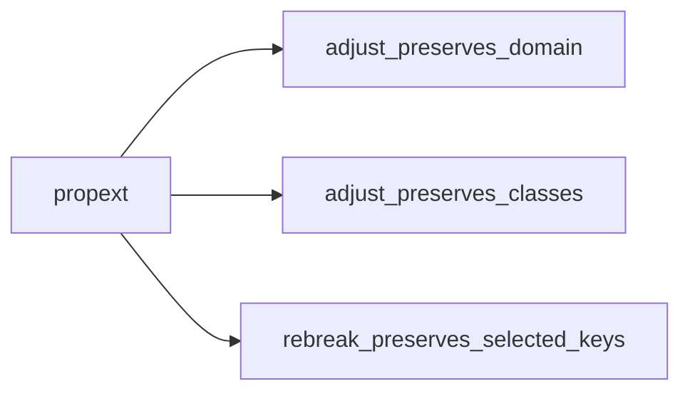
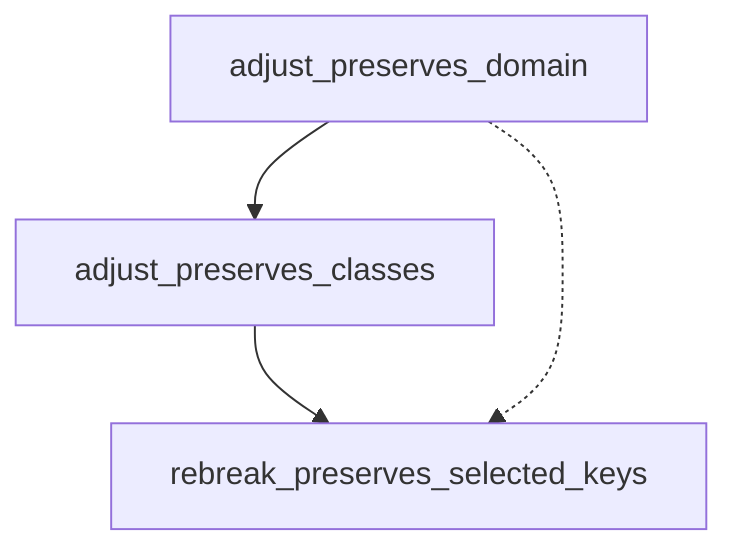

# [root ADR 0352](../adr/0352-prove-pagination-in-lean.md) の再組版と所有キーの保存

## 範囲

基準は `472733a1c` の本体と既存モデルである。
[BesideAdjustment.lean](../../experiments/pagination-proof/BesideAdjustment.lean) を Lean 4.7.0（`aarch64-apple-darwin`）で検査した。
本体と既存モデルは変更していない。
今回の証明は、段落を組み直しても、回り込み図版が所有する本文のキーが変わらないという前提の一部を導く。

本体の [parts](../../modules/golem-typeset/src/Golem/Typeset/Flow.hs#L5299) は、`cuBesides` の現在のキーを `Map.adjust` で更新する。
この更新は組み直した行と従来のオフセットを返し、キーを消したり追加したりしない。
段落を選ぶ [besideParagraphs](../../modules/golem-typeset/src/Golem/Typeset/Flow.hs#L4154) は、本文の表への所属と単位の制御判定を読み、本文の行数は読まない。
制御判定に使う単位の表は、この更新の対象ではない。

モデルの `adjustBeside` は、キーから Option の値を得る任意の関数に対し、対象のキーでだけ Option.map を適用する。
値の型と変更する関数には制約を置かない。
`classes` は、有限のキー区間で、この関数の値の有無と、別に与える制御判定を `Class` に写す。
更新前後で走査の結果が同じという結論自体は仮定しない。

これは有限区間の判定列へ写した後の証明である。
Haskell の Map の実装そのもの、任意の `Built` の全生成経路、Int のオーバーフローは証明していない。
行数を変えてもキーが残ることと、その行内容が改ページ後に過不足なく出力されることも区別する。
既存の採番の証明と、任意の原稿の全配置を結び付けたわけではない。

## 定理と依存

Lean の環境で、名前付き宣言の種類、型、elaboration 後の証明項を調べた。
公開定理 3 件、生成定理 4 件、手書き定義 2 件、生成定義 14 件、公理宣言 0 件だった。
今回のモジュールに private 定理はない。
7 定理すべてを、元の定理を参照する同じ型の別名を一時環境に作って `#print axioms` で調べた。
別名も kernel が検査する。

次の名前には、共通接頭辞 `BesideOwnership.` を付ける。

| 名前 | 位置 | 前提と結論 | 公理 |
| --- | --- | --- | --- |
| `root_adr0352_i5_adjust_preserves_domain` | [12 行](../../experiments/pagination-proof/BesideAdjustment.lean#L12) | 対象があれば値を更新する操作は、任意のキーで値の有無を保つ。対象がなければ追加しない。 | `propext` |
| `root_adr0352_i5_adjust_preserves_classes` | [20 行](../../experiments/pagination-proof/BesideAdjustment.lean#L20) | 同じ制御判定を使う有限区間では、更新前後の二つの判定列が同じである。 | `propext` |
| `root_adr0352_i5_rebreak_preserves_selected_keys` | [28 行](../../experiments/pagination-proof/BesideAdjustment.lean#L28) | 同じ区間を走査した結果のキーの列が、更新前後で等しい。 | `propext` |

手書き定義は `BesideOwnership.adjustBeside`（5 行）と `BesideOwnership.classes`（8 行）である。
生成定理の完全修飾名は次のとおりで、すべて公理に依存しない。
生成位置は取得できなかった。
いずれも `classes` の再帰とパターン分岐に由来する。

| 完全修飾名 |
| --- |
| `_private.experiments.«pagination-proof».BesideAdjustment.0.BesideOwnership.classes.match_1.eq_1` |
| `_private.experiments.«pagination-proof».BesideAdjustment.0.BesideOwnership.classes.match_1.eq_2` |
| `_private.experiments.«pagination-proof».BesideAdjustment.0.BesideOwnership.classes._eq_2` |
| `_private.experiments.«pagination-proof».BesideAdjustment.0.BesideOwnership.classes._eq_1` |

生成定義も再帰とパターン分岐のコンパイラ補助宣言である。
対象内に新しい公理を宣言していない。
標準公理 `propext` は Lean 4.7.0 の `Init.Core:1287` で宣言され、命題の同値から等式を導く。
今回の七定理は `Classical.choice` と `Quot.sound` に依存しない。

公理の図は、定義や補助定理を経由する推移的な依存を示す。
公理に依存しない四つの生成定理には辺がない。



次の図の実線は、型か証明項の定理の直接参照を示す。
破線は補助定理を経由する間接依存である。
標準の等式の補題と生成定理は省いた。



対象ソースに `sorry`、`admit`、`sorryAx` の使用はない。
Lean の diagnostic と七定理の公理依存にも証明の穴はなかった。
今回の範囲に、穴の影響を受ける定理はない。

## 実装との照合と残り

[BesideOwnership.hs](../../experiments/pagination-proof/BesideOwnership.hs) の `BESIDE_ADJUSTMENT=1` は、実装の Map の更新も比較する。
既存の実フォントから得た単位を使い、五種類のキー判定の長さ 0〜4 の全 781 通りで、各位置と区間の前後の対象キーを更新する。
本文の行を空にしてもキーが残ることと、実装の `besideParagraphs` の結果が変わらないことを 4,492 更新で検査した。
存在しないキーと、本文と制御の両方に当たるキーも含む。
この 781 通りの表が、通常の原稿からすべて生成されるとは扱わない。

この 4,492 件では、更新した Map の結果を、同じ値の有無を持つ関数へ写す。
既存の走査 8,203 件とともに、更新後の `classes` と `scan` の閉じた等式を Lean の `decide` で照合し、すべて一致した。
更新時に対象のキーを消す誤変更は、Lean の定理とネイティブの Map の検査の両方で拒否された。
有限の検査が任意の Map の実装の証明になったとは扱わない。

本体の `modules/` は `0aa78f65ac691cdd8d1a3bd5fc4c8bffb1feabdb` と一致する。
照合は GHC 9.10.3 と、この版の既存 runtime DB の登録済み package ID を読み取り専用で使う。
標準 Cabal 環境を新規構築したという検証ではない。
Cabal plan と package cache の実行前後の SHA-256 は一致した。

`check.sh` 全体も終了コード 0 で通った。
既存の 55,838 件と 156,520 件の配置、10,368 件の回り込み、4,864 件の因果的配置、216 件の制御、34,586 件の改行、実フォントのキャプション 40 件、Alloy 42 件の対応検査を含む。
Map の更新と閉じた等式の比較は、次の別コマンドで実行した。

```sh
BESIDE_ADJUSTMENT=1 RUNGHC=/private/tmp/golem-0352-built-probe-nov28/runner \
  sh experiments/pagination-proof/check-built-first-ids.sh \
  "$PWD/experiments/pagination-proof/BesideOwnership.hs" > /tmp/BesideAdjustmentExamples.lean
LEAN_PATH=/private/tmp/golem-0352-numbered-output-cache-nov28 \
  /Users/tett23/.elan/toolchains/leanprover--lean4---v4.7.0/bin/lean /tmp/BesideAdjustmentExamples.lean
```

任意の表の生成と再採番との一般の接続、全原稿の内容の全量と順序、全制御、一般のキャプションへの接続は残る。
末尾の保持に関する再試行の終了も未解消である。
[root ADR 0352](../adr/0352-prove-pagination-in-lean.md) 全体は採択済みで未実装のままである。
