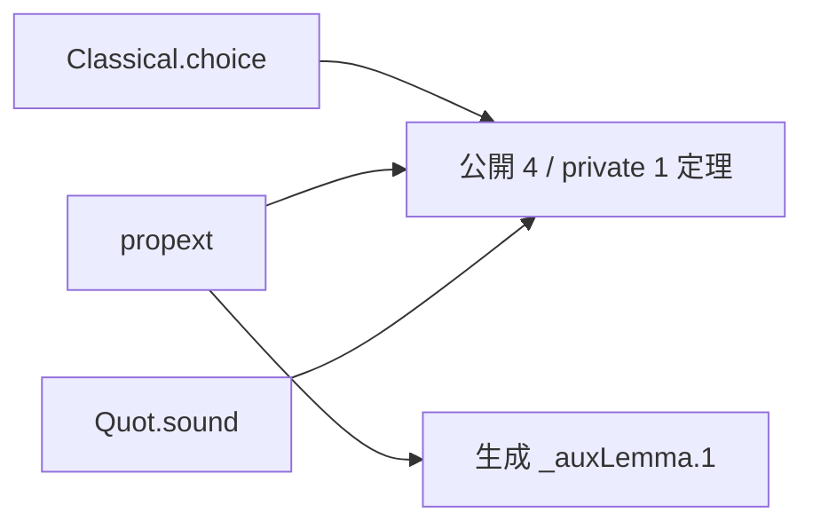
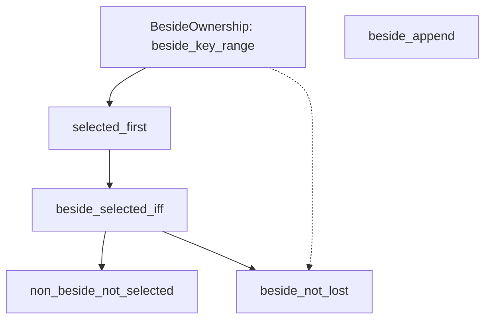

# [root ADR 0352](../adr/0352-prove-pagination-in-lean.md) の回り込み本文の選択条件

## 範囲

基準は `aabc4223d` の本体と既存モデルである。
[BesideCoverage.lean](../../experiments/pagination-proof/BesideCoverage.lean) を Lean 4.7.0（`aarch64-apple-darwin`）で検査した。
本体と既存モデルの振る舞いは変更していない。
[所有区間の証明](0352-beside-ownership-dependencies.md) が示した順序と重複のなさに加え、対象のキーを過不足なく選ぶ条件を導く。

本体の [besideParagraphs](../../modules/golem-typeset/src/Golem/Typeset/Flow.hs#L4154) は、本文の表にあるキーを選び、制御のキーを飛ばし、両方に当たらないキーで止まる。
今回の必要十分条件は、対象より前のすべてのキーが本文か制御に当たり、対象のキーが本文の表にあることとなる。
前に区切りがあれば対象は選ばれず、制御だけのキーも選ばれない。
対象が本文と制御の両方に当たる場合は、本文として選ぶ。

この証明も Nat のキーを持つ有限の判定列を扱う。
任意の `Built` の表から判定列への一般の対応、Int のオーバーフロー、選んだキーの行内容を実際の配置へ渡す全経路は対象に含めない。
キーの選択に欠落がないことから、任意の原稿の内容保存の完成までは導かない。

## 定理と依存

Lean の環境で、名前付き宣言の種類、型、elaboration 後の証明項を調べた。
公開定理 4 件、private 定理 1 件、生成定理 5 件、手書き定義 1 件、生成定義 6 件、公理宣言 0 件だった。
10 定理すべてを、元の定理を参照する同じ型の別名を一時環境に作って `#print axioms` で調べた。
別名も kernel が検査する。

次の名前には、共通接頭辞 `BesideOwnership.` を付ける。
標準三公理は `propext`、`Classical.choice`、`Quot.sound` を指す。

| 名前 | 位置 | 前提と結論 | 公理 |
| --- | --- | --- | --- |
| `root_adr0352_i5_beside_selected_iff` | [24 行](../../experiments/pagination-proof/BesideCoverage.lean#L24) | 対象が選ばれることと、前のすべての判定が通り、対象が本文に当たることが同値である。 | 標準三公理 |
| `root_adr0352_i5_beside_append` | [50 行](../../experiments/pagination-proof/BesideCoverage.lean#L50) | 前の区間の判定がすべて通れば、連結した入力の結果は、前後の区間を走査した結果の連結と等しい。後の開始キーには前の長さを加える。 | 標準三公理 |
| `root_adr0352_i5_non_beside_not_selected` | [70 行](../../experiments/pagination-proof/BesideCoverage.lean#L70) | 本文に当たらない対象のキーは、前の区間の判定によらず選ばれない。 | 標準三公理 |
| `root_adr0352_i5_beside_not_lost` | [78 行](../../experiments/pagination-proof/BesideCoverage.lean#L78) | 前のすべての判定が通り対象が本文に当たれば、対象のキーは必ず選ばれる。 | 標準三公理 |

private 定理の完全修飾名は `_private.experiments.«pagination-proof».BesideCoverage.0.BesideOwnership.selected_first`（7 行）である。
開始位置のキーが選ばれることと、その先頭要素が本文に当たることの同値を示す。
標準三公理に依存する。
手書き定義 `BesideOwnership.pass`（5 行）は、本文か制御の少なくとも一方の判定が真であることを表す。

生成定理の完全修飾名と公理は次のとおりである。
生成位置は取得できなかった。
先頭の一件は証明中のリストの所属判定の簡約に由来し、残りはインポートした `scan` を使うためのパターン分岐の補助宣言である。

| 完全修飾名 | 公理 |
| --- | --- |
| `experiments.«pagination-proof».BesideCoverage._auxLemma.1` | `propext` |
| `_private.experiments.«pagination-proof».BesideCoverage.0.BesideOwnership.scan.match_1.eq_2` | なし |
| `_private.experiments.«pagination-proof».BesideCoverage.0.BesideOwnership.scan.match_1.eq_1` | なし |
| `_private.experiments.«pagination-proof».BesideCoverage.0.BesideOwnership.scan._eq_2` | なし |
| `_private.experiments.«pagination-proof».BesideCoverage.0.BesideOwnership.scan._eq_1` | なし |

生成定義は `pass` とパターン分岐のコンパイラ補助宣言である。
10 定理のうち 5 件は標準三公理、1 件は `propext` のみに依存し、4 件は公理に依存しない。
新しい公理を宣言していない。

| 標準公理 | Lean 4.7.0 の位置 | 内容 |
| --- | --- | --- |
| `Classical.choice` | `Init.Prelude:730` | `Nonempty α` から要素を選ぶ。 |
| `propext` | `Init.Core:1287` | 命題の同値から等式を導く。 |
| `Quot.sound` | `Init.Core:1459` | 関係を満たす二要素が同じ商の値を持つ。 |

公理の図は、定義や補助定理を経由する推移的な依存を示す。
公理に依存しない 4 定理には辺がない。



次の図の実線は、型か証明項の定理の直接参照である。
破線は、補助定理を経由する間接依存を示す。
標準の等式と算術の補題と生成定理は省いた。
`beside_append` はほかの掲載定理を参照しない。



対象ソースに `sorry`、`admit`、`sorryAx` の使用はない。
Lean の diagnostic と 10 定理の公理依存にも証明の穴はなかった。
今回の範囲に、穴の影響を受ける定理はない。

## 実装との照合と残り

[BesideOwnership.hs](../../experiments/pagination-proof/BesideOwnership.hs) に `BESIDE_COVERAGE=1` を渡すと、従来の実装の走査に加えて、各キーの必要十分条件を検査する。
長さ 0〜4 の五種類の判定の全 781 通りで、各位置までの判定を別に調べ、実装の出力に対象が含まれるかと比較する。
本文、制御、図版、欠落、本文と制御の両方を含む 2,930 位置で一致した。
従来の走査 8,203 件と、この 2,930 件の所属判定を閉じた等式と同値として書き出し、Lean の `decide` で検査した。

前の判定を無視してよいとする誤変更と、連結後の開始位置に前の長さを加えない誤変更は、Lean の証明で拒否された。
制御だけのキーも本文として選ぶ誤変更は、ネイティブの所属判定の検査で拒否された。
有限の比較が一般の表の対応を証明したとは扱わない。

本体の `modules/` は `0aa78f65ac691cdd8d1a3bd5fc4c8bffb1feabdb` と一致する。
照合は GHC 9.10.3 と、この版の既存 runtime DB の登録済み package ID を読み取り専用で使う。
標準 Cabal 環境を新規構築したという検証ではない。
Cabal plan と package cache の実行前後の SHA-256 は一致した。

`check.sh` 全体も終了コード 0 で通った。
既存の 55,838 件と 156,520 件の配置、10,368 件の回り込み、4,864 件の因果的配置、216 件の制御、34,586 件の改行、実フォントのキャプション 40 件、Alloy 42 件の対応検査を含む。
ネイティブの所属判定と閉じた同値の照合は、次の別コマンドで実行した。

```sh
BESIDE_COVERAGE=1 RUNGHC=/private/tmp/golem-0352-built-probe-nov28/runner \
  sh experiments/pagination-proof/check-built-first-ids.sh \
  "$PWD/experiments/pagination-proof/BesideOwnership.hs" > /tmp/BesideCoverageExamples.lean
LEAN_PATH=/private/tmp/golem-0352-numbered-output-cache-nov28 \
  /Users/tett23/.elan/toolchains/leanprover--lean4---v4.7.0/bin/lean /tmp/BesideCoverageExamples.lean
```

任意の表の生成との対応、全原稿の内容の全量と順序、全制御、一般のキャプションへの接続は残る。
別の再試行分岐の終了の疑いは、[再試行の上限の調査](0352-retry-prefix-dependencies.md) に記したとおり未解消である。
[root ADR 0352](../adr/0352-prove-pagination-in-lean.md) 全体は採択済みで未実装のままである。
