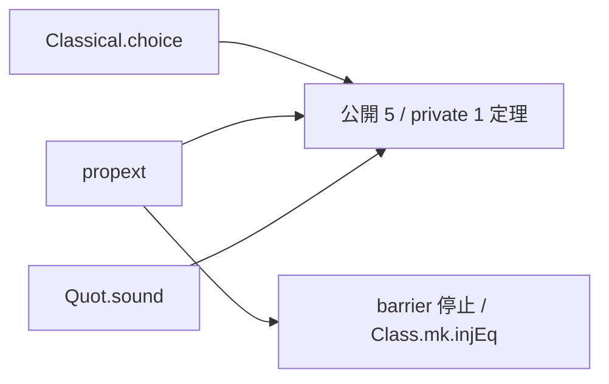
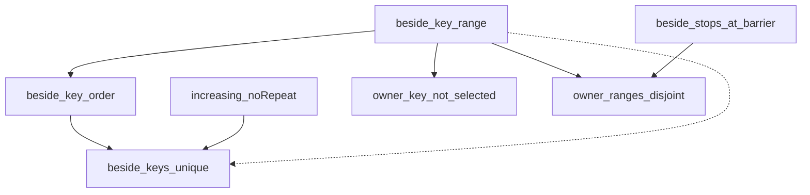

# [root ADR 0352](../adr/0352-prove-pagination-in-lean.md) の回り込み本文の所有区間

## 範囲

基準は `72c9be8dc` の本体と既存モデルである。
[BesideOwnership.lean](../../experiments/pagination-proof/BesideOwnership.lean) を Lean 4.7.0（`aarch64-apple-darwin`）で検査した。
本体と既存のモデルは変更していない。
この増分は、回り込み図版に続く段落を選ぶ走査の、キーの範囲、順序、重複のなさを扱う。

本体の [besideParagraphs](../../modules/golem-typeset/src/Golem/Typeset/Flow.hs#L4154) は図版の次のキーから走査する。
本文の表にキーがあれば採用し、制御の単位なら飛ばし、どちらでもなければ止まる。
[besideControlFlow](../../modules/golem-typeset/src/Golem/Typeset/Flow.hs#L4165) の対象には間隔、改段などがあり、図版は含まれない。
ただし、同じキーが本文の表にもある場合は、本文の表を先に読む。

`scan` は、この二つの判定を `Class` の二つの Bool に写した有限の走査である。
有限区間の外では両方の表にキーがない場合を扱う。
キーは Nat とし、Haskell の Int のオーバーフローや、任意の `Built` の表をこの区間へ写す一般の証明は含めない。
図版が走査を止める定理にも、そのキーが本文の表になく、制御にも当たらないという条件を明記する。
表を作るすべての経路でこの条件が成立することは、今回の証明の結論に含めない。

## 定理と公理

Lean の環境で、名前付き宣言の種類、型、elaboration 後の証明項を調べた。
公開定理 6 件、private 定理 1 件、生成定理 14 件、手書き定義 3 件、生成定義 36 件、公理宣言 0 件だった。
これとは別に `BesideOwnership.Class` の構造体宣言がある。
21 定理すべてを、元の定理を参照する同じ型の別名を一時環境に作って `#print axioms` で調べた。
別名も kernel が検査する。

次の表の名前には、共通接頭辞 `BesideOwnership.` を付ける。
標準三公理は `propext`、`Classical.choice`、`Quot.sound` を指す。

| 名前 | 位置 | 前提と結論 | 公理 |
| --- | --- | --- | --- |
| `root_adr0352_i5_beside_key_range` | [17 行](../../experiments/pagination-proof/BesideOwnership.lean#L17) | 採用したキーは開始位置以上で、有限区間の終わりより小さい。 | 標準三公理 |
| `root_adr0352_i5_beside_key_order` | [46 行](../../experiments/pagination-proof/BesideOwnership.lean#L46) | 採用したキーは狭義単調増加する。 | 標準三公理 |
| `root_adr0352_i5_beside_keys_unique` | [76 行](../../experiments/pagination-proof/BesideOwnership.lean#L76) | 採用したキーに重複がない。 | 標準三公理 |
| `root_adr0352_i5_owner_key_not_selected` | [80 行](../../experiments/pagination-proof/BesideOwnership.lean#L80) | 図版の次から走査した結果に、図版自身のキーは入らない。 | 標準三公理 |
| `root_adr0352_i5_beside_stops_at_barrier` | [87 行](../../experiments/pagination-proof/BesideOwnership.lean#L87) | 両方の判定が偽の単位より後の入力を足しても、走査結果は変わらない。 | `propext` |
| `root_adr0352_i5_owner_ranges_disjoint` | [98 行](../../experiments/pagination-proof/BesideOwnership.lean#L98) | 同じ単位で区切った前後の走査では、前の採用キーは後の採用キーより小さい。 | 標準三公理 |

private 定理の完全修飾名は `_private.experiments.«pagination-proof».BesideOwnership.0.BesideOwnership.increasing_noRepeat`（67 行）である。
狭義単調増加する列に重複がないことを示し、標準三公理に依存する。
手書き定義は `BesideOwnership.scan`（10 行）、`BesideOwnership.Increasing`（42 行）、`BesideOwnership.NoRepeat`（63 行）である。

生成定理は、構造体の識別、DecidableEq の導出、走査と述語のパターン分岐に由来する。
完全修飾名と公理は次のとおりで、生成位置は取得できなかった。

| 完全修飾名 | 公理 |
| --- | --- |
| `_private.experiments.pagination-proof.BesideOwnership.0.BesideOwnership.decEqClass.proof_2._@.experiments.pagination-proof.BesideOwnership._hyg.22` | なし |
| `BesideOwnership.Class.mk.sizeOf_spec` | なし |
| `_private.experiments.«pagination-proof».BesideOwnership.0.BesideOwnership.Increasing._eq_1` | なし |
| `_private.experiments.«pagination-proof».BesideOwnership.0.BesideOwnership.scan._eq_1` | なし |
| `_private.experiments.«pagination-proof».BesideOwnership.0.BesideOwnership.Increasing.match_1.eq_2` | なし |
| `_private.experiments.pagination-proof.BesideOwnership.0.BesideOwnership.decEqClass.proof_1._@.experiments.pagination-proof.BesideOwnership._hyg.22` | なし |
| `_private.experiments.«pagination-proof».BesideOwnership.0.BesideOwnership.scan.match_1.eq_2` | なし |
| `_private.experiments.pagination-proof.BesideOwnership.0.BesideOwnership.decEqClass.proof_3._@.experiments.pagination-proof.BesideOwnership._hyg.22` | なし |
| `_private.experiments.«pagination-proof».BesideOwnership.0.BesideOwnership.scan.match_1.eq_1` | なし |
| `BesideOwnership.Class.mk.injEq` | `propext` |
| `_private.experiments.«pagination-proof».BesideOwnership.0.BesideOwnership.Increasing.match_1.eq_1` | なし |
| `BesideOwnership.Class.mk.inj` | なし |
| `_private.experiments.«pagination-proof».BesideOwnership.0.BesideOwnership.Increasing._eq_2` | なし |
| `_private.experiments.«pagination-proof».BesideOwnership.0.BesideOwnership.scan._eq_2` | なし |

生成定義は、構造体の射影と導出された判定、および再帰とパターン分岐の補助宣言である。
今回の対象内に新しい公理宣言はない。
21 定理のうち 6 件が標準三公理、2 件が `propext` のみに依存し、13 件は公理に依存しない。

| 標準公理 | Lean 4.7.0 の位置 | 内容 |
| --- | --- | --- |
| `Classical.choice` | `Init.Prelude:730` | `Nonempty α` から要素を選ぶ。 |
| `propext` | `Init.Core:1287` | 命題の同値から等式を導く。 |
| `Quot.sound` | `Init.Core:1459` | 関係を満たす二要素が同じ商の値を持つ。 |

公理の図は、定義や補助定理を経由する推移的な依存を示す。
公理に依存しない 13 定理には辺がない。



次の図の実線は、型か証明項の定理の直接参照を表す。
破線は補助定理を経由する間接依存である。
標準の等式と算術の補題と生成定理は省いた。



対象ソースに `sorry`、`admit`、`sorryAx` の使用はない。
Lean の diagnostic と 21 定理の公理依存にも証明の穴はなかった。
今回の範囲に、穴の影響を受ける定理はない。

## 実装との照合

[BesideOwnership.hs](../../experiments/pagination-proof/BesideOwnership.hs) は、実フォントと二つの回り込み図版を使った原稿を評価し、`buildFlow` から段落と図版の単位を得る。
その単位を使い、本文、制御、図版、欠落、本文と制御の両方という五種類のキーを長さ 0〜4 の全 781 通りに並べた表を作る。
各表の走査と、各位置へ別の図版を入れた前後の走査を、実装の `besideParagraphs` で計算する。
8,203 件の計算結果を `scan` の閉じた等式へ書き出し、Lean の `decide` で照合した。
すべて一致した。

この 781 通りは、表の二つの判定を直接検査するための入力である。
すべての表が通常の原稿から生成されるという主張ではない。
とくに本文と制御の両方の場合を含め、本文の判定が先であることを確かめる。
観測用の一時コピーは export list だけを開き、モジュール本体が元と同一であることを比較する。
本体の公開 API は変えない。

キーを進めない誤変更と、区切りを無視して先へ進む誤変更は、Lean の証明で拒否された。
本文と制御の両方の場合に、本文の判定を落とした等式も、閉じた等式の検査で拒否された。

本体の `modules/` は `0aa78f65ac691cdd8d1a3bd5fc4c8bffb1feabdb` と一致する。
照合は GHC 9.10.3 と、この版の既存 runtime DB の登録済み package ID を読み取り専用で使う。
標準 Cabal 環境を新規構築したという検証ではない。
Cabal plan と package cache の実行前後の SHA-256 は一致した。

`check.sh` 全体も終了コード 0 で通った。
既存の 55,838 件と 156,520 件の配置、10,368 件の回り込み、4,864 件の因果的配置、216 件の制御、34,586 件の改行、実フォントのキャプション 40 件、Alloy 42 件の対応検査を含む。
所有区間のネイティブの走査 8,203 件の観測と、書き出した閉じた等式の検査は、次の別コマンドで実行した。

```sh
RUNGHC=/private/tmp/golem-0352-built-probe-nov28/runner \
  sh experiments/pagination-proof/check-built-first-ids.sh \
  "$PWD/experiments/pagination-proof/BesideOwnership.hs" > /tmp/BesideExamples.lean
LEAN_PATH=/private/tmp/golem-0352-numbered-output-cache-nov28 \
  /Users/tett23/.elan/toolchains/leanprover--lean4---v4.7.0/bin/lean /tmp/BesideExamples.lean
```

モデルと本体の任意の表の対応、図版所有の全生成経路、再組版による文字列の全量と順序、全制御、一般のキャプションへの接続は残る。
別の再試行分岐での終了の疑いも [再試行の上限の調査](0352-retry-prefix-dependencies.md) のまま未解消である。
[root ADR 0352](../adr/0352-prove-pagination-in-lean.md) 全体は採択済みで未実装のままである。
