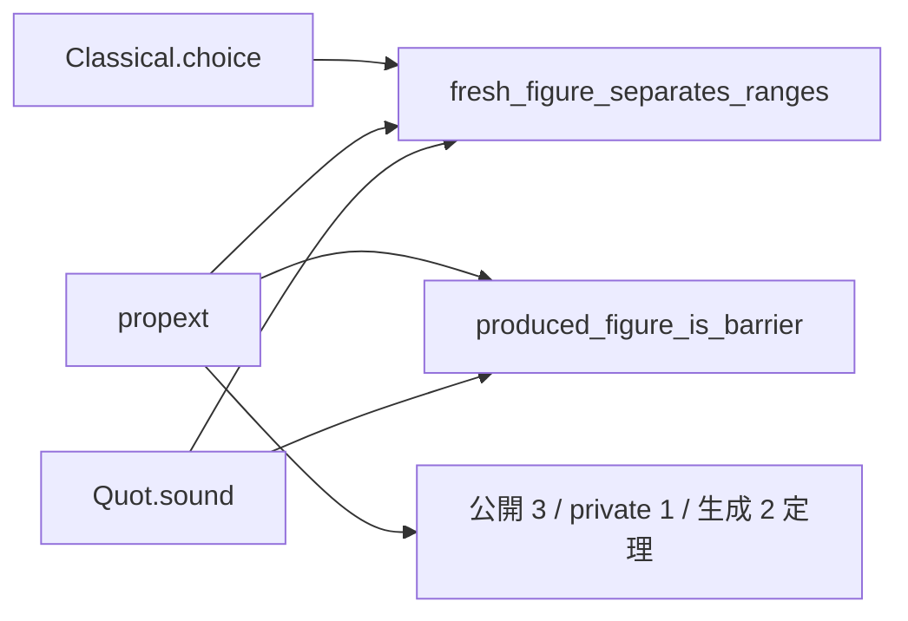
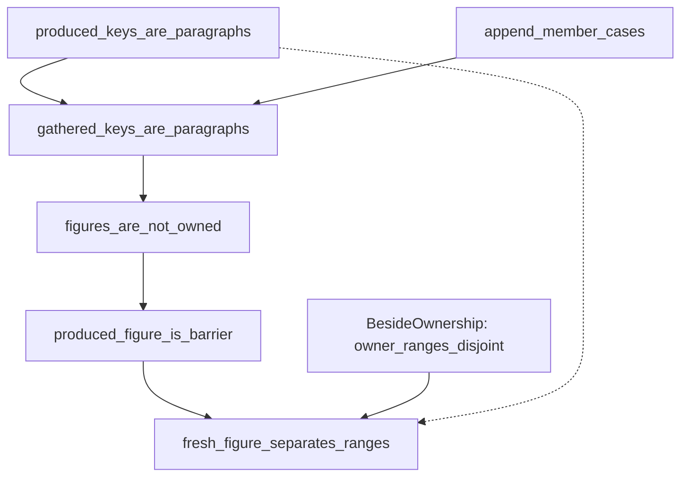

# [root ADR 0352](../adr/0352-prove-pagination-in-lean.md) の本文の生成と図版の区切り

## 範囲

基準は `38e4c4924` の本体と既存モデルである。
[BesideProducer.lean](../../experiments/pagination-proof/BesideProducer.lean) を Lean 4.7.0（`aarch64-apple-darwin`）で検査した。
本体と既存モデルは変更していない。
この増分は、新しく組んだ回り込み本文の表に図版のキーが入らないことから、[所有区間の証明](0352-beside-ownership-dependencies.md) が求めた図版の区切りの条件を導く。

本体の [composeBeside](../../modules/golem-typeset/src/Golem/Typeset/Flow.hs#L4073) は、罫線も囲みもなく、同じ項目の条件も満たす `UPara` だけを本文の結果へ加える。
自由な配置では所定の制御を飛ばし、それ以外では止まる。
図版の単位 `UFigure` を本文へ加える分岐はない。
[buildFlow の新しい組版の経路](../../modules/golem-typeset/src/Golem/Typeset/Flow.hs#L4866) は、図版ごとの結果を連結して本文の Map を作る。

モデルは、単位の種類を `Kind` に写し、段落を許す判定を別の callback にする。
許可の判定、打ち切り、段落と制御を読んだ後の状態の更新には、任意の全域関数を渡す。
状態には所有する図版の情報も含められるため、異なる図版でも同じ許可の真偽値を使うとは仮定しない。
`composeKeys` が出したキーは段落の種類に対応し、全ジョブを連結した `gather` もこの性質を保つ。

そのため図版のキーは本文の結果に含まれず、図版は制御の種類でもないので、消費側の二つの判定は両方とも偽になる。
この条件を、図版をまたぐ二つの走査のキーが分離するという既存の定理へ渡す。
図版のキーを除外することや、二つの判定が偽であること自体を仮定として与えない。

この増分は新しく組む経路の有限モデルを扱う。
`fuel` は、モデルが読む有限の単位の範囲を定める。
実際の Map の有限な台や Int の添字をその範囲へ写す一般の証明、組版の IO 全体の終了の証明は含めない。
また、[reusedBeside](../../modules/golem-typeset/src/Golem/Typeset/Flow.hs#L4855) で前のラウンドの結果を再利用する経路は、この証明の対象外である。
前の表の型の性質と、変化がない範囲の検査を次のラウンドへ接続する義務は残る。

## 定理と依存

Lean の環境で、名前付き宣言の種類、型、elaboration 後の証明項を調べた。
公開定理 5 件、private 定理 1 件、生成定理 19 件、手書き定義 4 件、生成定義 59 件、公理宣言 0 件だった。
別に `BesideProducer.Kind` の型の宣言と、`BesideProducer.Job` の構造体の宣言がある。
25 定理すべてを、元の定理を参照する同じ型の別名を一時環境に作って `#print axioms` で調べた。
別名も kernel が検査する。

次の名前には、共通接頭辞 `BesideProducer.` を付ける。
標準三公理は `propext`、`Classical.choice`、`Quot.sound` を指す。

| 名前 | 位置 | 前提と結論 | 公理 |
| --- | --- | --- | --- |
| `root_adr0352_i5_produced_keys_are_paragraphs` | [29 行](../../experiments/pagination-proof/BesideProducer.lean#L29) | 任意の許可と状態の更新の下でも、一つのジョブの出力キーは段落の種類に当たる。 | `propext` |
| `root_adr0352_i5_gathered_keys_are_paragraphs` | [78 行](../../experiments/pagination-proof/BesideProducer.lean#L78) | 同じ単位の表を読む複数のジョブの出力を連結しても、段落だけを含む。 | `propext` |
| `root_adr0352_i5_figures_are_not_owned` | [91 行](../../experiments/pagination-proof/BesideProducer.lean#L91) | 入力の単位が図版なら、そのキーは本文の結果に含まれない。 | `propext` |
| `root_adr0352_i5_produced_figure_is_barrier` | [109 行](../../experiments/pagination-proof/BesideProducer.lean#L109) | 図版の単位は、本文への所属も制御の判定も偽になる。 | `propext`、`Quot.sound` |
| `root_adr0352_i5_fresh_figure_separates_ranges` | [120 行](../../experiments/pagination-proof/BesideProducer.lean#L120) | 図版の位置で分けた前後の走査は、前の出力キーが後の出力キーより小さい。判定が偽という前提は前の定理から導く。 | 標準三公理 |

private 定理の完全修飾名は `_private.experiments.«pagination-proof».BesideProducer.0.BesideProducer.append_member_cases`（61 行）である。
連結した列の要素は、前か後の列の要素であることを示し、`propext` に依存する。

手書き定義は `BesideProducer.composeKeys`（17 行）、`BesideProducer.gather`（72 行）、`BesideProducer.controlAt`（101 行）、`BesideProducer.classAt`（106 行）である。
生成定理の完全修飾名と公理は次のとおりで、生成位置は取得できなかった。
型と構造体の判別、等値判定、再帰とパターン分岐に由来する。

| 完全修飾名 | 公理 |
| --- | --- |
| `BesideProducer.Kind.other.sizeOf_spec` | なし |
| `BesideProducer.Job.mk.inj` | なし |
| `BesideProducer.Kind.ofNat_toCtorIdx` | なし |
| `BesideProducer.Kind.figure.sizeOf_spec` | なし |
| `_private.experiments.«pagination-proof».BesideProducer.0.BesideProducer.composeKeys.match_2.eq_2` | なし |
| `_private.experiments.«pagination-proof».BesideProducer.0.BesideProducer.composeKeys._eq_1` | なし |
| `BesideProducer.Kind.paragraph.sizeOf_spec` | なし |
| `_private.experiments.«pagination-proof».BesideProducer.0.BesideProducer.gather._eq_2` | なし |
| `_private.experiments.«pagination-proof».BesideProducer.0.BesideProducer.gather.match_1.eq_1` | なし |
| `_private.experiments.«pagination-proof».BesideProducer.0.BesideProducer.composeKeys._eq_2` | なし |
| `BesideProducer.Job.mk.injEq` | `propext` |
| `_private.experiments.«pagination-proof».BesideProducer.0.BesideProducer.gather._eq_1` | なし |
| `BesideProducer.Kind.control.sizeOf_spec` | なし |
| `_private.experiments.«pagination-proof».BesideProducer.0.BesideProducer.gather.match_1.eq_2` | なし |
| `BesideProducer.instDecidableEqKind.proof_2` | なし |
| `BesideProducer.Job.mk.sizeOf_spec` | なし |
| `_private.experiments.«pagination-proof».BesideProducer.0.BesideProducer.composeKeys.match_2.eq_1` | なし |
| `BesideProducer.instDecidableEqKind.proof_1` | なし |
| `experiments.«pagination-proof».BesideProducer._auxLemma.1` | `propext` |

生成定義も、型と構造体、再帰とパターン分岐のコンパイラ補助宣言である。
25 定理の公理依存は、標準三公理が 1 件、`propext` と `Quot.sound` が 1 件、`propext` のみが 6 件、なしが 17 件だった。
対象内に新しい公理を宣言していない。

| 標準公理 | Lean 4.7.0 の位置 | 内容 |
| --- | --- | --- |
| `Classical.choice` | `Init.Prelude:730` | `Nonempty α` から要素を選ぶ。 |
| `propext` | `Init.Core:1287` | 命題の同値から等式を導く。 |
| `Quot.sound` | `Init.Core:1459` | 関係を満たす二要素が同じ商の値を持つ。 |

公理の図は、定義や補助定理を経由する推移的な依存を示す。
公理に依存しない十七の生成定理には辺がない。



次の図の実線は、型か証明項の定理の直接参照である。
破線は補助定理を経由する間接依存を示す。
標準の等式の補題と生成定理は省いた。



対象ソースに `sorry`、`admit`、`sorryAx` の使用はない。
Lean の diagnostic と二十五定理の公理依存にも証明の穴はなかった。
今回の範囲に、穴の影響を受ける定理はない。

## 実装との照合と残り

[BesideProducer.hs](../../experiments/pagination-proof/BesideProducer.hs) は、実フォントから得た単位と、組版で得た図版情報を使って `composeBeside` を直接呼ぶ。
長さ 0〜4 で、段落、空きの制御、図版、欠落、罫線付き段落、囲みのある段落という六種類を並べる。
全 1,555 通りの表で、先頭の図版と、途中の各図版から新しいジョブを作り、2,540 ジョブの結果を得た。
実際の本文の結果に図版のキーが入らないことと、ジョブの結果が重複せず連結されることも比較した。

2,540 ジョブと 1,555 連結結果の合計 4,095 件を、モデルの閉じた等式として Lean の `decide` で照合した。
すべて一致した。
図版も出力するモデルへの誤変更は、型の定理で拒否された。
罫線と囲みを無視し、段落を常に許可する誤変更も、実装との閉じた等式の照合で拒否された。

この観測では自由な配置を使い、制御は間隔 0 の `UGap` である。
モデルの状態は Unit に写し、許可を除く callback は何も変えない。
自由な配置では、行数や送りの距離がジョブのキーの受理条件を変えない範囲を比較している。
異なるリストの項目に属する場合、ほかの制御、行グリッドの除外領域の終わりで打ち切る場合の直接の観測は、この増分では行っていない。
この 1,555 通りが通常の原稿からすべて生成されるとも、IO 全体が証明できたとも扱わない。

観測用の一時コピーは export list だけを開き、モジュール本体が元と同じであることを比較する。
本体の公開 API は変えない。
本体の `modules/` は `0aa78f65ac691cdd8d1a3bd5fc4c8bffb1feabdb` と一致する。
照合は GHC 9.10.3 と、この版の既存 runtime DB の登録済み package ID を読み取り専用で使う。
標準 Cabal 環境を新規構築したという検証ではない。
Cabal plan と package cache の実行前後の SHA-256 は一致した。

`check.sh` 全体も終了コード 0 で通った。
既存の 55,838 件と 156,520 件の配置、10,368 件の回り込み、4,864 件の因果的配置、216 件の制御、34,586 件の改行、実フォントのキャプション 40 件、Alloy 42 件の対応検査を含む。
実装の新しい組版の経路と閉じた等式の比較は、次の別コマンドで実行した。

```sh
RUNGHC=/private/tmp/golem-0352-built-probe-nov28/runner \
  sh experiments/pagination-proof/check-built-first-ids.sh \
  "$PWD/experiments/pagination-proof/BesideProducer.hs" > /tmp/BesideProducerExamples.lean
LEAN_PATH=/private/tmp/golem-0352-numbered-output-cache-nov28 \
  /Users/tett23/.elan/toolchains/leanprover--lean4---v4.7.0/bin/lean /tmp/BesideProducerExamples.lean
```

前のラウンドの再利用、Map と有限範囲の一般の対応、全単位の寄与と実際の `Built` の採番の接続は残る。
内容の全量と順序、全制御、一般のキャプション、末尾の保持の再試行の是正も、この増分では完了していない。
[root ADR 0352](../adr/0352-prove-pagination-in-lean.md) 全体は採択済みで未実装のままである。
