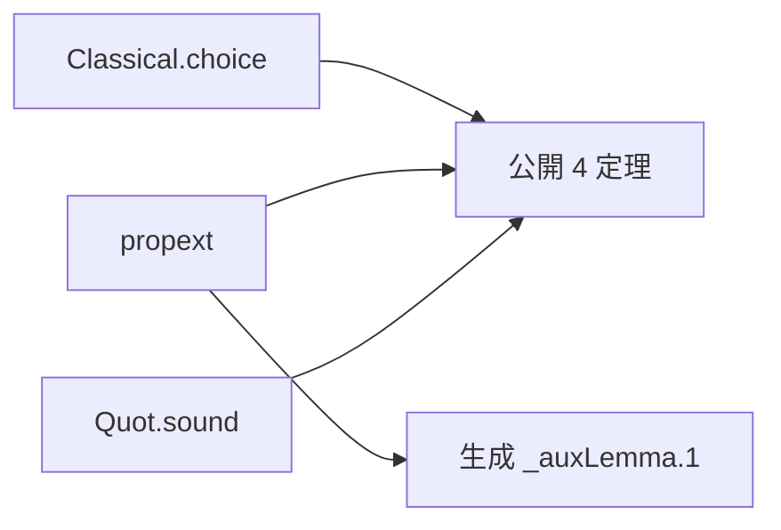
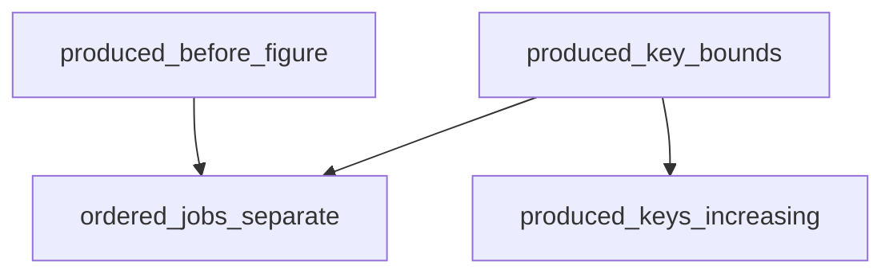

# [root ADR 0352](../adr/0352-prove-pagination-in-lean.md) の新しい本文の生成範囲

## 範囲

基準は `8d3de3321` の本体と既存モデルである。
[BesideProducerRange.lean](../../experiments/pagination-proof/BesideProducerRange.lean) を Lean 4.7.0（`aarch64-apple-darwin`）で検査した。
本体と既存モデルは変更していない。
この増分は、[新しく組む本文の型の証明](0352-beside-producer-dependencies.md) に加え、一つのジョブのキーの範囲と順序、二つのジョブの分離を導く。

本体の [composeBeside](../../modules/golem-typeset/src/Golem/Typeset/Flow.hs#L4073) は、所有する図版の次のキーから読み、段落や制御を読むと次のキーへ進む。
別の図版に当たった場合はそこで止まる。
型の証明だけでは、図版を出力せずに飛ばして、さらに後の本文を拾う誤りまでは区別できない。
今回は、開始位置以降にある図版より前で出力が終わることを、走査の再帰から導く。

その結果、前後に並んだ二つの所有者について、前の出力キーは後の図版より前にあり、後の出力キーはその図版より後にある。
二つの出力の範囲が分離すること自体は仮定しない。
同じジョブ内の出力も狭義単調増加することを導く。

モデルの許可、打ち切り、状態の更新の callback は、先行するモデルと同じく任意の全域関数である。
空の出力と `fuel = 0` も扱う。
開始位置と `fuel` に固定の上限は置かない。
キーは Nat の有限区間とし、Haskell の Map の全入力や Int の添字との一般の対応は残る。
前のラウンドの結果を再利用する経路と、実際の IO 全体の終了も、この増分では証明していない。

## 定理と依存

Lean の環境で、名前付き宣言の種類、型、elaboration 後の証明項を調べた。
公開定理 4 件、生成定理 9 件、生成定義 8 件、公理宣言 0 件だった。
手書きの定義と private 定理はない。
13 定理すべてを、元の定理を参照する同じ型の別名を一時環境に作って `#print axioms` で調べた。
別名も kernel が検査する。

次の名前には、共通接頭辞 `BesideProducer.` を付ける。
標準三公理は `propext`、`Classical.choice`、`Quot.sound` を指す。

| 名前 | 位置 | 前提と結論 | 公理 |
| --- | --- | --- | --- |
| `root_adr0352_i5_produced_key_bounds` | [5 行](../../experiments/pagination-proof/BesideProducerRange.lean#L5) | 出力のキーは開始位置以上で、開始位置に `fuel` を足した値より小さい。 | 標準三公理 |
| `root_adr0352_i5_produced_before_figure` | [39 行](../../experiments/pagination-proof/BesideProducerRange.lean#L39) | 開始位置以降に図版があれば、出力のキーはその図版の位置より小さい。 | 標準三公理 |
| `root_adr0352_i5_ordered_jobs_separate` | [80 行](../../experiments/pagination-proof/BesideProducerRange.lean#L80) | 前の所有者が後の図版より前にあれば、前のジョブの出力キーは後のジョブの出力キーより小さい。 | 標準三公理 |
| `root_adr0352_i5_produced_keys_increasing` | [94 行](../../experiments/pagination-proof/BesideProducerRange.lean#L94) | 一つのジョブの出力キーは狭義単調増加する。 | 標準三公理 |

三つ目の定理は、後の所有者の位置が図版の種類であることを入力に持つ。
開始位置は、それぞれの所有者の位置に 1 を足す。
前の所有者の位置の種類までは使わず、実装の有効な図版ジョブを含む範囲で証明する。

生成定理の完全修飾名と公理は次のとおりで、生成位置は取得できなかった。
インポートした `composeKeys` と順序の述語のパターン分岐、および証明中の所属判定の簡約に由来する。

| 完全修飾名 | 公理 |
| --- | --- |
| `_private.experiments.«pagination-proof».BesideProducerRange.0.BesideOwnership.Increasing._eq_2` | なし |
| `_private.experiments.«pagination-proof».BesideProducerRange.0.BesideProducer.composeKeys._eq_2` | なし |
| `_private.experiments.«pagination-proof».BesideProducerRange.0.BesideProducer.composeKeys.match_2.eq_1` | なし |
| `_private.experiments.«pagination-proof».BesideProducerRange.0.BesideProducer.composeKeys._eq_1` | なし |
| `experiments.«pagination-proof».BesideProducerRange._auxLemma.1` | `propext` |
| `_private.experiments.«pagination-proof».BesideProducerRange.0.BesideProducer.composeKeys.match_2.eq_2` | なし |
| `_private.experiments.«pagination-proof».BesideProducerRange.0.BesideOwnership.Increasing.match_1.eq_2` | なし |
| `_private.experiments.«pagination-proof».BesideProducerRange.0.BesideOwnership.Increasing.match_1.eq_1` | なし |
| `_private.experiments.«pagination-proof».BesideProducerRange.0.BesideOwnership.Increasing._eq_1` | なし |

生成定義も、インポートした定義を使うためのコンパイラ補助宣言である。
13 定理のうち、公開 4 件が標準三公理、生成 1 件が `propext` のみ、生成 8 件が公理に依存しない。
対象内に新しい公理を宣言していない。

| 標準公理 | Lean 4.7.0 の位置 | 内容 |
| --- | --- | --- |
| `Classical.choice` | `Init.Prelude:730` | `Nonempty α` から要素を選ぶ。 |
| `propext` | `Init.Core:1287` | 命題の同値から等式を導く。 |
| `Quot.sound` | `Init.Core:1459` | 関係を満たす二要素が同じ商の値を持つ。 |

公理の図は、定義や補助定理を経由する推移的な依存を示す。
公理に依存しない八つの生成定理には辺がない。



次の図の実線は、型か証明項の定理の直接参照である。
破線は補助定理を経由する間接依存を示す。
標準の等式と算術の補題と生成定理は省いた。
この四定理の間に、掲載する間接依存はない。



対象ソースに `sorry`、`admit`、`sorryAx` の使用はない。
Lean の diagnostic と十三定理の公理依存にも証明の穴はなかった。
今回の範囲に、穴の影響を受ける定理はない。

## 実装との照合と残り

[BesideProducer.hs](../../experiments/pagination-proof/BesideProducer.hs) の既存の観測に、キーの範囲と順序の検査を足した。
実フォント由来の単位と図版情報を使う 1,555 通りの表で、2,540 ジョブ、出力された合計 532 個の段落キーを検査した。
各キーが所有者より後にあり、同じジョブのキーが狭義単調増加し、途中の後の図版を越えないことを確認した。
空のジョブもこの行列に含む。

既存の 2,540 ジョブと 1,555 連結結果の合計 4,095 件の閉じた等式も、Lean の `decide` で再確認した。
モデルのキーの下限を開始位置より厳密に大きいとしてしまう誤変更は、Lean の証明で拒否された。
実装の所有者の直後のキーまで除外する誤変更も、観測の検査で拒否された。

この比較も自由な配置と間隔 0 の制御を使う。
異なる項目の組み合わせ、行グリッドの打ち切り、ほかの制御、前のラウンドからの再利用の直接の観測は増やしていない。
有限の比較を、全 IO と任意の原稿の証明として扱わない。

本体の `modules/` は `0aa78f65ac691cdd8d1a3bd5fc4c8bffb1feabdb` と一致する。
照合は GHC 9.10.3 と、この版の既存 runtime DB の登録済み package ID を読み取り専用で使う。
標準 Cabal 環境を新規構築したという検証ではない。
Cabal plan と package cache の実行前後の SHA-256 は一致した。

`check.sh` 全体も終了コード 0 で通った。
既存の 55,838 件と 156,520 件の配置、10,368 件の回り込み、4,864 件の因果的配置、216 件の制御、34,586 件の改行、実フォントのキャプション 40 件、Alloy 42 件の対応検査を含む。
実装の出力キーの観測と閉じた等式の比較は、次の別コマンドで実行した。

```sh
RUNGHC=/private/tmp/golem-0352-built-probe-nov28/runner \
  sh experiments/pagination-proof/check-built-first-ids.sh \
  "$PWD/experiments/pagination-proof/BesideProducer.hs" > /tmp/BesideProducerExamples.lean
LEAN_PATH=/private/tmp/golem-0352-numbered-output-cache-nov28 \
  /Users/tett23/.elan/toolchains/leanprover--lean4---v4.7.0/bin/lean /tmp/BesideProducerExamples.lean
```

Map と有限区間の一般の対応、前のラウンドからの再利用、全単位の寄与と実際の採番の接続は残る。
全原稿の内容の全量と順序、全制御、一般のキャプション、末尾の保持の再試行の是正も、この増分で完了していない。
[root ADR 0352](../adr/0352-prove-pagination-in-lean.md) 全体は採択済みで未実装のままである。
