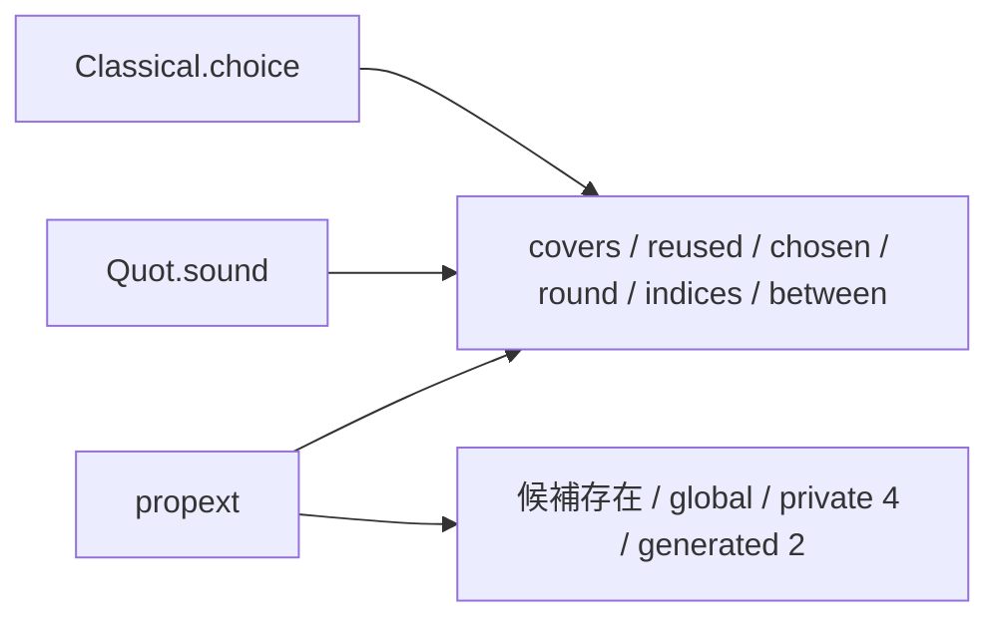
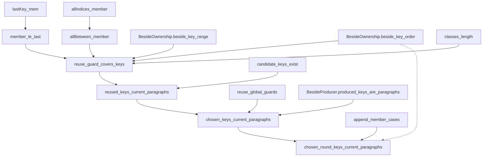

# [root ADR 0352](../adr/0352-prove-pagination-in-lean.md) の本文の再利用条件

## 範囲

基準は `58f8d40dc` の本体と既存モデルである。
[BesideReuse.lean](../../experiments/pagination-proof/BesideReuse.lean) を Lean 4.7.0（`aarch64-apple-darwin`）で検査した。
本体、公開 API、既存モデルは変更していない。
この増分は、新しく組む本文だけでなく、前のラウンドの結果を再利用する場合にも、選んだキーが現在の段落を指す条件を導く。

本体の [buildFlow](../../modules/golem-typeset/src/Golem/Typeset/Flow.hs#L4841) は、前後の単位数とリストマーカーの幅が等しい場合だけ、変化しなかった単位を記録する。
単位の比較には、値全体の一致、ページ参照がないこと、仮定した切断位置の一致を使う。
`reusedBeside` は、図版の所有者から最後の本文の次までを検査し、すべてが変化していない場合だけ前の本文を再利用する。
この区間は、現在の単位数より小さい添字に限る。

モデルの `candidateKeys` は、前の本文のキーの有無と、現在の制御の種類を使って候補を選ぶ。
前の表にキーがあれば、現在の種類より先にそのキーを選ぶ。
このため、前の段落を現在の図版に置き換えた場合も、候補にはそのキーが含まれうる。
候補の現在の種類が段落であることを仮定せず、区間の検査から前後の種類の一致を導く。

モデルの `sameAt` は、種類の一致と、残りの条件を表す `extra` の論理積である。
`extra` は任意の真偽値関数であり、本体の値全体の比較、ページ参照、切断位置の検査を弱めてよいという仕様ではない。
この射影では、再利用が許された結果の種類だけを証明する。
再利用した行の内容が改行し直した内容と等しいことまでは結論しない。

`oldTyped` は、前の本文のキーが前の単位では段落を指すという帰納の前提である。
現在の単位に対する結論を前提へ置いたものではない。
前の結果がない場合にはこの前提を必要とせず、新規生成の定理を使う。
ただし、実際の複数ラウンドを通してこの前提を受け渡す一般の接続は残る。

## 定理と公理

Lean の環境で、宣言の種類、型、elaboration 後の証明項を調べた。
対象モジュールには、公開定理 6 件、手書きの private 定理 6 件、生成定理 24 件、定義 71 件、公理宣言 0 件があった。
定義には、構造体の射影、再帰の分岐、インポートした定義を簡約するコンパイラの補助宣言を含む。
36 定理すべてについて、元の定理を参照する同じ型の別名を一時環境に作り、`#print axioms` を実行した。
別名の型と証明も kernel が検査する。

次の公開名には、共通接頭辞 `BesideReuse.` を付ける。
標準三公理は `propext`、`Classical.choice`、`Quot.sound` を指す。

| 名前 | 位置 | 前提と結論 | 公理 |
| --- | --- | --- | --- |
| `root_adr0352_i5_candidate_keys_exist` | [72 行](../../experiments/pagination-proof/BesideReuse.lean#L72) | 選ばれたキーは前の本文の表に存在する。 | `propext` |
| `root_adr0352_i5_reuse_guard_covers_keys` | [91 行](../../experiments/pagination-proof/BesideReuse.lean#L91) | 再利用の検査が通れば、選ばれた各キーで `sameAt` が真である。 | 標準三公理 |
| `root_adr0352_i5_reused_keys_current_paragraphs` | [110 行](../../experiments/pagination-proof/BesideReuse.lean#L110) | 前の表の型の条件と再利用の検査から、候補は現在の段落を指す。 | 標準三公理 |
| `root_adr0352_i5_reuse_global_guards` | [123 行](../../experiments/pagination-proof/BesideReuse.lean#L123) | 再利用が許されれば、前の結果があり、単位数と幅が一致する。 | `propext` |
| `root_adr0352_i5_chosen_keys_current_paragraphs` | [146 行](../../experiments/pagination-proof/BesideReuse.lean#L146) | 一つのジョブの再利用と新規生成のどちらでも、出力は現在の段落を指す。 | 標準三公理 |
| `root_adr0352_i5_chosen_round_keys_current_paragraphs` | [185 行](../../experiments/pagination-proof/BesideReuse.lean#L185) | 任意個のジョブの結果を連結しても、出力は現在の段落を指す。 | 標準三公理 |

private 定理の完全修飾名は、共通接頭辞 `_private.experiments.«pagination-proof».BesideReuse.0.BesideReuse.` に次の名前を続ける。

| 名前 | 位置 | 前提と結論 | 公理 |
| --- | --- | --- | --- |
| `classes_length` | [30 行](../../experiments/pagination-proof/BesideReuse.lean#L30) | 射影した判定の列は指定した長さを持つ。 | `propext` |
| `lastKey_mem` | [34 行](../../experiments/pagination-proof/BesideReuse.lean#L34) | 空でないキー列の最後のキーは、その列の要素である。 | `propext` |
| `member_le_last` | [43 行](../../experiments/pagination-proof/BesideReuse.lean#L43) | 増加するキー列の要素は最後のキー以下である。 | `propext` |
| `allIndices_member` | [56 行](../../experiments/pagination-proof/BesideReuse.lean#L56) | 全添字の検査が通れば、有効な一つの添字の検査も通る。 | 標準三公理 |
| `allBetween_member` | [66 行](../../experiments/pagination-proof/BesideReuse.lean#L66) | 区間の検査が通れば、その範囲の有効な添字の検査も通る。 | 標準三公理 |
| `append_member_cases` | [165 行](../../experiments/pagination-proof/BesideReuse.lean#L165) | 連結した列の要素は、左右どちらかの列の要素である。 | `propext` |

標準公理の宣言元と内容は次のとおりである。
対象モジュール内に、これら以外の新しい公理を宣言していない。

| 公理 | Lean 4.7.0 の位置 | 内容 |
| --- | --- | --- |
| `Classical.choice` | `Init.Prelude:730` | `Nonempty α` から要素を選ぶ。 |
| `propext` | `Init.Core:1287` | 命題の同値から等式を導く。 |
| `Quot.sound` | `Init.Core:1459` | 関係を満たす二要素が同じ商の値を持つ。 |

生成定理 24 件は次のとおりである。
生成位置は取得できなかった。
分岐の等式、構造体の射影と単射性、所属判定の簡約に由来する。

| 完全修飾名 | 公理 |
| --- | --- |
| `_private.experiments.«pagination-proof».BesideReuse.0.BesideOwnership.scan.match_1.eq_2` | なし |
| `_private.experiments.«pagination-proof».BesideReuse.0.BesideOwnership.classes.match_1.eq_1` | なし |
| `BesideReuse.ReuseJob.mk.injEq` | `propext` |
| `_private.experiments.«pagination-proof».BesideReuse.0.BesideReuse.allIndices._eq_2` | なし |
| `BesideReuse.ReuseJob.mk.inj` | なし |
| `_private.experiments.«pagination-proof».BesideReuse.0.BesideReuse.allIndices.match_1.eq_1` | なし |
| `_private.experiments.«pagination-proof».BesideReuse.0.BesideReuse.lastKey._eq_2` | なし |
| `_private.experiments.«pagination-proof».BesideReuse.0.BesideOwnership.scan._eq_1` | なし |
| `_private.experiments.«pagination-proof».BesideReuse.0.BesideReuse.allIndices._eq_1` | なし |
| `_private.experiments.«pagination-proof».BesideReuse.0.BesideOwnership.scan.match_1.eq_1` | なし |
| `_private.experiments.«pagination-proof».BesideReuse.0.BesideOwnership.classes._eq_1` | なし |
| `_private.experiments.«pagination-proof».BesideReuse.0.BesideReuse.chooseAll._eq_2` | なし |
| `_private.experiments.«pagination-proof».BesideReuse.0.BesideOwnership.classes._eq_2` | なし |
| `_private.experiments.«pagination-proof».BesideReuse.0.BesideReuse.chooseAll._eq_1` | なし |
| `_private.experiments.«pagination-proof».BesideReuse.0.BesideReuse.lastKey.match_1.eq_1` | なし |
| `_private.experiments.«pagination-proof».BesideReuse.0.BesideOwnership.scan._eq_2` | なし |
| `BesideReuse.ReuseJob.mk.sizeOf_spec` | なし |
| `_private.experiments.«pagination-proof».BesideReuse.0.BesideReuse.allIndices.match_1.eq_2` | なし |
| `_private.experiments.«pagination-proof».BesideReuse.0.BesideReuse.chooseAll.match_1.eq_2` | なし |
| `_private.experiments.«pagination-proof».BesideReuse.0.BesideReuse.lastKey._eq_1` | なし |
| `_private.experiments.«pagination-proof».BesideReuse.0.BesideReuse.chooseAll.match_1.eq_1` | なし |
| `experiments.«pagination-proof».BesideReuse._auxLemma.1` | `propext` |
| `_private.experiments.«pagination-proof».BesideReuse.0.BesideOwnership.classes.match_1.eq_2` | なし |
| `_private.experiments.«pagination-proof».BesideReuse.0.BesideReuse.lastKey.match_1.eq_2` | なし |

36 定理のうち、6 件は標準三公理、8 件は `propext` のみ、22 件は公理に依存しない。
次の公理の図は、定義や補助定理を経由する推移的な依存を示す。
公理に依存しない生成定理には辺がない。



次の定理の図の実線は、型か証明項の定理の直接参照である。
破線は定義や補助定理を経由する間接依存を示す。
標準の等式と算術の補題と生成定理は省いた。



対象ソースに `sorry`、`admit`、`sorryAx` の使用はない。
Lean の diagnostic と、36 定理の公理依存にも証明の穴はなかった。
この範囲に、穴の影響を受ける定理はない。

## 境界と実装との照合

未追加のモジュールを読む検査が失敗することを、追加前に確認した。
追加後は [BesideReuseBoundary.lean](../../experiments/pagination-proof/BesideReuseBoundary.lean) の 12 件の閉じた具体例を `decide` で検査した。
前の結果の有無、単位数と幅の違い、`extra` の不一致、段落から図版への変更、空の表、新規生成への切り替えを含む。
区間の終わりを所有者だけに狭める変異は、元の検査区間を導く定理で拒否された。

[BesideReuse.hs](../../experiments/pagination-proof/BesideReuse.hs) は、実フォントを使う原稿を評価し、前の `Built` を渡した `buildFlow` と、渡さない `buildFlow` を比べる。
五つの入力は、同じ原稿、本文の短縮、本文から図版への置換、本文の削除、本文から段送りへの置換である。
どちらも診断エラーがなく、本文のキーがすべて現在の段落を指し、各本文の行数と `bUnitFirsts` の表が一致した。
図版への置換では、単位数が 6 のまま、前の本文のキー 2 が現在の図版となり、そのキーを再利用しなかった。
削除では、単位数が 6 から 5 へ変わる境界も確認した。

検証用の一時ソースだけで区間の検査を常に真へ変えると、本文の短縮で再利用と新規生成の比較が失敗した。
本体のソースは変更していない。
観測の export list を開く前後に、本体の残りが同一であることを `check-built-first-ids.sh` で照合した。
この観測は内部の採番表を比較し、通常 CLI の PDF の視認を代用しない。

この検証は、固定した既存の package DB を読み取る明示的な依存環境で実行した。
使用した本体は `0aa78f65ac691cdd8d1a3bd5fc4c8bffb1feabdb` と `modules/` の差分がない。
GHC は 9.10.3、peg-hs は正規の固定版 `4b4adc7046` を使い、plan と DB を書き換えていない。
標準の Cabal 設定からの新しいビルドを実施したという記録ではない。

`check.sh` 全体も終了コード 0 で通った。
既存の 55,838 件と 156,520 件の配置、10,368 件の回り込み、4,864 件の因果的配置、216 件の制御、34,586 件の改行、実フォントのキャプション 40 件、Alloy 42 件の対応検査を含む。
実行前後で、Cabal plan と package cache の SHA-256 は一致した。

## 再現と残り

`check.sh` は、既存モデルの後で `BesideReuse.lean` と境界の具体例を検査する。
次は、依存するモデルの olean を作った後に、同じ `LEAN_PATH` で行う局所検査である。

```sh
LEAN_PATH="$work" lean -o "$work/BesideReuse.olean" experiments/pagination-proof/BesideReuse.lean
LEAN_PATH="$work" lean experiments/pagination-proof/BesideReuseBoundary.lean
RUNGHC=/private/tmp/golem-0352-built-probe-nov28/runner \
  sh experiments/pagination-proof/check-built-first-ids.sh \
  "$PWD/experiments/pagination-proof/BesideReuse.hs"
```

依存調査では `import Lean` と `import BesideReuse` の環境から宣言を列挙した。
各 `.thmInfo` の型と証明項の `getUsedConstants` を環境の宣言種別と照合し、直接参照する定理を取り出した。
各定理を参照する kernel 検査済みの別名に `#print axioms` を実行した。
ソース上の穴は次の検索でも確認した。

```sh
rg -n '\b(sorry|admit|sorryAx)\b' experiments/pagination-proof/BesideReuse.lean
```

キーは Nat の有限区間である。
Haskell の Int、実際の Map、値全体の一致からこの射影への一般の対応は未証明である。
候補の走査は単位数で有限に切るため、前の Map の定義域もその単位数の範囲内にあることを、本体から一般に導く接続も残る。
再利用した内容の一致、再利用を含むジョブの出力の順序、全ラウンドの帰納、外側の `Built` の採番量の前提も残る。
`hb` の全呼び出し元の前提、全制御の終了、本文全体の内容と順序、`captionCompared` と改行器の一般的一致は、この増分で完了していない。
[末尾の保持の再試行の反例](0352-last-retry-counter-dependencies.md) も、この増分では修正していない。
root [ADR 0352](../adr/0352-prove-pagination-in-lean.md) の全範囲は未完了のままである。
