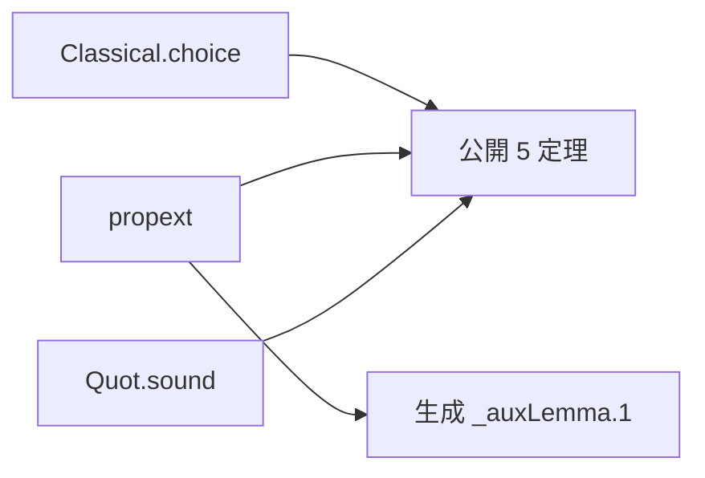
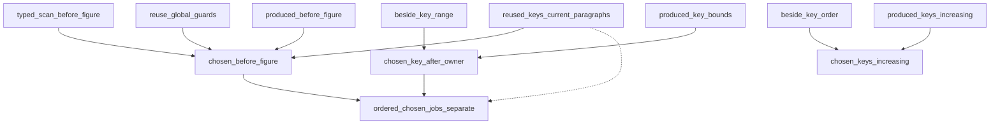

# [root ADR 0352](../adr/0352-prove-pagination-in-lean.md) の再利用を含むジョブの順序

## 範囲

基準は `8f83ac999` の本体と既存モデルである。
[BesideReuseOrder.lean](../../experiments/pagination-proof/BesideReuseOrder.lean) を Lean 4.7.0（`aarch64-apple-darwin`）で検査した。
本体と公開 API は変更していない。
この増分は、[新しい本文の生成範囲](0352-beside-producer-range-dependencies.md) の順序と区切りの条件を、再利用と新規生成が混在するジョブへ広げる。

最初に、現在の段落だけを選ぶ走査は、現在の図版の手前で止まることを導く。
前の表のキーが優先される場合も扱う。
図版を選んで通過したなら、選んだキーの現在の種類が段落であるという条件に反する。
制御として通過する分岐も、図版の種類とは両立しない。

次に、再利用の区間の検査から、選んだキーの現在の種類を導く既存の定理を使う。
この結果と走査の区切りを合わせ、再利用されたキーも後の図版を越えないことを示す。
前の表に現在の図版のキーがないことを、そのまま仮定していない。
前の表の型の条件は既存の入力とし、[複数ラウンドのモデル](0352-beside-reuse-rounds-dependencies.md) での受け渡しとは区別する。

新規生成の場合は、既存の生成範囲と順序の定理を使う。
どちらの経路でも、一つのジョブのキーは所有者より後にあり、狭義単調増加する。
二つの所有者が前後に並び、後の所有者が現在の図版を指せば、前のジョブの出力キーは、後のジョブの出力キーより小さい。
二つのジョブの結果が分離するという結論自体を前提に置いていない。

この増分も Nat の有限の走査を対象とする。
callback とその更新は任意の全域関数であり、空の出力も扱う。
ジョブ数と本文の長さに固定の上限は置かない。
本体の Map と Int の添字との一般の接続までは含めない。

## 定理と依存

Lean の環境で、宣言の種類、型、elaboration 後の証明項を調べた。
公開定理 5 件、生成定理 9 件、生成定義 8 件、公理宣言 0 件だった。
手書きの定義と private 定理はない。
14 定理のすべてについて、元の定理を参照する同じ型の別名を一時環境に作り、`#print axioms` を実行した。
別名も kernel が検査する。

次の公開名には、共通接頭辞 `BesideReuse.` を付ける。
公開 5 定理は、すべて `propext`、`Classical.choice`、`Quot.sound` に依存する。

| 名前 | 位置 | 前提と結論 |
| --- | --- | --- |
| `root_adr0352_i5_typed_scan_before_figure` | [7 行](../../experiments/pagination-proof/BesideReuseOrder.lean#L7) | 選んだキーが現在の段落を指せば、開始位置以降の図版より前で走査の出力が終わる。 |
| `root_adr0352_i5_chosen_key_after_owner` | [48 行](../../experiments/pagination-proof/BesideReuseOrder.lean#L48) | 再利用と新規生成のどちらでも、キーは所有者より後にある。 |
| `root_adr0352_i5_chosen_before_figure` | [67 行](../../experiments/pagination-proof/BesideReuseOrder.lean#L67) | 前の表の型の条件から、どちらの経路も後の現在の図版を越えない。 |
| `root_adr0352_i5_chosen_keys_increasing` | [90 行](../../experiments/pagination-proof/BesideReuseOrder.lean#L90) | どちらの経路も、一つのジョブのキーは狭義単調増加する。 |
| `root_adr0352_i5_ordered_chosen_jobs_separate` | [106 行](../../experiments/pagination-proof/BesideReuseOrder.lean#L106) | 前後の所有者と後の図版の条件から、前のジョブのキーは後のジョブのキーより小さい。 |

生成定理は次の 9 件である。
生成位置は取得できなかった。
インポートした走査と判定の列を簡約する分岐の等式、および所属判定の簡約に由来する。

| 完全修飾名 | 公理 |
| --- | --- |
| `_private.experiments.«pagination-proof».BesideReuseOrder.0.BesideOwnership.classes.match_1.eq_1` | なし |
| `_private.experiments.«pagination-proof».BesideReuseOrder.0.BesideOwnership.scan._eq_1` | なし |
| `_private.experiments.«pagination-proof».BesideReuseOrder.0.BesideOwnership.classes._eq_2` | なし |
| `experiments.«pagination-proof».BesideReuseOrder._auxLemma.1` | `propext` |
| `_private.experiments.«pagination-proof».BesideReuseOrder.0.BesideOwnership.scan._eq_2` | なし |
| `_private.experiments.«pagination-proof».BesideReuseOrder.0.BesideOwnership.scan.match_1.eq_2` | なし |
| `_private.experiments.«pagination-proof».BesideReuseOrder.0.BesideOwnership.classes._eq_1` | なし |
| `_private.experiments.«pagination-proof».BesideReuseOrder.0.BesideOwnership.classes.match_1.eq_2` | なし |
| `_private.experiments.«pagination-proof».BesideReuseOrder.0.BesideOwnership.scan.match_1.eq_1` | なし |

標準公理の宣言元と内容は次のとおりである。
対象内に、新しい公理を宣言していない。

| 公理 | Lean 4.7.0 の位置 | 内容 |
| --- | --- | --- |
| `Classical.choice` | `Init.Prelude:730` | `Nonempty α` から要素を選ぶ。 |
| `propext` | `Init.Core:1287` | 命題の同値から等式を導く。 |
| `Quot.sound` | `Init.Core:1459` | 関係を満たす二要素が同じ商の値を持つ。 |

公理の図は、定義や補助定理を経由する推移的な依存を示す。
公理に依存しない生成 8 定理には辺がない。



次の定理の図の実線は、型か証明項の定理の直接参照である。
破線は定義や補助定理を経由する間接依存を示す。
標準の等式と算術の補題と生成定理は省いた。



対象ソースに `sorry`、`admit`、`sorryAx` の使用はない。
Lean の diagnostic と 14 定理の公理依存にも証明の穴はなかった。
この範囲に、穴の影響を受ける定理はない。

## 境界と実装との照合

追加前には、未追加のモジュールと定理を読む検査が失敗することを確認した。
追加後は [BesideReuseOrderBoundary.lean](../../experiments/pagination-proof/BesideReuseOrderBoundary.lean) の 8 件の具体例を検査した。
二つのジョブを両方再利用、両方新規生成、片方ずつ再利用する四通りと、再利用の可否の真偽値を含む。
前の段落のキーに図版を入れた例と、キーの順序の定理の適用も含む。

[BesideReuseOrder.hs](../../experiments/pagination-proof/BesideReuseOrder.hs) は、実フォントの 6 回の計算で、合計 13 ジョブの選んだキーを検査した。
それぞれのキーが所有者より後で、同じジョブ内で狭義単調増加し、後の図版より前にあることを確認した。
すべてのジョブの結果を連結すると、本文の Map のキーの昇順の列と一致した。
再利用を含む各回で新規生成とも比べ、各本文の行数と `bUnitFirsts` の表も一致した。
この入力の系列は、前のラウンドのキーが現在の図版に変わる場合も含む。

図版とその直前の本文との間に一つ余計な添字を要求する変異は、Lean の証明で拒否された。
所有者の直後のキーを除外する観測の変異も、実装の検査で拒否された。
本体は変更していない。
観測は export list だけを開く一時ソースで行い、本体の残りが元と一致することを確認した。

本体の `modules/` は `0aa78f65ac691cdd8d1a3bd5fc4c8bffb1feabdb` と一致する。
GHC 9.10.3 と peg-hs の正規固定版 `4b4adc7046` の、既存の runtime DB を読み取り専用で使う。
標準の Cabal 設定から新しくビルドしたという記録ではない。
この比較は内部のキーと採番の表を対象とし、通常 CLI の PDF の視認を代用しない。

`check.sh` 全体も終了コード 0 で通った。
既存の 55,838 件と 156,520 件の配置、10,368 件の回り込み、4,864 件の因果的配置、216 件の制御、34,586 件の改行、実フォントのキャプション 40 件、Alloy 42 件の対応検査を含む。
Cabal plan と package cache の実行前後の SHA-256 は一致した。

## 再現と残り

`check.sh` は、依存する `BesideProducerRange.olean` と `BesideReuse.olean` を作った後、このモデルと境界の具体例を検査する。
同じ環境での局所検査と、実装の観測は次のコマンドで行う。

```sh
LEAN_PATH="$work" lean -o "$work/BesideReuseOrder.olean" \
  experiments/pagination-proof/BesideReuseOrder.lean
LEAN_PATH="$work" lean experiments/pagination-proof/BesideReuseOrderBoundary.lean
RUNGHC=/private/tmp/golem-0352-built-probe-nov28/runner \
  sh experiments/pagination-proof/check-built-first-ids.sh \
  "$PWD/experiments/pagination-proof/BesideReuseOrder.hs"
```

依存調査では `import Lean` と `import BesideReuseOrder` の環境から宣言を列挙した。
各 `.thmInfo` の型と証明項の `getUsedConstants` を環境の宣言種別と照合し、定理の直接参照を調べた。
生成定理を含むすべての定理の別名へ `#print axioms` を実行した。
ソースの穴は次の検索でも確認した。

```sh
rg -n '\b(sorry|admit|sorryAx)\b' experiments/pagination-proof/BesideReuseOrder.lean
```

今回の証明は一つのジョブ内の順序と、二つの前後のジョブの範囲の分離を導く。
実際の図版の Map とジョブ列の順序、前の Map の内容、値全体の一致、Int の添字と Nat の一般の対応は未証明である。
有限の観測でジョブの連結が一致したことを、任意の本体の連結と Map の一般的一致の証明とは扱わない。

本文の値の一致と全量と順序、外側の `Built` の採番量、`hb` の全呼び出し元、全制御、`captionCompared` と改行器の一般的一致も残る。
[末尾の保持の再試行の反例](0352-last-retry-counter-dependencies.md) も、この増分では修正していない。
root [ADR 0352](../adr/0352-prove-pagination-in-lean.md) の全範囲は未完了のままである。
