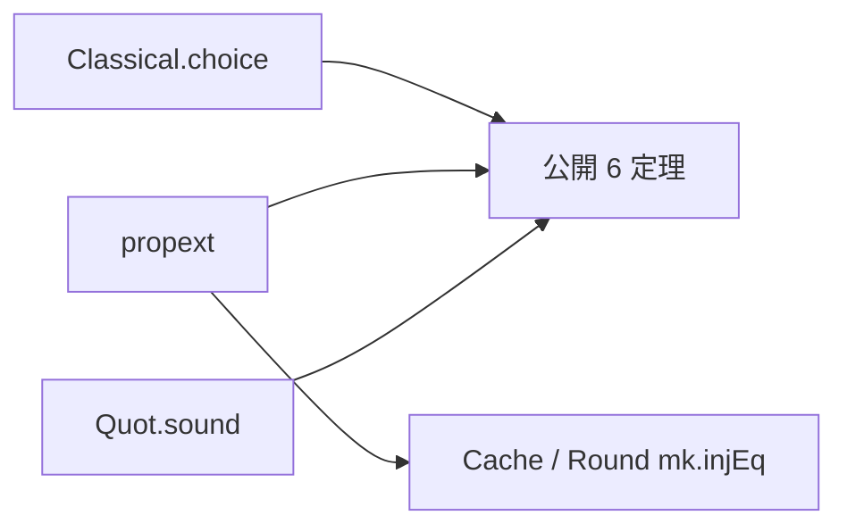
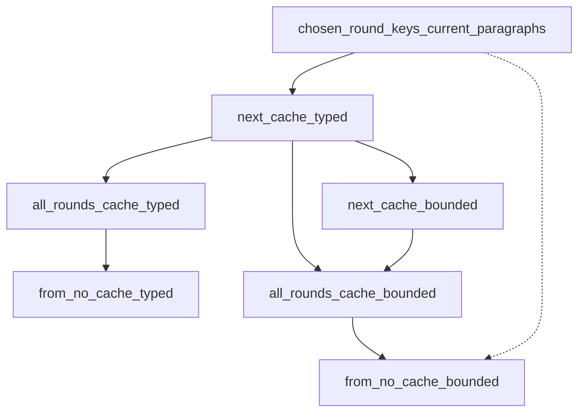

# [root ADR 0352](../adr/0352-prove-pagination-in-lean.md) の複数ラウンドの本文の型

## 範囲

基準は `55e67a41d` の本体と既存モデルである。
[BesideReuseRounds.lean](../../experiments/pagination-proof/BesideReuseRounds.lean) を Lean 4.7.0（`aarch64-apple-darwin`）で検査した。
本体と公開 API は変更していない。
この増分は、[本文の再利用条件](0352-beside-reuse-dependencies.md) の `oldTyped` を、モデル内の前のラウンドの結果から帰納的に渡す。

`Cache` は、前の単位の種類、その単位数、選んだ本文のキーを持つ。
`Round` は、現在の単位の種類と数、再利用の条件、新規生成の callback とジョブを持つ。
`nextCache` は、前の結果がなければ新規生成し、あれば同じ `chooseAll` で再利用の可否を検査する。
`runRounds` は、ラウンドの有限の列を先頭から処理する。
ラウンド数やジョブ数に固定の上限は置かない。

`cacheTyped` は、保存した各キーが、そのラウンドの段落を指す条件である。
一つの遷移でこの条件が保たれることを、前の結果の有無を分けて証明した。
ラウンドの列に関する帰納から、前の結果がない状態で始めれば、任意回数の遷移の結果もこの条件を満たす。
現在の結果の型を、現在の遷移の前提に置いていない。

`kindBounded` は、入力の単位数以上の添字では種類がないという条件である。
これは選んだ結果に関する条件ではなく、有限の単位列を射影した入力に関する条件である。
この入力の条件と `cacheTyped` から、結果のキーが単位数未満である `cacheBounded` を導く。
入力の条件を満たす任意のラウンド列について、前の結果がない状態から、同じ有限範囲の条件が保たれることも証明した。

二つの遷移関数は `noncomputable def` とした。
関数のフィールドを持つ構造体を組み立てる際に、Lean 4.7.0 のコード生成が補助的な unsafe axiom 宣言を作らないようにするためである。
定義と証明は kernel が検査し、閉じた境界は `decide` で簡約する。
この選択で新しい公理や証明の穴を加えていない。
モデルをネイティブに実行する速度を評価したものでもない。

## 定理と依存

Lean の環境で、宣言の種類、型、elaboration 後の証明項を調べた。
公開定理 6 件、生成定理 6 件、定義 49 件、公理宣言 0 件だった。
手書きの private 定理はない。
定義は手書きの 9 件と、構造体の射影などの生成定義を含む。
12 定理のすべてについて、元の定理を参照する同じ型の別名を一時環境に作り、`#print axioms` を実行した。
別名も kernel が検査する。

次の公開名には、共通接頭辞 `BesideReuse.` を付ける。
公開 6 定理は、すべて `propext`、`Quot.sound`、`Classical.choice` に依存する。

| 名前 | 位置 | 前提と結論 |
| --- | --- | --- |
| `root_adr0352_i5_next_cache_typed` | [40 行](../../experiments/pagination-proof/BesideReuseRounds.lean#L40) | 前の結果があればその型の条件から、次の結果の型の条件を導く。 |
| `root_adr0352_i5_all_rounds_cache_typed` | [61 行](../../experiments/pagination-proof/BesideReuseRounds.lean#L61) | 型の条件を満たす前の結果から、任意のラウンド列の結果もその条件を満たす。 |
| `root_adr0352_i5_from_no_cache_typed` | [72 行](../../experiments/pagination-proof/BesideReuseRounds.lean#L72) | 前の結果がなくても、任意のラウンド列の結果は型の条件を満たす。 |
| `root_adr0352_i5_next_cache_bounded` | [84 行](../../experiments/pagination-proof/BesideReuseRounds.lean#L84) | 前の結果の型と現在の有限な入力から、次の結果のキーは現在の単位数未満となる。 |
| `root_adr0352_i5_all_rounds_cache_bounded` | [96 行](../../experiments/pagination-proof/BesideReuseRounds.lean#L96) | 前の結果の型と範囲、各入力の有限な範囲から、ラウンド列の結果の範囲を導く。 |
| `root_adr0352_i5_from_no_cache_bounded` | [114 行](../../experiments/pagination-proof/BesideReuseRounds.lean#L114) | 前の結果がなくても、各入力が有限な範囲を持てば、ラウンド列の結果もその範囲内にある。 |

生成定理は、構造体の単射性とサイズに関する次の 6 件である。
生成位置は取得できなかった。

| 完全修飾名 | 公理 |
| --- | --- |
| `BesideReuse.Cache.mk.injEq` | `propext` |
| `BesideReuse.Round.mk.injEq` | `propext` |
| `BesideReuse.Round.mk.sizeOf_spec` | なし |
| `BesideReuse.Cache.mk.inj` | なし |
| `BesideReuse.Round.mk.inj` | なし |
| `BesideReuse.Cache.mk.sizeOf_spec` | なし |

標準公理の宣言元と内容は次のとおりである。
対象内に、新しい公理を宣言していない。

| 公理 | Lean 4.7.0 の位置 | 内容 |
| --- | --- | --- |
| `Classical.choice` | `Init.Prelude:730` | `Nonempty α` から要素を選ぶ。 |
| `propext` | `Init.Core:1287` | 命題の同値から等式を導く。 |
| `Quot.sound` | `Init.Core:1459` | 関係を満たす二要素が同じ商の値を持つ。 |

公理の図は、定義や補助定理を経由する推移的な依存を示す。
公理に依存しない生成 4 定理には辺がない。



次の定理の図の実線は、型か証明項の定理の直接参照である。
破線は定義や補助定理を経由する間接依存を示す。
標準の等式と算術の補題と生成定理は省いた。



対象ソースに `sorry`、`admit`、`sorryAx` の使用はない。
Lean の diagnostic と 12 定理の公理依存にも証明の穴はなかった。
この範囲に、穴の影響を受ける定理はない。

## 境界と実装との照合

追加前には、未追加のモジュールと定理を読む検査が失敗することを確認した。
追加後には [BesideReuseRoundsBoundary.lean](../../experiments/pagination-proof/BesideReuseRoundsBoundary.lean) の 8 件の具体例を検査した。
前の結果がない空のラウンド列、一回の新規生成、同じ種類の再利用、段落を図版へ変更した後の再生成、さらに段落へ戻す場合を含む。
三ラウンドの具体例では、型と有限範囲の定理も適用した。
現在の計算を使わず前のキーを無条件に残す変異と、結果の単位数を 0 へ変える変異は、それぞれの証明で拒否された。

[BesideReuseRounds.hs](../../experiments/pagination-proof/BesideReuseRounds.hs) は、最初の原稿を新規生成した後、5 回の変更を同じ `Built` の受け渡しで処理する。
各回で新規生成とも比較する。
実フォントの原稿で、同一、短縮、段落から図版への置換、削除、段送りへの置換を順に処理した。
初回を含む 6 回の計算で、選んだ本文のキーが現在の段落を指し、各本文の行数と `bUnitFirsts` が新規生成と一致した。
削除と段送りの置換では、直前の本文のキーが現在の図版になる場合も含んだ。
前の `Built` 自体をそのまま次の結果とする変異は、短縮の回で比較に失敗した。

同じ観測から、各回の単位の種類、単位数、幅の一致、単位全体の一致、ページ参照の有無をモデルへ渡した。
仮定した切断位置の表が空であることも確認した。
この fixture は自由な配置で、段落の許可を妨げる項目の違いや規則や箱はなく、行グリッドの打ち切りもない。
この範囲で callback の状態を省いたモデルの 6 回の出力キーの等式を、kernel の `decide` で確認した。
この有限の一致を、任意の原稿と callback の一致の証明とは扱わない。

観測は export list だけを開く一時ソースで行い、本体の残りが元と同一であることを確認した。
本体の `modules/` は `0aa78f65ac691cdd8d1a3bd5fc4c8bffb1feabdb` と一致する。
GHC 9.10.3 と peg-hs の正規固定版 `4b4adc7046` の、既存の runtime DB を読み取り専用で使った。
標準 Cabal 環境を新規構築したという検証ではない。
この内部の表の観測は、通常 CLI の PDF の視認を代用しない。

`check.sh` 全体も終了コード 0 で通った。
既存の 55,838 件と 156,520 件の配置、10,368 件の回り込み、4,864 件の因果的配置、216 件の制御、34,586 件の改行、実フォントのキャプション 40 件、Alloy 42 件の対応検査を含む。
Cabal plan と package cache の実行前後の SHA-256 は一致した。

## 再現と残り

`check.sh` は `BesideReuse.olean` を作った後、このモデルと境界の具体例を検査する。
依存するモデルの olean がある環境での局所検査と、実装の観測は次のコマンドで行う。

```sh
LEAN_PATH="$work" lean -o "$work/BesideReuseRounds.olean" \
  experiments/pagination-proof/BesideReuseRounds.lean
LEAN_PATH="$work" lean experiments/pagination-proof/BesideReuseRoundsBoundary.lean
RUNGHC=/private/tmp/golem-0352-built-probe-nov28/runner \
  sh experiments/pagination-proof/check-built-first-ids.sh \
  "$PWD/experiments/pagination-proof/BesideReuseRounds.hs"
BESIDE_REUSE_LEAN=1 RUNGHC=/private/tmp/golem-0352-built-probe-nov28/runner \
  sh experiments/pagination-proof/check-built-first-ids.sh \
  "$PWD/experiments/pagination-proof/BesideReuseRounds.hs" > /tmp/BesideReuseRoundsExamples.lean
LEAN_PATH="$work" lean /tmp/BesideReuseRoundsExamples.lean
```

依存調査では `import Lean` と `import BesideReuseRounds` の環境から宣言を列挙した。
各 `.thmInfo` の型と証明項の `getUsedConstants` を環境の宣言種別と照合し、定理の直接参照を調べた。
生成定理を含むすべての定理の別名へ `#print axioms` を実行した。
ソースの穴は次の検索でも確認した。

```sh
rg -n '\b(sorry|admit|sorryAx)\b' experiments/pagination-proof/BesideReuseRounds.lean
```

今回の帰納は、選んだキーの有無だけを次へ渡すモデルのラウンド列についての証明である。
本体の `buildFlow` の各呼び出しと、この遷移の一般的な対応は未証明である。
実際の Map の内容、全単位の一致、入力の種類の有限範囲、Int の添字と Nat の対応も、本体からモデルへ一般に接続していない。
任意の有限回のラウンドについて証明したことから、製品の再計算が常に有限回で終わるとは結論しない。

本文の値の一致と全量と順序、再利用したジョブ間の順序、外側の `Built` の採番量、`hb` の全呼び出し元、全制御、`captionCompared` と改行器の一般的一致は残る。
[末尾の保持の再試行の反例](0352-last-retry-counter-dependencies.md) も、この増分では修正していない。
root [ADR 0352](../adr/0352-prove-pagination-in-lean.md) の全範囲は未完了のままである。
