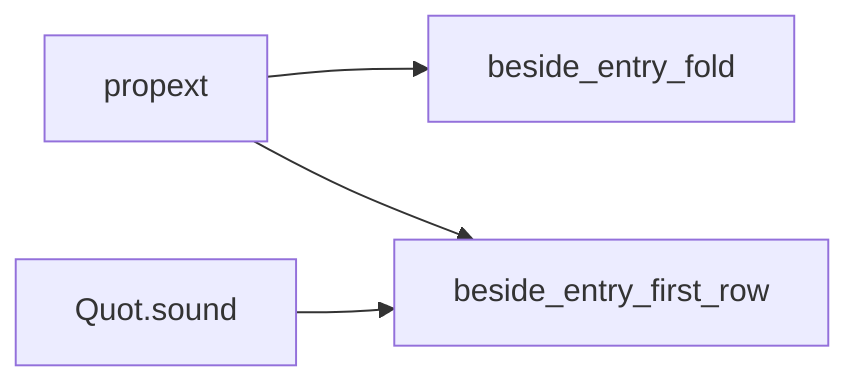
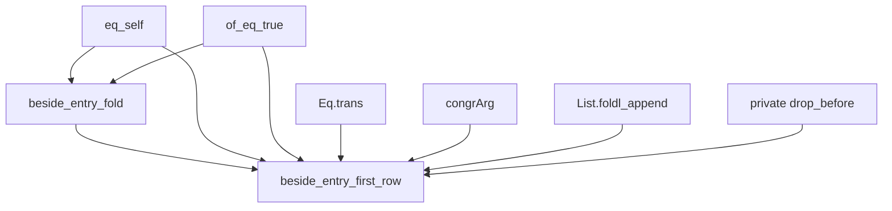

# [root ADR 0352](../adr/0352-prove-pagination-in-lean.md) の本文の先頭 ID と行の fold

## 範囲

基準は `b47d79a4b` の証明と本体である。
[BesideScanRows.lean](../../experiments/pagination-proof/BesideScanRows.lean) を Lean 4.7.0（`aarch64-apple-darwin`）で検査した。
本体のソースは `0aa78f65ac691cdd8d1a3bd5fc4c8bffb1feabdb` と同一であり、後に採択された配置や注の変更を検証した記録ではない。
本体と公開 API は変更していない。

本体の `Flow.hs:4966` の `besideFirsts` は、図版の内部 ID の次から、本文ごとの行数を足して先頭 ID の表を作る。
これを `scan` でモデルにした。
一方、同じソースの `numberFigure` は `Flow.hs:4596` の `go` と同 4606 の fold で行を採番して連結する。
既存の [WrappedRowFold](0352-wrapped-row-fold-dependencies.md) は、この行の fold をモデルにする。

最初の定理は、選んだ本文の先頭 ID が、それより前の本文の行を fold した後の次の ID と一致することを示す。
二つ目の定理は、選んだ本文が空でなければ、実際の行の fold が追加する最初の行の ID と、その表の値が一致することを示す。
以前の行の列は任意であり、行の値の型も任意である。
空の先行本文、重複する値、重複するキーを排除しない。

表はキーと値の列であり、キーで検索する Map ではない。
重複キーを受け入れることから、Map に保存した後の一般的一致は導けない。
本体の `Built` 全体、キーの一意性と Map の検索、改行器から行ができる過程は、この定理の結論に含まれない。

## 宣言と公理

Lean の環境で宣言の種類、型、証明項と直接の定理参照を取得した。
公開定理 2 件、private 定理 1 件、生成定理 14 件、定義 16 件、公理宣言 0 件だった。
全 17 定理を kernel で検査し、公理依存を取得した。
位置の取得できなかった生成宣言は、以下で生成元と名前を示す。

共通の名前空間は `BesideScanRows` である。

| 名前 | 位置 | 前提と結論 | 公理 |
| --- | --- | --- | --- |
| `scan` | [9 行](../../experiments/pagination-proof/BesideScanRows.lean#L9) | 任意の開始 ID と本文の列から、次の ID と本文ごとの先頭 ID の列を作る。 | 定義 |
| `root_adr0352_i5_beside_entry_fold` | [17 行](../../experiments/pagination-proof/BesideScanRows.lean#L17) | 任意の先行本文と初期状態について、選んだ本文の表の値を、先行行の fold の次の ID へ接続する。 | `propext` |
| `root_adr0352_i5_beside_entry_first_row` | [35 行](../../experiments/pagination-proof/BesideScanRows.lean#L35) | 対象本文の最初の行がある場合、表の値と、その本文を fold して追加する最初の行の ID が一致する。 | `propext`、`Quot.sound` |

private の補題は `_private.experiments.«pagination-proof».BesideScanRows.0.BesideScanRows.drop_before`、位置は [27 行](../../experiments/pagination-proof/BesideScanRows.lean#L27) である。
任意の二つの列を連結して先行列の長さだけ取り除くと、後続列が残ることを示す。
公理には依存しない。

生成定理の共通接頭辞は `_private.experiments.«pagination-proof».BesideScanRows.0.` である。
次の各名前の前半に suffix を付けた全 14 件があり、いずれも公理に依存しない。

| 名前の前半 | suffix | 件数 |
| --- | --- | --- |
| `NumberedPayload.numberRows` | `._eq_1`、`._eq_2`、`.match_1.eq_1`、`.match_1.eq_2` | 4 |
| `BesideScanRows.scan` | `._eq_1`、`._eq_2`、`.match_1.eq_1`、`.match_1.eq_2` | 4 |
| `List.drop` | `._eq_1`、`._eq_2`、`._eq_3`、`.match_1.eq_1`、`.match_1.eq_2`、`.match_1.eq_3` | 6 |

定義 16 件のうち、手書きは `scan` だけである。
`BesideScanRows.scan._sunfold`、`BesideScanRows.scan.match_1`、`BesideScanRows.scan.match_1._cstage1` の 3 件が生成される。
残る 12 件は上の private 接頭辞の後に `NumberedPayload.numberRows.match_1.splitter`、`BesideScanRows.scan.match_1.splitter`、`List.drop.match_1.splitter` を置き、それぞれ suffix なし、`._cstage1`、`._cstage2`、`._rarg._cstage2` とした名前である。

`propext` は命題の同値から等値を得る公理であり、Lean 4.7.0 の `Init/Core.lean:1287` にある。
`Quot.sound` は関係を満たす二要素の商の値が等しいことを示す公理であり、同 1459 にある。
`Classical.choice` への依存はない。
新たな公理は宣言していない。

次の図は、定義と補助定理を経由した推移的な公理依存を表す。

次の図の実線は、型または elaboration 後の証明項に現れた定理の直接参照である。
公開定理の共通接頭辞 `BesideScanRows.root_adr0352_i5_` は省く。
private の `drop_before` は上記の完全修飾名に対応する。
生成した 14 定理に直接の定理参照はなく、公理に依存しない。

`eq_self` は `propext` を使い、`List.foldl_append` は `propext` と `Quot.sound` を使う。
図の他の標準定理 `of_eq_true`、`Eq.trans`、`congrArg` は公理に依存しない。
`Eq.refl` は constructor であり、定理のノードには数えていない。

## 先に失敗させた検査と境界

行の fold 全体へ結論を強め、帰納証明をまだ追加していない段階で `rfl` による証明が失敗した。
これは本体の反例ではなく、任意の先行列を扱う証明が欠けていたことを示す。
`drop_before` を帰納的に証明してから、二つの公開定理が通った。

開始 ID を一つずらす変異と、行数を足さない変異は、それぞれ kernel の検査に失敗した。
[局所境界](../../experiments/pagination-proof/BesideScanRowsBoundary.lean) は 14 式であり、空列、空の本文、重複キーと行の値、本文の順序の変更、範囲外の添字、以前の行がある初期状態を含む。
本文の順序だけを変えた場合、終端の ID が同じでも表の値が変わることを検査した。

## 実装との有限の照合

[BesideScanRowsFonts.hs](../../experiments/pagination-proof/BesideScanRowsFonts.hs) は、二つのキャプション付き回り込み図版と三つの本文、制御を含む原稿を実フォントで組む。
以前の照合と同じ八つの手作業の行数更新履歴について、所有する本文の順序を `besideRows` と比べる。
行数の変更を改行器が生成した入力とは扱わない。

図版の行の fold は 64 例であり、16 例は実際の先行単位の採番状態、48 例は開始 ID を 0、3、17 とする独立の状態である。
実装の `Built.bUnitFirsts` の本文の値 96 件を、図版の開始 ID からの差分として取得し、同じ本文の行の fold の最初の ID と比較する。
図版の開始 ID を変えた独立の例では、その差分だけ移動した値を比較する。
任意の初期状態から作った `Built` を検査したとは扱わない。

以前からある 256 式と、新しい表と終端の 128 式を合わせた 384 式を Lean へ生成し、kernel で検査した。
元の行の値と順序、図版の記録、以前の行の保存も実装側で検査する。
Haskell の全 `Line` の構造を Lean の行の値へ符号化したものではない。

本体と一致する GHC 9.10.3 の既存 package DB と plan を読み取り専用で使い、Cabal の再計画やビルドはしていない。
plan の SHA-256 は `981a01138b41bf0d6b1e8ea82155b2ed1227297b7339699bbc60005bc4c83957`、package DB の cache は `dd7fdb3fca241d4a7039e18fccf8ff7065a265540225c2cf813e5b07cbe75fc8` で、検査の前後で変わらなかった。
標準の Cabal 環境だけを使った結果とは区別する。

## 全体の検査

追加したモデルと 14 式の境界を `check.sh` に接続し、同じ旧版の本体と Lean 4.7.0 で全体を再実行して終了コード 0 を得た。
grid 55838 入力、自由な配置 156520 入力、回り込みの試し 10368 件、causal 4864 ケース、制御 216 ケース、改行の評価 34586 入力、実フォントの caption 40 件の一致を保った。
42 件の Alloy コマンドに対応する既存の Lean の検査も通ったが、Alloy ソルバーを再実行したわけではない。
新しい CI ワークフローと予算の変更は加えていない。

## 証明の穴と残り

対象のソースに `sorry`、`admit`、`sorryAx` はなく、17 定理の公理依存にも `sorryAx` はない。
取得できなかった対象の証明項はない。

本文の先頭 ID の算術と、行の fold の ID と値の順序を接続した部分証明である。
本体の全 `Built`、Map の合成と検索、Int と Nat の一般的一致、全呼び出し元、全制御の終了と内容保存、caption の改行の一般的一致は残る。
行を作る callback と注や印の計算も、この増分では接続していない。
[root ADR 0352](../adr/0352-prove-pagination-in-lean.md) は `accepted-pending` のままにする。
