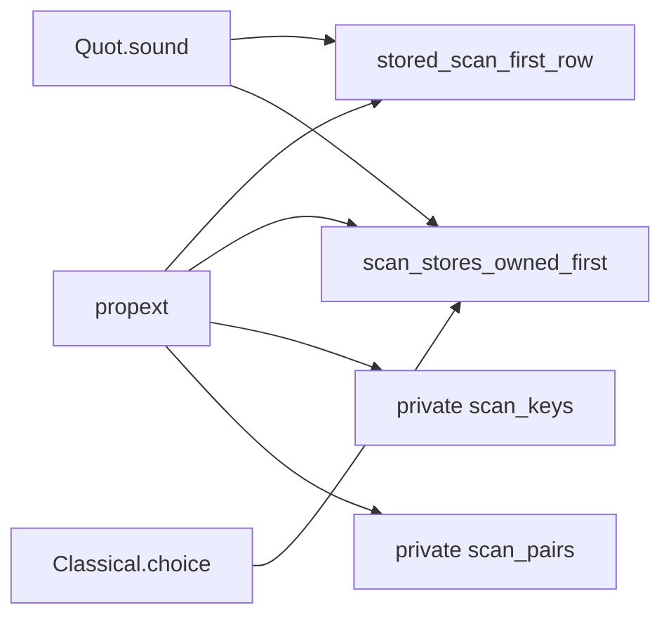
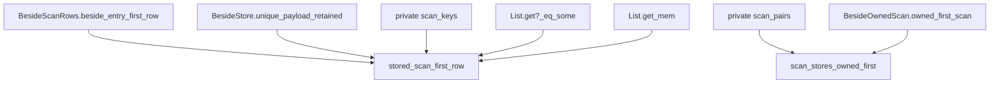

# [root ADR 0352](../adr/0352-prove-pagination-in-lean.md) の本文の先頭 ID の保存

## 範囲

基準は `f6d311536adeb3f27a8c19107c32a00ec70e4294` の証明と本体である。
[BesideScanStore.lean](../../experiments/pagination-proof/BesideScanStore.lean) を Lean 4.7.0（`aarch64-apple-darwin`）で検査した。
本体のソースは `0aa78f65ac691cdd8d1a3bd5fc4c8bffb1feabdb` と同一であり、その後の注や縦中横の変更を検証した記録ではない。
本体と公開 API は変更していない。

前の [先頭 ID と行の fold](0352-beside-scan-row-dependencies.md) は、先頭 ID の表を順序付きの列として扱った。
今回は、同じキーが繰り返されれば後の値を使う既存の `fromPairs` へ接続する。
これは `Flow.hs:4966` の本文の先頭 ID の scan と、同 4970 の `Map.fromList` の保存に対応させたモデルである。
Haskell の Map 全体の一般的な意味論を新しく証明したものではない。

最初の定理は、キーが重複せず、対象本文の最初の行がある場合を扱う。
表に保存してからキーで取り出す ID と、先行本文と対象本文の行を fold して得る最初の行の ID が一致する。
以前の行の列と行の値の型は任意である。
キーの一意性は必要な前提として明示し、任意の列で成り立つとはしない。

二つ目の定理は、本文の表からキーの選択と行数の scan を行い、保存した表の値を既存の `ownedFirstId` へ接続する。
結果の ID の一致を前提には置かない。
ここでは選択したキーの一意性が既存の選択モデルから導かれるため、呼び出し元が一意性を渡す必要はない。
本体の原稿や全 `Built` が、この選択モデルの入力に一致することは別に残る。

## 宣言と公理

Lean の環境で宣言の種類、型、elaboration 後の証明項と定理の直接参照を取得した。
公開定理 2 件、private 定理 2 件、生成定理 12 件、生成定義 12 件、公理宣言 0 件である。
全 16 定理へ `#print axioms` を実行し、取得できない証明項はなかった。

公開定理の共通接頭辞は `BesideScanStore.` である。

| 名前 | 位置 | 前提と結論 | 公理 |
| --- | --- | --- | --- |
| `root_adr0352_i5_stored_scan_first_row` | [22 行](../../experiments/pagination-proof/BesideScanStore.lean#L22) | キーが重複せず、対象本文が空でなければ、保存した先頭 ID とその本文の行の fold の最初の ID が一致する。 | `propext`、`Quot.sound` |
| `root_adr0352_i5_scan_stores_owned_first` | [43 行](../../experiments/pagination-proof/BesideScanStore.lean#L43) | 任意の本文の表と単位の分類から、行の scan を保存した値と既存の先頭 ID のモデルの一致を導く。 | `propext`、`Quot.sound`、`Classical.choice` |

private の補題の共通接頭辞は `_private.experiments.«pagination-proof».BesideScanStore.0.BesideScanStore.` である。
両方とも `propext` のみに依存する。

| 名前の末尾 | 位置 | 前提と結論 |
| --- | --- | --- |
| `scan_pairs` | [6 行](../../experiments/pagination-proof/BesideScanStore.lean#L6) | 任意のキー列と行の表について、行の scan と、行数を使う既存の `numberPairs` が一致する。 |
| `scan_keys` | [13 行](../../experiments/pagination-proof/BesideScanStore.lean#L13) | 任意の本文の列について、scan の前後でキーの列が変わらない。 |

生成定理の共通接頭辞は `_private.experiments.«pagination-proof».BesideScanStore.0.` である。
`BesideOwnedScan.numberPairs`、`BesideScanRows.scan`、`BesideStore.pairKeys` に、それぞれ `._eq_1`、`._eq_2`、`.match_1.eq_1`、`.match_1.eq_2` を加えた全 12 件である。
生成定義は同じ三つの名前に `.match_1.splitter` を加え、suffix なし、`._cstage1`、`._cstage2`、`._rarg._cstage2` とした全 12 件である。
生成した宣言のソース位置は取得できなかった。
生成定理に直接の定理参照と公理への依存はない。

`propext` は命題の同値から等値を得る公理であり、Lean 4.7.0 の `Init/Core.lean:1287` にある。
`Quot.sound` は関係を満たす二要素の商の値が等しいことを示す公理であり、同 1459 にある。
`Classical.choice` は `Nonempty α` から要素を選ぶ公理であり、`Init/Prelude.lean:730` にある。
いずれも既存の公理であり、新たな公理は宣言していない。

次の図は、補助宣言を経由した推移的な公理依存を表す。

次の図の実線は、型または証明項に現れた定理の直接参照である。
公開定理の `BesideScanStore.root_adr0352_i5_`、既存定理の `root_adr0352_i5_`、private の上記の接頭辞を省く。
既存の標準の等式と論理の補題は図から省いた。
型や証明に現れない推測の辺は足していない。

private の二つの補題は `of_eq_true`、`Eq.trans`、`congrArg`、`eq_self` を直接参照する。
`stored_scan_first_row` は図のほかに `congrArg` と `Eq.symm` を参照する。
`scan_stores_owned_first` は図のほかに `congrArg`、`funext`、`of_eq_true`、`Eq.trans`、`eq_self`、`Eq.symm` を参照する。
constructor `Eq.refl` は定理のノードとして数えていない。

## 反例と境界

キー 1 が二回ある `[(1, [8]), (1, [9])]` を開始 ID 0 から採番すると、保存後のキー 1 は後の値 1 になる。
これが最初の行の ID 0 と一致するという命題は、`decide` で偽と判定された。
この反例を残し、最初の定理から一意性の前提を取り除いていない。
二つ目の定理で図版の内部 ID の確保を一つ増やす変異も、kernel の検査に失敗した。

[局所境界](../../experiments/pagination-proof/BesideScanStoreBoundary.lean) は 14 式であり、重複キーの後勝ち、空列、空の本文、重複する行の値、既存の行がある初期状態、制御を挟む選択、表にないキーを含む。
本文の値がない場合の `getD []` はモデルを全域化するためであり、本体の `Map.!` の失敗を空の本文として扱う仕様にはしない。

## 実装との照合

前の増分の観測器 [BesideScanRowsFonts.hs](../../experiments/pagination-proof/BesideScanRowsFonts.hs) に `BESIDE_SCAN_STORE_LEAN=1` の出力を加えた。
従来の出力にあった 384 式を残し、実際に観測した表の値について、保存後の検索 96 式を加える。
追加前の 384 式では要求する 480 式に足りないことを確認した。
行や図版の幾何と原稿の範囲は、前の 64 例から増やしていない。
観測器が出した全 480 式は kernel で通り、追加の 96 式を除いて import を元に戻した出力は、従来の 384 式の出力と byte 単位で一致した。
GHC 9.10.3 の既存 package DB を読み取り専用で使い、plan と package DB の cache の SHA-256 は前の増分の検査後から変わらなかった。

これは保存のモデルを既存の観測へ適用する有限の照合であり、Haskell の Map の任意の状態を Lean に符号化したものではない。
通常の Cabal の再計画やビルドとも区別する。

## 全体の検査

モデルと 14 式の境界を `check.sh` に接続し、同じ旧版の本体と Lean 4.7.0 で全体を再実行して終了コード 0 を得た。
grid 55838 入力、自由な配置 156520 入力、回り込みの試し 10368 件、causal 4864 ケース、制御 216 ケース、改行の評価 34586 入力、実フォントの caption 40 件の一致を保った。
42 件の Alloy コマンドに対応する既存の Lean の検査も通ったが、Alloy ソルバーを再実行したわけではない。
新しい CI ワークフローと予算の変更は加えていない。

## 証明の穴と残り

対象に `sorry`、`admit`、`sorryAx` はなく、公理依存にも `sorryAx` はない。
最初の定理の一意性は、任意の列に成り立つとはしない。
二つ目の定理は選択モデルの一意性を導くが、全 `Built` や実際の原稿との一般的一致を示してはいない。

本体の全制御の終了、内容と順序の保存、全 Map の合成、Int と Nat の一般的一致、callback と注や印の計算、一般的な caption の改行との対応は残る。
[root ADR 0352](../adr/0352-prove-pagination-in-lean.md) は未実装のままにし、この増分だけでは実装完了を記録しない。
