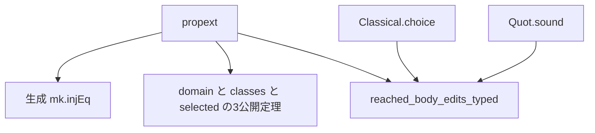
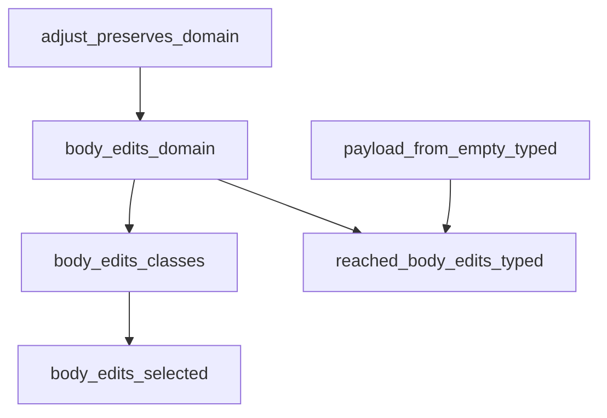

# [root ADR 0352](../adr/0352-prove-pagination-in-lean.md) の本文の値の更新履歴

## 範囲

基準は `62e9cd9b7` の本体と既存モデルである。
[BodyEdits.lean](../../experiments/pagination-proof/BodyEdits.lean) を Lean 4.7.0（`aarch64-apple-darwin`）で検査した。
本体と公開 API は変更していない。
この増分は、複数の本文の値を順に変えた後も、キーの有無、所有段落の選択と本文の型の条件が保たれることを扱う。

`BodyEdit` は対象のキーと値の変更関数を持つ。
`applyEdits` は列の先頭から順に `adjustBeside` を適用する。
存在するキーの値だけを変え、存在しないキーには新しい値を挿入しない。
同じキーを繰り返し変える場合や、空の履歴にも制限を加えていない。

全ての更新履歴について、各キーの有無と、固定の制御を使った `classes` が元の本文と一致する。
そのため、固定の現在の単位から選ぶ `candidateKeys` も、任意の所有者と個数で一致する。
空から到達した初期 cache の本文の型を使い、履歴の後に値を持つキーも現在の段落であることを導く。
更新後の値の関数について、新しい cache への到達を仮定してはいない。
更新後の cache レコード全体の到達を証明したものとも扱わない。

本体の [rebuild](../../modules/golem-typeset/src/Golem/Typeset/Flow.hs#L5064) は入力、版面、環境、単位と幅を保つ。
本文の変更は [trial の格納](../../modules/golem-typeset/src/Golem/Typeset/Flow.hs#L5147)、[次の行の試行](../../modules/golem-typeset/src/Golem/Typeset/Flow.hs#L5209)、[段落の試行](../../modules/golem-typeset/src/Golem/Typeset/Flow.hs#L5235)、[採用済み prefix と未消費部分の結合](../../modules/golem-typeset/src/Golem/Typeset/Flow.hs#L5299) で `cuBesides` の `Map.adjust` を使う。
この増分は、その成功した値の更新を並べるモデルである。
ソースの再解析で単位の型や制御が変わる場合と、失敗した配置をそのまま更新する経路は対象にしない。

## 定理と公理

Lean の環境から宣言の種類、型、elaboration 後の証明項と直接の定理参照を取得した。
公開定理 4 件、生成定理 11 件、定義 24 件、公理宣言 0 件だった。
手書きの定義は [applyEdits](../../experiments/pagination-proof/BodyEdits.lean#L9) の 1 件である。
別に [BodyEdit](../../experiments/pagination-proof/BodyEdits.lean#L5) の型を加えた。
定義の数には、型のフィールドの取得などの生成定義も含む。
手書きの private 定理はない。
全 15 定理へ同じ型の別名を一時環境で作り、kernel の検査と `#print axioms` を行った。

公開名の共通接頭辞は `BesideBodyEdits.` である。
標準三公理は `propext`、`Classical.choice`、`Quot.sound` を指す。

| 名前 | 位置 | 前提と結論 | 公理 |
| --- | --- | --- | --- |
| `root_adr0352_i5_body_edits_domain` | [13 行](../../experiments/pagination-proof/BodyEdits.lean#L13) | 任意の更新履歴の前後で、各キーの値の有無が一致する。 | `propext` |
| `root_adr0352_i5_body_edits_classes` | [20 行](../../experiments/pagination-proof/BodyEdits.lean#L20) | 制御を固定した任意の範囲で、本文の存在と制御の分類が一致する。 | `propext` |
| `root_adr0352_i5_body_edits_selected` | [27 行](../../experiments/pagination-proof/BodyEdits.lean#L27) | 現在の単位を固定すると、任意の所有者と個数で選択キーが一致する。 | `propext` |
| `root_adr0352_i5_reached_body_edits_typed` | [33 行](../../experiments/pagination-proof/BodyEdits.lean#L33) | 空から到達した初期 cache から始まる任意の履歴の後も、本文を持つキーは現在の段落である。 | 標準三公理 |

型から生成される次の 3 定理には共通接頭辞 `BesideBodyEdits.BodyEdit.` を付ける。
生成位置は取得できなかった。

| 名前 | 由来 | 公理 |
| --- | --- | --- |
| `mk.inj` | 構築子の単射性 | なし |
| `mk.injEq` | 構築子の等式の分解 | `propext` |
| `mk.sizeOf_spec` | 型の大きさの規則 | なし |

残る生成定理 8 件の共通接頭辞は `_private.experiments.«pagination-proof».BodyEdits.0.` である。
次の前半と suffix を組み合わせると全 8 件の名前になる。
いずれも生成位置は取得できず、公理への依存はない。

| 名前の前半 | suffix | 件数 |
| --- | --- | --- |
| `BesideBodyEdits.applyEdits` | `._eq_1`, `._eq_2`, `.match_1.eq_1`, `.match_1.eq_2` | 4 |
| `BesideOwnership.classes` | `._eq_1`, `._eq_2`, `.match_1.eq_1`, `.match_1.eq_2` | 4 |

標準公理への依存には既存の補助定理を経由するものも含む。
`propext` は命題の同値からの等値（Lean の `Init/Core.lean:1287`）、`Classical.choice` は空でない型からの選択（`Init/Prelude.lean:730`）、`Quot.sound` は同値関係で結ばれた値の商での等値（`Init/Core.lean:1459`）である。
新しい公理宣言、`sorry`、`admit` はない。

公理の図は推移的な依存を表す。
公理に依存しない生成定理 10 件は省略した。

定理の図の実線は型か証明項の直接参照である。
標準の論理と算術の補助定理は省略した。

既存の依存は [本文の値の変更](0352-beside-adjustment-dependencies.md) と [到達した payload](0352-payload-rounds-dependencies.md) を参照する。

## 境界、変異と実装との照合

新しい API がない状態で試験が終了コード 1 を返し、追加後に [BodyEditsBoundary.lean](../../experiments/pagination-proof/BodyEditsBoundary.lean) の 13 式が通った。
同じキーへの繰り返し、存在しないキーと制御への更新、空の履歴、0 行への更新と復帰、更新の順序で値が変わる場合を含む。
分類の一致と、任意のキーについて履歴の後の本文の型を導く公開定理の適用も調べた。

値を全く変えない変異でも、補助証明をその定義に合わせると、領域と選択の不変性の定理は通った。
一方、変更後の値を期待する局所境界は false と判定され、Lean が終了コード 1 を返した。
領域と選択の一致だけを、値の更新全体と本体の一般的一致の証明として扱わない。
実装との照合でも、`Map.adjust` を `Map.delete` に変えると、検証側の領域が同じという明示的な条件で終了コード 1 を返した。
コンパイルの失敗をこの削除の検出として数えていない。

[BodyEditsFonts.hs](../../experiments/pagination-proof/BodyEditsFonts.hs) は、表、コード、制御、二つの図版と三つの所有段落を実フォントで組む。
七つの値の更新を順に適用し、初期を含む八つの状態を検査する。
対象のキー 5、7、9 に加え、存在しない 999 と制御の 6 を含む。
キー 5 は 0 行へ変えた後に 1 行へ戻し、各更新には最初の空でない行の列をテンプレートとして使う。
現在の空の列に `cycle` を適用して失敗する検証にはしていない。

本体では各状態のキーの領域と、各図版が選ぶ段落のキーが初期と同じであることを確かめる。
モデルでは、その時点の全本文のキーと行数、各単位の本文の有無と制御、二つの図版の選択キーを本体と比較する。
任意の所有者についての選択の一致と、任意のキーについての型の公開定理も適用した。
初期 cache の 1 式と各状態の 6 式の計 49 式が kernel で通った。
八つの状態を八冊の通常 CLI の比較とは扱わず、全 `Built` の状態遷移の一般証明とも区別する。

本体のソースは `0aa78f65ac691cdd8d1a3bd5fc4c8bffb1feabdb` であり、この作業ツリーの `modules/` と一致する。
GHC 9.10.3 と既存の専用 package DB の read-only 環境を使い、共有の build と依存の版は変えない。

## 全体の検査

`check.sh` にこのモデルと局所境界を加え、GHC 9.10.3 と Lean 4.7.0 の既存の全検査が終了コード 0 で通った。
grid 55,838 件、free 156,520 件、回り込みの試し置き 10,368 件、causal 4,864 件、制御 216 件、改行の評価 34,586 件、実フォントの caption 40 件を保った。
Alloy の 42 コマンドに対応する既存の Lean の検査も保ち、Alloy の新しい実行回数とは区別する。

plan の SHA-256 は `981a01138b41bf0d6b1e8ea82155b2ed1227297b7339699bbc60005bc4c83957`、package DB の cache は `dd7fdb3fca241d4a7039e18fccf8ff7065a265540225c2cf813e5b07cbe75fc8` で、検査の前後で変わらなかった。
新規の証明専用 CI や予算の変更は加えていない。

## 未証明の範囲

この増分は、固定した単位と制御の下での本文の値の更新履歴を扱う。
履歴全体の前後で各 ID や本文の値が等しいとは主張しない。
別の本文の更新で後の段落の ID が変わることは許す。
また、領域が同じであることを、原稿の全データと全行の順序が保たれることとは区別する。

全 `Built` と全呼び出し元との接続、任意の履歴の後の ID の取得、固定の採番件数、Map の意味論、Int と Nat、図版の全フィールドと配置の callback、caption の計算との一般的一致は残る。
全制御の終了、`hb` の全呼び出し元、`captionCompared` と改行器の一般的一致も完成扱いしない。
root [ADR 0352](../adr/0352-prove-pagination-in-lean.md) は採択済み未実装のままとする。
