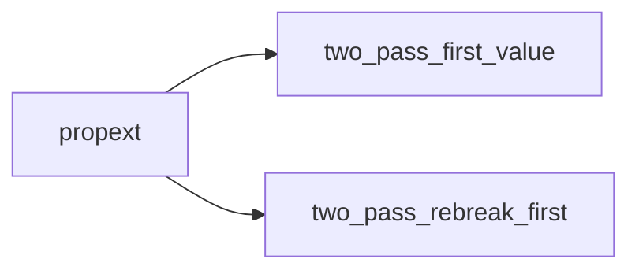
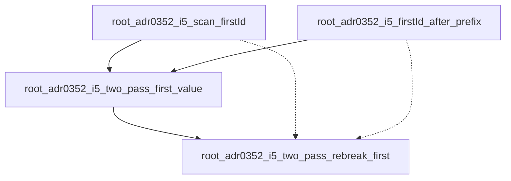

# [root ADR 0352](../adr/0352-prove-pagination-in-lean.md) の図版と脇の段落の採番

## 範囲

基準は `c0025e522` の本体と既存モデルである。
[BuiltFirstIds.lean](../../experiments/pagination-proof/BuiltFirstIds.lean) を Lean 4.7.0（`aarch64-apple-darwin`）で検査した。
この増分は、回り込みの図版と脇の段落を二段階で採番する算術を扱う。
本体と `Physical.lean` は変更していない。

本体では、段落を組み直すと、その段落を所有する図版の採番量も変わる。
[Flow.hs:4606](../../modules/golem-typeset/src/Golem/Typeset/Flow.hs#L4606) は、図版の一つの ID と脇の全段落の行数を進める。
したがって、組み直す段落より前にある全ユニットの採番量が不変だとは言えない。
図版より前の採番量と、同じ図版に属する先行段落の行数を分けて扱う。

[Flow.hs:4958](../../modules/golem-typeset/src/Golem/Typeset/Flow.hs#L4958) の最初の走査は、図版の先頭 ID を得る。
[Flow.hs:4967](../../modules/golem-typeset/src/Golem/Typeset/Flow.hs#L4967) の次の走査は、その ID に一つ加え、脇の先行段落の行数だけ進む。
今回のモデルは、この二つの走査から得る現在の段落の先頭 ID が、現在の段落の行数を変えても不変だと証明する。
図版より前のユニットの採番量と脇の先行段落の行数は固定する。
先行段落の行数を変えた場合にまで不変だとは主張しない。

ここでの行数と ID は `Nat` である。
本体の `Int` の範囲の妥当性や、任意の原稿からこの走査への射影は別の課題として残る。
`Map.union` のキーの重複、所有関係の構築、全種類のユニットの採番量も、このモデルだけでは証明しない。

## 定理と公理

Lean の環境で、名前付き宣言の種類、型、elaboration 後の証明項を照合した。
手書き定理 3 件、生成定理 12 件、手書き定義 5 件、生成定義 46 件、公理宣言 0 件だった。
15 定理すべてで `#print axioms` を実行した。

| 完全修飾名 | 位置 | 前提と結論 | 公理 |
| --- | --- | --- | --- |
| `CausalFirstIds.root_adr0352_i5_scan_firstId` | [BuiltFirstIds.lean:13](../../experiments/pagination-proof/BuiltFirstIds.lean#L13) | 有効な位置で、走査が出す ID と既存の `firstId` が等しい。 | なし |
| `CausalFirstIds.root_adr0352_i5_two_pass_first_value` | [BuiltFirstIds.lean:40](../../experiments/pagination-proof/BuiltFirstIds.lean#L40) | 二段階の走査の結果が存在し、外側の先行量、一つの図版、脇の先行行数から決まる。現在の段落が空でも成り立つ。 | `propext` |
| `CausalFirstIds.root_adr0352_i5_two_pass_rebreak_first` | [BuiltFirstIds.lean:55](../../experiments/pagination-proof/BuiltFirstIds.lean#L55) | 両方の先行量を固定すると、現在の行数を変えてもその段落の先頭 ID は変わらない。 | `propext` |

生成定理の共通接頭辞は `_private.experiments.«pagination-proof».BuiltFirstIds.0.CausalFirstIds.` である。
次の接尾辞を加えたものが、それぞれの完全修飾名になる。
いずれも分岐の等式で、公理への依存はない。
生成位置を取得できなかったため行番号は付けない。

| 接尾辞 | 由来 |
| --- | --- |
| `firstId._eq_1`、`firstId._eq_2`、`firstId._eq_3` | 読み込んだ先頭 ID の計算の等式 |
| `firstId.match_1.eq_1`、`firstId.match_1.eq_2`、`firstId.match_1.eq_3` | 同じ計算のパターン分岐 |
| `scanFirsts._eq_1`、`scanFirsts._eq_2` | 走査の再帰の等式 |
| `scanFirsts.match_1.eq_1`、`scanFirsts.match_1.eq_2` | 走査のパターン分岐 |
| `besideFromTwoPass.match_1.eq_1`、`besideFromTwoPass.match_1.eq_2` | 最初の走査の結果を読む分岐 |

手書き定義は `CausalFirstIds.scanFirsts`、`CausalFirstIds.ownedRows`、`CausalFirstIds.besideFromTwoPass`、`CausalFirstIds.sameFirst`、`CausalFirstIds.twoPassBoundaries` である。
生成定義は、再帰、有限検査のリストの走査、比較の補助宣言である。
依存する標準公理 `propext` は Lean 4.7.0 の `Init.Core:1287` にあり、命題の同値から等式を導く。

公理の図は、補助定理を経由した推移的依存を示す。
走査の定理と生成 12 定理に、公理への依存はない。



次の図の実線は、型か証明項の直接参照である。
破線は、補助定理を経由した間接依存である。
標準の等式と自然数の補題は省いた。



対象ソースに `sorry`、`admit`、`sorryAx` の使用はない。
Lean の diagnostic と 15 定理の公理依存にも証明の穴はなかった。
今回の範囲に、穴の影響を受ける定理はない。

## 境界と実装の観測

有限検査は、空とゼロを含む外側と内側の先行量と後続量、現在の行数の変更、開始 ID の組み合わせ 648 件を実行する。
空の走査には先頭 ID がないことと、先行段落の行数を変えると現在の ID が変わることも検査する。
実行結果を `check.sh` で `true` と比較し、有限検査を一般証明の前提には使わない。
図版の一つの ID を落とす、採番量を進めてから ID を出す、現在の行数を現在の ID に加える三つの誤変更は、Lean の証明で拒否された。
実装の観測で後続 ID の期待値を一つずらす誤変更も拒否された。

[check-built-first-ids.sh](../../experiments/pagination-proof/check-built-first-ids.sh) は、一時コピーで `Flow.hs` の export list だけを公開し、本体の `numberComposedFlow` と `buildFlow` を直接呼ぶ。
export list より後のソースが元と一致することを `cmp` で検査する。
本番の API は変えず、この経路を通常の CLI とも呼ばない。

[BuiltFirstIds.hs](../../experiments/pagination-proof/BuiltFirstIds.hs) は、Noto Serif JP の実フォント、図版二つ、脇の段落三つを組む。
各段落を 0、1、3、7 行へ変えた 12 件で、所有する図版と現在の段落までの先頭 ID が不変で、後続の ID が行数の差だけ動くことを確認した。
段落の先頭 ID と、所有する図版の先頭 ID に一つと先行段落の行数を加えた値も比較した。
この観測は任意の所有関係や原稿についての証明ではない。

観測には GHC 9.10.3 と、`0aa78f65ac691cdd8d1a3bd5fc4c8bffb1feabdb` の既存 runtime DB を読み取り専用で使った。
本体の `modules/` は今回の基準の版と一致する。
`RUNGHC` に登録済み package ID を明示するラッパーを指定し、次のコマンドで実行した。
これは標準 Cabal 環境を新規構築したという検証ではない。
Cabal plan と package cache の実行前後の SHA-256 は一致した。

`check.sh` 全体も終了コード 0 で通った。
既存の 55,838 件と 156,520 件の配置、10,368 件の回り込み、4,864 件の因果的配置、216 件の制御、34,586 件の改行、実フォントのキャプション 40 件、Alloy 42 件の対応検査を含む。

```sh
RUNGHC=/private/tmp/golem-0352-built-probe-nov28/runner \
  sh experiments/pagination-proof/check-built-first-ids.sh
```

実装の任意の `Built` からモデルへの射影、`parts` の再帰全体への接続、文字列の全量と順序、全制御、一般のキャプションの対応は残る。
[root ADR 0352](../adr/0352-prove-pagination-in-lean.md) 全体は採択済みで未実装のままである。
