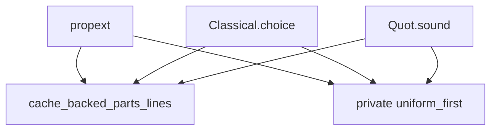
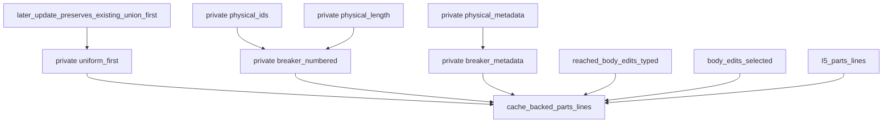

# [root ADR 0352](../adr/0352-prove-pagination-in-lean.md) の cache から導く parts の採番条件

## 範囲

基準は `68cdb6ede` の本体と既存モデルである。
[CacheBreaker.lean](../../experiments/pagination-proof/CacheBreaker.lean) を Lean 4.7.0（`aarch64-apple-darwin`）で検査した。
本体と公開 API は変更していない。
既存の [I5_parts_lines](../../experiments/pagination-proof/Physical.lean#L5957) が受け取る行番号の条件 `hb` を、cache を使う特定の番号付けのモデルから導く。

`I5_parts_lines` は、どの状態でも改行器が `base + before` から連番を付けるという条件を受け取る。
この増分では、初期 cache の到達と任意の先行更新履歴、初期の図版 job と対象の選択から、一つの先頭 ID を導く。
各状態でその対象の本文を組み直し、右側の採番の表が変わっても、その ID は残る。
状態ごとに別の値の存在だけを得て終わらず、更新前の表の照会の一意性から、全状態に共通の ID へそろえる。

この表の ID と `before` を使い、渡された行の ID だけを付け直す改行器のモデルを定義する。
元の行の ID は使わない。
モデルの注（ID と行数）、行のはみ出し量、行に付いた原稿の終了位置は保つ。
このモデルから `hb` を導き、既存の `I5_parts_lines` へ渡す。
公開定理の前提に `hb` や番号付け済みの行の連番性を置かない。

結果は、成功したモデルの `parts` が、その開始 ID から連番の行を一度ずつ順に追加するという条件付きの性質である。
`hold` が行と図版の ID 列を変えないという条件は前提のままである。
全入力の成功や、本体の再試行の終了を示すものではない。

本体では [更新した表の ID と採用済みの行数](../../modules/golem-typeset/src/Golem/Typeset/Flow.hs#L5301) で [numberedLines](../../modules/golem-typeset/src/Golem/Typeset/Flow.hs#L4366) を呼ぶ。
この増分はその番号付けの形をモデルにする。
全 `Built` の到達、全呼び出し元、実際に行を作る callback とモデルの入力との一般的一致は残る。
特に、ここで渡す注やはみ出し量は既に計算した値であり、本体の注の所属の計算から導いたものではない。

## 定理と公理

Lean の環境から宣言の種類、型、証明項と直接の定理参照を取得した。
公開定理 1 件、手書きの private 定理 6 件、生成定理 8 件、定義 11 件、公理宣言 0 件だった。
全 15 定理へ同じ型の別名を一時環境で作り、kernel の検査と `#print axioms` を行った。

公開名は `BesideCacheBreaker.root_adr0352_i5_cache_backed_parts_lines`、位置は [81 行](../../experiments/pagination-proof/CacheBreaker.lean#L81) である。
初期の到達と選択から、現在の ID の存在、全状態での番号付けと行の付随情報の保存、成功した `parts` の `Step`（行と図版の ID 列の追加を表すモデルの関係）を導く。
`propext`、`Classical.choice`、`Quot.sound` に依存する。
成功条件と `hold` の保存条件を除く本体の全前提を証明したという意味には使わない。

private 定理の共通接頭辞は `_private.experiments.«pagination-proof».CacheBreaker.0.BesideCacheBreaker.` である。
標準三公理は `propext`、`Classical.choice`、`Quot.sound` を指す。

| 名前 | 位置 | 概要 | 公理 |
| --- | --- | --- | --- |
| `physical_ids` | [12 行](../../experiments/pagination-proof/CacheBreaker.lean#L12) | 値に付けた ID をモデルの行に移すと、同じ連番の ID 列となる。 | なし |
| `physical_length` | [21 行](../../experiments/pagination-proof/CacheBreaker.lean#L21) | 行の ID を付け直しても行数は変わらない。 | なし |
| `physical_metadata` | [29 行](../../experiments/pagination-proof/CacheBreaker.lean#L29) | 注、はみ出し量、原稿の終了位置の列が保たれる。 | なし |
| `breaker_numbered` | [39 行](../../experiments/pagination-proof/CacheBreaker.lean#L39) | 全状態に共通の ID が表に存在すれば、この改行器のモデルは `hb` を満たす。 | なし |
| `breaker_metadata` | [48 行](../../experiments/pagination-proof/CacheBreaker.lean#L48) | 同じ存在条件から、全状態で行の付随情報を保つ。 | なし |
| `uniform_first` | [64 行](../../experiments/pagination-proof/CacheBreaker.lean#L64) | 本文の型、現在の job と選択から、任意の状態ごとの本文の更新と右側の表に対し、同じ先頭 ID が存在する。 | 標準三公理 |

生成定理の共通接頭辞は `_private.experiments.«pagination-proof».CacheBreaker.0.` である。
`NumberedPayload.numberRows` と `PhysicalPagination.ids` に、それぞれ `._eq_1`、`._eq_2`、`.match_1.eq_1`、`.match_1.eq_2` を加えた 8 件である。
いずれも生成位置は取得できず、公理に依存しない。

手書きの定義は `BesideCacheBreaker.` を接頭辞とする `physicalRows`（[5 行](../../experiments/pagination-proof/CacheBreaker.lean#L5)）、`cachedBreaker`（[8 行](../../experiments/pagination-proof/CacheBreaker.lean#L8)）、`recomputedTables`（[58 行](../../experiments/pagination-proof/CacheBreaker.lean#L58)）の 3 件である。
いずれも証明だけで使う `noncomputable` な関数である。
`cachedBreaker` は値がない場合に空列で全域化するが、公開定理の条件からは全状態で値の存在を導くため、その場合は使われない。
これを本体の `Map.!` の失敗時の仕様とは扱わない。

生成定義は、前の共通接頭辞の下の `NumberedPayload.numberRows.match_1.splitter` と `PhysicalPagination.ids.match_1.splitter` が名前の前半である。
それぞれ suffix がない名前と、`._cstage1`、`._cstage2`、`._rarg._cstage2` の 4 件、計 8 件である。
定理としては数えていない。

`propext` は命題の同値からの等値（Lean の `Init/Core.lean:1287`）、`Classical.choice` は空でない型からの選択（`Init/Prelude.lean:730`）、`Quot.sound` は同値関係で結ばれた値の商での等値（`Init/Core.lean:1459`）である。
新しい公理、`sorry`、`admit` はない。
公理の図は既存の補助定理を経由する推移的な依存も表す。
公理に依存しない手書きの private 定理 5 件と生成定理 8 件は省略した。

定理の図の実線は型か証明項の直接参照である。
標準の論理の定理と生成された等式定理は省略した。

既存の依存は [後続段落の更新](0352-suffix-count-dependencies.md)、[更新履歴](0352-body-edits-dependencies.md)、[cache と既存の行列の採番](0352-cache-numbered-rows-dependencies.md) にまとめた。

## 境界と変異

新しい API がない状態で試験が終了コード 1 を返し、追加後に [CacheBreakerBoundary.lean](../../experiments/pagination-proof/CacheBreakerBoundary.lean) の 13 式が通った。
先行履歴で先頭 ID が 10 になった対象を使い、`before` が 0 と 2 の場合の ID、空列、原稿の終了位置を確認した。
注、負を含むはみ出し量、終了位置を持つ行の ID だけを変える式も含む。

三行を二行分の段へ配置するモデルの `parts` が、1 段組みと 2 段組みの両方で `[10,11,12]` を追加する場合を検査した。
空の原稿と、公開定理から `hb` を渡さず導く場合も含む。
これらはモデルの具体例であり、本体の全入力の配置の一致とは区別する。

`before` の加算を 0 に置き換える変異は、番号付けの証明で終了コード 1 となった。
終了位置を全て 0 に置き換える別の変異は、付随情報の保存の証明で終了コード 1 となった。
後者では ID と行数だけの性質は残るため、それだけで内容を消費する位置まで正しいとは扱わない。

## 実装側の根拠

本体との有限な照合の根拠は、[前の cache の採番の検査](0352-cache-numbered-rows-dependencies.md) の 144 例と 865 式である。
対象は本体の現在と更新後の先頭 ID、採用済みの行数を加える採番、既に組んだ行の値と順序である。
本体の全 `Line` の値の比較は Haskell 側で行い、Lean 側へは順序と重複を試す数値の列を渡した。
今回の注とはみ出し量の保存は、渡されたモデルの値に対する性質であり、本体の注の所属の計算からの射影の一般的一致は残る。

本体のソースは `0aa78f65ac691cdd8d1a3bd5fc4c8bffb1feabdb` である。
この作業ツリーの `modules/` と、前の検査に使った `CacheNumberedRowsFonts.hs` は、基準 `68cdb6ede` から変わっていない。
GHC 9.10.3 と既存の専用 package DB の read-only の環境も保ち、共有の build と依存の版は変えていない。
通常の Cabal の再ビルドとは区別する。

## 全体の検査

`check.sh` にモデルと局所境界を加え、GHC 9.10.3 と Lean 4.7.0 の既存の全検査が終了コード 0 で通った。
grid 55,838 件、free 156,520 件、回り込みの試し置き 10,368 件、causal 4,864 件、制御 216 件、改行の評価 34,586 件、実フォントの caption 40 件を保った。
Alloy の 42 コマンドに対応する既存の Lean の検査も保ち、Alloy の新しい実行回数とは区別する。

plan の SHA-256 は `981a01138b41bf0d6b1e8ea82155b2ed1227297b7339699bbc60005bc4c83957`、package DB の cache は `dd7fdb3fca241d4a7039e18fccf8ff7065a265540225c2cf813e5b07cbe75fc8` で、検査の前後で変わらなかった。
新規の証明専用 CI や予算の変更は加えていない。

## 未証明の範囲

閉じたのは、この cache を使う番号付けのモデルから `I5_parts_lines` の採番条件を導く部分である。
全 `Built` と全呼び出し元からの到達と選択、実際の再帰の各状態と `recomputedTables` の対応、行を作る callback、本体の注と印の計算との一般的一致は残る。
`hold` の保存条件も公開定理の前提のままである。

成功したモデルの配置の性質を、本体の全入力の成功や再試行の終了の証明とは扱わない。
図版の所有者自身の照会、固定の採番件数、Map の意味論、Int と Nat、図版の全フィールドや配置の callback、caption の計算との一般的一致も未証明である。
root [ADR 0352](../adr/0352-prove-pagination-in-lean.md) は採択済み未実装のままとする。
