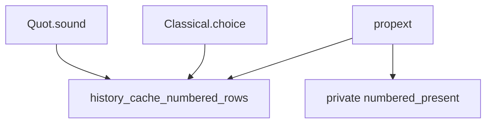
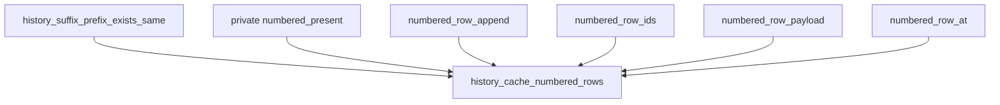

# [root ADR 0352](../adr/0352-prove-pagination-in-lean.md) の cache の ID と既存の行列の採番

## 範囲

基準は `caa48fe03` の本体と既存モデルである。
[CacheNumberedRows.lean](../../experiments/pagination-proof/CacheNumberedRows.lean) を Lean 4.7.0（`aarch64-apple-darwin`）で検査した。
本体と公開 API は変更していない。
[更新履歴と選択した接尾部の先頭 ID](0352-later-edits-dependencies.md) を、[既に組んだ行列の採番](0352-numbered-row-payload-dependencies.md) へ接続する。

本体の [paragraph.parts](../../modules/golem-typeset/src/Golem/Typeset/Flow.hs#L5299) は、採用済みの行と組み直した残りを本文へ格納して採番を呼び直す。
その後で、[新しい表の先頭 ID と採用済みの行数](../../modules/golem-typeset/src/Golem/Typeset/Flow.hs#L5301) を加え、残りを [numberedLines](../../modules/golem-typeset/src/Golem/Typeset/Flow.hs#L4366) へ渡す。
ここでは、モデルの cache から導いた先頭 ID を使って、この後半の採番と既存の行列の連結を接続する。

初期 cache の到達と任意の先行更新履歴、初期の図版 job と対象の選択を使う。
選択した接尾部の更新後にも、現在と同じ先頭 ID が表に存在することを既存の定理から導く。
この値や更新前後の ID の一致を、新しい定理の前提として渡さない。

採用済みの行と残りの行は、任意の型の値の列として渡す。
全行を更新前の対象の ID から採番する結果は、採用済みの行をその ID から採番し、残りを更新後の ID と採用済みの行数から採番した結果の連結と一致する。
残りの ID は連番になり、全ての行の値は順序と重複を含めて保たれる。
各添字の値と ID の対応も導く。

これは既に組んだ行の採番の性質である。
原稿からこれらの行を作る改行器や、採用済みの行と残りの行で原稿を過不足なく分割することは、この増分では証明していない。
本文の値の更新関数が、渡した二つの行の列の連結を実際に格納することの一般的な対応も残る。
全 `Built`、全呼び出し元、`hb` と本体の番号付けの一般的な接続も残る。

## 定理と公理

Lean の環境から宣言の種類、型、証明項と直接の定理参照を取得した。
公開定理 1 件、手書きの private 定理 1 件、手書きの定義 1 件、公理宣言 0 件だった。
生成定理と生成定義はない。
両定理へ同じ型の別名を一時環境で作り、kernel の検査と `#print axioms` を行った。

公開名は `BesideCacheNumberedRows.root_adr0352_i5_history_cache_numbered_rows`、位置は [13 行](../../experiments/pagination-proof/CacheNumberedRows.lean#L13) である。
初期の到達と選択から導いた現在と更新後の同じ ID、およびその ID に基づく採番の結果を、存在する値として返す。
結果には行列の連結、ID 列、行の値の列、各添字での値と ID の対応を含む。
`propext`、`Classical.choice`、`Quot.sound` に依存する。

private 定理は `_private.experiments.«pagination-proof».CacheNumberedRows.0.BesideCacheNumberedRows.numbered_present`、位置は [9 行](../../experiments/pagination-proof/CacheNumberedRows.lean#L9) である。
表に値が存在するときの採番を、その値から始める通常の採番へ戻す。
`propext` に依存する。
この private 定理で使う存在の前提は、公開定理では初期の到達と選択から導く。

手書きの定義は [numberedFrom](../../experiments/pagination-proof/CacheNumberedRows.lean#L6) であり、証明だけに使う `noncomputable` な関数である。
表の値がなければ `none`、あれば採番した列を `some` で返す。
欠けた ID を 0 に置き換える定義にはしていない。
公開定理の条件からは値が存在するため、成功した採番の結果が得られる。
これを、本体の `Map.!` が欠けたときの動作の仕様とは扱わない。

`propext` は命題の同値からの等値（Lean の `Init/Core.lean:1287`）、`Classical.choice` は空でない型からの選択（`Init/Prelude.lean:730`）、`Quot.sound` は同値関係で結ばれた値の商での等値（`Init/Core.lean:1459`）である。
新しい公理、`sorry`、`admit` はない。
公理の図は既存の補助定理を経由する推移的な依存も表す。

定理の図の実線は型か証明項の直接参照である。

既存の依存は [更新履歴と選択した接尾部](0352-later-edits-dependencies.md) と [既存の行の値の保存](0352-numbered-row-payload-dependencies.md) にまとめた。

## 境界と実装との照合

新しい API がない状態で試験が終了コード 1 を返し、追加後に [CacheNumberedRowsBoundary.lean](../../experiments/pagination-proof/CacheNumberedRowsBoundary.lean) の 12 式が通った。
表に値がない場合と、値はあるが行が空の場合を区別する。
採用済みの二行と重複を含む残り三行、添字と ID、行の順序が異なる対照を含む。
先行履歴で現在の対象の ID が 10 になった例でも、更新後の残りを 12 から採番し、公開定理へ接続した。

[CacheNumberedRowsFonts.hs](../../experiments/pagination-proof/CacheNumberedRowsFonts.hs) は、実フォントで組んだ表、コード、制御、二つの図版と三つの所有段落を使う。
七つの先行更新で得た八つの状態で、三つの対象の採用済みの行数を 0、2、5、残りの行数を 0、7 とする計 144 例を調べる。
元の空でない行をテンプレートとして幅の値を変えた既存の行を使い、両方を連結して対象の本文に格納し、採番を呼び直す。
改行器からこれらの行を生成したとは扱わない。

現在の ID で連結した全行と採用済みの行を採番し、更新後の ID と採用済みの行数で残りを採番する。
本体の `numberedLines` を使い、ID と格納した行の列を比較する。
Haskell 側では各 `Line` 全体の `Eq` を使う。
Lean の具体例には順序と重複を試す `Nat` の列を渡し、Haskell の全 `Line` の構造を符号化したとは扱わない。

現在と更新後の ID、連結した行数、全行の採番、残りの採番、公開の定理を各例で検査した。
初期 cache の 1 式と合わせて 865 式が kernel で通った。
本体の注の所属、ラベル、印、行の字下げ、配置など、`numberedLines` の全ての計算の一般的一致を証明したものではない。

本体の採番を呼ぶ検証側で、採用済みの行数の加算を落とす変異は、ID の連結の検査で終了コード 1 となった。
モデルへの入力だけでその加算を落とす別の変異では、Haskell の実行は終了コード 0 だったが、kernel が 48 式を false と判定し、Lean は終了コード 1 となった。
単なる行数と値の一致だけで、残りの開始 ID が正しいと扱わない。

本体のソースは `0aa78f65ac691cdd8d1a3bd5fc4c8bffb1feabdb` であり、この作業ツリーの `modules/` と一致する。
GHC 9.10.3 と既存の専用 package DB を read-only で使い、共有の build と依存の版は変えない。
通常の Cabal の再ビルドとは区別する。

## 全体の検査

後続のモデルが import できるよう、`check.sh` の既存の `NumberedPayload.lean` の検査で `.olean` も出力する。
そのモデルの内容は変えず、この増分のモデルと局所境界を後に検査する。

`check.sh` にモデルと局所境界を加え、GHC 9.10.3 と Lean 4.7.0 の既存の全検査が終了コード 0 で通った。
grid 55,838 件、free 156,520 件、回り込みの試し置き 10,368 件、causal 4,864 件、制御 216 件、改行の評価 34,586 件、実フォントの caption 40 件を保った。
Alloy の 42 コマンドに対応する既存の Lean の検査も保ち、Alloy の新しい実行回数とは区別する。

plan の SHA-256 は `981a01138b41bf0d6b1e8ea82155b2ed1227297b7339699bbc60005bc4c83957`、package DB の cache は `dd7fdb3fca241d4a7039e18fccf8ff7065a265540225c2cf813e5b07cbe75fc8` で、検査の前後で変わらなかった。
新規の証明専用 CI や予算の変更は加えていない。

## 未証明の範囲

全 `Built` と全呼び出し元から、初期の到達、job と対象の選択、本体の段落列とモデルの選択した接尾部の対応を導く接続は残る。
既存の行の値と順序の保存は、原稿からの改行、注や印の所属、配置後の全出力の保存を証明するものではない。
図版の所有者自身の照会、固定の採番件数、Map の意味論、Int と Nat、図版の全フィールドや配置の callback、caption の計算との一般的一致も未証明である。

全制御の終了、`hb` の全呼び出し元、`captionCompared` と改行器の一般的一致は完成扱いしない。
root [ADR 0352](../adr/0352-prove-pagination-in-lean.md) は採択済み未実装のままとする。
