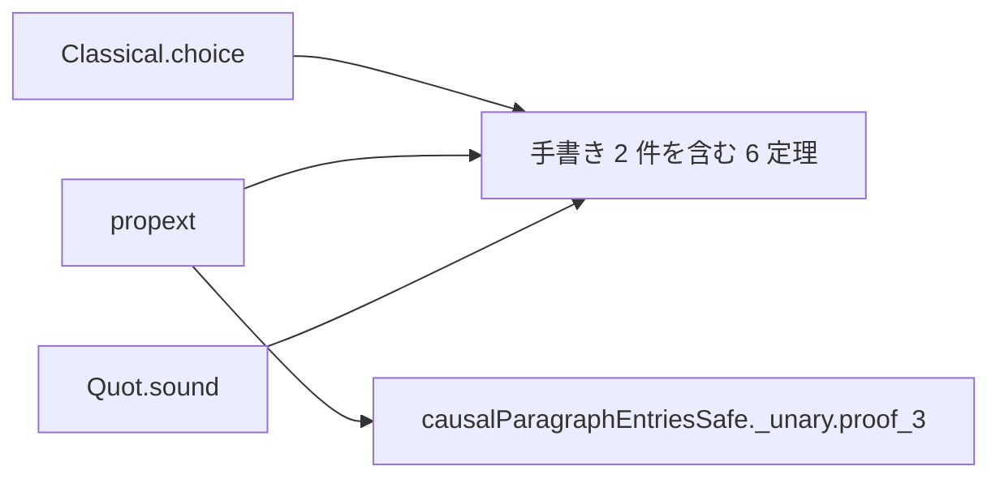
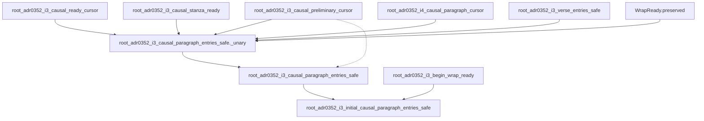

# [root ADR 0352](../adr/0352-prove-pagination-in-lean.md) の段落処理の各入口

## 範囲

この調査は、対応モデルの `paragraphs` が試みる各処理の入口を扱う。
基準は `06e5ad8ba9249e93405c58fdc780624d5b579ef3` で、追加した [CausalCalls.lean](../../experiments/pagination-proof/CausalCalls.lean) を Lean 4.7.0（`aarch64-apple-darwin`）で検査した。
既存の配置モデルと本体の定義は変えていない。

先行する [段落間の受け渡しの証明](0352-causal-paragraphs-dependencies.md) は、処理全体が成功した場合の出力を扱う。
今回の述語 `causalParagraphEntriesSafe` は、処理全体の成功を前提にせず、途中で失敗する場合も、その試みの入力を検査する。
対象は `paragraphs` の再帰入力、`preliminary` が返す組み直しの入力、`tryVerses` の全再帰入力、`ready` が返す段落または詩の配置の入力である。

入口では `WrapReady` を検査する。
これは、除外領域が現在位置より後になく、領域が有効なら現在の段に局所のテキストがある条件である。
回り込み図版のスロットも、そのテキストに含む。
定義は [カーソルの依存調査](0352-pagination-proof-dependencies.md) に記録している。

この証明は、対応モデル `CausalBoundary.Ms` の任意の値と、任意の長さの段落番号列を量化する。
ただし、モデルの段落間の制御は `noBreak` だけであり、文字幅も文字数で測る。
本体の全制御や実フォントとの一致、詩の配置 `stanza` と `accept` の内部の全再帰入力は、今回の述語の対象ではない。

## 宣言

Lean の環境から宣言の種類と型、elaboration 後の証明項を取得した。
手書きの定義 1 件、生成定義 21 件、手書き定理 2 件、生成定理 12 件、公理宣言 0 件だった。
生成定理と private の宣言も含む 14 定理すべてで `#print axioms` を実行した。

| 完全修飾名 | 位置 | 内容 |
| --- | --- | --- |
| `PhysicalPagination.causalParagraphEntriesSafe` | [CausalCalls.lean:11](../../experiments/pagination-proof/CausalCalls.lean#L11) | `paragraphs` と同じ分岐と再帰先をたどり、各入口で `WrapReady` を検査する述語。段落番号列の長さで減少する。 |
| `PhysicalPagination.root_adr0352_i3_causal_paragraph_entries_safe` | [CausalCalls.lean:51](../../experiments/pagination-proof/CausalCalls.lean#L51) | 入力の `WrapReady` から、対応モデルの全入口の述語を導く。処理の成功は前提に置かない。 |
| `PhysicalPagination.root_adr0352_i3_initial_causal_paragraph_entries_safe` | [CausalCalls.lean:98](../../experiments/pagination-proof/CausalCalls.lean#L98) | `beginWrap` の成功結果から全入口の述語を導く。最初の `WrapReady` を別の前提に置かない。 |

生成定理の行位置は環境から取得できなかったため、完全修飾名と生成元を記録する。
`match_1` から `match_3` の等式は、結果の成功と失敗の二つの分岐を表す。

| 生成定理 | 生成元 |
| --- | --- |
| `PhysicalPagination.causalParagraphEntriesSafe._unary.proof_1` | 11〜47 行の述語の減少証明。 |
| `_private.experiments.«pagination-proof».CausalCalls.0.PhysicalPagination.causalParagraphEntriesSafe.match_3.eq_1` | 11〜47 行の述語の結果の分岐。 |
| `PhysicalPagination.causalParagraphEntriesSafe._unary.proof_2` | 11〜47 行の述語の減少証明。 |
| `_private.experiments.«pagination-proof».CausalCalls.0.PhysicalPagination.causalParagraphEntriesSafe.match_2.eq_1` | 11〜47 行の述語の結果の分岐。 |
| `PhysicalPagination.causalParagraphEntriesSafe._unary.proof_3` | 11〜47 行の述語の減少証明。 |
| `_private.experiments.«pagination-proof».CausalCalls.0.PhysicalPagination.causalParagraphEntriesSafe.match_1.eq_1` | 11〜47 行の述語の結果の分岐。 |
| `_private.experiments.«pagination-proof».CausalCalls.0.PhysicalPagination.causalParagraphEntriesSafe.match_2.eq_2` | 11〜47 行の述語の結果の分岐。 |
| `_private.experiments.«pagination-proof».CausalCalls.0.PhysicalPagination.causalParagraphEntriesSafe._eq_1` | 11〜47 行の述語の空リストと非空リストの等式。 |
| `PhysicalPagination.root_adr0352_i3_causal_paragraph_entries_safe._unary` | 51 行の定理の再帰証明の本体。 |
| `_private.experiments.«pagination-proof».CausalCalls.0.PhysicalPagination.causalParagraphEntriesSafe.match_3.eq_2` | 11〜47 行の述語の結果の分岐。 |
| `_private.experiments.«pagination-proof».CausalCalls.0.PhysicalPagination.causalParagraphEntriesSafe.match_1.eq_2` | 11〜47 行の述語の結果の分岐。 |
| `_private.experiments.«pagination-proof».CausalCalls.0.PhysicalPagination.causalParagraphEntriesSafe._eq_2` | 11〜47 行の述語の空リストと非空リストの等式。 |

## 公理と依存

14 定理のうち、手書き 2 件を含む 6 件は三つの標準公理に推移的に依存した。
述語の減少証明 `PhysicalPagination.causalParagraphEntriesSafe._unary.proof_3` は `propext` だけに依存した。
残りの生成定理 7 件は、公理に依存しなかった。

| 公理 | Lean 4.7.0 の位置 | 内容 |
| --- | --- | --- |
| `Classical.choice` | `Init.Prelude:730` | `Nonempty α` から `α` の要素を選ぶ。 |
| `propext` | `Init.Core:1287` | `a ↔ b` から `a = b` を得る。 |
| `Quot.sound` | `Init.Core:1459` | 関係を満たす二要素が同じ商の値を持つ。 |

次の図は、定義と補助定理を経由する推移的な公理依存を表す。

次の図では、実線は型または証明項に現れた定理の直接参照、破線は生成された再帰の本体を経由する参照を表す。
ノード名はすべて `PhysicalPagination` の定理であり、共通の名前空間は省いた。
標準の等式と論理の補題、述語の生成された減少証明は省いた。

前処理と配置の成功結果の条件は、既存のカーソルの関係から導く。
`tryVerses` の全再帰入力には、先行する `root_adr0352_i3_verse_entries_safe` を適用する。
通常の段落の `parts` の最初の入力は `ready` そのものであり、同じカーソルへ `root_adr0352_i3_parts_entry_safe` を適用するための条件になる。
ただし、`stanza` 内部の退避先や再試行すべてをたどる述語はまだ追加していない。

## 分岐と実装の照合

[check-causal-call-shape.sh](../../experiments/pagination-proof/check-causal-call-shape.sh) は、`Physical.lean:3727` の `paragraphs` と、入口の述語の分岐を比較する。
終端の戻り値を真に置き換え、入口の検査の連言を除いた分岐と再帰先が一致することを確認する。
その前に、各入口の条件が述語にあることも検査する。
元の二つのファイルを渡した検査は成功した。

検査が必要な違いを見落とさないことも、四つの変更で確かめた。
配置の入口の条件を一つ削る変更、通常の段落の再帰先を捨てる変更、`ready` の入力を元のカーソルから前処理の結果に変える変更、詩の全再帰入力の条件を捨てる変更は、それぞれ検査に失敗した。
追加する定理がない時点の名前の検査でも失敗を確認し、元の述語では二つの定理が成功した。

この増分では本体と既存の対応モデルを変えていない。
先行する 216 境界ケースと既存の 4864 ケースの Haskell と Lean の一致は、[段落間の依存調査](0352-causal-paragraphs-dependencies.md) に記録している。
同じソースの有限の照合を、任意の実装入力の証明には数えない。

## 証明の穴と残り

対象のソースに `sorry`、`admit`、`sorryAx` はなく、14 定理の公理依存にも `sorryAx` はなかった。
取得できなかった対象の証明項はなかった。
述語と証明は段落番号列の長さで終了し、対象に `partial` の定義はない。
既存の `CausalBoundary.lean:44` の列挙用の `partial def firstNeed` の終了は、この変更では証明していない。

`paragraphs` の入口の接続は、対応モデルの制御の範囲で示した。
本体の全制御、`stanza` と `accept` の内部の全再帰入力、`parts` の行 ID の前提 `hb`、内容の過不足と順序、一般的なキャプションの改行の一致は残る。
[root ADR 0352](../adr/0352-prove-pagination-in-lean.md) は `accepted-pending` のままにする。
