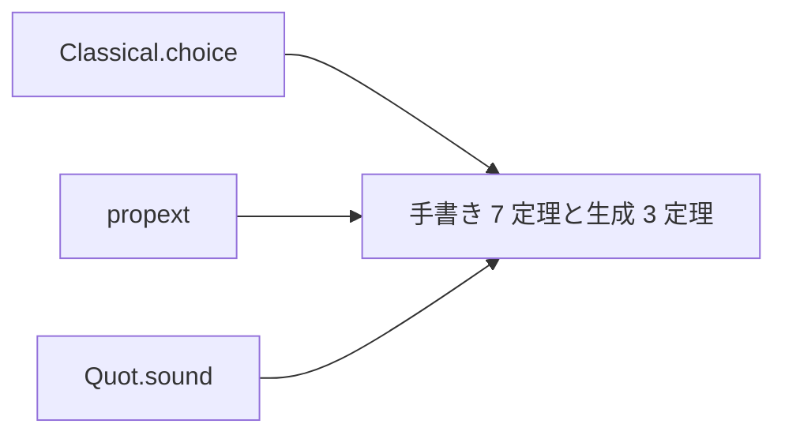
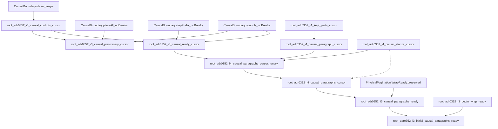

# [root ADR 0352](../adr/0352-prove-pagination-in-lean.md) の段落間のカーソルの受け渡し

## 範囲

この調査は、回り込み図版の横の段落を処理する `paragraphs` が、段落間でカーソルの条件を保つことを扱う。
基準は詩の配置の証明を含む `b420db802bf7e3dca77835da330473b8ca874d97` で、追加した [CausalParagraphs.lean](../../experiments/pagination-proof/CausalParagraphs.lean) を Lean 4.7.0（`aarch64-apple-darwin`）で検査した。
本体と、既存の配置モデルの定義は変えていない。

`PreservesWrapCursor` は、位置を戻さず、同じ位置にとどまるときは閉じた段のテキスト数を変えず、配置済みのテキスト数を減らさない関係である。
`WrapReady` は、除外領域が現在位置より後になく、領域が有効なら現在の段に局所のテキストがある条件である。
回り込み図版のスロットも、そのテキストに含む。
定義と先行する証明は [詩の配置と退避先の依存調査](0352-causal-stanza-dependencies.md) に記録している。

今回の定理は、対応モデル `CausalBoundary.Ms` の任意の値と、任意の長さの段落番号列を量化する。
ただし、モデルの段落間の制御は `noBreak` だけであり、文字幅の計測も文字数を使う。
Golem の全制御、段落開始の改ページ指定、任意の実フォントの一致を示す定理ではない。
成功結果のカーソルの関係は、行の内容と順序の一致とも異なる。

## 定理

Lean の環境から、型と elaboration 後の証明項の定数参照を取得し、定理に解決した。
手書き定理 7 件、生成定理 13 件、生成された定義 23 件、公理宣言 0 件を確認した。
生成定理には再帰の本体、分岐の等式、既存の定義を展開したときの等式が含まれる。
対象の 20 定理すべてで `#print axioms` を実行し、位置の取得できない生成定理も省かなかった。

| 完全修飾名 | 位置 | 前提と結論 |
| --- | --- | --- |
| `PhysicalPagination.root_adr0352_i3_causal_controls_cursor` | [CausalParagraphs.lean:7](../../experiments/pagination-proof/CausalParagraphs.lean#L7) | 任意の回数の `nbIter` は、入力から結果へのカーソルの関係を満たす。要求の行数と判定を制限しない。 |
| `PhysicalPagination.root_adr0352_i3_causal_preliminary_cursor` | [CausalParagraphs.lean:15](../../experiments/pagination-proof/CausalParagraphs.lean#L15) | モデルの `preliminary` の成功結果は、入力との関係を満たす。 |
| `PhysicalPagination.root_adr0352_i3_causal_ready_cursor` | [CausalParagraphs.lean:25](../../experiments/pagination-proof/CausalParagraphs.lean#L25) | モデルの `ready` の成功結果は、入力との関係を満たす。後続として渡す行を制限しない。 |
| `PhysicalPagination.root_adr0352_i4_causal_paragraph_cursor` | [CausalParagraphs.lean:35](../../experiments/pagination-proof/CausalParagraphs.lean#L35) | `paragraphAt` の成功結果は、入力との関係を満たす。保持条件、後続の二つの要求、`probeNext` の結果を制限しない。 |
| `PhysicalPagination.root_adr0352_i4_causal_paragraphs_cursor` | [CausalParagraphs.lean:53](../../experiments/pagination-proof/CausalParagraphs.lean#L53) | `paragraphs` の成功結果は、入力との関係を満たす。詩と通常の段落の両方を含み、段落番号列の長さで帰納する。 |
| `PhysicalPagination.root_adr0352_i3_causal_paragraphs_ready` | [CausalParagraphs.lean:94](../../experiments/pagination-proof/CausalParagraphs.lean#L94) | 入力が `WrapReady` を満たし、`paragraphs` が成功すれば、出力も同条件を満たす。 |
| `PhysicalPagination.root_adr0352_i3_initial_causal_paragraphs_ready` | [CausalParagraphs.lean:102](../../experiments/pagination-proof/CausalParagraphs.lean#L102) | `beginWrap` の返り値から始めた `paragraphs` が成功すれば、出力は同条件を満たす。入力の条件を別の前提に置かない。 |

生成定理の名前も、環境から取得した完全修飾名で記録する。
行位置は環境から取得できなかったため、生成元の位置を示す。

| 生成定理 | 生成元と性質 |
| --- | --- |
| `_private.experiments.«pagination-proof».CausalParagraphs.0.PhysicalPagination.root_adr0352_i4_causal_paragraph_cursor.match_1.eq_1` | 40 行の `probeNext` の結果の分岐の等式。 |
| `PhysicalPagination.root_adr0352_i4_causal_paragraphs_cursor._unary` | 53 行の再帰証明の本体。段落番号列の長さで減少する。 |
| `_private.experiments.«pagination-proof».CausalParagraphs.0.PhysicalPagination.tryVerses.match_1.eq_2` | 63 行以降の `paragraphs` の展開で使う既存の結果の分岐の等式。 |
| `_private.experiments.«pagination-proof».CausalParagraphs.0.PhysicalPagination.putLines.match_1.eq_2` | 63 行以降の `paragraphs` の展開で使う既存の結果の分岐の等式。 |
| `_private.experiments.«pagination-proof».CausalParagraphs.0.PhysicalPagination.tryVerses.match_1.eq_1` | 63 行以降の `paragraphs` の展開で使う既存の結果の分岐の等式。 |
| `_private.experiments.«pagination-proof».CausalParagraphs.0.CausalBoundary.paragraphAt.match_1.eq_1` | 51 行の `paragraphAt` の展開で使う結果の分岐の等式。 |
| `_private.experiments.«pagination-proof».CausalParagraphs.0.PhysicalPagination.tryVerses.match_3.eq_2` | 63 行以降の `paragraphs` の展開で使う既存の結果の分岐の等式。 |
| `_private.experiments.«pagination-proof».CausalParagraphs.0.CausalBoundary.paragraphAt.match_1.eq_2` | 51 行の `paragraphAt` の展開で使う結果の分岐の等式。 |
| `_private.experiments.«pagination-proof».CausalParagraphs.0.PhysicalPagination.paragraphs._eq_1` | 64 行の `rw [paragraphs]` による既存関数の分岐の等式。 |
| `_private.experiments.«pagination-proof».CausalParagraphs.0.PhysicalPagination.paragraphs._eq_2` | 64 行の `rw [paragraphs]` による既存関数の分岐の等式。 |
| `_private.experiments.«pagination-proof».CausalParagraphs.0.PhysicalPagination.tryVerses.match_3.eq_1` | 63 行以降の `paragraphs` の展開で使う既存の結果の分岐の等式。 |
| `_private.experiments.«pagination-proof».CausalParagraphs.0.PhysicalPagination.root_adr0352_i4_causal_paragraph_cursor.match_1.eq_2` | 40 行の `probeNext` の結果の分岐の等式。 |
| `_private.experiments.«pagination-proof».CausalParagraphs.0.PhysicalPagination.putLines.match_1.eq_1` | 63 行以降の `paragraphs` の展開で使う既存の結果の分岐の等式。 |

## 公理と依存

手書き定理 7 件と、再帰の本体および `paragraphs` の分岐の等式 3 件は、次の標準公理に推移的に依存した。
ほかの生成定理 10 件は、公理に依存しなかった。
生成された定義は、局所の `probed` の分岐、再帰の引数の束ね方、減少証明、既存の定義を展開したときの補助宣言である。

| 公理 | Lean 4.7.0 の位置 | 内容 |
| --- | --- | --- |
| `Classical.choice` | `Init.Prelude:730` | `Nonempty α` から `α` の要素を選ぶ。 |
| `propext` | `Init.Core:1287` | `a ↔ b` から `a = b` を得る。 |
| `Quot.sound` | `Init.Core:1459` | 関係を満たす二要素が同じ商の値を持つ。 |

次の図は、補助宣言を経由した推移的な公理依存を示す。

次の図では、実線は型または証明項に現れた定理の直接参照、破線は生成された再帰の本体を経由する参照を表す。
ノード名は上の表と同じ `PhysicalPagination` の定理で、長い名前の共通部分を省いた。
名前空間を記していないノードも `PhysicalPagination` に属する。
標準の等式と論理の補題は図から省いた。

`preliminary` の定理は単独で前処理の成功結果を扱う。
`paragraphs` の出力の証明は `ready` の定理を使う。
これは、実装とモデルがともに `ready` を前処理の結果でなく元のカーソルからやり直すためである。
`paragraphAt` の証明は、実際の `probeNext` の結果を保持の要求へ渡す形を、先行する `root_adr0352_i4_kept_parts_cursor` に当てはめる。
後続の判定そのものが行の内容や順序を保つことは、ここで証明していない。

## 実装形と境界照合

本体の `Flow.hs:5136` の `paragraphs` は、前処理の後に詩か通常の段落に分岐する。
通常の段落は元のカーソルから `stepPhysicalPrefix` をやり直し、段落を置いて残りへ再帰する。
詩も元のカーソルから同じ前処理をやり直し、詩を置いて残りへ再帰する。
`Physical.lean:3727` の写しと、この受け渡し順を読み合わせた。
ただし、本体の前処理には段落開始の改ページ指定もあり、今回のモデルの `noBreak` だけの制御へ一般化してはならない。

追加する定理がない状態では、名前の検査が失敗した。
制御後のカーソルを先頭ページの空の段へ戻す変更では、任意のカーソルから先頭位置への前進を証明できず、Lean が失敗した。
ページ 2 から初期カーソルへ戻す操作が関係を満たさないという具体的な反例も、Lean で確認した。
元の制御と保持では、7 定理が成功した。

`CAUSAL_MODE=controls` で、制御が 0、1、3 個の場合を、段落と詩の前後に置く境界照合を追加した。
図版幅 2、3zw と容量 1〜6 行を組み合わせ、空の本文、図版が容量を超える失敗、保持付きの段落も含む 216 ケースを評価した。
GHC 9.10.3 の通常の `layoutPdf` と Lean の出力はともに 539 行で、差分はなかった。
各図版を処理する前提の検査も、216 ケースで失敗 0 件だった。
同じケースが複数の組み合わせに現れるため、216 は異なる原稿だけを数えた値ではない。

既存の 4864 ケースは既定の入力として保つ。
変更後にも再実行し、両者の出力はともに 18921 行で差分がなく、各図版を処理する前提も失敗 0 件だった。
新しい境界照合は、任意のモデル入力についての定理とは別に実装との対応を確認する検査であり、全原稿の一致の証明には数えない。

## 証明の穴と残り

対象のソースに `sorry`、`admit`、`sorryAx` はなく、20 定理の公理依存にも `sorryAx` はなかった。
取得できなかった対象の証明項はなかった。
既存の `CausalBoundary.lean:44` の `partial def firstNeed` の終了は、この変更では証明していない。

今回扱うのは成功結果であり、`paragraphs` の全途中状態や失敗に至る呼び出しすべてを集める定理はまだない。
`tryVerses` と `parts` の再帰入力の条件については、先行する定理を使うための最初の入力との接続を、全実装の制御について残す。
`I5_stanza_lines` の保持と退避先の前提、`parts` の行 ID の前提 `hb`、内容の過不足と順序、一般的なキャプションの改行の一致も残る。
[root ADR 0352](../adr/0352-prove-pagination-in-lean.md) は `accepted-pending` のままにする。
