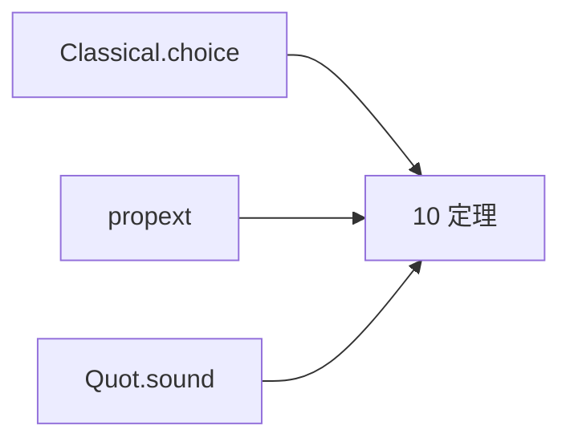
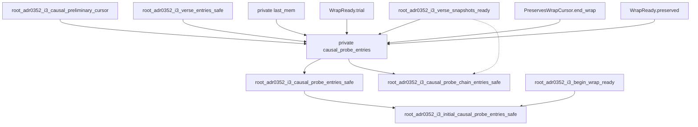

# [root ADR 0352](../adr/0352-prove-pagination-in-lean.md) の後続のプローブの各入口

## 範囲

この調査は、回り込み図版の横で後続の段落を調べる `probeNext` と `probeChain` の各入口を扱う。
基準の main は `fd1936c2a43a2a392541d156c544ac70edb7e88b` で、先行する詩の入口の証明 `2a09a7beb43f8ddf2a6183c008b709dbb29477b0` を含む枝に追加した。
[CausalProbeEntries.lean](../../experiments/pagination-proof/CausalProbeEntries.lean) を Lean 4.7.0（`aarch64-apple-darwin`）で検査した。
この増分自体は、本体と既存の配置モデルを変えていない。

二つの述語 `probeEntriesSafe` と `probeChainEntriesSafe` は、元の関数の再帰をたどり、カーソルの条件 `WrapReady` を検査する。
`WrapReady` は、除外領域が現在位置より後になく、現在段でのその長さが正なら局所のテキストがある条件である。
回り込み図版のスロットも、そのテキストに含む。
定義は [カーソルの依存調査](0352-pagination-proof-dependencies.md) に記録している。

検査する入口は、相互再帰、前処理後の入力、詩の試しの全再帰入力、通常の段落の試し後の入力、最後の段落の後で `following` に渡す入力である。
処理全体の成功を前提にせず、失敗する試みも含む。
前処理の条件を別途仮定せず、対応モデルの `noBreak` の処理から導く。

対象は、対応モデル `CausalBoundary.Ms` の任意の値と、任意の長さの段落番号列である。
このモデルの段落間の制御は `noBreak` だけであり、文字幅は文字数で測る。
本体の全制御、組み直す `Built` の全フィールド、任意の実フォントの一致を示す定理ではない。
カーソルの位置とテキスト数の性質を、内容と順序の一致へ読み替えてはならない。

## 宣言

Lean の環境から宣言の種類、型、elaboration 後の証明項を取得した。
手書き定義 2 件、生成定義 34 件、private の補題 2 件を含む手書き定理 6 件、生成定理 18 件、公理宣言 0 件だった。
位置の取得できない生成定理も含め、24 定理すべてで `#print axioms` を実行した。

| 完全修飾名 | 位置 | 主な前提と結論 |
| --- | --- | --- |
| `PhysicalPagination.probeEntriesSafe` | [CausalProbeEntries.lean:9](../../experiments/pagination-proof/CausalProbeEntries.lean#L9) | 後続のプローブの各入口と、その中で行う試しの入力の条件を表す述語。 |
| `PhysicalPagination.probeChainEntriesSafe` | [CausalProbeEntries.lean:57](../../experiments/pagination-proof/CausalProbeEntries.lean#L57) | 続く保持のプローブの再帰入力の条件を表す述語。 |
| `PhysicalPagination.PreservesWrapCursor.end_wrap` | [CausalProbeEntries.lean:69](../../experiments/pagination-proof/CausalProbeEntries.lean#L69) | `endWrap` が変えるのは使用済みの長さであり、位置とテキスト数の関係を保つ。 |
| `_private.experiments.«pagination-proof».CausalProbeEntries.0.PhysicalPagination.last_mem` | [CausalProbeEntries.lean:73](../../experiments/pagination-proof/CausalProbeEntries.lean#L73) | 最後の要素が得られれば、その要素は元のリストに属する。 |
| `_private.experiments.«pagination-proof».CausalProbeEntries.0.PhysicalPagination.causal_probe_entries` | [CausalProbeEntries.lean:80](../../experiments/pagination-proof/CausalProbeEntries.lean#L80) | 最初の `WrapReady` から、対応モデルの両方の述語を同時に導く。 |
| `PhysicalPagination.root_adr0352_i3_causal_probe_entries_safe` | [CausalProbeEntries.lean:142](../../experiments/pagination-proof/CausalProbeEntries.lean#L142) | 最初の `WrapReady` から、後続のプローブの全入口の条件を導く。 |
| `PhysicalPagination.root_adr0352_i3_causal_probe_chain_entries_safe` | [CausalProbeEntries.lean:149](../../experiments/pagination-proof/CausalProbeEntries.lean#L149) | 最初の `WrapReady` から、続く保持のプローブの全入口の条件を導く。 |
| `PhysicalPagination.root_adr0352_i3_initial_causal_probe_entries_safe` | [CausalProbeEntries.lean:156](../../experiments/pagination-proof/CausalProbeEntries.lean#L156) | `beginWrap` の成功結果から各入口の条件を導き、最初の条件を別途仮定しない。 |

生成定理の行位置は環境から取得できなかったため、完全修飾名と生成元を記録する。
表では `propext`、`Classical.choice`、`Quot.sound` を「標準三公理」と略す。

| 生成定理 | 生成元 | 公理への依存 |
| --- | --- | --- |
| `_private.experiments.«pagination-proof».CausalProbeEntries.0.PhysicalPagination.probeEntriesSafe.match_3.eq_1` | 9〜67 行の相互再帰の述語の減少証明または分岐の等式。 | なし |
| `_private.experiments.«pagination-proof».CausalProbeEntries.0.PhysicalPagination.probeEntriesSafe.match_1.eq_1` | 9〜67 行の相互再帰の述語の減少証明または分岐の等式。 | なし |
| `_private.experiments.«pagination-proof».CausalProbeEntries.0.PhysicalPagination.probeEntriesSafe.match_4.eq_1` | 9〜67 行の相互再帰の述語の減少証明または分岐の等式。 | なし |
| `_private.experiments.«pagination-proof».CausalProbeEntries.0.PhysicalPagination.probeEntriesSafe._eq_1` | 9〜67 行の相互再帰の述語の減少証明または分岐の等式。 | 標準三公理 |
| `PhysicalPagination.probeEntriesSafe._unary._mutual.proof_4` | 9〜67 行の相互再帰の述語の減少証明または分岐の等式。 | 標準三公理 |
| `_private.experiments.«pagination-proof».CausalProbeEntries.0.PhysicalPagination.probeEntriesSafe.match_3.eq_2` | 9〜67 行の相互再帰の述語の減少証明または分岐の等式。 | なし |
| `_private.experiments.«pagination-proof».CausalProbeEntries.0.PhysicalPagination.probeEntriesSafe.match_5.eq_1` | 9〜67 行の相互再帰の述語の減少証明または分岐の等式。 | なし |
| `PhysicalPagination.probeEntriesSafe._unary._mutual.proof_3` | 9〜67 行の相互再帰の述語の減少証明または分岐の等式。 | 標準三公理 |
| `_private.experiments.«pagination-proof».CausalProbeEntries.0.PhysicalPagination.probeEntriesSafe.match_1.eq_2` | 9〜67 行の相互再帰の述語の減少証明または分岐の等式。 | なし |
| `_private.experiments.«pagination-proof».CausalProbeEntries.0.PhysicalPagination.probeEntriesSafe.match_5.eq_2` | 9〜67 行の相互再帰の述語の減少証明または分岐の等式。 | なし |
| `_private.experiments.«pagination-proof».CausalProbeEntries.0.PhysicalPagination.probeChainEntriesSafe._eq_1` | 9〜67 行の相互再帰の述語の減少証明または分岐の等式。 | 標準三公理 |
| `PhysicalPagination.probeEntriesSafe._unary._mutual.proof_1` | 9〜67 行の相互再帰の述語の減少証明または分岐の等式。 | なし |
| `_private.experiments.«pagination-proof».CausalProbeEntries.0.PhysicalPagination.probeEntriesSafe.match_2.eq_1` | 9〜67 行の相互再帰の述語の減少証明または分岐の等式。 | なし |
| `_private.experiments.«pagination-proof».CausalProbeEntries.0.PhysicalPagination.probeEntriesSafe._eq_2` | 9〜67 行の相互再帰の述語の減少証明または分岐の等式。 | 標準三公理 |
| `_private.experiments.«pagination-proof».CausalProbeEntries.0.PhysicalPagination.probeEntriesSafe.match_2.eq_2` | 9〜67 行の相互再帰の述語の減少証明または分岐の等式。 | なし |
| `_private.experiments.«pagination-proof».CausalProbeEntries.0.PhysicalPagination.probeEntriesSafe.match_3.eq_3` | 9〜67 行の相互再帰の述語の減少証明または分岐の等式。 | なし |
| `PhysicalPagination.probeEntriesSafe._unary._mutual.proof_2` | 9〜67 行の相互再帰の述語の減少証明または分岐の等式。 | 標準三公理 |
| `_private.experiments.«pagination-proof».CausalProbeEntries.0.PhysicalPagination.probeEntriesSafe.match_4.eq_2` | 9〜67 行の相互再帰の述語の減少証明または分岐の等式。 | なし |

## 公理と依存

24 定理のうち 10 件は三つの標準公理に推移的に依存した。
残りの 14 件は、公理に依存しなかった。
生成定義には、相互再帰の引数の束ね方と分岐の補助宣言が含まれる。

| 公理 | Lean 4.7.0 の位置 | 内容 |
| --- | --- | --- |
| `Classical.choice` | `Init.Prelude:730` | `Nonempty α` から `α` の要素を選ぶ。 |
| `propext` | `Init.Core:1287` | `a ↔ b` から `a = b` を得る。 |
| `Quot.sound` | `Init.Core:1459` | 関係を満たす二要素が同じ商の値を持つ。 |

次の図は、補助宣言を経由した推移的な公理依存を示す。

次の図の実線は、型または証明項に現れた定理の直接参照、破線は private の帰納証明を経由する参照である。
ノード名はすべて `PhysicalPagination` の定理であり、共通の名前空間は省いた。
private の補題は、上の表の完全修飾名に対応する。
標準の等式と論理の補題、生成された分岐の等式は省いた。

減少する値は、残りの段落番号列の長さと、二つの関数を区別する値である。
`probeNext` が `probeChain` を呼ぶ場合は、試す段落か詩の列を取り除くので長さが減る。
逆向きの呼び出しでは、長さは同じで、関数を区別する値が 1 から 0 に減る。

詩の試しから選ぶ最後の状態は、実際の `tryVerses` の成功結果の要素であることを示す。
その状態の条件は `root_adr0352_i3_verse_snapshots_ready` から導き、別の前提には置かない。
先行する [詩の入口の証明](0352-causal-stanza-entry-dependencies.md) が後続のプローブへ渡す `WrapReady` は、今回の定理の最初の条件として使える。

## 分岐と実装の照合

[check-causal-probe-shape.sh](../../experiments/pagination-proof/check-causal-probe-shape.sh) は、`Physical.lean:3461` の `probeNext` と同 3509 の `probeChain` の分岐、再帰先、引数を、入口の述語と比較する。
入口の条件の連言を除き、最後の結果を返すだけの分岐を正規化して比較する。
正規化する分岐は、元のエラー返却、三つ組の返却、真偽値の射影と正確に一致する場合だけ省く。
そこで新たに関数を呼ぶ変更は、検査を通らない。

元のファイルを使う分岐の検査は成功した。
前処理後の条件の削除、詩の試しの条件の削除、通常の段落の試しの入力の変更、詩の後の再帰の削除、次の番号の変更、`endWrap` の省略、試しの後の条件の削除、末尾の返却を新しい呼び出しに変える変更は、それぞれ検査に失敗した。
追加する定理がない段階の名前の検査でも失敗を確認し、元の述語では 6 定理が成功した。

本体は `Flow.hs:5233` の `probeNext` と同 5276 の `probeChain` に対応する。
前処理を進め、詩か通常の段落を試し、同じ段に必要な行が入り、残りの保持も調べる場合だけ次のプローブに進む。
この呼び出し順を読み合わせたが、本体のすべての書式や組み直す状態との一般的な対応は残す。

元の照合時の本体と `CausalBoundary.hs` および `CausalBoundary.lean` は、直前の [詩の入口の照合](0352-causal-stanza-entry-dependencies.md) から変わっていない。
同じ基準コードの 216 ケース 539 行と 4864 ケース 18921 行について、Haskell と Lean の差分 0、前提の失敗 0 の結果を使う。
この有限の照合を、任意の実装入力の一般証明とは数えない。
新しい CI ワークフローは追加していない。

マージ前に main `a1e5ed5af7d99553b1b4de68d3d4add7dc641ea9` を取り込み、Lean 4.7.0 で `check.sh` 全体を再実行して終了コード 0 を得た。
本体のコードはこの main と同一である。
照合には GHC 9.10.3、正規の peg-hs 固定版 `4b4adc7046`、plugins 有効の [root ADR 0483](../adr/0483-finish-forced-paragraph-placement-without-repeating-the-retry.md) 検証用 package DB を読み取り専用で使った。
`CABAL_PLAN` にその plan、`RUNGHC` に package ID を明示する wrapper を渡し、Cabal の再計画やビルドは行っていない。
これは標準の Cabal 環境だけで実行した結果ではない。

この再実行では、自由な配置の 156520 入力、回り込みの試し 10368 件、因果的な配置 4864 ケース、`noBreak` を繰り返す 216 ケースが Haskell と Lean で一致した。
改行の評価と選択の 34586 入力、二つの実フォントを使うキャプション 40 件も一致した。
42 件の Alloy コマンドに対応する Lean の検査が成功したが、ここで Alloy ソルバーを再実行したわけではない。
[root ADR 0483](../adr/0483-finish-forced-paragraph-placement-without-repeating-the-retry.md) の強制配置の消費も、同じ実行の `ForcedPrefix.lean` で検査した。
本稿で示す本体とモデルの行位置は、この main で読み直した位置である。
対象とそのインポートをこの版から再ビルドし、24 定理の公理と直接参照を再取得したところ、元の調査出力と一致した。
分岐の検査も元の述語で成功し、保存した八つの変異をすべて拒否した。

## 証明の穴と残り

対象のソースに `sorry`、`admit`、`sorryAx` はなく、24 定理の公理依存にも `sorryAx` はなかった。
取得できなかった対象の証明項はなかった。
相互再帰の述語と証明は減少する二つの値で終了し、対象に `partial` の定義はない。
既存の `CausalBoundary.lean:44` の列挙用の `partial def firstNeed` の終了は、この変更では証明していない。

モデルの詩の配置から呼ぶプローブについて、各入口のカーソルの条件を接続した。
本体の全制御、組み直す状態全体、`parts` の行 ID の前提 `hb`、内容の過不足と順序、一般的なキャプションの改行の一致は残る。
[root ADR 0352](../adr/0352-prove-pagination-in-lean.md) は未実装のままにし、この増分だけでは実装完了を記録しない。
