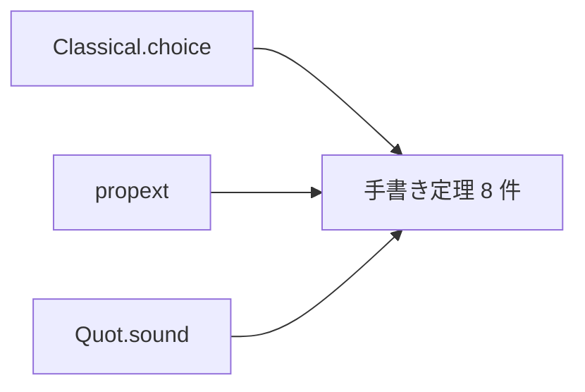
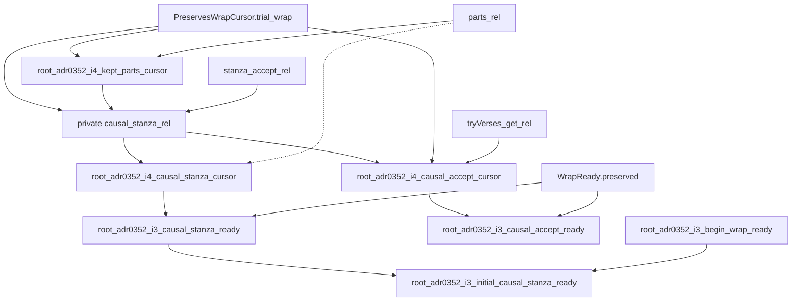

# [root ADR 0352](../adr/0352-prove-pagination-in-lean.md) の詩の配置と退避先の前提

## 範囲

この調査は、[root ADR 0352](../adr/0352-prove-pagination-in-lean.md) の残件のうち、回り込み図版の横の詩を配置する `stanza` と、その試し置きを採用する `accept` の成功結果を扱う。
基準の main は `f4b931cc3d9f48542f6ff974ba6a4f6a20b4a454` で、追加した [CausalStanza.lean](../../experiments/pagination-proof/CausalStanza.lean) を Lean 4.7.0（`aarch64-apple-darwin`）で検査した。
本体の API と既存モデルの定義は変えていない。

`PreservesWrapCursor` は、位置を戻さず、同じ位置にとどまるときは閉じた段のテキスト数を変えず、配置済みのテキスト数を減らさない関係である。
これはテキストの内容や順序の一致ではない。
`WrapReady` は、除外領域が現在位置より後になく、領域が有効なら現在の段に局所のテキストがある条件である。
回り込み図版のスロットも、ここでのテキストに含む。
定義と前提は [先の依存調査](0352-pagination-proof-dependencies.md) に記録している。

今回の `stanza` と `accept` の定理は、`CausalBoundary.Ms` の任意の値について成り立ち、既存の 4864 個の列挙入力には限らない。
ただし、`Ms` は段落、詩、図版、リスト項目などを持つ対応モデルの原稿である。
文字幅を単純な文字数で測るこのモデルと、任意の実フォントや Golem の全原稿の一致を示す定理ではない。
すべての実装の呼び出し元からの初期条件、行の内容と順序、一般的なキャプションの改行の一致は残す。

## 定理

環境から宣言の種類と証明項を読み、型と証明項の定数参照を定理に解決した。
手書き定理は private の補題 1 件を含め 8 件で、生成定理、定義、公理宣言は 0 件だった。
8 件すべてで `#print axioms` を実行し、三つの標準公理への推移依存を確認した。

表の名前は `PhysicalPagination` 名前空間の完全修飾名である。
private の補題には、環境で取得した名前をそのまま記す。

| 定理 | 位置 | 主な前提と結論 |
| --- | --- | --- |
| `PhysicalPagination.PreservesWrapCursor.trial_wrap` | [CausalStanza.lean:8](../../experiments/pagination-proof/CausalStanza.lean#L8) | `trialWrap` が成功すれば、配置と移動のどちらでも、入力から結果へのカーソルの関係を満たす。 |
| `PhysicalPagination.root_adr0352_i4_kept_parts_cursor` | [CausalStanza.lean:20](../../experiments/pagination-proof/CausalStanza.lean#L20) | 保持が `waitForPrior` の形の `parts` が成功すれば、入力から出力への関係を満たす。改行器の行 ID と行の内容を保つことは前提にしない。 |
| `_private.experiments.«pagination-proof».CausalStanza.0.PhysicalPagination.causal_stanza_rel` | [CausalStanza.lean:43](../../experiments/pagination-proof/CausalStanza.lean#L43) | 対応モデルの保持と退避先を使う `stanza` と `accept` へ、一般の関係の定理を適用する。後者では、試し置きの各カーソルが入力との関係を満たすことを求める。 |
| `PhysicalPagination.root_adr0352_i4_causal_stanza_cursor` | [CausalStanza.lean:74](../../experiments/pagination-proof/CausalStanza.lean#L74) | 対応モデルの `stanza` が成功すれば、カーソルの関係を満たす。保持と退避先の関係を別の前提に置かない。 |
| `PhysicalPagination.root_adr0352_i4_causal_accept_cursor` | [CausalStanza.lean:81](../../experiments/pagination-proof/CausalStanza.lean#L81) | `tryVerses` の成功結果を使う `accept` が成功すれば、カーソルの関係を満たす。各試し置きの関係も `tryVerses_get_rel` から導く。 |
| `PhysicalPagination.root_adr0352_i3_causal_stanza_ready` | [CausalStanza.lean:93](../../experiments/pagination-proof/CausalStanza.lean#L93) | 入力が `WrapReady` を満たし、対応モデルの `stanza` が成功すれば、出力も同条件を満たす。 |
| `PhysicalPagination.root_adr0352_i3_causal_accept_ready` | [CausalStanza.lean:100](../../experiments/pagination-proof/CausalStanza.lean#L100) | 入力が同条件を満たし、`tryVerses` の成功結果を使う `accept` が成功すれば、出力も同条件を満たす。 |
| `PhysicalPagination.root_adr0352_i3_initial_causal_stanza_ready` | [CausalStanza.lean:109](../../experiments/pagination-proof/CausalStanza.lean#L109) | `beginWrap` の返り値を直接入力にする `stanza` が成功すれば、出力は同条件を満たす。入力の `WrapReady` を別の前提に置かない。 |

`parts_rel`（`Physical.lean:7383`）と `stanza_accept_rel`（同 7497）は、試し置き、移動、保持と退避先が保つ関係を引数に取る。
今回の補題は、その関係を `PreservesWrapCursor` とし、各関数の前提を既存の `Adv` と `Step` から導く。
`tryVerses_get_rel`（同 7472）は、試し置きの各成功結果へ関係を伝える。
既存の定理の前提自体を、今回の結論として仮定したものではない。

## 公理と依存

対象の 8 定理には、次の三つの標準公理への推移的な依存があった。
これは今回追加した公理ではない。

| 公理 | Lean 4.7.0 の位置 | 内容 |
| --- | --- | --- |
| `Classical.choice` | `Init.Prelude:730` | `Nonempty α` から `α` の要素を選ぶ。 |
| `propext` | `Init.Core:1287` | `a ↔ b` から `a = b` を得る。 |
| `Quot.sound` | `Init.Core:1459` | 関係を満たす二要素が同じ商の値を持つ。 |

次の図は、定義と補助定理を経由した推移的な公理依存である。

次の図は、対象の 8 定理と、説明に必要な既存の定理の間の依存である。
実線は elaboration 後の証明項に現れた直接参照、破線は補助定理を経由する参照を表す。
標準の等式と分岐の補題、既存の移動、待機、保持の各補題は図から省いた。
ノードの省略名は、上の表と同じ `PhysicalPagination` 名前空間の定理に対応する。

## 実装の形と境界照合

対応モデルの保持は `CausalBoundary.holdNext`（`CausalBoundary.lean:264`）であり、`waitForPrior` へ少なくとも一行を渡す。
本体の `keepPhysicalNext`（`Paginate/Physical.hs:230`）も同じ形である。
`stanzaArgs`（`CausalBoundary.lean:399`）の退避先は、既定の保持で、後続の二つの要求をともに 0 にした `paragraphAt` である。
これは本体の `Flow.hs:5288` から呼ぶ `paragraph` の形に対応する。
後続を調べないので、保持へ渡す値は一行で、行だけの要求になる。

最初は追加する定理がなく、名前の検査で失敗した。
保持がカーソルを `initial env` へ戻す変更では、`PreservesWrapCursor st (initial env)` を導けず、Lean の検査に失敗した。
元の保持と退避先では、8 定理が成功した。

GHC 9.10.3 と 13 個の in-place package ID を指定し、既存の `CausalBoundary.hs` と `CausalBoundary.lean` の 4864 原稿を再照合した。
Haskell と Lean はともに 18921 行で、差分はなかった。
各図版を処理する前提の検査も、4864 原稿で失敗 0 件だった。
基準 main と、使用した main `81adc858419ae607483e5889091d18e8561fab4d` のライブラリのソースは、`modules/` と `scripts/fixtures/` の差分が 0 行だった。
この有限の照合を、任意の実装入力の証明とは扱わない。

## 証明の穴と未確認の範囲

対象のソースに `sorry`、`admit`、`sorryAx` はなく、8 定理の公理依存にも `sorryAx` はなかった。
取得できなかった対象の証明項はなかった。
既存の `CausalBoundary.lean:44` の列挙用の `partial def firstNeed` は、この変更で終了を証明した関数には含めない。
今回の結論は成功結果の関係であり、すべての実装の `causalFreeFlow` が終了することではない。

`paragraphs` の前処理と制御フローが返す状態の接続は残る。
`I5_stanza_lines` の保持と退避先の前提、`parts` の行 ID の前提 `hb`、行の過不足と順序、一般的なキャプション改行の一致も残る。
配置済みテキスト数を減らさないことを、内容や順序を保つ証明へ読み替えてはならない。
[root ADR 0352](../adr/0352-prove-pagination-in-lean.md) は `accepted-pending` のままにする。
