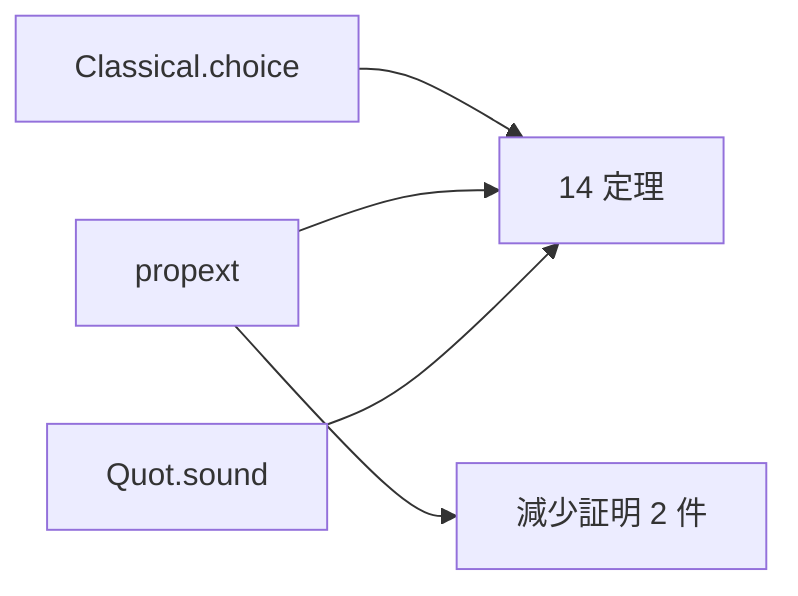
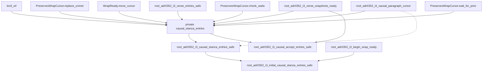

# [root ADR 0352](../adr/0352-prove-pagination-in-lean.md) の詩の相互再帰の各入口

## 範囲

この調査は、回り込み図版の横の詩を配置する `stanza` と、試し置きから採用する行数を選ぶ `accept` の各入口を扱う。
基準の main は `fd1936c2a43a2a392541d156c544ac70edb7e88b` で、追加した [CausalStanzaEntries.lean](../../experiments/pagination-proof/CausalStanzaEntries.lean) を Lean 4.7.0（`aarch64-apple-darwin`）で検査した。
本体と既存の配置モデルの定義は変えていない。

二つの述語 `stanzaEntriesSafe` と `acceptEntriesSafe` は、元の関数と同じ分岐と相互再帰をたどり、各入口で `WrapReady` を検査する。
`WrapReady` は、除外領域が現在位置より後になく、現在段でのその長さが正なら局所のテキストがある条件である。
回り込み図版のスロットも、そのテキストに含む。
定義は [カーソルの依存調査](0352-pagination-proof-dependencies.md) に記録している。

今回の述語は、処理全体の成功を前提にしない。
詩の試しが失敗する場合も、その入力と、そこまでの各再帰入力を検査する。
採用した状態に警告を付ける処理、段を進める処理、採用する行数を減らす処理、一つの詩の行を通常の段落として配置する退避先を扱う。
`accept` では、後続のプローブに渡す `settled` と、保持後の `held` の条件も検査する。

対象は、対応モデル `CausalBoundary.Ms` の任意の値と、任意の長さの詩の行の番号列である。
このモデルの段落間の制御は `noBreak` だけであり、文字幅は文字数で測る。
本体の全制御や任意の実フォントの一致、プローブの内部の全再帰入力は、この証明の対象ではない。
また、モデルが行数 0 や試しの範囲外に返す失敗も扱うが、その値を実装が採用処理に渡すとは主張しない。

## 宣言

Lean の環境から宣言の種類、型、elaboration 後の証明項を取得した。
手書き定義 2 件、生成定義 33 件、private の補題を含む手書き定理 5 件、生成定理 22 件、公理宣言 0 件だった。
位置の取得できない生成定理も含め、27 定理すべてで `#print axioms` を実行した。

| 完全修飾名 | 位置 | 主な前提と結論 |
| --- | --- | --- |
| `PhysicalPagination.stanzaEntriesSafe` | [CausalStanzaEntries.lean:9](../../experiments/pagination-proof/CausalStanzaEntries.lean#L9) | 配置の各再帰入力と、その都度行う詩の試しの全再帰入力の条件を表す述語。 |
| `PhysicalPagination.acceptEntriesSafe` | [CausalStanzaEntries.lean:54](../../experiments/pagination-proof/CausalStanzaEntries.lean#L54) | 採用処理の再帰入力、試しの各状態、後続のプローブへの入力、保持の結果の条件を表す述語。 |
| `PhysicalPagination.PreservesWrapCursor.replace_unmet` | [CausalStanzaEntries.lean:99](../../experiments/pagination-proof/CausalStanzaEntries.lean#L99) | 未充足の規則の報告だけを置き換えても、位置とテキスト数の関係を保つ。 |
| `_private.experiments.«pagination-proof».CausalStanzaEntries.0.PhysicalPagination.causal_stanza_entries` | [CausalStanzaEntries.lean:103](../../experiments/pagination-proof/CausalStanzaEntries.lean#L103) | 最初のカーソルの条件と、採用処理では試しの各状態の条件から、両方の述語を同時に導く。減少する五つの値で帰納する。 |
| `PhysicalPagination.root_adr0352_i3_causal_stanza_entries_safe` | [CausalStanzaEntries.lean:224](../../experiments/pagination-proof/CausalStanzaEntries.lean#L224) | 最初の `WrapReady` から、対応モデルの配置の全入口の条件を導く。 |
| `PhysicalPagination.root_adr0352_i3_causal_accept_entries_safe` | [CausalStanzaEntries.lean:231](../../experiments/pagination-proof/CausalStanzaEntries.lean#L231) | 最初の `WrapReady` と、実際に成功した `tryVerses` の返り値から、採用処理の全入口の条件を導く。 |
| `PhysicalPagination.root_adr0352_i3_initial_causal_stanza_entries_safe` | [CausalStanzaEntries.lean:241](../../experiments/pagination-proof/CausalStanzaEntries.lean#L241) | `beginWrap` の成功結果から配置の全入口の条件を導き、最初の条件を別途仮定しない。 |

private の補題の試しの各状態の前提は、公開した採用処理の定理では `root_adr0352_i3_verse_snapshots_ready` から導く。
各再帰入力の安全性そのものを仮定した定理ではない。
通常の段落の退避先と保持の性質は、先行する具体的な関数の証明から導く。

生成定理の完全修飾名と生成元も記録する。
これらの行位置は、環境から取得できなかった。
`propext`、`Classical.choice`、`Quot.sound` を、表では「標準三公理」と略す。

| 生成定理 | 生成元 | 公理への依存 |
| --- | --- | --- |
| `PhysicalPagination.stanzaEntriesSafe._unary._mutual.proof_3` | 9〜97 行の相互再帰の述語の減少証明または分岐の等式。 | 標準三公理 |
| `_private.experiments.«pagination-proof».CausalStanzaEntries.0.PhysicalPagination.acceptEntriesSafe.match_2.eq_2` | 9〜97 行の相互再帰の述語の減少証明または分岐の等式。 | なし |
| `PhysicalPagination.stanzaEntriesSafe._unary._mutual.proof_1` | 9〜97 行の相互再帰の述語の減少証明または分岐の等式。 | なし |
| `_private.experiments.«pagination-proof».CausalStanzaEntries.0.PhysicalPagination.stanzaEntriesSafe.match_3.eq_2` | 9〜97 行の相互再帰の述語の減少証明または分岐の等式。 | なし |
| `PhysicalPagination.stanzaEntriesSafe._unary._mutual.proof_5` | 9〜97 行の相互再帰の述語の減少証明または分岐の等式。 | 標準三公理 |
| `_private.experiments.«pagination-proof».CausalStanzaEntries.0.PhysicalPagination.stanzaEntriesSafe.match_1.eq_2` | 9〜97 行の相互再帰の述語の減少証明または分岐の等式。 | なし |
| `_private.experiments.«pagination-proof».CausalStanzaEntries.0.PhysicalPagination.acceptEntriesSafe._eq_1` | 9〜97 行の相互再帰の述語の減少証明または分岐の等式。 | 標準三公理 |
| `PhysicalPagination.stanzaEntriesSafe._unary._mutual.proof_2` | 9〜97 行の相互再帰の述語の減少証明または分岐の等式。 | `propext` |
| `_private.experiments.«pagination-proof».CausalStanzaEntries.0.PhysicalPagination.stanzaEntriesSafe._eq_1` | 9〜97 行の相互再帰の述語の減少証明または分岐の等式。 | 標準三公理 |
| `_private.experiments.«pagination-proof».CausalStanzaEntries.0.PhysicalPagination.stanzaEntriesSafe.match_2.eq_1` | 9〜97 行の相互再帰の述語の減少証明または分岐の等式。 | なし |
| `PhysicalPagination.stanzaEntriesSafe._unary._mutual.proof_6` | 9〜97 行の相互再帰の述語の減少証明または分岐の等式。 | 標準三公理 |
| `PhysicalPagination.stanzaEntriesSafe._unary._mutual.proof_7` | 9〜97 行の相互再帰の述語の減少証明または分岐の等式。 | 標準三公理 |
| `_private.experiments.«pagination-proof».CausalStanzaEntries.0.PhysicalPagination.stanzaEntriesSafe.match_2.eq_2` | 9〜97 行の相互再帰の述語の減少証明または分岐の等式。 | なし |
| `_private.experiments.«pagination-proof».CausalStanzaEntries.0.PhysicalPagination.stanzaEntriesSafe._eq_2` | 9〜97 行の相互再帰の述語の減少証明または分岐の等式。 | 標準三公理 |
| `_private.experiments.«pagination-proof».CausalStanzaEntries.0.PhysicalPagination.stanzaEntriesSafe.match_3.eq_1` | 9〜97 行の相互再帰の述語の減少証明または分岐の等式。 | なし |
| `PhysicalPagination.stanzaEntriesSafe._unary._mutual.proof_4` | 9〜97 行の相互再帰の述語の減少証明または分岐の等式。 | 標準三公理 |
| `_private.experiments.«pagination-proof».CausalStanzaEntries.0.PhysicalPagination.stanzaEntriesSafe.match_1.eq_1` | 9〜97 行の相互再帰の述語の減少証明または分岐の等式。 | なし |
| `_private.experiments.«pagination-proof».CausalStanzaEntries.0.PhysicalPagination.acceptEntriesSafe.match_1.eq_1` | 9〜97 行の相互再帰の述語の減少証明または分岐の等式。 | なし |
| `PhysicalPagination.stanzaEntriesSafe._unary._mutual.proof_8` | 9〜97 行の相互再帰の述語の減少証明または分岐の等式。 | 標準三公理 |
| `PhysicalPagination.stanzaEntriesSafe._unary._mutual.proof_9` | 9〜97 行の相互再帰の述語の減少証明または分岐の等式。 | 標準三公理 |
| `_private.experiments.«pagination-proof».CausalStanzaEntries.0.PhysicalPagination.acceptEntriesSafe.match_2.eq_1` | 9〜97 行の相互再帰の述語の減少証明または分岐の等式。 | なし |
| `_private.experiments.«pagination-proof».CausalStanzaEntries.0.PhysicalPagination.acceptEntriesSafe.match_1.eq_2` | 9〜97 行の相互再帰の述語の減少証明または分岐の等式。 | なし |

## 公理と依存

27 定理のうち 14 件は三つの標準公理に、2 件は `propext` だけに推移的に依存した。
残りの 11 件は、公理に依存しなかった。
生成定義には、相互再帰の引数の束ね方と分岐の補助宣言が含まれる。

| 公理 | Lean 4.7.0 の位置 | 内容 |
| --- | --- | --- |
| `Classical.choice` | `Init.Prelude:730` | `Nonempty α` から `α` の要素を選ぶ。 |
| `propext` | `Init.Core:1287` | `a ↔ b` から `a = b` を得る。 |
| `Quot.sound` | `Init.Core:1459` | 関係を満たす二要素が同じ商の値を持つ。 |

次の図は、補助宣言を経由する推移的な公理依存を表す。

次の図では、実線は型または証明項に現れた定理の直接参照、破線は private の帰納証明を経由する参照を表す。
ノード名はすべて `PhysicalPagination` の定理であり、共通の名前空間は省いた。
private の補題は、上の表の完全修飾名に対応する。
標準の等式と論理の補題、生成された分岐の等式は省いた。

減少する値は、残りの詩の行数、保持条件の順位、カーソルの順位、配置と採用を区別する値、採用する行数である。
各再帰呼び出しで、左から初めて変わる値が小さくなり、それより前の値は等しい。
カーソルの条件は、移動、警告、待機の確認、保持、退避先の各関数から導く。
先行する `CausalCalls.lean` がモデルの詩の配置へ渡す `WrapReady` は、今回の配置の定理の最初の条件として使える。
ただし、プローブへの入力が安全であることを、プローブの内部の全呼び出しの証明へ読み替えてはならない。

## 分岐と実装の照合

[check-causal-stanza-shape.sh](../../experiments/pagination-proof/check-causal-stanza-shape.sh) は、`Physical.lean:3539` の `stanza` と同 3597 の `accept` の分岐、再帰先、引数を、入口の述語と比較する。
終端の戻り値を真に置き換え、入口の条件の連言を除いた形を比較する。
その前に、カーソル、試しの各状態、詩の試し、プローブへの入力、保持の結果の条件があることも検査する。
元のファイルを使う検査は成功した。

保持の結果の条件の削除、試しの各状態の条件の削除、採用する状態の添字の変更、採用する行数を減らす再帰の削除、退避先の入力の変更、配置の移動する再帰の削除は、それぞれ検査に失敗した。
追加する定理がない段階の名前の検査も失敗し、元の述語と実際の保持および退避先では、5 定理が成功した。
`check.sh` は、必要な `.olean` を作ってから、分岐と証明をローカルで検査する。
新しい CI ワークフローは追加していない。

本体は `Flow.hs:5243` の `stanza` と同 5251 の局所関数 `accept` に対応する。
実装も試しの状態を選び、警告を付け、後続が収まらなければ採用する行数を減らすか段を進める。
一つの詩の行が空の段にも収まらなければ、通常の段落を配置する退避先を使う。
この分岐を読み合わせたが、組み直す `Built` の全フィールドや任意の実フォントの一致の証明には含めない。

## Haskell との照合

GHC 9.10.3 の既存のビルドを、パッケージ DB と package ID を明示した `runghc` から読み取った。
13 個の in-place package ID と、原稿の検査に必要な 12 個の外部 package ID を指定し、`GHC_ENVIRONMENT=-` で別の環境の混入を避けた。
Cabal の再計画やビルドは行っていない。

ビルド元は `0aa78f65ac691cdd8d1a3bd5fc4c8bffb1feabdb` である。
基準の main との `modules/` と `scripts/fixtures/` の差分が 0 行であることを確認した。
`plan.json` とパッケージ DB のキャッシュの SHA256 も、実行の前後で同じだった。

| 対象 | SHA256 |
| --- | --- |
| `plan.json` | `981a01138b41bf0d6b1e8ea82155b2ed1227297b7339699bbc60005bc4c83957` |
| `package.cache` | `dd7fdb3fca241d4a7039e18fccf8ff7065a265540225c2cf813e5b07cbe75fc8` |

追加済みの 216 境界ケースは両者とも 539 行、既存の 4864 ケースは両者とも 18921 行で、差分はなかった。
各図版を処理する前提の検査も、両方で失敗 0 件だった。
この有限の照合を、任意の実装入力の一般証明とは数えない。

## 証明の穴と残り

対象のソースに `sorry`、`admit`、`sorryAx` はなく、27 定理の公理依存にも `sorryAx` はなかった。
取得できなかった対象の証明項はなかった。
相互再帰の述語と証明は、元の関数と同じ減少尺度で終了し、対象に `partial` の定義はない。
既存の `CausalBoundary.lean:44` の列挙用の `partial def firstNeed` の終了は、この変更では証明していない。

モデルの詩の配置と採用について、再帰入力と保持の結果の条件を接続した。
本体の全制御、プローブの内部、`parts` の行 ID の前提 `hb`、内容の過不足と順序、一般的なキャプションの改行の一致は残る。
[root ADR 0352](../adr/0352-prove-pagination-in-lean.md) は `accepted-pending` のままにする。
