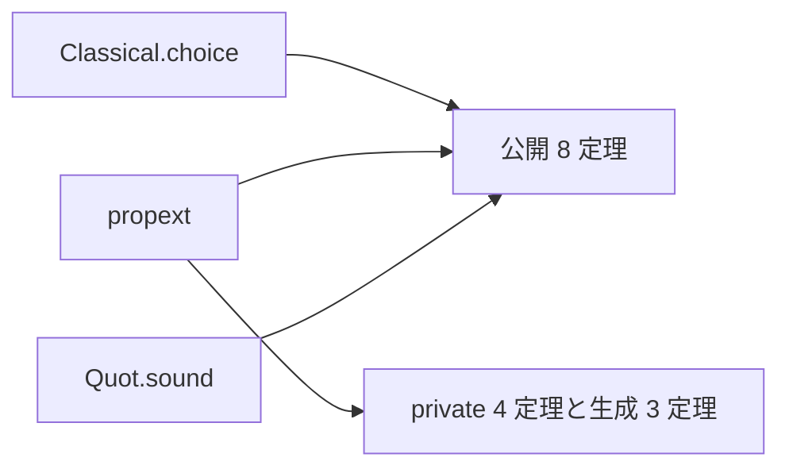
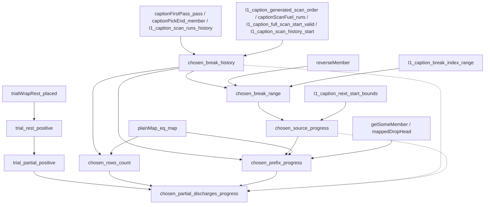

# [root ADR 0352](../adr/0352-prove-pagination-in-lean.md) の改行位置とソースの前進

## 範囲

基準は `ee2d83797` の本体と既存モデルである。
[ChosenSourceProgress.lean](../../experiments/pagination-proof/ChosenSourceProgress.lean) を Lean 4.7.0（`aarch64-apple-darwin`）で検査した。
本体と `Pagination.lean` と `Physical.lean` は変更していない。
この増分は、改行器が選んだ位置から、未消費のソースの次の位置が前進するという条件を導く。
ここでソースとは、シェーピング後のボックス、glue、penalty の列を指す。

本体の [Flow.hs:5046](../../modules/golem-typeset/src/Golem/Typeset/Flow.hs#L5046) は、ソースを `start` から組み直した改行位置に `start` を加える。
[Flow.hs:5049](../../modules/golem-typeset/src/Golem/Typeset/Flow.hs#L5049) の `itemAfterBreak` はその位置の次から走査し、ボックスか強制改行の penalty で止まる。
[Flow.hs:5326](../../modules/golem-typeset/src/Golem/Typeset/Flow.hs#L5326) は、一部を採用したときの最後の改行位置をこの関数へ渡す。

モデルでは、`captionCompared` の選択結果から走査履歴を取り出し、選んだ改行位置がソースの実在する要素であることを導く。
先に有効な位置や履歴を仮定しない。
ソースの接尾部を組み直す場合も同じ証明を使い、相対位置に `start` と一つを加えてから既存の `captionNextSourceStart` を適用する。
結果は元の `start` より後で、ソースの長さ以下になる。

さらに、`trialWrap` の成功した部分採用は、一行以上を採ることを導く。
採用数の下限には既存の `trialWrapRest_placed` を使い、空の入力を除く部分採用の条件を `trialWrapFrom` と `trialWrap` の分岐へ接続した。
その行列を選択した改行位置と次の位置から作ると、`PhysicalPagination.parts` が `noProgress` の判定に使う二つの条件を導ける。
結論は `start < nextItem rows count start` と `start < source.length` である。
ソースの前進自体を仮定せず、選択された走査と部分採用の結果から得る。

これは、この行列を作るモデルとソースの前進の条件についての接続である。
本体の任意の `Composed` の計測値、行の値、`brPositions` をこのモデルへ写す一般的な対応は残る。
別の `noProgress` の条件である再試行の行数上限の減少や、全制御、内容の全量の保存も未完了である。
モデルの上限は `Option Nat` であり、本体の内部の `Maybe Int` に負数を渡す場合まで保証しない。
実際の呼び出しで上限がどのように作られるかとの接続も、この区別を保って調べる。
ソース位置もモデルでは `Nat` なので、本体の `Int` の範囲についての確認は残る。

## 定理と公理

Lean の環境で、名前付き宣言の種類、型、elaboration 後の証明項を照合した。
手書きの公開定理 8 件、手書きの private 定理 5 件、生成定理 15 件、手書き定義 2 件、生成定義 32 件、公理宣言 0 件だった。
28 定理すべてで公理依存を調べた。
生成された補助定理の名前の解決に依存しないよう、一時環境で元の定理を参照する同じ型の別名を作り、その別名へ `#print axioms` を実行した。
別名は kernel が検査する定理であり、元の定理以外を証明として加えない。

公開 8 定理はいずれも `propext`、`Classical.choice`、`Quot.sound` に依存する。
以下では、この三つを「標準三公理」と略す。

| 完全修飾名 | 位置 | 前提と結論 |
| --- | --- | --- |
| `GolemPagination.root_adr0352_i4_chosen_break_history` | [ChosenSourceProgress.lean:8](../../experiments/pagination-proof/ChosenSourceProgress.lean#L8) | `captionCompared` の選択結果から、そのノードの候補と行数と履歴の条件を導く。 |
| `GolemPagination.root_adr0352_i4_chosen_break_range` | [ChosenSourceProgress.lean:45](../../experiments/pagination-proof/ChosenSourceProgress.lean#L45) | 選択結果の改行位置が入力の長さより小さい。 |
| `GolemPagination.root_adr0352_i4_chosen_source_progress` | [ChosenSourceProgress.lean:59](../../experiments/pagination-proof/ChosenSourceProgress.lean#L59) | ソースの接尾部の選択結果から、次の位置が `start` より後で、元のソースの長さ以下だと導く。 |
| `PhysicalPagination.root_adr0352_i4_trial_rest_positive` | [ChosenSourceProgress.lean:79](../../experiments/pagination-proof/ChosenSourceProgress.lean#L79) | 試し置きの後半が配置結果を返せば、採用数は正である。 |
| `PhysicalPagination.root_adr0352_i4_trial_partial_positive` | [ChosenSourceProgress.lean:88](../../experiments/pagination-proof/ChosenSourceProgress.lean#L88) | 試し置きが成功し行列の一部を採用した場合、その数は正である。 |
| `GolemPagination.root_adr0352_i4_chosen_rows_count` | [ChosenSourceProgress.lean:153](../../experiments/pagination-proof/ChosenSourceProgress.lean#L153) | 改行位置と次の位置を持つ行列の長さが、選択されたノードの行数と等しい。 |
| `GolemPagination.root_adr0352_i4_chosen_prefix_progress` | [ChosenSourceProgress.lean:162](../../experiments/pagination-proof/ChosenSourceProgress.lean#L162) | 正でノードの行数以下の採用数について、`nextItem` とソース長の条件を導く。 |
| `GolemPagination.root_adr0352_i4_chosen_partial_discharges_progress` | [ChosenSourceProgress.lean:182](../../experiments/pagination-proof/ChosenSourceProgress.lean#L182) | 選択された接尾部から作る行列の部分採用の結果から、`parts` のソース前進の条件を導く。正の採用数も別に仮定しない。 |

private 宣言の共通接頭辞は `_private.experiments.«pagination-proof».ChosenSourceProgress.0.GolemPagination.` である。
次の接尾辞を加えたものが各宣言の完全修飾名になる。

| 接尾辞 | 位置 | 内容 | 公理 |
| --- | --- | --- | --- |
| `inAppend` | 26 | 連結した列への所属を二つの列への所属へ分ける。 | `propext` |
| `reverseMember` | 32 | 逆順の列の要素がもとの列にも属する。 | `propext` |
| `getSomeMember` | 114 | 有効な位置に、その列に属する要素がある。 | なし |
| `mappedDropHead` | 125 | 写像した列の指定位置の先頭と、指定位置を読んだ後の写像が等しい。 | `propext` |
| `plainMap_eq_map` | 137 | 単純再帰で書いた写像が標準の `List.map` と等しい。 | `propext` |
| `plainMap` | 133 | 単純再帰の写像。定義であり定理ではない。 | 該当なし |

もう一つの手書き定義は `GolemPagination.chosenSourceRows`（145 行）である。
各改行位置に、行の値と次のソース位置を対応付ける。
行の値を作る関数は任意で、ソース位置の証明はその値の内容を読まない。

生成定理の完全修飾名と公理は次のとおりである。
生成位置は取得できなかった。

| 完全修飾名 | 公理 |
| --- | --- |
| `_private.experiments.«pagination-proof».ChosenSourceProgress.0.GolemPagination.captionScanFuel.match_1.eq_2` | なし |
| `_private.experiments.«pagination-proof».ChosenSourceProgress.0.PhysicalPagination.trial.match_1.eq_2` | なし |
| `_private.experiments.«pagination-proof».ChosenSourceProgress.0._private.experiments.«pagination-proof».ChosenSourceProgress.0.GolemPagination.plainMap._eq_1` | なし |
| `experiments.«pagination-proof».ChosenSourceProgress._auxLemma.2` | `propext` |
| `experiments.«pagination-proof».ChosenSourceProgress._auxLemma.1` | `propext` |
| `_private.experiments.«pagination-proof».ChosenSourceProgress.0._private.experiments.«pagination-proof».ChosenSourceProgress.0.GolemPagination.plainMap.match_1.eq_1` | なし |
| `_private.experiments.«pagination-proof».ChosenSourceProgress.0.PhysicalPagination.putLines.match_2.eq_1` | なし |
| `_private.experiments.«pagination-proof».ChosenSourceProgress.0.GolemPagination.MeasuredCaptionItem.insideWidth.match_1.eq_1` | なし |
| `_private.experiments.«pagination-proof».ChosenSourceProgress.0.PhysicalPagination.trial.match_1.eq_1` | なし |
| `_private.experiments.«pagination-proof».ChosenSourceProgress.0._private.experiments.«pagination-proof».ChosenSourceProgress.0.GolemPagination.plainMap.match_1.eq_2` | なし |
| `experiments.«pagination-proof».ChosenSourceProgress._auxLemma.3` | `propext` |
| `_private.experiments.«pagination-proof».ChosenSourceProgress.0._private.experiments.«pagination-proof».ChosenSourceProgress.0.GolemPagination.plainMap._eq_2` | なし |
| `_private.experiments.«pagination-proof».ChosenSourceProgress.0.GolemPagination.captionScanFuel.match_1.eq_1` | なし |
| `_private.experiments.«pagination-proof».ChosenSourceProgress.0.GolemPagination.MeasuredCaptionItem.insideWidth.match_1.eq_2` | なし |
| `_private.experiments.«pagination-proof».ChosenSourceProgress.0.PhysicalPagination.putLines.match_2.eq_2` | なし |

生成定義は、分岐の補助関数と、インポートした定義を証明で使うための補助宣言である。
全 28 定理の内訳は、標準三公理に依存する 8 件、`propext` だけの 7 件、公理に依存しない 13 件だった。
新しい公理は宣言していない。

| 標準公理 | Lean 4.7.0 の位置 | 内容 |
| --- | --- | --- |
| `Classical.choice` | `Init.Prelude:730` | `Nonempty α` から要素を選ぶ。 |
| `propext` | `Init.Core:1287` | 命題の同値から等式を導く。 |
| `Quot.sound` | `Init.Core:1459` | 関係を満たす二要素が同じ商の値を持つ。 |

公理の図は、補助定理や定義を経由する推移的依存を示す。



次の図の実線は型か証明項の定理の直接参照である。
破線はほかの定理を経由する間接依存である。
標準の等式と算術の補題は省いた。



対象ソースに `sorry`、`admit`、`sorryAx` の使用はない。
Lean の diagnostic と 28 定理の公理依存にも証明の穴はなかった。
今回の範囲に、穴の影響を受ける定理はない。

## 実装との境界照合

[ChosenSourceProgress.hs](../../experiments/pagination-proof/ChosenSourceProgress.hs) は、実フォントで組んだ三つの段落に対して、開始位置四つと行長三つから 36 個の接尾部を作る。
実装の非公開の `rebreakComposed` で組み直し、行数と改行位置数が等しいことを検査する。
選ばれた 79 個の改行位置で、その位置が接尾部と元のソースの範囲内にあり、`itemAfterBreak` の結果が `start` より後でソース長以下であることを検査した。

さらに、実フォントのボックスと、glue、通常の penalty、改行禁止の penalty、強制改行の penalty を含む列で六つの境界を検査する。
合計 85 件は、実装から得た次の位置と元の要素の種類を Lean の例として出力し、`captionNextSourceStart` の計算値と `decide` で一致させた。
空のソースで選択結果がない場合まで、前進すると仮定していない。

改行位置の上限を一つ狭める、一つ進める処理を落とす、行列を重複させる、最低採用数を二行とする四つの誤変更は、Lean の証明で拒否された。
実装から出した次の位置を一つずらす誤変更も、生成例の検査で拒否された。

この観測は、[check-built-first-ids.sh](../../experiments/pagination-proof/check-built-first-ids.sh) で export list だけを公開した一時ソースを使う。
export list より後の本体は `cmp` で元と一致させる。
本番の API は変えず、通常の CLI の検証とも区別する。
GHC 9.10.3 と、`0aa78f65ac691cdd8d1a3bd5fc4c8bffb1feabdb` の既存 runtime DB の登録済み package ID を読み取り専用で使った。
本体の `modules/` は今回の基準の版と一致する。
標準 Cabal 環境を新規構築したという検証ではない。
Cabal plan と package cache の実行前後の SHA-256 は一致した。

`check.sh` 全体も終了コード 0 で通った。
既存の 55,838 件と 156,520 件の配置、10,368 件の回り込み、4,864 件の因果的配置、216 件の制御、34,586 件の改行、実フォントのキャプション 40 件、Alloy 42 件の対応検査を含む。

```sh
set -e
RUNGHC=/private/tmp/golem-0352-built-probe-nov28/runner \
  sh experiments/pagination-proof/check-built-first-ids.sh \
  "$PWD/experiments/pagination-proof/ChosenSourceProgress.hs" > /tmp/SourceProgressExamples.lean
LEAN_PATH=/private/tmp/golem-0352-numbered-output-cache-nov28 \
  /Users/tett23/.elan/toolchains/leanprover--lean4---v4.7.0/bin/lean /tmp/SourceProgressExamples.lean
```

本体の全種類の原稿とモデルの行列の一般的な対応、再試行する上限の減少、全制御、内容の全量と順序、一般のキャプションの接続は残る。
[root ADR 0352](../adr/0352-prove-pagination-in-lean.md) 全体は採択済みで未実装のままである。
