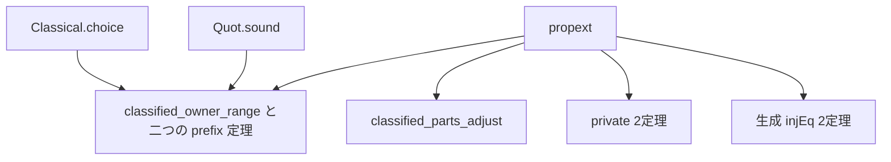
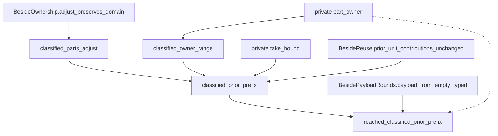

# [root ADR 0352](../adr/0352-prove-pagination-in-lean.md) の単位の分類と採番 prefix

## 範囲

基準は `bd4c18f31` の本体と既存モデルである。
[ClassifiedPrefix.lean](../../experiments/pagination-proof/ClassifiedPrefix.lean) を Lean 4.7.0（`aarch64-apple-darwin`）で検査した。
本体と公開 API は変更していない。
この増分は、[先行単位の採番増分](0352-prior-unit-counts-dependencies.md) の所有者の範囲と表の型の前提を、単位の添字と到達した cache から導く。

`CountSlot` は、表、固定の採番増分を持つ普通の単位、回り込み図版の三つを区別する。
表は既存の skip より先に固定件数を返す。
残りの単位は、skip の対象か、脇の本文の表に同じキーがあれば 0 とする。
それ以外では普通の単位は固定件数、回り込み図版は自身の 1 と選択した本文の行数を寄与する。
本体の回り込みの採番に入る図版だけを `wrapped` に対応させる。
診断でこの分岐に入らない場合などは固定の増分として扱う。
固定件数そのものはモデルの入力であり、この増分で本体の全分岐の計算式を再実装したとは扱わない。

`classifiedParts` は現在の添字を順に増やし、この分類から寄与を作る。
回り込み図版の所有者を、呼び出し側が任意の番号の列として渡す構成ではない。
対象の所有者より前の `take owner` の範囲を使い、そこで選んだ所有者が対象より前にあることを導く。
本文の値を `adjustBeside` で変えてもキーの存在は変わらないので、この分類も変わらない。

この結果を既存の先行単位の採番増分の定理へ渡す。
対象の本文を変えても、対象の所有者より前の採番増分の列は変わらない。
最後の定理では、[空の cache からの到達](0352-payload-rounds-dependencies.md) を使って表の型も導く。
先行所有者の範囲と型を、最終定理の自由な前提として残さない。

本体の [numberUnit](../../modules/golem-typeset/src/Golem/Typeset/Flow.hs#L4424) は表を先に処理する。
[numberOther](../../modules/golem-typeset/src/Golem/Typeset/Flow.hs#L4540) は既存の制御と脇の本文を先に除く。
回り込み図版は [numberFigure](../../modules/golem-typeset/src/Golem/Typeset/Flow.hs#L4570) で自身の 1 と選択した本文の行数を数える。
コードは [numberCode](../../modules/golem-typeset/src/Golem/Typeset/Flow.hs#L4627) で行の ID を増やす。

回り込みの再試行の [rebuild](../../modules/golem-typeset/src/Golem/Typeset/Flow.hs#L5064) は、同じ入力、版面、環境、単位と幅を使う。
本文の更新は [cuBesides だけの更新](../../modules/golem-typeset/src/Golem/Typeset/Flow.hs#L5299) であり、通常の単位、表、コード、既存の制御の格納値は変えない。
この増分はその分類をモデル化するが、固定件数と本体の全分岐の一般的な対応は未証明である。

## 定理と公理

Lean の環境から宣言の種類、型、elaboration 後の証明項を取得した。
公開定理 4 件、手書きの private 定理 2 件、生成定理 17 件、定義 29 件、公理宣言 0 件だった。
定義は手書きの private `part` と公開 `classifiedParts` の 2 件と生成定義を含む。
別に三つの構築子を持つ型 `CountSlot` を加えた。
全 23 定理について、元の定理を参照する同じ型の別名を一時環境に作り、`#print axioms` を実行した。
別名も kernel が検査する。

公開名には共通接頭辞 `BesideClassifiedPrefix.` を付ける。
標準三公理は `propext`、`Classical.choice`、`Quot.sound` を指す。

| 名前 | 位置 | 前提と結論 | 公理 |
| --- | --- | --- | --- |
| `root_adr0352_i5_classified_parts_adjust` | [20 行](../../experiments/pagination-proof/ClassifiedPrefix.lean#L20) | 本文の値だけを更新しても、同じ添字と単位の分類は変わらない。 | `propext` |
| `root_adr0352_i5_classified_owner_range` | [39 行](../../experiments/pagination-proof/ClassifiedPrefix.lean#L39) | 分類で得た所有者は、列の開始位置から単位の数までの範囲内にある。 | 標準三公理 |
| `root_adr0352_i5_classified_prior_prefix` | [65 行](../../experiments/pagination-proof/ClassifiedPrefix.lean#L65) | 本文の表の型、対象の図版と選択された本文の条件から、対象より前の分類済みの採番増分が更新前後で一致する。 | 標準三公理 |
| `root_adr0352_i5_reached_classified_prior_prefix` | [80 行](../../experiments/pagination-proof/ClassifiedPrefix.lean#L80) | 空の cache からの到達、対象の図版と本文の選択の条件から、分類済みの先行採番増分の一致を導く。 | 標準三公理 |

private 宣言の共通接頭辞は `_private.experiments.«pagination-proof».ClassifiedPrefix.0.BesideClassifiedPrefix.` である。
private 定義 `part` は [11 行](../../experiments/pagination-proof/ClassifiedPrefix.lean#L11) の分類である。

| 定理 | 位置 | 前提と結論 | 公理 |
| --- | --- | --- | --- |
| `part_owner` | [28 行](../../experiments/pagination-proof/ClassifiedPrefix.lean#L28) | 所有者を持つ分類なら、その所有者は分類した添字そのものである。 | `propext` |
| `take_bound` | [55 行](../../experiments/pagination-proof/ClassifiedPrefix.lean#L55) | 指定数だけ取った列の長さは、その指定数以下である。 | `propext` |

型から生成された次の 7 定理は、共通接頭辞 `BesideClassifiedPrefix.CountSlot.` を付ける。
生成位置は取得できなかった。

| 名前 | 由来 | 公理 |
| --- | --- | --- |
| `table.inj`, `ordinary.inj` | 固定件数を持つ構築子の単射性 | なし |
| `table.injEq`, `ordinary.injEq` | 構築子の等式の分解 | `propext` |
| `table.sizeOf_spec`, `ordinary.sizeOf_spec`, `wrapped.sizeOf_spec` | 構築子の大きさの規則 | なし |

残りの生成定理 10 件の共通接頭辞は `_private.experiments.«pagination-proof».ClassifiedPrefix.0.` である。
表の名前の後ろへ列挙した suffix をそれぞれ付けると、全 10 件の名前になる。
いずれも公理に依存せず、生成位置は取得できなかった。

| 名前の前半 | suffix | 由来 |
| --- | --- | --- |
| `BesideClassifiedPrefix.classifiedParts` | `._eq_1`, `._eq_2`, `.match_1.eq_1`, `.match_1.eq_2` | 分類の再帰の分岐の等式 |
| `List.take` | `._eq_1`, `._eq_2`, `._eq_3` | 列の先頭を取る処理の簡約 |
| `List.drop` | `.match_1.eq_1`, `.match_1.eq_2`, `.match_1.eq_3` | 列を送る処理の簡約 |

標準公理には、既存の証明や算術の補助定理を経由する依存も含む。
`propext` は命題の同値からの等値（Lean の `Init/Core.lean:1287`）、`Classical.choice` は空でない型からの選択（`Init/Prelude.lean:730`）、`Quot.sound` は同値関係で結ばれた値の商での等値（`Init/Core.lean:1459`）である。
対象内に新しい公理宣言はない。

公理の図の矢印は推移的な依存を示す。
公理に依存しない生成定理 15 件は図から除いた。



定理の図では実線を elaboration 後の型か証明項の直接参照、点線を示した補助定理を経由する依存とする。
標準の論理と算術の補助定理は省略し、今回の全手書き定理と必要な既存定理を載せた。



公開定理のラベルには共通接頭辞 `root_adr0352_i5_` を付ける。
今回の公開定理にはさらに `BesideClassifiedPrefix.` を付ける。
private の名前は上の表の接頭辞を使う。

## 境界と実装との照合

先に境界を追加し、正規の `LEAN_PATH` で検査すると未定義の namespace と API のため終了コード 1 になった。
実装した後は直接の境界 11 件が kernel で通った。
表、普通の単位、回り込み図版、既存の skip、本文の存在、範囲の開始位置、空の prefix、本文を 0 行へ変える場合を含む。
表を先に扱う直接境界は、内部の分類の値の試験であり、通常 CLI で生成した入力と混同しない。

[ClassifiedPrefix.hs](../../experiments/pagination-proof/ClassifiedPrefix.hs) は、Noto Serif JP の実フォントで有効な原稿を構成した。
原稿は普通の段落、表、二行のコード、改ページ、二つの回り込み図版と三つの脇の段落を持つ。
さらに、最初の図版の脇の段落の間に改段の制御を置く。
表とコードの採番増分が正であること、図版に属する制御が存在すること、本文のキーが現在の段落を指すこと、単位の添字が連続することを検査した。

最初の図版より前の採番増分は `[1, 2, 2, 0]` だった。
既存の制御の skip には真の位置も含み、モデルへ実際の集合を渡す。
固定件数は、更新前の本体の `numberUnit` の `nuNext` の増分から得る。
これは本体の全分岐の計算式をモデルから独立に導いたという意味ではない。

モデルの初期の payload cache も生成し、その組が観測した本文のキーと行数に一致することを一つの閉じた式で確認した。
更新前の本文の表は、その cache の組から作る。
そこから三つの本文について、組み終えた行の列だけを 0、1、3、7 行へ変え、実際の `numberComposedFlow` を実行した。
この 12 件は組版後の行の列の直接変更であり、12 件の原稿を通常 CLI で組み直した結果ではない。

各変更では、対象の所有者より前の全単位の採番増分と二段階の first ID を本体と比較した。
また、同じ初期 cache に到達することと図版と本文の選択を具体的に確認し、`reached_classified_prior_prefix` を各変更へ適用した。
初期 cache の組の一致 1 件と、各変更での prefix の照合、定理の適用、first ID の照合各 12 件の計 37 式が kernel で通った。
Lean の診断はなかった。

検証した runtime のソースは `0aa78f65ac691cdd8d1a3bd5fc4c8bffb1feabdb`、コンパイラは GHC 9.10.3 である。
既存の package database を読み取り専用で使い、この tree の通常の Cabal 環境を再構築した検証とは区別する。
private 宣言の観測には既存の adapter を使い、module の export 以外のソースが変わっていないことを比較した。
共用の package database や cache は変更しない。

```sh
CLASSIFIED_PREFIX_LEAN=1 RUNGHC=/private/tmp/golem-0352-built-probe-nov28/runner \
  sh experiments/pagination-proof/check-built-first-ids.sh \
  "$PWD/experiments/pagination-proof/ClassifiedPrefix.hs" > /private/tmp/golem-0352-classified-prefix-reached-examples-nov28.lean
LEAN_PATH=/private/tmp/golem-0352-numbered-output-cache-nov28 \
  /Users/tett23/.elan/toolchains/leanprover--lean4---v4.7.0/bin/lean \
  /private/tmp/golem-0352-classified-prefix-reached-examples-nov28.lean
```

回り込み図版の所有者を一つ先の添字にする変異は、所有者が現在の添字であることの証明で失敗した。
表に skip を先に適用する変異では、一時コピーの補助証明をその分岐へ合わせると、prefix の不変性の定理は通った。
しかし、表を先に採番する直接境界は kernel で偽となり、終了コード 1 で拒否した。
この違いは、不変性の証明と本体の分類との対応を別に確かめる必要を示す。
本体や正規のモデルを変異へ置き換えたままにはしていない。

既存のローカル `check.sh` に、このモデルと境界を接続し、全体の終了コード 0 を確認した。
grid 55,838 件、free 156,520 件、回り込みの試し置き 10,368 件、causal 4,864 件、制御の 216 件、改行の評価 34,586 件、実フォントの caption 40 件、Alloy の 42 コマンドの Lean への対応を保った。
Alloy の件数は既存の対応の検査であり、今回 solver を新しく 42 回実行した意味ではない。
新しい CI workflow は追加していない。

読み取り前後の plan の SHA-256 は `981a01138b41bf0d6b1e8ea82155b2ed1227297b7339699bbc60005bc4c83957`、package database の `package.cache` は `dd7fdb3fca241d4a7039e18fccf8ff7065a265540225c2cf813e5b07cbe75fc8` で一致した。
この tree と検証した runtime の `modules/` の差分も空だった。

## 残件

対象の Lean の診断と全 23 定理の公理依存に、証明の穴はなかった。
`sorry`、`admit`、`sorryAx` の候補も対象ソースにはなかった。
先行所有者の範囲と到達した表の型は導いたが、固定件数の算出と本体の全分岐との一般的一致は残る。
Map の内部、Int と Nat の対応、前の payload の妥当性、IO と状態更新も未証明である。

また、`Built` と `hb` の全呼び出し元、全制御、本文の全量と順序、`captionCompared` と改行器の一般的一致も残る。
[末尾保持の再試行の反例](0352-last-retry-counter-dependencies.md) はこの増分では変更していない。
root [ADR 0352](../adr/0352-prove-pagination-in-lean.md) の全範囲は未完了のままである。
