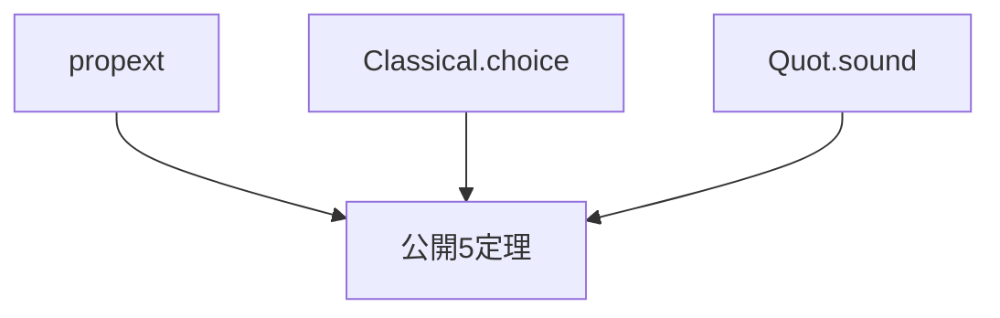
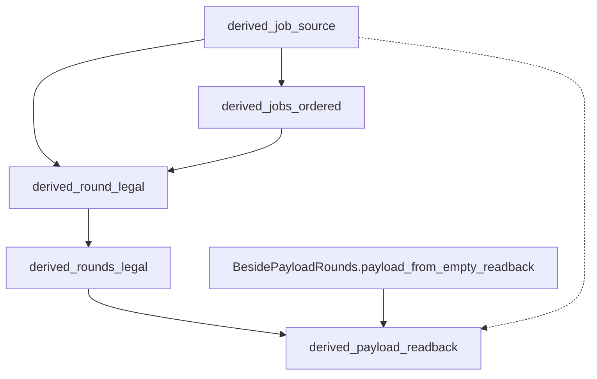

# [root ADR 0352](../adr/0352-prove-pagination-in-lean.md) の図版 job の生成

## 範囲

基準は `358c5590e` の本体と既存モデルである。
[DerivedJobs.lean](../../experiments/pagination-proof/DerivedJobs.lean) を Lean 4.7.0（`aarch64-apple-darwin`）で検査した。
本体と公開 API は変更していない。
この増分は、[payload cache の帰納](0352-payload-rounds-dependencies.md) に必要な job の所有者の順序と図版の条件を、添字の走査から導く。

`jobsFrom` は、指定した開始位置から一定個数の添字を順に走査する。
その位置の現在の単位が図版で、選択の callback が真を返したときだけ job を作る。
job は、その位置、全体の個数から後ろに残る個数、その位置の状態を持つ。
図版以外の単位が選択されても job は作らない。

生成された job の所有者が走査した範囲内にあり、現在の単位が図版であることを、再帰から導く。
所有者の昇順も同じ再帰から導く。
`derivedRound` は開始位置を 0、走査数を現在の全体の個数とし、元の round の job をこの生成結果に置き換える。
このモデルの生成結果については、job の合法性を自由な前提として残さない。

`derivedRounds` は、round ごとの選択と状態の callback を使って、任意の round の列の job を生成する。
生成した各 round が合法であることを導き、空の payload cache からの格納と読み取りの定理へ渡す。
ただし、このモデルと本体の全ての job の生成との一般的一致は、証明していない。

本体は、[現在の図版の表](../../modules/golem-typeset/src/Golem/Typeset/Flow.hs#L4865) を現在の `UFigure` の単位から作る。
[job の生成](../../modules/golem-typeset/src/Golem/Typeset/Flow.hs#L4867) は、その表を `Map.toList` で列挙し、caption の行の列が空で、回り込みの exclusion がある図版を選ぶ。
モデルの選択 callback は、この図版の配置後の選択を表す。
配置や caption の計算そのものは、この増分ではモデル化していない。
Map の列挙の意味論と現在の単位の添字との一般的な接続も残る。

## 宣言と公理

Lean の環境から、宣言の種類、型、elaboration 後の証明項を取得した。
公開定理 5 件、生成定理 12 件、定義 27 件、公理宣言 0 件だった。
手書きの private 定理はない。
定義は手書きの 3 件と生成定義を含む。
全 17 定理について、元の定理を参照する同じ型の別名を一時環境に作り、`#print axioms` を実行した。
別名も kernel が検査する。

次の公開名には、共通接頭辞 `BesideDerivedJobs.` を付ける。
標準三公理は `propext`、`Classical.choice`、`Quot.sound` を指す。

| 名前 | 位置 | 前提と結論 | 公理 |
| --- | --- | --- | --- |
| `root_adr0352_i5_derived_job_source` | [14 行](../../experiments/pagination-proof/DerivedJobs.lean#L14) | 生成された job の所有者は走査の範囲内で、現在の図版を指す。選択条件、残りの個数、渡す状態も生成元と一致する。 | 標準三公理 |
| `root_adr0352_i5_derived_jobs_ordered` | [34 行](../../experiments/pagination-proof/DerivedJobs.lean#L34) | 添字を順に走査して生成した job の所有者は昇順になる。 | 標準三公理 |
| `root_adr0352_i5_derived_round_legal` | [52 行](../../experiments/pagination-proof/DerivedJobs.lean#L52) | 一つの round の job を生成し直すと、所有者の順序と図版の条件を満たす。 | 標準三公理 |
| `root_adr0352_i5_derived_rounds_legal` | [64 行](../../experiments/pagination-proof/DerivedJobs.lean#L64) | round ごとの選択と状態が任意でも、生成し直した列の全 round が job の条件を満たす。 | 標準三公理 |
| `root_adr0352_i5_derived_payload_readback` | [76 行](../../experiments/pagination-proof/DerivedJobs.lean#L76) | この job の生成を使う任意の round 列で、空の cache から到達した組を同じキー順で読み戻せる。 | 標準三公理 |

最初の定理の範囲は、任意の `start` と `fuel` に対する `start ≤ owner < start + fuel` である。
この定理だけで、任意の引数について所有者が全体の個数より小さいとは主張しない。
`derivedRound` が `start = 0`、`fuel = count` を渡すことで、全体の個数の範囲になる。

生成定理 12 件の共通接頭辞は `_private.experiments.«pagination-proof».DerivedJobs.0.` である。
いずれも公理に依存しない。
位置は取得できなかったため、由来と完全名で区別する。

| 名前 | 由来 |
| --- | --- |
| `BesideDerivedJobs.jobsFrom._eq_1` | job の生成の空の場合 |
| `BesideDerivedJobs.jobsFrom._eq_2` | job の生成の再帰の場合 |
| `BesideDerivedJobs.jobsFrom.match_1.eq_1` | job の生成の分岐の等式 |
| `BesideDerivedJobs.jobsFrom.match_1.eq_2` | job の生成の分岐の等式 |
| `BesideReuse.jobsOrdered._eq_1` | 既存の順序条件の空の場合の簡約 |
| `BesideReuse.jobsOrdered._eq_2` | 既存の順序条件の再帰の場合の簡約 |
| `BesideReuse.jobsOrdered.match_1.eq_1` | 順序条件の分岐の等式 |
| `BesideReuse.jobsOrdered.match_1.eq_2` | 順序条件の分岐の等式 |
| `BesideDerivedJobs.derivedRounds._eq_1` | round 列の生成の空の場合 |
| `BesideDerivedJobs.derivedRounds._eq_2` | round 列の生成の再帰の場合 |
| `BesideDerivedJobs.derivedRounds.match_1.eq_1` | round 列の分岐の等式 |
| `BesideDerivedJobs.derivedRounds.match_1.eq_2` | round 列の分岐の等式 |

標準公理は既存の証明や算術の補助定理を経由しても使う。
`propext` は命題の同値からの等値（Lean の `Init/Core.lean:1287`）、`Classical.choice` は空でない型からの選択（`Init/Prelude.lean:730`）、`Quot.sound` は同値関係で結ばれた値の商での等値（`Init/Core.lean:1459`）である。
対象内に新しい公理宣言はない。
`derivedRound` と `derivedRounds` は `noncomputable` とし、kernel の簡約で検査した。
初期の定義で関数を含む構造体の処理から生成された `_elambda_1` の公理が、最終の環境にはないことも確認した。
これは実行コードを外部の関数へ置き換えたものではない。

公理の図の矢印は推移的な依存を示す。
公理に依存しない生成定理 12 件は図から除いた。



定理の図では実線を elaboration 後の型か証明項の直接参照、点線を示した補助定理を経由する依存とする。
標準の論理と算術の補助定理は省略し、今回の全公開定理と接続した既存定理を載せた。



図のラベルには共通の接頭辞 `root_adr0352_i5_` を付ける。
今回の定理にはさらに `BesideDerivedJobs.` を付ける。

## 検査

先に境界を追加し、正規の `LEAN_PATH` で検査すると未定義の namespace と API のため終了コード 1 になった。
実装した後は、境界 11 件が kernel で通った。
全位置の選択、選択なし、一つの図版だけの選択、走査数 0、図版を含まない途中の範囲、図版から始まる一つの走査、末尾を過ぎた走査を含む。
段落と制御を選択しても job を作らないことも確認した。
一つと二つの round の cache の読み取りも比較した。

本体との照合は、[DerivedJobs.hs](../../experiments/pagination-proof/DerivedJobs.hs) で行った。
実フォントの初期原稿から、同じ原稿、段落の短縮、旧本文位置への図版、要素の削除、制御の挿入という六つの入力を使う。
各変更で前の `Built` を渡す場合と渡さない場合の行数と採番を比較した。
本体の図版の表から得た選択の真偽と、現在の単位の種別と個数をモデルへ渡す。
モデルの走査で生成した job の所有者と残りの長さを、本体の所有者と現在の単位数から算定した列と比較した。
六つの閉じた式が一致した。
本体の job 自体は所有者と図版の配置を持ち、fuel のフィールドを持つと主張するものではない。

同じ生成した job を使い、前の組の列から作る表を round 間で渡す。
六つの到達結果で、キー、行数、offset の列を本体と比較した。
job の列 6 件と payload の列 6 件の計 12 式が kernel で通り、Lean の診断はなかった。
観測した行数と offset は新規生成 callback の表として使うため、整形や offset の算出の一般的な正しさの証明とは区別する。
入力は caption のない回り込み図版であり、caption の計算をこの照合で確かめたとは扱わない。

検証した runtime のソースは `0aa78f65ac691cdd8d1a3bd5fc4c8bffb1feabdb`、コンパイラは GHC 9.10.3 である。
既存の package database を読み取り専用で使い、この tree の通常の Cabal 環境を再構築した検証とは区別する。
private 宣言の観測には既存の adapter を使い、module の export 以外のソースが変わっていないことを比較した。
共用の package database や cache は変更しない。

```sh
DERIVED_JOBS_LEAN=1 RUNGHC=/private/tmp/golem-0352-built-probe-nov28/runner \
  sh experiments/pagination-proof/check-built-first-ids.sh \
  "$PWD/experiments/pagination-proof/DerivedJobs.hs" > /private/tmp/golem-0352-derived-jobs-examples-nov28.lean
LEAN_PATH=/private/tmp/golem-0352-numbered-output-cache-nov28 \
  /Users/tett23/.elan/toolchains/leanprover--lean4---v4.7.0/bin/lean \
  /private/tmp/golem-0352-derived-jobs-examples-nov28.lean
```

図版の条件を外すモデルの変異は、生成元の条件を証明する箇所で失敗した。
状態を一つ先の添字から取る変異も、生成元との一致の証明で失敗した。
どちらも一時コピーだけで実行し、終了コード 1 だった。
この変異の拒否だけで、本体の全ての変更を検出できるとは扱わない。

既存のローカル `check.sh` に、このモデルと境界の検査を接続し、全体の終了コード 0 を確認した。
grid 55,838 件、free 156,520 件、回り込みの試し置き 10,368 件、causal 4,864 件、制御の 216 件、改行の評価 34,586 件、実フォントの caption 40 件、Alloy の 42 コマンドの Lean への対応を保った。
Alloy の件数は既存の対応の検査であり、今回 solver を新しく 42 回実行した意味ではない。
新しい CI workflow は追加していない。

読み取り前後の plan の SHA-256 は `981a01138b41bf0d6b1e8ea82155b2ed1227297b7339699bbc60005bc4c83957`、package database の `package.cache` は `dd7fdb3fca241d4a7039e18fccf8ff7065a265540225c2cf813e5b07cbe75fc8` で一致した。
この tree と検証した runtime の `modules/` の差分も空だった。

## 残件

対象の Lean の診断と全 17 定理の公理依存に、証明の穴はなかった。
`sorry`、`admit`、`sorryAx` の候補も対象ソースにはなかった。
今回のモデルの job の順序と図版の前提は生成側から導いたが、本体の Map の構築と列挙が全入力でこの走査に一致する証明は残る。
Int と Nat の添字と個数、配置後の選択条件との一般的な対応も未証明である。

また、前の payload の妥当性、callback の IO と状態更新、`Built` と `hb` の全呼び出し元、全制御、本文の全量と順序、`captionCompared` と改行器の一般的一致も残る。
[末尾保持の再試行の反例](0352-last-retry-counter-dependencies.md) はこの増分では変更していない。
root [ADR 0352](../adr/0352-prove-pagination-in-lean.md) の全範囲は未完了のままである。
