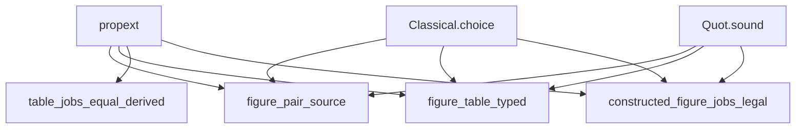
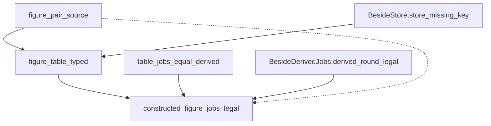

# [root ADR 0352](../adr/0352-prove-pagination-in-lean.md) の現在の図版の表

## 範囲

基準は `ca13bb16f` の本体と既存モデルである。
[FigureTable.lean](../../experiments/pagination-proof/FigureTable.lean) を Lean 4.7.0（`aarch64-apple-darwin`）で検査した。
本体と公開 API は変更していない。
この増分は、[図版 job の生成](0352-derived-jobs-dependencies.md) が検査する図版の型を、現在の図版の表の生成から導く。

本体の [図版の表](../../modules/golem-typeset/src/Golem/Typeset/Flow.hs#L4865) は、現在の `UFigure` の位置だけから作る。
[job の選択](../../modules/golem-typeset/src/Golem/Typeset/Flow.hs#L4867) は、その表の値の最初の診断列が空で、回り込みの exclusion があることを検査する。
job の選択で元の単位が図版かどうかをもう一度検査してはいない。
前のモデルの `jobsFrom` は現在の単位が図版であることも検査するため、この検査が結果を変えない条件を接続する。

`figurePairs` は、現在の単位が図版で、配置の callback が値を返した位置だけを組の列へ加える。
この列を `fromPairs` で格納した表のキーが、現在の図版を指すことを証明する。
配置の callback の値は任意の型であり、配置の計算自体の正しさは仮定にも結論にも含めない。

`tableJobs` は、表にある値について選択条件だけを検査し、現在の単位の種別を検査しない。
表のキーが図版を指すと分かれば、この走査は図版を検査する `jobsFrom` と一致する。
`figurePairs` から作った表にこの性質を適用し、生成した job の順序と図版の条件へ接続する。
最終定理では、この生成した表のキーが図版を指すという自由な前提を残さない。

ただし、`tableJobs` は添字を順に調べる走査であり、本体の `Map.toList` の意味論を直接表す証明ではない。
Map の構築と列挙、配置の callback、現在の単位の添字との一般的な対応は残る。

## 定理と公理

Lean の環境から宣言の種類、型、elaboration 後の証明項を取得した。
公開定理 4 件、生成定理 16 件、定義 38 件、公理宣言 0 件だった。
手書きの private 定理はない。
定義は手書きの 3 件と生成定義を含む。
全 20 定理について、元の定理を参照する同じ型の別名を一時環境に作り、`#print axioms` を実行した。
別名も kernel が検査する。

公開名には共通接頭辞 `BesideFigureTable.` を付ける。
標準三公理は `propext`、`Classical.choice`、`Quot.sound` を指す。

| 名前 | 位置 | 前提と結論 | 公理 |
| --- | --- | --- | --- |
| `root_adr0352_i5_figure_pair_source` | [13 行](../../experiments/pagination-proof/FigureTable.lean#L13) | 生成された組のキーは走査の範囲内で、現在の図版を指す。 | 標準三公理 |
| `root_adr0352_i5_figure_table_typed` | [37 行](../../experiments/pagination-proof/FigureTable.lean#L37) | 生成した組の格納表に存在するキーは、現在の図版を指す。 | 標準三公理 |
| `root_adr0352_i5_table_jobs_equal_derived` | [59 行](../../experiments/pagination-proof/FigureTable.lean#L59) | 表のキーが図版を指すなら、表だけを選択する走査と図版を検査する走査が一致する。 | `propext` |
| `root_adr0352_i5_constructed_figure_jobs_legal` | [73 行](../../experiments/pagination-proof/FigureTable.lean#L73) | 現在の図版から生成した表を選択する job は、所有者の順序と図版の条件を満たす。 | 標準三公理 |

最初の定理の範囲は `start ≤ key < start + fuel` である。
全体の個数の範囲として使う最終定理は、開始位置に 0、走査数に現在の単位の個数を渡す。
配置できなかった図版を、表に存在すると仮定する前提は追加していない。

生成定理 16 件の共通接頭辞は `_private.experiments.«pagination-proof».FigureTable.0.` である。
いずれも公理に依存しない。
生成位置は取得できなかったため、完全名と由来で区別する。

| 名前 | 由来 |
| --- | --- |
| `BesideFigureTable.figurePairs._eq_1` | 図版の組の生成の空の場合 |
| `BesideFigureTable.figurePairs._eq_2` | 図版の組の生成の再帰の場合 |
| `BesideFigureTable.figurePairs.match_1.eq_1` | 生成の分岐の等式 |
| `BesideFigureTable.figurePairs.match_1.eq_2` | 生成の分岐の等式 |
| `BesideFigureTable.figurePairs.match_2.eq_1` | 配置の有無の分岐の等式 |
| `BesideFigureTable.figurePairs.match_2.eq_2` | 配置の有無の分岐の等式 |
| `BesideStore.pairKeys._eq_1` | 既存のキー列を読む空の場合の簡約 |
| `BesideStore.pairKeys._eq_2` | キー列を読む再帰の場合の簡約 |
| `BesideStore.pairKeys.match_1.eq_1` | キー列の分岐の等式 |
| `BesideStore.pairKeys.match_1.eq_2` | キー列の分岐の等式 |
| `BesideDerivedJobs.jobsFrom._eq_1` | 既存の job の生成の空の場合の簡約 |
| `BesideDerivedJobs.jobsFrom._eq_2` | job の生成の再帰の場合の簡約 |
| `BesideDerivedJobs.jobsFrom.match_1.eq_1` | job の生成の分岐の等式 |
| `BesideDerivedJobs.jobsFrom.match_1.eq_2` | job の生成の分岐の等式 |
| `BesideFigureTable.tableJobs._eq_1` | 表の走査の空の場合 |
| `BesideFigureTable.tableJobs._eq_2` | 表の走査の再帰の場合 |

標準公理には既存の証明と算術の補助定理を経由する依存も含む。
`propext` は命題の同値からの等値（Lean の `Init/Core.lean:1287`）、`Classical.choice` は空でない型からの選択（`Init/Prelude.lean:730`）、`Quot.sound` は同値関係で結ばれた値の商での等値（`Init/Core.lean:1459`）である。
対象内に新しい公理宣言はない。

公理の図の矢印は推移的な依存を示す。
公理に依存しない生成定理 16 件は図から除いた。



定理の図では実線を elaboration 後の型か証明項の直接参照、点線を示した補助定理を経由する依存とする。
標準の論理と算術の補助定理は省略し、今回の全公開定理と必要な既存定理を載せた。



図のラベルには共通接頭辞 `root_adr0352_i5_` を付ける。
今回の定理にはさらに `BesideFigureTable.` を付ける。

## 境界と実装との照合

先に境界を追加し、正規の `LEAN_PATH` で検査すると未定義の namespace と API のため終了コード 1 になった。
実装した後は直接の境界 11 件が kernel で通った。
配置の成功と不在、選択する値と選択しない値、非図版の位置に値を返す callback、走査数 0、途中の範囲、格納後の読み取り、選択条件の反転を含む。

[FigureTable.hs](../../experiments/pagination-proof/FigureTable.hs) は、containers の `Data.Map.Strict` と比較する。
段落、制御、その他、配置されない図版、配置されて選ばれない図版、配置されて選ばれる図版という六つの状態を、長さ 0 から 4 まで列挙した。
非図版にも配置の callback が値を返す例を含むが、図版の表はその値を使わない。
1,555 表について、Map の列挙、真の値を選ぶ job の列、偽の値を選ぶ job の列の計 4,665 式が kernel で通った。
これは containers の API の有限な比較であり、Map の内部の一般証明ではない。

[FigureTableFonts.hs](../../experiments/pagination-proof/FigureTableFonts.hs) は、実フォントの初期原稿から、同じ原稿、段落の短縮、旧本文位置への図版、要素の削除、制御の挿入という六つの入力を使う。
前の `Built` を渡す場合と渡さない場合の行数と採番も比較した。
現在の単位と、配置された図版の表から、モデルへ配置と選択の結果を渡す。
本体の図版の値は、最初の診断列が空で、回り込みの exclusion があるかという真偽へ射影する。
この表の列 6 件、選ばれた job の列 6 件、前の payload 表を引き継いだ出力の列 6 件の計 18 式が kernel で通った。
job の残りの長さは、実際の単位数と所有者から算定し、本体の job に fuel のフィールドがあるとは扱わない。

二つの照合の計 4,683 式で Lean の診断はなかった。
実フォントの入力は caption のない回り込み図版であり、caption の計算をこの照合で検証したとは扱わない。
行数と offset は本体で観測した値を callback に渡すため、それらの算出の一般的な正しさの証明とは区別する。

検証した runtime のソースは `0aa78f65ac691cdd8d1a3bd5fc4c8bffb1feabdb`、コンパイラは GHC 9.10.3 である。
既存の package database を読み取り専用で使い、この tree の通常の Cabal 環境を再構築した検証とは区別する。
private 宣言の観測には既存の adapter を使い、module の export 以外のソースが変わっていないことを比較した。
共用の package database や cache は変更しない。

```sh
/private/tmp/golem-0352-numbered-tools-nov28/runghc-driver -package=containers \
  experiments/pagination-proof/FigureTable.hs > /private/tmp/golem-0352-figure-table-examples-nov28.lean
FIGURE_TABLE_LEAN=1 RUNGHC=/private/tmp/golem-0352-built-probe-nov28/runner \
  sh experiments/pagination-proof/check-built-first-ids.sh \
  "$PWD/experiments/pagination-proof/FigureTableFonts.hs" > /private/tmp/golem-0352-figure-table-fonts-examples-nov28.lean
```

両方の出力を `LEAN_PATH=/private/tmp/golem-0352-numbered-output-cache-nov28` と Lean 4.7.0 で検査した。
図版の組を作る際の型の条件を外すモデルの変異は、生成元の型の証明で失敗した。
native の Map の列挙を逆順にする変異は、生成した閉じた式の kernel 検査で失敗した。
いずれも一時コピーだけで実行し、終了コード 1 だった。
これだけで本体の全ての変更を検出できるとは扱わない。

既存のローカル `check.sh` に、このモデルと境界を接続し、全体の終了コード 0 を確認した。
grid 55,838 件、free 156,520 件、回り込みの試し置き 10,368 件、causal 4,864 件、制御の 216 件、改行の評価 34,586 件、実フォントの caption 40 件、Alloy の 42 コマンドの Lean への対応を保った。
Alloy の件数は既存の対応の検査であり、今回 solver を新しく 42 回実行した意味ではない。
新しい CI workflow は追加していない。

読み取り前後の plan の SHA-256 は `981a01138b41bf0d6b1e8ea82155b2ed1227297b7339699bbc60005bc4c83957`、package database の `package.cache` は `dd7fdb3fca241d4a7039e18fccf8ff7065a265540225c2cf813e5b07cbe75fc8` で一致した。
この tree と検証した runtime の `modules/` の差分も空だった。

## 残件

対象の Lean の診断と全 20 定理の公理依存に、証明の穴はなかった。
`sorry`、`admit`、`sorryAx` の候補も対象ソースにはなかった。
生成された表のキーの図版の型は導いたが、本体の Map の構築と列挙が全入力でこの走査に一致する証明は残る。
配置の callback と caption の計算、Int と Nat の添字、前の payload の妥当性、IO と状態更新との一般的な対応も未証明である。

また、`Built` と `hb` の全呼び出し元、全制御、本文の全量と順序、`captionCompared` と改行器の一般的一致も残る。
[末尾保持の再試行の反例](0352-last-retry-counter-dependencies.md) はこの増分では変更していない。
root [ADR 0352](../adr/0352-prove-pagination-in-lean.md) の全範囲は未完了のままである。
