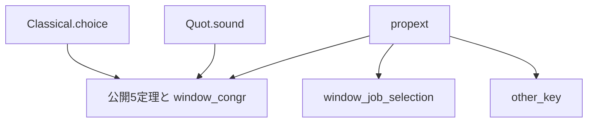
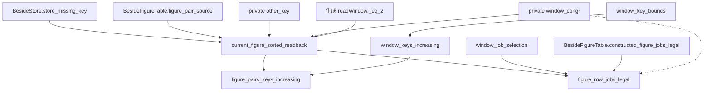

# [root ADR 0352](../adr/0352-prove-pagination-in-lean.md) の図版の表の昇順読み取り

## 範囲

基準は `74e6ec10b` の本体と既存モデルである。
[FigureWindow.lean](../../experiments/pagination-proof/FigureWindow.lean) を Lean 4.7.0（`aarch64-apple-darwin`）で検査した。
本体と公開 API は変更していない。
この増分は、[現在の図版の表](0352-figure-table-dependencies.md) の生成と格納を、添字の範囲を使う読み取りと、その列からの job の選択へ接続する。

`readWindow` は、開始位置から指定数の添字を順に調べ、表にあるキーと値だけを返す。
現在の図版を生成した組を格納し、同じ範囲で読むと、元の組の全値と順序が保たれる。
読み取り範囲に含まれる欠けたキーが、値を作ったり、次の値を失わせたりしないことも含む。
この結果は、読み取るキー列と元の組のキー列が等しいという自由な前提を使わない。

範囲から読むキーはその範囲内にあり、昇順である。
この結果と読み戻しの一致から、元の図版の組のキーの昇順も導く。
値は任意の型のままであり、配置の内容を正しいと仮定して順序を示す構成ではない。

`rowJobs` は、読み取った組の列から、値の選択条件を満たすものだけを job へ写す。
この選択は、表を添字の範囲で調べる `tableJobs` と一致する。
生成した図版の組からの選択にも、この一致を適用して job の順序と図版の条件を導く。
job の状態は添字を受け取る callback の値であり、本体の図版の配置値との一般的な対応は未証明である。

本体の [job の生成](../../modules/golem-typeset/src/Golem/Typeset/Flow.hs#L4867) は、`Map.toList` から得た列を条件で選択する。
今回のモデルは、範囲の読み取りと列の選択との一致を示す。
Haskell の Map の実装や、その `toList` が全入力でこの列と一致することを証明したとは扱わない。

## 定理と公理

Lean の環境から宣言の種類、型、elaboration 後の証明項を取得した。
公開定理 6 件、手書きの private 定理 2 件、生成定理 30 件、定義 50 件、公理宣言 0 件だった。
定義は手書きの 2 件と生成定義を含む。
全 38 定理について、元の定理を参照する同じ型の別名を一時環境に作り、`#print axioms` を実行した。
別名も kernel が検査する。

公開名には共通接頭辞 `BesideFigureWindow.` を付ける。
標準三公理は `propext`、`Classical.choice`、`Quot.sound` を指す。

| 名前 | 位置 | 前提と結論 | 公理 |
| --- | --- | --- | --- |
| `root_adr0352_i5_current_figure_sorted_readback` | [25 行](../../experiments/pagination-proof/FigureWindow.lean#L25) | 現在の図版の組を格納し、生成した範囲で読むと元の組に戻る。 | 標準三公理 |
| `root_adr0352_i5_window_key_bounds` | [57 行](../../experiments/pagination-proof/FigureWindow.lean#L57) | 任意の表から読んだキーは `start ≤ key < start + fuel` を満たす。 | 標準三公理 |
| `root_adr0352_i5_window_keys_increasing` | [75 行](../../experiments/pagination-proof/FigureWindow.lean#L75) | 任意の表の範囲の読み取りで、キーは昇順になる。 | 標準三公理 |
| `root_adr0352_i5_figure_pairs_keys_increasing` | [90 行](../../experiments/pagination-proof/FigureWindow.lean#L90) | 現在の図版から生成した組のキーは昇順になる。 | 標準三公理 |
| `root_adr0352_i5_window_job_selection` | [103 行](../../experiments/pagination-proof/FigureWindow.lean#L103) | 表からの job の選択と、範囲で読んだ組からの job の選択が一致する。 | `propext` |
| `root_adr0352_i5_figure_row_jobs_legal` | [111 行](../../experiments/pagination-proof/FigureWindow.lean#L111) | 生成した図版の組から選ぶ job は、所有者の順序と図版の条件を満たす。 | 標準三公理 |

private 定理の共通接頭辞は `_private.experiments.«pagination-proof».FigureWindow.0.BesideFigureWindow.` である。

| 名前 | 位置 | 前提と結論 | 公理 |
| --- | --- | --- | --- |
| `other_key` | [11 行](../../experiments/pagination-proof/FigureWindow.lean#L11) | 先頭に一つの組を加えても、そのキー以外の格納値は変わらない。 | `propext` |
| `window_congr` | [15 行](../../experiments/pagination-proof/FigureWindow.lean#L15) | 範囲内の全キーで値が等しい表は、その範囲の読み取り結果が等しい。 | 標準三公理 |

生成定理 30 件の共通接頭辞は `_private.experiments.«pagination-proof».FigureWindow.0.` である。
表の名前の後ろへ列挙した suffix をそれぞれ付けると、全 30 件の名前になる。
いずれも公理に依存しない。
生成位置は取得できなかった。

| 名前の前半 | suffix | 件数と由来 |
| --- | --- | --- |
| `BesideFigureWindow.readWindow` | `._eq_1`, `._eq_2`, `.match_1.eq_1`, `.match_1.eq_2`, `.match_2.eq_1`, `.match_2.eq_2` | 6 件。範囲の読み取りの分岐の等式 |
| `BesideFigureWindow.rowJobs` | `._eq_1`, `._eq_2`, `.match_1.eq_1`, `.match_1.eq_2` | 4 件。組の列からの選択の分岐の等式 |
| `BesideFigureTable.figurePairs` | `._eq_1`, `._eq_2`, `.match_1.eq_1`, `.match_1.eq_2`, `.match_2.eq_1`, `.match_2.eq_2` | 6 件。図版の組の生成の分岐の等式 |
| `BesideFigureTable.tableJobs` | `._eq_1`, `._eq_2` | 2 件。既存の表からの選択の簡約 |
| `BesideStore.fromPairs` | `._eq_1`, `._eq_2`, `.match_2.eq_1`, `.match_2.eq_2` | 4 件。格納の簡約 |
| `BesideStore.pairKeys` | `._eq_1`, `._eq_2`, `.match_1.eq_1`, `.match_1.eq_2` | 4 件。キー列の簡約 |
| `BesideOwnership.Increasing` | `._eq_1`, `._eq_2`, `.match_1.eq_1`, `.match_1.eq_2` | 4 件。昇順の条件の簡約 |

標準公理には、算術や既存の証明を経由する依存も含む。
`propext` は命題の同値からの等値（Lean の `Init/Core.lean:1287`）、`Classical.choice` は空でない型からの選択（`Init/Prelude.lean:730`）、`Quot.sound` は同値関係で結ばれた値の商での等値（`Init/Core.lean:1459`）である。
対象内に新しい公理宣言はない。

公理の図の矢印は推移的な依存を示す。
公理に依存しない生成定理 30 件は図から除いた。



定理の図では実線を elaboration 後の型か証明項の直接参照、点線を示した補助定理を経由する依存とする。
標準の論理と算術の補助定理は省略し、今回の全手書き定理と、必要な既存定理と生成定理を載せた。



公開定理のラベルには共通接頭辞 `root_adr0352_i5_` を付ける。
今回の公開定理にはさらに `BesideFigureWindow.` を付ける。
生成と private の名前は上の表の接頭辞を使う。

## 境界と実装との照合

先に境界を追加し、正規の `LEAN_PATH` で検査すると未定義の namespace と API のため終了コード 1 になった。
実装した後は直接の境界 11 件が kernel で通った。
範囲の前後の欠けたキー、走査数 0、先頭か途中からの読み取り、末尾、図版の生成と格納の読み戻し、値の条件による job の選択を含む。

[FigureWindow.hs](../../experiments/pagination-proof/FigureWindow.hs) は、containers の `Data.Map.Strict` と比較する。
段落、制御、その他、配置されない図版、配置されて選ばれない図版、配置されて選ばれる図版という六つの状態を、長さ 0 から 4 まで列挙した。
1,555 表について、元の表の列、範囲の読み取り、表から真か偽の値を選ぶ二つの job の列、元の組から真か偽の値を選ぶ二つの job の列の計 9,330 式が kernel で通った。
これは containers の API の有限な比較であり、Map の内部の一般証明ではない。

[FigureWindowFonts.hs](../../experiments/pagination-proof/FigureWindowFonts.hs) は、実フォントの初期原稿から、同じ原稿、段落の短縮、旧本文位置への図版、要素の削除、制御の挿入という六つの入力を使う。
前の `Built` を渡す場合と渡さない場合の行数と採番も比較した。
現在の単位と、配置された図版の表から、モデルへ配置と選択の結果を渡す。
図版の値は、caption の行の列が空で、回り込みの exclusion があるかという真偽へ射影する。
元の表の列 6 件、格納後の範囲での読み取り 6 件、列から選ばれた job の列 6 件、前の payload 表を引き継いだ出力の列 6 件の計 24 式が kernel で通った。
job の残りの長さは、実際の単位数と所有者から算定し、本体の job に fuel のフィールドがあるとは扱わない。

二つの照合の計 9,354 式で Lean の診断はなかった。
実フォントの入力は caption のない回り込み図版であり、caption の計算をこの照合で検証したとは扱わない。
行数と offset は本体で観測した値を callback に渡すため、それらの算出の一般的な正しさの証明とは区別する。

検証した runtime のソースは `0aa78f65ac691cdd8d1a3bd5fc4c8bffb1feabdb`、コンパイラは GHC 9.10.3 である。
既存の package database を読み取り専用で使い、この tree の通常の Cabal 環境を再構築した検証とは区別する。
private 宣言の観測には既存の adapter を使い、module の export 以外のソースが変わっていないことを比較した。
共用の package database や cache は変更しない。

```sh
/private/tmp/golem-0352-numbered-tools-nov28/runghc-driver -package=containers \
  experiments/pagination-proof/FigureWindow.hs > /private/tmp/golem-0352-figure-window-examples-nov28.lean
FIGURE_WINDOW_LEAN=1 RUNGHC=/private/tmp/golem-0352-built-probe-nov28/runner \
  sh experiments/pagination-proof/check-built-first-ids.sh \
  "$PWD/experiments/pagination-proof/FigureWindowFonts.hs" > /private/tmp/golem-0352-figure-window-fonts-examples-nov28.lean
```

両方の出力を `LEAN_PATH=/private/tmp/golem-0352-numbered-output-cache-nov28` と Lean 4.7.0 で検査した。
範囲で得た組を逆順にするモデルの変異は、元の組へ戻ることの証明で失敗した。
欠けたキーの次を一つ飛ばす変異も、範囲内の値の一致を使う証明で失敗した。
いずれも一時コピーだけで実行し、終了コード 1 だった。
これだけで本体の全ての変更を検出できるとは扱わない。

既存のローカル `check.sh` に、このモデルと境界を接続し、全体の終了コード 0 を確認した。
grid 55,838 件、free 156,520 件、回り込みの試し置き 10,368 件、causal 4,864 件、制御の 216 件、改行の評価 34,586 件、実フォントの caption 40 件、Alloy の 42 コマンドの Lean への対応を保った。
Alloy の件数は既存の対応の検査であり、今回 solver を新しく 42 回実行した意味ではない。
新しい CI workflow は追加していない。

読み取り前後の plan の SHA-256 は `981a01138b41bf0d6b1e8ea82155b2ed1227297b7339699bbc60005bc4c83957`、package database の `package.cache` は `dd7fdb3fca241d4a7039e18fccf8ff7065a265540225c2cf813e5b07cbe75fc8` で一致した。
この tree と検証した runtime の `modules/` の差分も空だった。

## 残件

対象の Lean の診断と全 38 定理の公理依存に、証明の穴はなかった。
`sorry`、`admit`、`sorryAx` の候補も対象ソースにはなかった。
図版の表の読み取りと列からの選択の対応は示したが、本体の Map の構築と列挙が全入力でこの走査に一致する証明は残る。
配置の callback と caption の計算、Int と Nat の添字、前の payload の妥当性、IO と状態更新、job の状態と本体の配置値の受け渡しの一般的な対応も未証明である。

また、`Built` と `hb` の全呼び出し元、全制御、本文の全量と順序、`captionCompared` と改行器の一般的一致も残る。
[末尾保持の再試行の反例](0352-last-retry-counter-dependencies.md) はこの増分では変更していない。
root [ADR 0352](../adr/0352-prove-pagination-in-lean.md) の全範囲は未完了のままである。
