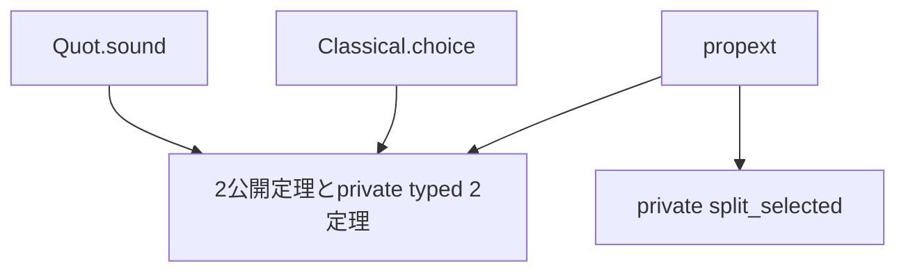
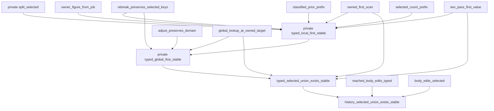

# [root ADR 0352](../adr/0352-prove-pagination-in-lean.md) の更新履歴の後の再改行 ID

## 範囲

基準は `25f4a90d0` の本体と既存モデルである。
[HistoryFirst.lean](../../experiments/pagination-proof/HistoryFirst.lean) を Lean 4.7.0（`aarch64-apple-darwin`）で検査した。
本体と公開 API は変更していない。
この増分は、[任意の更新履歴の後の本文の型と選択](0352-body-edits-dependencies.md) を、[左優先の合成後の先頭 ID の存在と安定](0352-owned-union-dependencies.md) へ接続する。

前の ID の定理は、空から到達した cache の本文に対する一回の更新を扱う。
実際には、その後に別の段落を更新した状態でも、現在の対象を再び改行する。
ここで更新後の本文が新たな cache として到達したことを仮定すると、その接続を別に証明しなければならない。

この増分では、まず型の合う任意の本文に対し、選ばれた対象の再改行の前後で同じ ID が存在することを導く。
先行単位の寄与と先行する所有段落の行数の不変性を、現在の本文の型から接続し直す。
この段階では cache への到達を使わない。
その結果へ、初期 cache の到達から導いた履歴後の型と、初期から保たれる選択を渡す。
更新後の本文に新たな到達の前提を追加せず、任意の履歴の後の現在の再改行にも接続する。

右側の `baseFirsts` のモデルは、現在の更新の前後で任意に変わってよい。
選ばれた対象自身の本文を変える一回の再改行では、左優先の合成後に同じ `some ident` が残る。
この `ident` は、その時点の先行する寄与から計算する。
以前に別の本文を変えたとき、現在の ID が初期の ID と等しいことは要求していない。

本体では [rebuild](../../modules/golem-typeset/src/Golem/Typeset/Flow.hs#L5064) の下で `cuBesides` の値を更新し、[numberedLines](../../modules/golem-typeset/src/Golem/Typeset/Flow.hs#L5148) や [採用済み行数を加える処理](../../modules/golem-typeset/src/Golem/Typeset/Flow.hs#L5301) が更新後の ID を読む。
この増分は固定した単位、制御と図版の下で、その成功した値の更新履歴を扱う。
全 `Built` と全呼び出し元から、モデルの初期の到達と選択を導く部分は引き続き残る。

## 定理と公理

Lean の環境から宣言の種類、型、elaboration 後の証明項と直接の定理参照を取得した。
公開定理 2 件、手書きの private 定理 3 件、生成定理 7 件、定義 4 件、公理宣言 0 件だった。
手書きの型と定義は加えていない。
全 12 定理へ同じ型の別名を一時環境で作り、kernel の検査と `#print axioms` を行った。

公開名の共通接頭辞は `BesideHistoryFirst.` である。
標準三公理は `propext`、`Classical.choice`、`Quot.sound` を指す。

| 名前 | 位置 | 前提と結論 | 公理 |
| --- | --- | --- | --- |
| `root_adr0352_i5_typed_selected_union_exists_stable` | [66 行](../../experiments/pagination-proof/HistoryFirst.lean#L66) | 型の合う本文と現在の図版 job、その job が選ぶ対象から、その対象の更新前後に同じ ID が合成後も存在する。到達の前提はない。 | 標準三公理 |
| `root_adr0352_i5_history_selected_union_exists_stable` | [89 行](../../experiments/pagination-proof/HistoryFirst.lean#L89) | 初期 cache の到達と任意の履歴、初期の図版 job とその選択から、履歴後の現在の対象の再改行でも同じ ID が合成後に存在する。更新後の到達は仮定しない。 | 標準三公理 |

private 定理の共通接頭辞は `_private.experiments.«pagination-proof».HistoryFirst.0.BesideHistoryFirst.` である。

| 名前 | 位置 | 概要 | 公理 |
| --- | --- | --- | --- |
| `split_selected` | [5 行](../../experiments/pagination-proof/HistoryFirst.lean#L5) | 選ばれた対象の前後の列を、元のキーの列から導く。 | `propext` |
| `typed_local_first_stable` | [18 行](../../experiments/pagination-proof/HistoryFirst.lean#L18) | 現在の本文の型と選択から、対象自身の値を変えても局所の先頭 ID が一致する。到達の前提は使わない。 | 標準三公理 |
| `typed_global_first_stable` | [42 行](../../experiments/pagination-proof/HistoryFirst.lean#L42) | 更新後も本文の型と選択を保ち、前の局所の結果を全図版の表へ接続する。 | 標準三公理 |

生成定理の共通接頭辞は `_private.experiments.«pagination-proof».HistoryFirst.0.` である。
次の前半と suffix を組み合わせると全 7 件の名前になる。
いずれも生成位置は取得できず、公理への依存はない。

| 名前の前半 | suffix | 件数 |
| --- | --- | --- |
| `BesideOwnedFirst.beforeTarget` | `._eq_1`, `._eq_2`, `.match_1.eq_1`, `.match_1.eq_2` | 4 |
| `BesideOwnedFirst.afterTarget` | `._eq_1`, `._eq_2` | 2 |
| `BesideReuse.candidateKeys` | `._eq_1` | 1 |

生成定義の共通接頭辞は `_private.experiments.«pagination-proof».HistoryFirst.0.BesideOwnedFirst.beforeTarget.match_1.splitter` である。
suffix がない名前と、`._cstage1`、`._cstage2`、`._rarg._cstage2` の 4 件であり、分岐と実行コードの生成に由来する。
定理としては数えていない。

標準公理への依存には既存の補助定理を経由するものも含む。
`propext` は命題の同値からの等値（Lean の `Init/Core.lean:1287`）、`Classical.choice` は空でない型からの選択（`Init/Prelude.lean:730`）、`Quot.sound` は同値関係で結ばれた値の商での等値（`Init/Core.lean:1459`）である。
新しい公理宣言、`sorry`、`admit` はない。

公理の図は推移的な依存を表す。
公理に依存しない生成定理 7 件は省略した。

定理の図の実線は型か証明項の直接参照である。
標準の論理と算術の補助定理は省略した。

既存の根拠は [分類した先行寄与](0352-classified-prefix-dependencies.md)、[全図版の先頭 ID](0352-owned-global-dependencies.md)、[更新履歴](0352-body-edits-dependencies.md) を参照する。

## 境界、変異と実装との照合

新しい API がない状態で試験が終了コード 1 を返し、追加後に [HistoryFirstBoundary.lean](../../experiments/pagination-proof/HistoryFirstBoundary.lean) の 13 式が通った。
先行する別の本文の更新で対象の現在の ID が 4 から 11 へ変わり、その現在の対象自身を更新しても 11 が残る場合を含む。
初期の選択と到達だけから、履歴後の同じ値の存在を公開定理で導く式も調べた。

本文の表に図版自身のキーまで含めた、型の条件を満たさない入力では、対象自身の更新で ID が 8 から 13 へ変わる具体例と、その不等式を残した。
任意の表へ型の条件を省いて保証を広げることはできない。
モデルへの入力から履歴を落とす検証側の変異では、Haskell の観測プログラムは終了コード 0 で通った。
その出力との数値の比較を kernel が false と判定し、Lean が終了コード 1 を返した。
型や領域の一致だけで、現在の ID の数値まで一致すると扱わない。

[HistoryFirstFonts.hs](../../experiments/pagination-proof/HistoryFirstFonts.hs) は、表、コード、制御、二つの図版と三つの所有段落を実フォントで組む。
七つの値の更新で得た、初期を含む八つの状態を使う。
各状態で三つの対象の行の列をそれぞれ 0 行と 7 行へ追加で置き換え、採番を呼び直す。
計 48 例である。
本文の行の列を手で変え、最初の空でない列をテンプレートとして使う。
改行器そのものから 0 行と 7 行を生成したという検査ではない。

各例で現在と追加の値の更新後の `numberComposedFlow` を呼び、対象自身の ID がその二つの状態で一致することを調べる。
初期の ID と一致するという検査にはしていない。
実際の `numberUnit` から再構成した `baseFirsts` と所有段落の表を合成し、本体の全 ID の表とも比較する。
右側に対象の値として 999 と 888 を入れた場合も、所有段落の値が残ることを確かめた。

モデルでは履歴の後の値を `applyEdits` から作り、その時点の先行する寄与と行数から ID を計算する。
初期の cache 以外に、新しい到達を渡していない。
現在と追加の更新後の全表、対象の値、同じ値が存在する公開定理の計 4 式を各例で調べ、初期 cache の 1 式と合わせて 193 式が kernel で通った。
48 冊の通常 CLI の比較や、全 `Built` の状態遷移の一般証明とは区別する。

図版の値は実際のソース位置と、最初の診断列が空で exclusion があるかの真偽へ射影する。
ソース位置が負でないことを確かめ、job の初期状態へ渡す。
本体の job に fuel のフィールドがあるとは扱わない。
本体のソースは `0aa78f65ac691cdd8d1a3bd5fc4c8bffb1feabdb` であり、この作業ツリーの `modules/` と一致する。
GHC 9.10.3 と既存の専用 package DB の read-only 環境を使い、共有の build と依存の版は変えない。

## 全体の検査

`check.sh` にこのモデルと局所境界を加え、GHC 9.10.3 と Lean 4.7.0 の既存の全検査が終了コード 0 で通った。
grid 55,838 件、free 156,520 件、回り込みの試し置き 10,368 件、causal 4,864 件、制御 216 件、改行の評価 34,586 件、実フォントの caption 40 件を保った。
Alloy の 42 コマンドに対応する既存の Lean の検査も保ち、Alloy の新しい実行回数とは区別する。

plan の SHA-256 は `981a01138b41bf0d6b1e8ea82155b2ed1227297b7339699bbc60005bc4c83957`、package DB の cache は `dd7fdb3fca241d4a7039e18fccf8ff7065a265540225c2cf813e5b07cbe75fc8` で、検査の前後で変わらなかった。
新規の証明専用 CI や予算の変更は加えていない。

## 未証明の範囲

全 `Built` と全呼び出し元から、初期の到達、job と対象の選択を導く接続は残る。
図版の所有者自身など、所有段落以外のキーに対する ID の取得は今回の定理に含めない。
固定の採番件数、Map の意味論、Int と Nat、図版の全フィールドと配置の callback、caption の計算との一般的一致も未証明である。

この増分は、履歴後の現在の対象をさらに再改行する際の ID を扱う。
原稿の全データと全行の順序、全制御の終了、`hb` の全呼び出し元、`captionCompared` と改行器の一般的一致は完成扱いしない。
root [ADR 0352](../adr/0352-prove-pagination-in-lean.md) は採択済み未実装のままとする。
